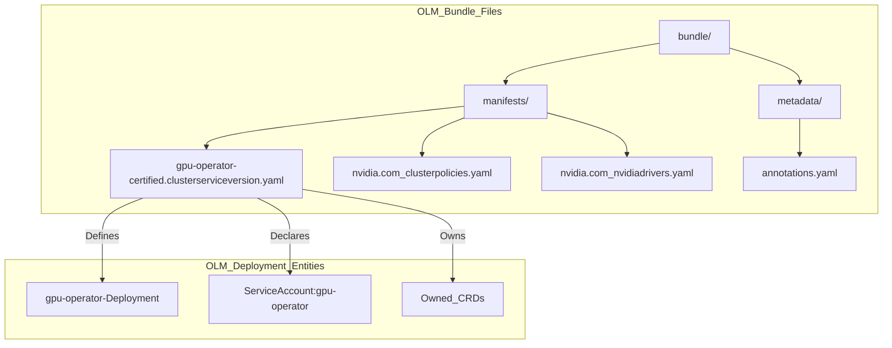
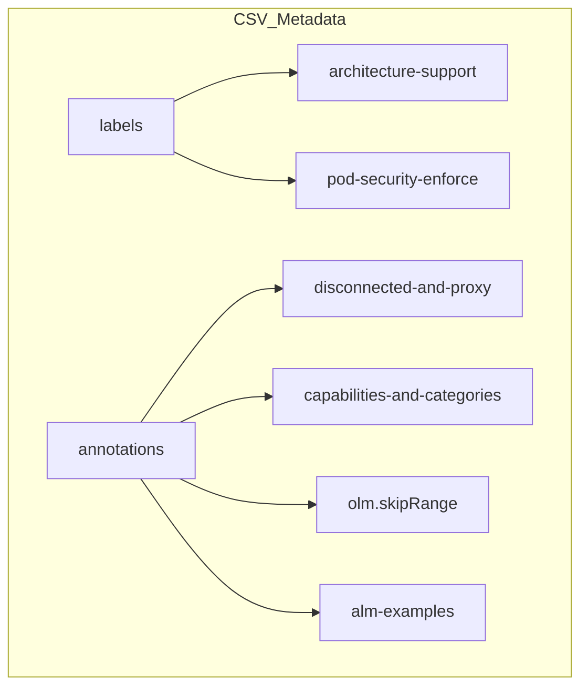
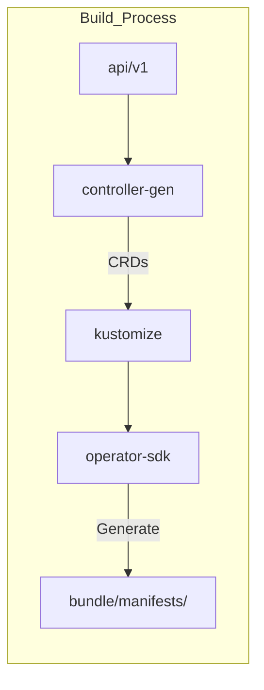

<!-- source: DeepWiki mcp.deepwiki.com · repo NVIDIA/gpu-operator · page 5.2 OLM Bundle Deployment · fetched 2026-10-26 -->

# Olp Bundle Deployment

Relevant source files

The following files were used as context for generating this wiki page:

- [.common-ci.yml](.common-ci.yml)
- [.github/renovate.json](.github/renovate.json)
- [.golangci.yml](.golangci.yml)
- [.nvidia-ci.yml](.nvidia-ci.yml)
- [Makefile](Makefile)
- [bundle/manifests/gpu-operator-certified.clusterserviceversion.yaml](bundle/manifests/gpu-operator-certified.clusterserviceversion.yaml)
- [bundle/metadata/annotations.yaml](bundle/metadata/annotations.yaml)
- [config/manager/kustomization.yaml](config/manager/kustomization.yaml)
- [config/manager/manager.yaml](config/manager/manager.yaml)
- [config/rbac/auth_proxy_role_binding.yaml](config/rbac/auth_proxy_role_binding.yaml)
- [config/rbac/kustomization.yaml](config/rbac/kustomization.yaml)
- [config/rbac/leader_election_role_binding.yaml](config/rbac/leader_election_role_binding.yaml)
- [config/rbac/role_binding.yaml](config/rbac/role_binding.yaml)
- [config/rbac/service_account.yaml](config/rbac/service_account.yaml)
- [config/samples/nvidia_v1alpha1_nvidiadriver.yaml](config/samples/nvidia_v1alpha1_nvidiadriver.yaml)
- [docker/Dockerfile](docker/Dockerfile)
- [docker/Dockerfile.devel](docker/Dockerfile.devel)
- [docker/bundle.Dockerfile](docker/bundle.Dockerfile)
- [hack/prepare-env.sh](hack/prepare-env.sh)
- [tests/scripts/.definitions.sh](tests/scripts/.definitions.sh)
- [versions.mk](versions.mk)

## Purpose and Scope

This page documents the Operator Lifecycle Manager (OLM) bundle deployment method for the NVIDIA GPU Operator. OLM is an alternative installation mechanism to Helm, primarily used in OpenShift environments but also available for standard Kubernetes clusters. For Helm-based deployment, see [5.1 Helm Chart Deployment]().

The OLM bundle provides a standardized packaging format that enables automated operator discovery, installation, dependency resolution, and lifecycle management through the Operator Hub interface.

Sources: [bundle/manifests/gpu-operator-certified.clusterserviceversion.yaml:1-21](), [bundle/metadata/annotations.yaml:1-17]()

## OLM Bundle Architecture

### Overview

The OLM bundle is a structured collection of Kubernetes manifests that describe how to install and manage the GPU Operator. Unlike Helm charts which use templates, OLM bundles contain explicit manifests and a ClusterServiceVersion (CSV) that defines the operator's metadata, permissions, and deployment specifications.

Sources: [bundle/manifests/gpu-operator-certified.clusterserviceversion.yaml:1-100](), [bundle/metadata/annotations.yaml:1-8]()

### Code-to-System Mapping: OLM Bundle Components

The following diagram maps OLM system components to the specific files and entities within the GPU Operator codebase.

**OLM Bundle Structure and Manifests**

Sources: [bundle/manifests/gpu-operator-certified.clusterserviceversion.yaml:1-3](), [bundle/metadata/annotations.yaml:1-17]()

### Bundle Directory Structure

The bundle contains two primary directories defined in the metadata:

| Directory | Purpose | Key Files |
|-----------|---------|-----------|
| `bundle/manifests/` | Contains all Kubernetes manifests | ClusterServiceVersion, CRDs |
| `bundle/metadata/` | Bundle metadata for OLM catalog | `annotations.yaml` |

The manifests directory includes the `ClusterServiceVersion` (CSV), which is the primary descriptor defining the operator's lifecycle, and the full CRD definitions for `ClusterPolicy` and `NVIDIADriver`.

Sources: [bundle/manifests/gpu-operator-certified.clusterserviceversion.yaml:1-3](), [bundle/metadata/annotations.yaml:4-7]()

## ClusterServiceVersion Structure

### Metadata and Annotations

The CSV metadata section defines operator capabilities, compatibility, and discovery information. It includes labels for supported architectures and pod security standards.

**CSV Metadata Configuration**

**Key Annotations:**
- **Architecture Support**: `operatorframework.io/arch.arm64` and `amd64` indicate multi-architecture support [bundle/manifests/gpu-operator-certified.clusterserviceversion.yaml:5-6]().
- **OpenShift Features**: Disconnected environments and proxy support are explicitly enabled [bundle/manifests/gpu-operator-certified.clusterserviceversion.yaml:11-13]().
- **Skip Range**: Defines which versions can be upgraded directly (e.g., `olm.skipRange: '>=1.9.0 <26.7.2'`) [bundle/manifests/gpu-operator-certified.clusterserviceversion.yaml:21]().
- **alm-examples**: Provides sample `ClusterPolicy`, `GPUCluster`, and `NVIDIADriver` CR definitions for the UI [bundle/manifests/gpu-operator-certified.clusterserviceversion.yaml:22-188]().
- **OpenShift Versions**: Compatibility is restricted to `v4.18-v4.22` [bundle/metadata/annotations.yaml:17]().

Sources: [bundle/manifests/gpu-operator-certified.clusterserviceversion.yaml:3-188](), [bundle/metadata/annotations.yaml:1-17]()

### Build and Generation

The OLM bundle is generated using `operator-sdk` and `kustomize`. The `Makefile` defines the `bundle` target which automates manifest generation from Go source code and CRD bases.

**Bundle Generation Workflow**

**Key Makefile Targets:**
- `manifests`: Generates CRDs and RBAC roles from code using `controller-gen` [Makefile:107-110]().
- `bundle`: Orchestrates `kustomize` and `operator-sdk` to produce the final OLM bundle [Makefile:124-129]().
- `build-bundle-image`: Builds the OLM bundle container image using `docker/bundle.Dockerfile` [Makefile:132-137]().

Sources: [Makefile:107-137](), [versions.mk:20]()

## Bundle Dockerfile Implementation

The bundle is packaged using a dedicated Dockerfile (`docker/bundle.Dockerfile`) that copies the generated manifests and metadata into the image at specific locations expected by OLM.

**Key Labels in Bundle Image:**
- `operators.operatorframework.io.bundle.manifests.v1`: Path to Kubernetes manifests [bundle/metadata/annotations.yaml:4]().
- `operators.operatorframework.io.bundle.metadata.v1`: Path to bundle metadata [bundle/metadata/annotations.yaml:6]().
- `com.redhat.openshift.versions`: Defines OCP version compatibility (`v4.18-v4.22`) [bundle/metadata/annotations.yaml:17]().

Sources: [bundle/metadata/annotations.yaml:1-17](), [Makefile:130-137]()

## Installation on OpenShift

On OpenShift, the GPU Operator is typically installed via OperatorHub. OLM handles the creation of the `Subscription` and `InstallPlan`.

### Data Flow: OLM to Operator Deployment

1. **Subscription Creation**: A `Subscription` resource is created pointing to the `gpu-operator-certified` package [bundle/metadata/annotations.yaml:7]().
2. **Catalog Resolution**: OLM resolves the bundle image from the `CatalogSource`.
3. **InstallPlan Execution**: OLM creates the `ClusterServiceVersion`, `CRDs`, and `RBAC` manifests [bundle/manifests/gpu-operator-certified.clusterserviceversion.yaml:1-221]().
4. **Operator Startup**: The `gpu-operator` binary starts up, using the `OPERATOR_NAMESPACE` environment variable to determine scope [Makefile:83-85]().
5. **Leader Election**: The operator initializes leader election using the configured lease lock.

Sources: [bundle/manifests/gpu-operator-certified.clusterserviceversion.yaml:1-221](), [bundle/metadata/annotations.yaml:1-17](), [Makefile:83-85]()

---

