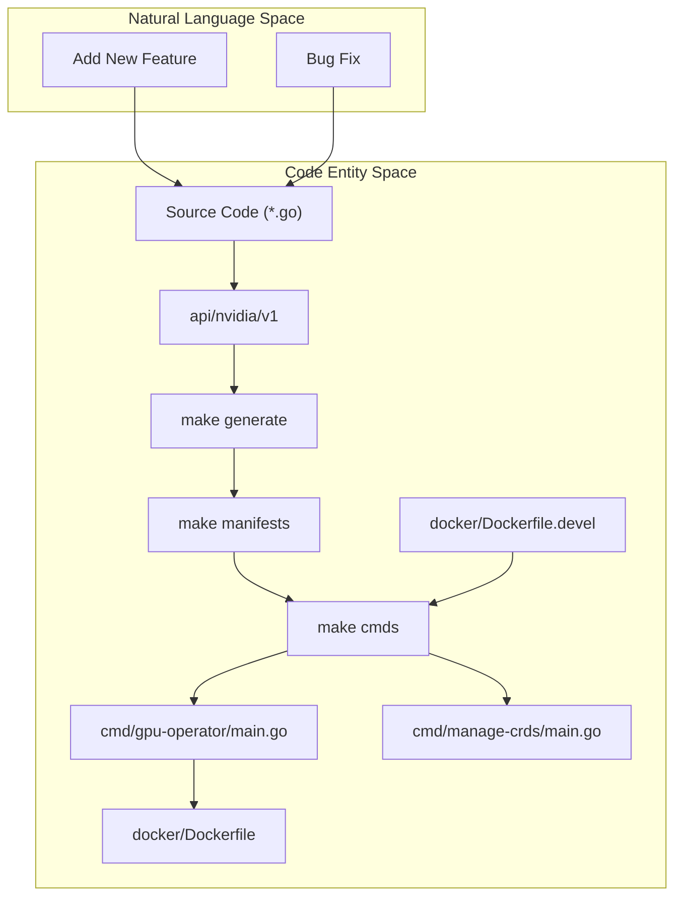
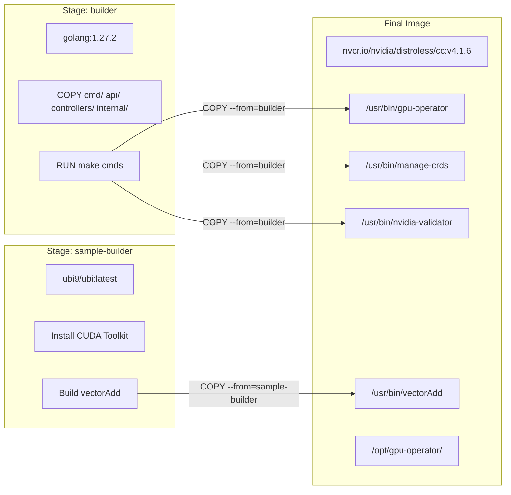

<!-- source: DeepWiki mcp.deepwiki.com · repo NVIDIA/gpu-operator · page 6 Development · fetched 2026-10-26 -->

# Development

Relevant source files

The following files were used as context for generating this wiki page:

- [.common-ci.yml](.common-ci.yml)
- [.github/renovate.json](.github/renovate.json)
- [.golangci.yml](.golangci.yml)
- [.nvidia-ci.yml](.nvidia-ci.yml)
- [Makefile](Makefile)
- [bundle/manifests/gpu-operator-certified.clusterserviceversion.yaml](bundle/manifests/gpu-operator-certified.clusterserviceversion.yaml)
- [bundle/metadata/annotations.yaml](bundle/metadata/annotations.yaml)
- [config/samples/nvidia_v1alpha1_nvidiadriver.yaml](config/samples/nvidia_v1alpha1_nvidiadriver.yaml)
- [docker/Dockerfile](docker/Dockerfile)
- [docker/Dockerfile.devel](docker/Dockerfile.devel)
- [go.mod](go.mod)
- [go.sum](go.sum)
- [tests/scripts/.definitions.sh](tests/scripts/.definitions.sh)
- [vendor/github.com/onsi/ginkgo/v2/CHANGELOG.md](vendor/github.com/onsi/ginkgo/v2/CHANGELOG.md)
- [vendor/github.com/onsi/ginkgo/v2/core_dsl.go](vendor/github.com/onsi/ginkgo/v2/core_dsl.go)
- [vendor/github.com/onsi/ginkgo/v2/ginkgo/run/run_command.go](vendor/github.com/onsi/ginkgo/v2/ginkgo/run/run_command.go)
- [vendor/github.com/onsi/ginkgo/v2/ginkgo/watch/watch_command.go](vendor/github.com/onsi/ginkgo/v2/ginkgo/watch/watch_command.go)
- [vendor/github.com/onsi/ginkgo/v2/internal/parallel_support/server_handler.go](vendor/github.com/onsi/ginkgo/v2/internal/parallel_support/server_handler.go)
- [vendor/github.com/onsi/ginkgo/v2/internal/suite.go](vendor/github.com/onsi/ginkgo/v2/internal/suite.go)
- [vendor/github.com/onsi/ginkgo/v2/reporters/default_reporter.go](vendor/github.com/onsi/ginkgo/v2/reporters/default_reporter.go)
- [vendor/github.com/onsi/ginkgo/v2/types/config.go](vendor/github.com/onsi/ginkgo/v2/types/config.go)
- [vendor/github.com/onsi/ginkgo/v2/types/errors.go](vendor/github.com/onsi/ginkgo/v2/types/errors.go)
- [vendor/github.com/onsi/ginkgo/v2/types/version.go](vendor/github.com/onsi/ginkgo/v2/types/version.go)
- [vendor/modules.txt](vendor/modules.txt)
- [versions.mk](versions.mk)

This page provides a high-level overview for developers working on the NVIDIA GPU Operator codebase. It describes the project structure, local development workflows, and build orchestration.

For deep dives into specific subsystems, see the following child pages:
*   **[Build System](#6.1)**: Details on multi-stage Dockerfiles, Makefiles, and version injection.
*   **[CI/CD Pipelines](#6.2)**: Documentation for GitHub Actions, GitLab CI, and release automation.
*   **[Testing](#6.3)**: Guidance on unit tests, E2E suites, and Holodeck infrastructure.
*   **[Code Generation](#6.4)**: Explanation of `controller-gen`, `client-gen`, and manifest synchronization.

## Prerequisites

Development requires a Go environment and container tooling. Versioning for these tools is pinned to ensure consistency across the maintainer group.

| Tool | Version | Purpose |
| :--- | :--- | :--- |
| Go | `1.26.3` | Defined in [go.mod:3]() |
| golangci-lint | `v2.14.0` | Defined in [versions.mk:24]() |
| Docker | Latest | Image construction and multi-arch builds |
| Helm | 3.x | Chart management and CRD hooks |

The project module is defined as `github.com/NVIDIA/gpu-operator` in [go.mod:1]().

**Sources**: [go.mod:1,3](), [versions.mk:24]()

## Project Structure

The codebase is organized into functional directories following standard Kubernetes operator patterns.

| Directory | Role | Key Entities |
| :--- | :--- | :--- |
| `cmd/` | Binary entrypoints | `gpu-operator`, `manage-crds`, `nvidia-validator` |
| `api/` | API Definitions | CRD Go types for `v1` and `v1alpha1` |
| `controllers/` | Control Plane | Reconcilers for ClusterPolicy and NVIDIADriver |
| `internal/` | Logic & Metadata | `internal/info` for versioning |
| `deployments/` | Packaging | Helm charts and OLM bundle manifests |
| `assets/` | Static Resources | DaemonSet and ConfigMap templates |

**Sources**: [docker/Dockerfile:32-35](), [docker/Dockerfile:131-133]()

## Development Workflow

The development cycle bridges local code changes to containerized validation.

**Sources**: [Makefile:81-120](), [docker/Dockerfile:27-44]()

## Key Build Orchestration

The [Makefile:1-322]() serves as the primary interface for development tasks.

### Code and Manifest Generation
The operator relies on generated code for deepcopy methods and CRD schemas.
*   `make generate`: Invokes `$(CONTROLLER_GEN)` to update deepcopy objects [Makefile:110-111]().
*   `make manifests`: Generates CRD and RBAC YAMLs into `config/crd/bases` [Makefile:105-107]().
*   `make generate-clientset`: Uses `$(CLIENT_GEN)` to produce typed clients in the `api/` directory [Makefile:112-118]().

### Building Binaries and Images
*   `make cmds`: Builds all binaries found in `cmd/` [Makefile:44]().
*   `make .build-image`: Creates a local development container using `docker/Dockerfile.devel` for consistent linting and building [Makefile:153-161]().
*   `make build-bundle-image`: Builds the OLM bundle image using `docker/bundle.Dockerfile` [Makefile:129-134]().

**Sources**: [Makefile:44,105-161](), [docker/Dockerfile:1-145]()

## Multi-Stage Image Construction

The production image is built in multiple stages to keep the final footprint small while including necessary validation tools.

**Sources**: [docker/Dockerfile:20-145]()

## Development Tooling

Tooling is managed via `go.mod` to avoid dependency conflicts with the main operator binary.
*   **Location**: [go.mod:1]()
*   **Key Tools**:
    *   `sigs.k8s.io/controller-runtime`: For controller development [go.mod:35]().
    *   `k8s.io/client-go`: For Kubernetes API interaction [go.mod:32]().
    *   `sigs.k8s.io/yaml`: For YAML processing [go.mod:36]().
    *   `github.com/onsi/ginkgo/v2`: For BDD-style testing [go.mod:16]().

**Sources**: [go.mod:1,5-37](), [Makefile:76-79]()

## Versioning Logic

The operator injects version metadata during the build process to provide telemetry and debugging information.
*   **Variables**: `VERSION` and `GIT_COMMIT` are defined in [versions.mk:20-28]().
*   **Injection**: The [Makefile:71-72]() defines the `VERSION_PKG` as `github.com/NVIDIA/gpu-operator/internal/info` and uses it during binary compilation to track the build state.

**Sources**: [versions.mk:15-29](), [Makefile:71-72](), [docker/Dockerfile:93-96]()

## CRD Lifecycle Management

For developers working on Helm charts, the `manage-crds` utility is critical for managing schema updates without manual intervention.
*   **Purpose**: Handles the application and deletion of CRDs during Helm hooks.
*   **Usage**: It is packaged into the main operator image [docker/Dockerfile:124]() and invoked by the `gpu-operator-upgrade-crd` Job.
*   **Cleanup**: A separate job exists to delete CRDs when `operator.cleanupCRD` is enabled.

**Sources**: [docker/Dockerfile:124]()

---

