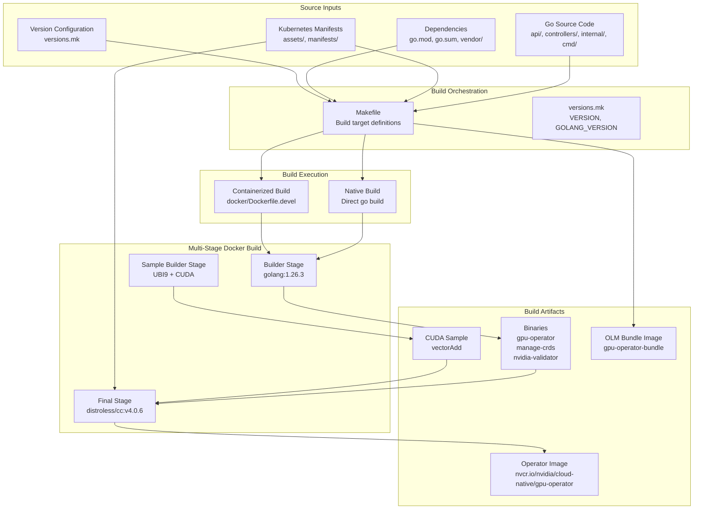
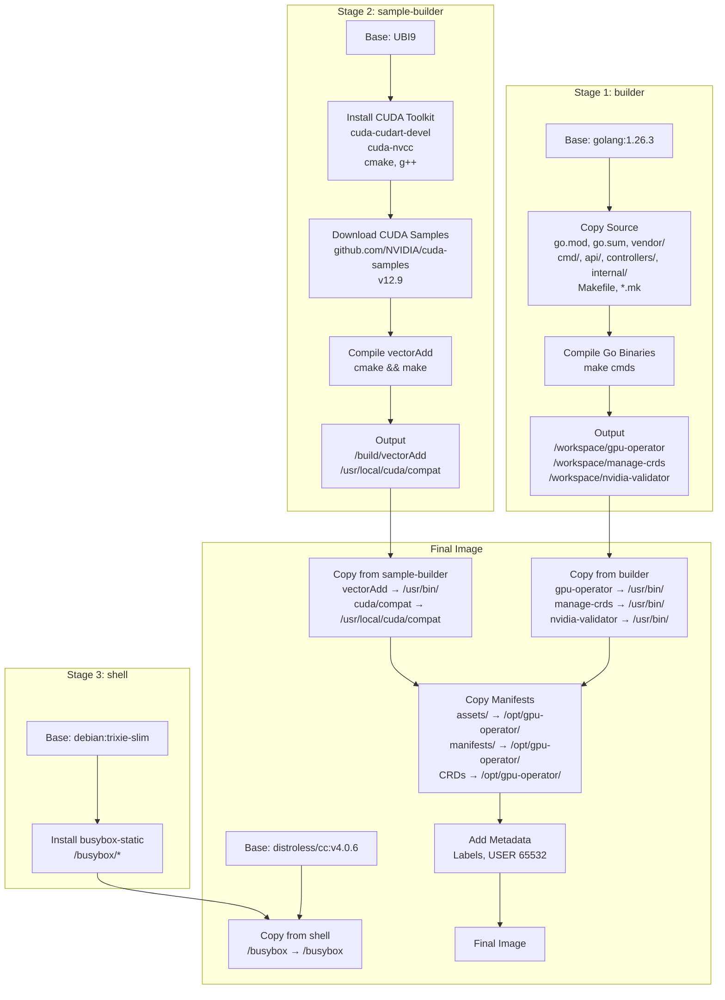
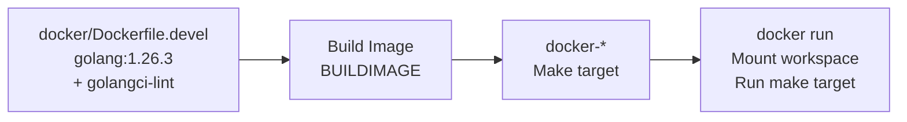
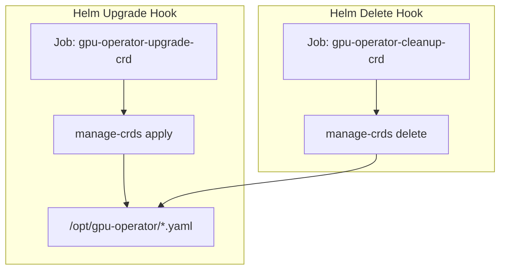

<!-- source: DeepWiki mcp.deepwiki.com · repo NVIDIA/gpu-operator · page 6.1 Build System · fetched 2026-10-26 -->

# Build System

Relevant source files

The following files were used as context for generating this wiki page:

- [.gitignore](.gitignore)
- [THIRD_PARTY_NOTICES.md](THIRD_PARTY_NOTICES.md)
- [api/versioned/clientset.go](api/versioned/clientset.go)
- [api/versioned/fake/clientset_generated.go](api/versioned/fake/clientset_generated.go)
- [go.mod](go.mod)
- [go.sum](go.sum)
- [multi-arch.mk](multi-arch.mk)
- [native-only.mk](native-only.mk)
- [tools/generate-third-party-notices.sh](tools/generate-third-party-notices.sh)
- [tools/go.mod](tools/go.mod)
- [tools/go.sum](tools/go.sum)
- [tools/tools.go](tools/tools.go)
- [vendor/github.com/onsi/ginkgo/v2/CHANGELOG.md](vendor/github.com/onsi/ginkgo/v2/CHANGELOG.md)
- [vendor/github.com/onsi/ginkgo/v2/core_dsl.go](vendor/github.com/onsi/ginkgo/v2/core_dsl.go)
- [vendor/github.com/onsi/ginkgo/v2/ginkgo/run/run_command.go](vendor/github.com/onsi/ginkgo/v2/ginkgo/run/run_command.go)
- [vendor/github.com/onsi/ginkgo/v2/ginkgo/watch/watch_command.go](vendor/github.com/onsi/ginkgo/v2/ginkgo/watch/watch_command.go)
- [vendor/github.com/onsi/ginkgo/v2/internal/parallel_support/server_handler.go](vendor/github.com/onsi/ginkgo/v2/internal/parallel_support/server_handler.go)
- [vendor/github.com/onsi/ginkgo/v2/internal/suite.go](vendor/github.com/onsi/ginkgo/v2/internal/suite.go)
- [vendor/github.com/onsi/ginkgo/v2/reporters/default_reporter.go](vendor/github.com/onsi/ginkgo/v2/reporters/default_reporter.go)
- [vendor/github.com/onsi/ginkgo/v2/types/config.go](vendor/github.com/onsi/ginkgo/v2/types/config.go)
- [vendor/github.com/onsi/ginkgo/v2/types/errors.go](vendor/github.com/onsi/ginkgo/v2/types/errors.go)
- [vendor/github.com/onsi/ginkgo/v2/types/version.go](vendor/github.com/onsi/ginkgo/v2/types/version.go)
- [vendor/modules.txt](vendor/modules.txt)

## Purpose and Scope

This document describes the GPU Operator's build system, including the multi-stage Docker build process, Makefile targets, code generation tooling, and artifact construction. The build system produces the operator container image, OLM bundle image, and manages version information embedded in binaries.

For information about CI/CD pipelines that invoke this build system, see [CI/CD Pipelines](#6.2). For deployment artifacts like Helm charts and OLM manifests, see [Helm Chart Deployment](#5.1) and [OLM Bundle Deployment](#5.2).

---

## Build Architecture Overview

The build system follows a multi-stage approach that separates dependency management, compilation, sample application building, and final image assembly. The process is orchestrated by Make targets and can execute either natively or within containerized environments.

**Build Architecture Flow**

**Sources:** [docker/Dockerfile:1-131](), [Makefile:1-183](), [versions.mk:1-27]()

---

## Multi-Stage Docker Build

The primary build artifact is the operator container image, constructed using a multi-stage Dockerfile that optimizes for build caching, image size, and security.

**Dockerfile Stages**

### Stage 1: Builder (golang:1.26.3)

The builder stage compiles Go binaries using the official Golang image. It leverages Go module caching by copying dependency files first:

- **Base Image:** `golang:1.26.3` [docker/Dockerfile:17]()
- **Dependency Copying:** `go.mod`, `go.sum`, `vendor/` [docker/Dockerfile:24-26]()
- **Source Copying:** `cmd/`, `api/`, `controllers/`, `internal/`, `Makefile`, `*.mk` [docker/Dockerfile:29-36]()
- **Build Command:** `make cmds` with `VERSION` and `GIT_COMMIT` arguments [docker/Dockerfile:39-41]()

The `make cmds` target invokes pattern rules that compile each binary in `cmd/` subdirectories:
- `gpu-operator` - Main operator controller binary [docker/Dockerfile:109]()
- `manage-crds` - CRD lifecycle management utility [docker/Dockerfile:110]()
- `nvidia-validator` - Validation workload binary [docker/Dockerfile:111]()

**Sources:** [docker/Dockerfile:17-41](), [Makefile:145-146]()

### Stage 2: Sample Builder (UBI9)

The sample builder stage creates a CUDA sample application used for validation. This stage:

- **Base Image:** `registry.access.redhat.com/ubi9/ubi:latest` [docker/Dockerfile:43]()
- **Architecture Detection:** Translates `amd64`→`x86_64`, `arm64`→`sbsa` [docker/Dockerfile:45]()
- **CUDA Repository:** Adds NVIDIA CUDA repository for RHEL9 [docker/Dockerfile:46]()
- **Packages:** Installs `cmake`, `cuda-cudart-devel`, `cuda-nvcc`, `g++` [docker/Dockerfile:50-58]()
- **Sample Download:** Fetches `cuda-samples` v12.9 from GitHub [docker/Dockerfile:66]()
- **Compilation:** Builds `vectorAdd` sample using CMake [docker/Dockerfile:68-71]()

**Sources:** [docker/Dockerfile:43-72]()

### Stage 3: Shell and Final Image

The operator uses a static `busybox` layout to provide basic shell utilities in a distroless environment.

- **Shell Stage:** Installs `busybox-static` and creates symlinks for `sh`, `rm`, `ln`, etc. [docker/Dockerfile:76-82]()
- **Final Base:** `nvcr.io/nvidia/distroless/cc:v4.0.6` (C/C++ runtime) [docker/Dockerfile:86]()
- **Security Context:** Non-root user `65532:65532` [docker/Dockerfile:127]()
- **Binaries:** Operator, CRD manager, validator from builder stage [docker/Dockerfile:109-111]()
- **CUDA Sample:** `vectorAdd` and CUDA compat libraries for validation [docker/Dockerfile:112-114]()
- **Assets:** Kubernetes manifests from `assets/`, `manifests/`, `validator/manifests` [docker/Dockerfile:116-118]()
- **CRDs:** ClusterPolicy, NVIDIADriver, and NFD CRDs for Helm upgrades [docker/Dockerfile:123-125]()
- **Entrypoint:** `/usr/bin/gpu-operator` [docker/Dockerfile:131]()

**Sources:** [docker/Dockerfile:76-131]()

---

## Build Targets and Makefile

The Makefile provides a comprehensive set of targets for building, testing, and packaging the operator.

**Key Makefile Targets**

| Target | Purpose | Key Actions |
|--------|---------|-------------|
| `cmds` | Build all command binaries | Compiles all binaries in `cmd/` [Makefile:145-146]() |
| `manifests` | Generate CRDs and RBAC | Runs `controller-gen` for Kubernetes manifests [Makefile:107-110]() |
| `generate` | Generate deepcopy methods | Runs `controller-gen object` for Go types [Makefile:112-113]() |
| `generate-clientset` | Generate typed clients | Runs `client-gen` for `nvidia/v1` and `v1alpha1` [Makefile:115-121]() |
| `bundle` | Generate OLM bundle | Generates kustomize manifests and validates bundle [Makefile:124-129]() |
| `build-bundle-image` | Build OLM bundle image | Creates bundle image from `docker/bundle.Dockerfile` [Makefile:132-137]() |
| `check` | Run all checks | Executes lint, license, validation targets [Makefile:184]() |
| `run` | Run operator locally | Executes `go run ./cmd/gpu-operator/...` [Makefile:83-84]() |

**Sources:** [Makefile:1-184]()

### Version Injection

Build flags inject version information into binaries using Go's `-ldflags`. The versioning is controlled by `versions.mk`:

- `VERSION` defaults to `v26.3.1` [versions.mk:20]()
- `GIT_COMMIT` is extracted via `git describe` [versions.mk:26]()
- `VERSION_PKG` is set to `github.com/NVIDIA/gpu-operator/internal/info` [Makefile:74]()

These values are passed as `--build-arg` during the Docker build [docker/Dockerfile:39-40, 90-91]().

**Sources:** [versions.mk:20-26](), [Makefile:74](), [docker/Dockerfile:39-91]()

### Containerized Build Workflow

For consistent build environments, developers can execute builds inside Docker containers using a development image.

The workflow:
1. **Build Development Image:** `make .build-image` creates a containerized build environment [Makefile:155-164]().
   - Base: `golang:$(GOLANG_VERSION)` (1.26.3) [docker/Dockerfile.devel:17]()
   - Adds: `golangci-lint` (v1.60.3) [docker/Dockerfile.devel:15,18]()
2. **Execute Target in Container:** `make docker-*` wraps any Make target (e.g., `docker-cmds`, `docker-check`) [Makefile:172-182]().

**Sources:** [Makefile:153-182](), [docker/Dockerfile.devel:1-18](), [versions.mk:22]()

---

## Vendored Dependencies

The GPU Operator uses Go modules for dependency management, with vendoring enabled.

- **`go.mod`**: Defines direct and indirect dependencies, along with their versions [go.mod:1-37]().
- **`go.sum`**: Contains cryptographic hashes of module contents for verification [go.sum:1-79]().
- **`vendor/` directory**: Stores copies of all required dependencies. This ensures reproducible builds and allows for offline compilation. The `vendor/modules.txt` file lists all vendored modules and their explicit requirements [vendor/modules.txt:1-178]().
- **`tools/go.mod`**: Manages dependencies for build tools (e.g., `controller-gen`, `client-gen`, `kustomize`) separately from the main application dependencies [tools/go.mod:1-12](). These tools are not part of the final operator binary but are essential for the build process.
- **`tools/tools.go`**: Uses `//go:build tools` and `_ "package"` imports to ensure these tool dependencies are tracked by `go mod tidy` without being compiled into the main application [tools/tools.go:1-29]().

**Sources:** [go.mod:1-37](), [go.sum:1-79](), [vendor/modules.txt:1-178](), [tools/go.mod:1-12](), [tools/tools.go:1-29]()

---

## Manage-CRDs Utility

The `manage-crds` binary (defined in `cmd/manage-crds/main.go`) is a specialized tool included in the operator image to handle CRD lifecycle management during Helm operations.

**CRD Management Flow**

- **Upgrade Hook:** A `pre-upgrade` Job runs `manage-crds apply` for `clusterpolicies`, `nvidiadrivers`, and `nfd-api-crds` [deployments/gpu-operator/templates/upgrade_crd.yaml:87-94]().
- **Cleanup Hook:** A `pre-delete` Job runs `manage-crds delete` if `operator.cleanupCRD` is enabled [deployments/gpu-operator/templates/cleanup_crd.yaml:38-45]().
- **Embedded CRDs:** The Dockerfile copies CRD manifests to `/opt/gpu-operator/` specifically for this utility [docker/Dockerfile:123-125]().

**Sources:** [deployments/gpu-operator/templates/upgrade_crd.yaml:83-94](), [deployments/gpu-operator/templates/cleanup_crd.yaml:34-45](), [docker/Dockerfile:123-125]()

---

## Validation and Checks

The build system enforces code quality through several automated checks:

- **Linting:** Uses `golangci-lint` with a configuration that enables `contextcheck`, `gocritic`, `gosec`, `misspell`, and `unconvert` [.golangci.yml:2-8]().
- **License Check:** A custom script verifies that all `.go` files (excluding `vendor/`) contain a Copyright header [Makefile:186-194](). The `THIRD_PARTY_NOTICES.md` file is also generated to list all third-party dependencies and their licenses [THIRD_PARTY_NOTICES.md:1-94](). This generation is handled by the `generate-third-party-notices.sh` script [tools/generate-third-party-notices.sh]().
- **Formatting:** Enforces `gofmt` and `goimports` via the linter [.golangci.yml:37-38]().
- **Security:** `gosec` is configured with specific exclusions like `G101` (hardcoded credentials) and `G404` (insecure random) [.golangci.yml:10-14]().

**Sources:** [Makefile:184-194](), [.golangci.yml:1-49](), [THIRD_PARTY_NOTICES.md:1-94](), [tools/generate-third-party-notices.sh]()

---

