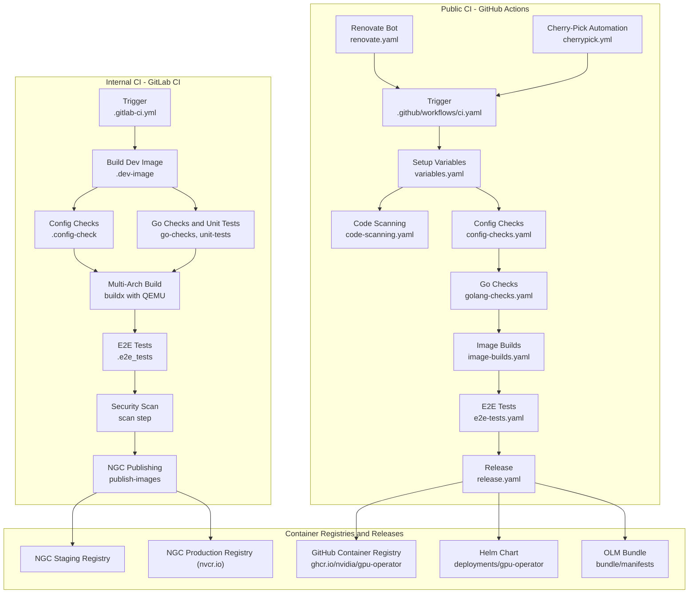
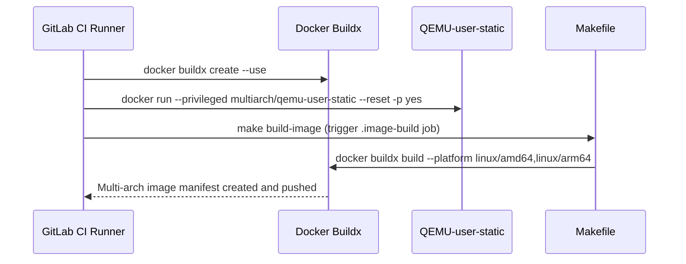
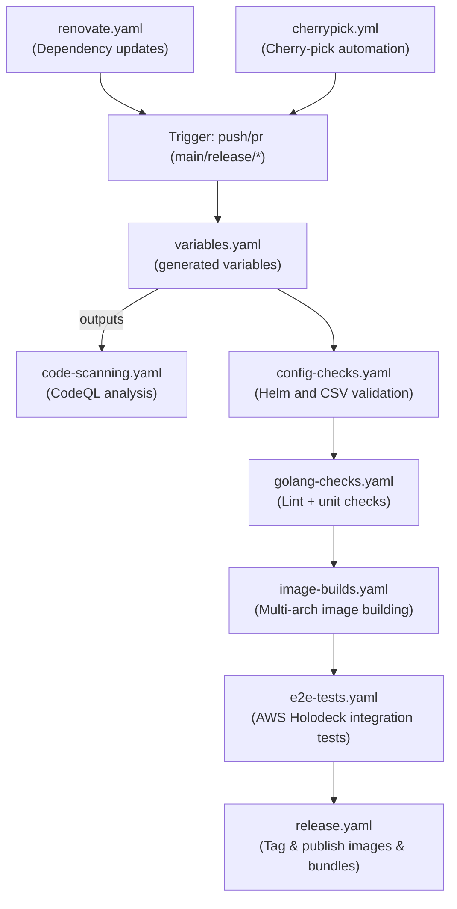
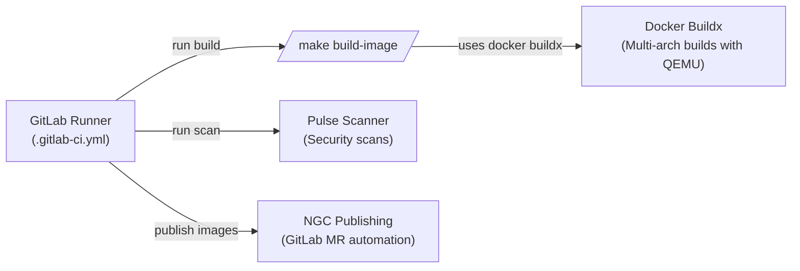

<!-- source: DeepWiki mcp.deepwiki.com · repo NVIDIA/gpu-operator · page 6.2 CI/CD Pipelines · fetched 2026-10-26 -->

# CI/CD Pipelines

Relevant source files

The following files were used as context for generating this wiki page:

- [.github/scripts/add-labels-from-comment.js](.github/scripts/add-labels-from-comment.js)
- [.github/scripts/backport.js](.github/scripts/backport.js)
- [.github/scripts/extract-branches.js](.github/scripts/extract-branches.js)
- [.github/scripts/generate-image-list.py](.github/scripts/generate-image-list.py)
- [.github/scripts/merge-yaml.py](.github/scripts/merge-yaml.py)
- [.github/scripts/update-csv-images.py](.github/scripts/update-csv-images.py)
- [.github/scripts/validate-olm-release-metadata.py](.github/scripts/validate-olm-release-metadata.py)
- [.github/workflows/cherrypick.yml](.github/workflows/cherrypick.yml)
- [.github/workflows/ci.yaml](.github/workflows/ci.yaml)
- [.github/workflows/code-scanning.yaml](.github/workflows/code-scanning.yaml)
- [.github/workflows/config-checks.yaml](.github/workflows/config-checks.yaml)
- [.github/workflows/coverage.yaml](.github/workflows/coverage.yaml)
- [.github/workflows/e2e-tests.yaml](.github/workflows/e2e-tests.yaml)
- [.github/workflows/forward-compatibility.yaml](.github/workflows/forward-compatibility.yaml)
- [.github/workflows/golang-checks.yaml](.github/workflows/golang-checks.yaml)
- [.github/workflows/image-builds.yaml](.github/workflows/image-builds.yaml)
- [.github/workflows/publish-helm-oci-chart.yaml](.github/workflows/publish-helm-oci-chart.yaml)
- [.github/workflows/release-image-list.yaml](.github/workflows/release-image-list.yaml)
- [.github/workflows/release-rc-assets.yaml](.github/workflows/release-rc-assets.yaml)
- [.github/workflows/release.yaml](.github/workflows/release.yaml)
- [.github/workflows/renovate.yaml](.github/workflows/renovate.yaml)
- [.github/workflows/third-party-notices-check.yaml](.github/workflows/third-party-notices-check.yaml)
- [.github/workflows/variables.yaml](.github/workflows/variables.yaml)
- [.gitlab-ci.yml](.gitlab-ci.yml)
- [.gitmodules](.gitmodules)
- [RELEASE.md](RELEASE.md)
- [assets/pre-requisites/0200_runtime_class.yaml](assets/pre-requisites/0200_runtime_class.yaml)
- [tests/ci-run-e2e.sh](tests/ci-run-e2e.sh)
- [tests/holodeck.yaml](tests/holodeck.yaml)
- [tests/scripts/.rsync-excludes](tests/scripts/.rsync-excludes)
- [tests/terraform.tfvars](tests/terraform.tfvars)

## Purpose and Scope

This document describes the Continuous Integration and Continuous Deployment (CI/CD) infrastructure for the NVIDIA GPU Operator. The operator uses a dual-pipeline architecture with **GitHub Actions** for public CI and **GitLab CI** for internal NVIDIA development and release workflows. Both pipelines execute validation checks, build multi-architecture container images, run end-to-end tests, perform security scanning, manage dependency updates, and publish artifacts to container registries including NGC.

For information about the build system and Dockerfile structure, see [Build System (6.1)](). For details on testing infrastructure and methodologies, see [Testing (6.3)]().

---

## Pipeline Architecture Overview

The CI/CD system ensures high code quality, security, and efficient delivery workflows connecting public contributions to NVIDIA’s internal release pipelines.

### Data Flow and Component Interaction

**Sources:**
- [.github/workflows/ci.yaml:15-98]()
- [.gitlab-ci.yml:1-201]()
- [.github/workflows/renovate.yaml:1-28]()
- [.github/workflows/cherrypick.yml:1-107]()
- [.nvidia-ci.yml:66-203]() (internal scans and publishing)

---

## GitHub Actions Pipeline

The GitHub Actions pipeline serves as the public-facing CI system validating contributions and orchestrating multi-arch builds, tests, and releases.

### Workflow Triggers and Concurrency

Triggers activate the pipeline on:

- Pushes to `main` branch
- Pushes to `release-*` branches
- Pull requests matching `pull-request/[0-9]+`
- Manual workflow dispatches

Concurrency control cancels in-progress runs on the same branch or PR to avoid redundant executions [ .github/workflows/ci.yaml:17-27]().

### Modular Job Breakdown

| Job Name           | Workflow Path                        | Description                                                          |
|--------------------|-----------------------------------|----------------------------------------------------------------------|
| `variables`         | `.github/workflows/variables.yaml` | Resolves and exports image tags and versions                         |
| `code-scanning`     | `.github/workflows/code-scanning.yaml` | Performs static security code analysis (CodeQL)                      |
| `config-checks`     | `.github/workflows/config-checks.yaml` | Validates Helm charts, manifests, and CSV files                      |
| `golang-checks`     | `.github/workflows/golang-checks.yaml` | Runs Go linters, formatters, and simple tests                        |
| `image-builds`      | `.github/workflows/image-builds.yaml` | Builds multi-architecture container images for amd64 and arm64      |
| `e2e-tests`         | `.github/workflows/e2e-tests.yaml` | Runs full system end-to-end tests against an AWS cluster            |
| `release`           | `.github/workflows/release.yaml`       | Tags publishes new container images and OLM bundles                 |
| `renovate`          | `.github/workflows/renovate.yaml`      | Automated dependency updates via Renovate bot                        |
| `cherry-pick`       | `.github/workflows/cherrypick.yml`     | Automates cherry-pick labels and backport PR merging                 |

**Sources:**
- [.github/workflows/ci.yaml:31-98]()
- [.github/workflows/code-scanning.yaml:14-50]()
- [.github/workflows/renovate.yaml:1-28]()
- [.github/workflows/cherrypick.yml:14-107]()

### Multi-Architecture Image Builds

The image builds leverage `docker buildx` and build container images supporting multiple architectures (amd64 and arm64). This ensures GPU Operator compatibility on diverse node platforms.

The build steps:

- Use multi-stage Dockerfiles compiling the operator and its dependencies.
- The `gpu-operator`, `manage-crds`, and `nvidia-validator` binaries are compiled with Go within the container, separating build and runtime stages [docker/Dockerfile:109-111]().

- CUDA samples like `vectorAdd` are compiled and included in the toolkit image for runtime validation [docker/Dockerfile:57-71]().

**Sources:**
- [.github/workflows/image-builds.yaml:15-85]()
- [docker/Dockerfile:57-111]()

### End-to-End Testing Infrastructure

E2E tests validate the full GPU Operator functionality in real Kubernetes clusters on AWS provisioned via **Holodeck**.

Details:

- Holodeck config file [`tests/holodeck.yaml`] sets up AWS instances with GPU hardware (`g4dn.xlarge` with Tesla T4 GPUs), installs containerd runtime, and a Kubernetes v1.36 cluster via kubeadm [tests/holodeck.yaml:1-26]().

- Tests execute using a helper script `tests/ci-run-e2e.sh`, which exports environment variables such as `OPERATOR_IMAGE`, `OPERATOR_VERSION`, `GPU_PRODUCT_NAME`, and the test case path before invoking local shell test scripts [tests/ci-run-e2e.sh:5-17]().

- These tests run against deployed clusters to verify GPU visibility, plugin functionality, tooling, and monitoring components.

**Sources:**
- [.github/workflows/e2e-tests.yaml:15-179]()
- [tests/holodeck.yaml:1-26]()
- [tests/ci-run-e2e.sh:1-17]()

---

## GitLab CI Pipeline for Internal Development

GitLab CI supports internal NVIDIA development, advanced validation, security scanning, and manages publishing to NVIDIA GPU Cloud (NGC).

### Pipeline Structure and Stages

Defined in `.gitlab-ci.yml`, the main pipeline stages include:

- `config-checks`: Helm linting and manifest validation
- `go-checks`: Compilation and unit test execution, including coverage reports
- `image-build`: Multi-arch container image builds using `buildx` and QEMU
- `e2e_tests`: End-to-end tests run on provisioned AWS clusters
- `scan`: Security scans for container images using Pulse scanner
- `release`: Commands to publish images to NGC and other registries [ .gitlab-ci.yml:10-200]().

### Multi-Arch Image Build Implementation

GitLab CI sets up buildx with QEMU emulation to produce multi-arch images in a single step.

The `make build-image` target leverages docker’s buildx builder configured with QEMU for cross-platform container image builds [ .gitlab-ci.yml:81-94](), [Makefile:135-139]().

### Security Scanning

The pipeline performs internal compliance and vulnerability scanning using NVIDIA's Pulse CLI tool:

- The container image from the build stage is pulled and saved to a local tarball [ .nvidia-ci.yml:78-80]().
- `pulse-cli` is run to scan the image against configured policy rules and CVEs, yielding a results file and compliance report [ .nvidia-ci.yml:82-95]().

### NGC Image Publishing

Once images pass security scanning, they are published to NVIDIA GPU Cloud registries:

- The `update-nspect` job integrates with NVIDIA’s internal release-tracking system `nspect` [ .nvidia-ci.yml:153-164]().
- `ngc-image-publish` creates Merge Requests in the internal NGC publishing project with the rendered configs to automate pushes to staging and production registries [ .nvidia-ci.yml:175-188]().

### OLM Bundle Management

OLM bundle images are built and pushed as part of releases:

- Bundle metadata in `bundle/metadata/annotations.yaml` configures supported OpenShift versions and channels (e.g., `stable`, `v26.3`), ensuring operator compatibility [bundle/metadata/annotations.yaml:1-17]().

- `make push-bundle-image` target builds and publishes the OLM bundle to GHCR [Makefile:124-142]().

**Sources:**
- [.gitlab-ci.yml:10-200]()
- [.nvidia-ci.yml:66-203]()
- [Makefile:120-142]()
- [bundle/metadata/annotations.yaml:1-17]()

---

## Release and Publishing Process

The release process coordinates tagging, publishing container images, Helm charts, and OLM bundles, aligning with the calendar versioning scheme.

### Steps in the Release Process

Outlined in `RELEASE.md`, the release checklist involves:

1. Creating a release PR to bump the version in `versions.mk` and OLM bundle manifests.
2. Merging the release PR.
3. Tagging the release and pushing the tag to internal mirrors.
4. Waiting for container images to be published to nvcr.io.
5. Publishing the Helm chart to nvcr.io and to GitHub Pages.
6. Creating a PR for the OLM bundle in the Certified Operators catalog.
7. Publishing the GitHub release notes [RELEASE.md:1-27]().

### GitHub Actions Release Workflow

Launches only on pushes to `main`. The workflow:

- Calculates release variables including image tags and latest tags [ .github/workflows/release.yaml:30-60]().
- Retags and copies container images in GHCR to `main-latest` tags [ .github/workflows/release.yaml:61-90]().
- Updates OLM bundle manifests with the new image tags and pushes bundle images [ .github/workflows/release.yaml:91-130]().

**Sources:**
- [RELEASE.md:1-27]()
- [.github/workflows/release.yaml:15-124]()

---

## Maintenance and Dependency Management

### Renovate Bot

- The Renovate bot manages automated dependency upgrades for the GPU Operator.
- Scheduled to run daily at 9:00 AM UTC [ .github/workflows/renovate.yaml:1-29]().

### GitHub Cherry-Pick Automations

- Cherry-pick bot listens to `/cherry-pick` comments on pull requests.
- Automatically labels PRs with backport branches and creates backport merge requests to specified release branches on merge.
- Uses JavaScript scripts such as `add-labels-from-comment.js` and `backport.js` for label processing and backport PR creation [ .github/workflows/cherrypick.yml:15-110]().

### Versioning Centralization

- Versions, Go versions, and lint versions are defined in `versions.mk`, ensuring consistency across builds and releases [versions.mk:1-27]().

---

# Diagrams Bridging Concepts and Code Entities

## Diagram 1: GitHub Actions CI Flow with Workflow Files

*This diagram maps natural-language pipeline stages to specific GitHub workflow YAML files facilitating navigation and debugging.*

## Diagram 2: GitLab CI Pipeline Stages and Makefile Interaction

*This diagram identifies the relationship between GitLab job scripts, the Makefile, build tools, and publishing steps.*

---

# Summary

The NVIDIA GPU Operator’s CI/CD pipelines exhibit a robust and mature system integrating public and internal workflows. GitHub Actions manages community-facing validation and release orchestration, including multi-architecture image builds, comprehensive config checks, security scanning, end-to-end tests using Holodeck, and automated publishing of Helm charts and OLM bundles. Internally, GitLab CI enhances the process with additional scanning, image staging, and integration with NGC publishing pipelines. Dependency management is automated with Renovate, and a cherry-pick bot streamlines backports, all tied to a clear release process guided by calendar versioning principles.

**Sources:**

- [.github/workflows/ci.yaml:15-98]()
- [.github/workflows/code-scanning.yaml:14-50]()
- [.github/workflows/e2e-tests.yaml:15-179]()
- [.github/workflows/renovate.yaml:1-28]()
- [.github/workflows/cherrypick.yml:14-107]()
- [.github/workflows/release.yaml:15-124]()
- [.gitlab-ci.yml:1-201]()
- [.nvidia-ci.yml:66-203]()
- [tests/ci-run-e2e.sh:1-17]()
- [tests/holodeck.yaml:1-26]()
- [Makefile:120-142]()
- [RELEASE.md:1-27]()
- [versions.mk:1-27]()
- [docker/Dockerfile:57-111]()
- [bundle/metadata/annotations.yaml:1-17]()

---

