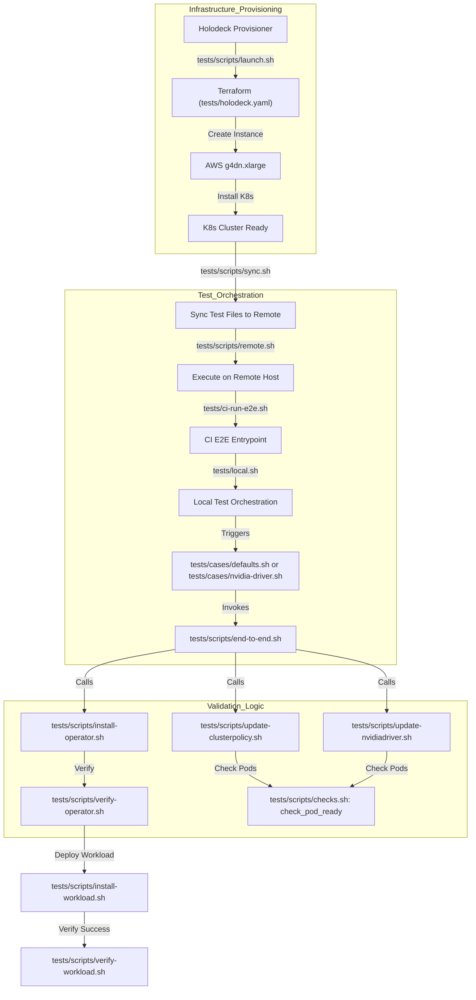
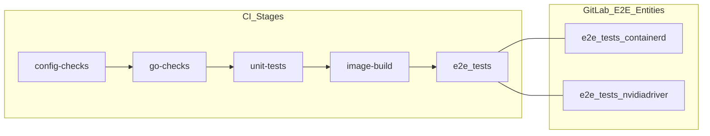

<!-- source: DeepWiki mcp.deepwiki.com · repo NVIDIA/gpu-operator · page 6.3 Testing · fetched 2026-10-26 -->

# Testing

Relevant source files

The following files were used as context for generating this wiki page:

- [internal/state/driver_cleanup_test.go](internal/state/driver_cleanup_test.go)
- [internal/state/driver_manifest_test.go](internal/state/driver_manifest_test.go)
- [internal/state/driver_sync_test.go](internal/state/driver_sync_test.go)
- [internal/state/info_source_test.go](internal/state/info_source_test.go)
- [internal/state/manager_test.go](internal/state/manager_test.go)
- [internal/state/state_skel.go](internal/state/state_skel.go)
- [internal/state/state_skel_reconcile_test.go](internal/state/state_skel_reconcile_test.go)
- [internal/state/state_skel_test.go](internal/state/state_skel_test.go)
- [tests/cases/experimental-runtime.sh](tests/cases/experimental-runtime.sh)
- [tests/e2e/gpu_operator_test.go](tests/e2e/gpu_operator_test.go)
- [tests/e2e/helpers/constants.go](tests/e2e/helpers/constants.go)
- [tests/e2e/helpers/daemonset.go](tests/e2e/helpers/daemonset.go)
- [tests/e2e/helpers/node.go](tests/e2e/helpers/node.go)
- [tests/e2e/helpers/nvidiadriver.go](tests/e2e/helpers/nvidiadriver.go)
- [tests/e2e/helpers/operator.go](tests/e2e/helpers/operator.go)
- [tests/e2e/helpers/pod.go](tests/e2e/helpers/pod.go)
- [tests/scripts/.local.sh](tests/scripts/.local.sh)
- [tests/scripts/checks.sh](tests/scripts/checks.sh)
- [tests/scripts/cleanup.sh](tests/scripts/cleanup.sh)
- [tests/scripts/end-to-end.sh](tests/scripts/end-to-end.sh)
- [tests/scripts/install-workload.sh](tests/scripts/install-workload.sh)
- [tests/scripts/launch.sh](tests/scripts/launch.sh)
- [tests/scripts/prerequisites.sh](tests/scripts/prerequisites.sh)
- [tests/scripts/pull.sh](tests/scripts/pull.sh)
- [tests/scripts/push.sh](tests/scripts/push.sh)
- [tests/scripts/remote.sh](tests/scripts/remote.sh)
- [tests/scripts/sync.sh](tests/scripts/sync.sh)
- [tests/scripts/uninstall-operator.sh](tests/scripts/uninstall-operator.sh)
- [tests/scripts/uninstall-workload.sh](tests/scripts/uninstall-workload.sh)
- [tests/scripts/update-clusterpolicy.sh](tests/scripts/update-clusterpolicy.sh)
- [tests/scripts/update-nvidiadriver.sh](tests/scripts/update-nvidiadriver.sh)
- [tests/scripts/verify-disable-operands.sh](tests/scripts/verify-disable-operands.sh)
- [tests/scripts/verify-operand-restarts.sh](tests/scripts/verify-operand-restarts.sh)
- [tests/scripts/verify-operator.sh](tests/scripts/verify-operator.sh)

This page documents the testing infrastructure, test types, and test execution workflows for the GPU Operator. This includes unit tests, end-to-end (E2E) tests, infrastructure provisioning via Holodeck, and shell-based validation scripts.

## Overview

The GPU Operator testing strategy consists of two primary layers:

1.  **Unit Tests**: Go-based tests validating controllers, state management, and utility functions. These run in isolated environments without requiring a GPU.
2.  **E2E Tests**: Functional tests that deploy the operator to real Kubernetes clusters on AWS GPU instances. These validate driver installation, device plugin functionality, and workload execution.

## Unit Tests

Unit tests are written in Go and utilize the standard `testing` package along with `controller-runtime` testing utilities for manager and reconciler logic.

For example, the `internal/state/state_skel_test.go` and `internal/state/state_skel_reconcile_test.go` files contain unit tests for the `stateSkel` struct, which is a common skeleton for implementing different states in the operator's reconciliation loop [internal/state/state_skel.go:44-52](). These tests cover:
*   `Name()` and `Description()` methods [internal/state/state_skel_test.go:107-111]()
*   `getObj()`, `createObj()`, and `updateObj()` for Kubernetes object manipulation [internal/state/state_skel_test.go:113-138](), [internal/state/state_skel_test.go:178-182]()
*   `checkDeleteSupported()` for verifying if a GVK is supported for deletion [internal/state/state_skel_test.go:140-176]()
*   Error handling in `createOrUpdateObjs()` [internal/state/state_skel_reconcile_test.go:47-101]()
*   Specific merge logic for `ServiceAccount` objects [internal/state/state_skel_reconcile_test.go:103-123]()
*   Readiness checks for `DaemonSet` objects, including handling stale generations [internal/state/state_skel_reconcile_test.go:125-161]()

### Test Execution
Unit tests are triggered via the `Makefile` and integrated into the CI pipelines.

| Command | Action | Source |
| :--- | :--- | :--- |
| `make check` | Runs Go checks (linting and formatting). | [.gitlab-ci.yml:59-64]() |
| `make build` | Compiles the operator binary. | [.gitlab-ci.yml:66-71]() |
| `make coverage` | Runs all Go unit tests and calculates code coverage. | [.gitlab-ci.yml:73-78]() |

Unit tests are executed within a dedicated build image to ensure a consistent environment [[.gitlab-ci.yml:74-75]()].

**Sources**: [.gitlab-ci.yml:59-78](), [internal/state/state_skel.go:44-52](), [internal/state/state_skel_test.go:107-111](), [internal/state/state_skel_test.go:113-138](), [internal/state/state_skel_test.go:140-176](), [internal/state/state_skel_test.go:178-182](), [internal/state/state_skel_reconcile_test.go:47-101](), [internal/state/state_skel_reconcile_test.go:103-123](), [internal/state/state_skel_reconcile_test.go:125-161]()

## End-to-End (E2E) Tests

E2E tests validate the operator's behavior in a live environment. The suite includes shell-based orchestration and Go-based tests (located in `tests/e2e/`).

### Test Infrastructure: Holodeck
For GitHub Actions, the operator uses **Holodeck** to provision ephemeral AWS infrastructure. Holodeck creates a single-node Kubernetes cluster on a GPU-enabled instance [[.github/workflows/e2e-tests.yaml:81-87](), [tests/holodeck.yaml:1-7]()]. The `tests/scripts/launch.sh` script executes the Terraform plan to provision this infrastructure [tests/scripts/launch.sh:11-12]().

**Holodeck Environment Specification** ([tests/holodeck.yaml:1-26]()):
*   **Instance Type**: `g4dn.xlarge` (includes NVIDIA Tesla T4 GPU).
*   **Region**: `us-west-1`.
*   **OS Image**: `ami-07c175e73e37b02df` (AMD64).
*   **Runtime**: `containerd` (v2.2.3).
*   **Kubernetes**: `kubeadm` (v1.35.4).

### Test Case Structure
E2E tests are organized into "cases" which are typically shell scripts that configure specific operator states.

*   **Default Case**: Validates standard installation using Helm [[tests/cases/defaults.sh]()].
*   **NVIDIADriver Case**: Validates driver management via the `NVIDIADriver` CRD [[.github/workflows/e2e-tests.yaml:184-184](), [tests/cases/nvidia-driver.sh]()].

Additionally, there are Ginkgo-based E2E tests in `tests/e2e/gpu_operator_test.go` that deploy the GPU Operator via Helm and verify operand pod readiness and absence of restarts [tests/e2e/gpu_operator_test.go:79-168]().

### Execution Flow
The E2E pipeline follows a strict sequence of provisioning, deployment, and validation. The entry point for execution is `tests/ci-run-e2e.sh`, which invokes `tests/local.sh` [[tests/ci-run-e2e.sh:15-17]()]. The `tests/scripts/sync.sh` script is used to synchronize test files to the remote host [tests/scripts/sync.sh:13-16]().

**Sources**: [tests/ci-run-e2e.sh:1-17](), [tests/local.sh:1-46](), [tests/scripts/end-to-end.sh:1-67](), [tests/holodeck.yaml:1-26](), [tests/scripts/launch.sh:11-12](), [tests/scripts/sync.sh:13-16](), [tests/e2e/gpu_operator_test.go:79-168]()

## Test Script Implementation

The testing framework relies on a set of core shell scripts to manage the lifecycle of the operator and its components.

### Installation Logic (`install-operator.sh`)
The `install-operator.sh` script handles operator deployment via Helm. It supports two modes:
1.  **Values File**: Merges environment-based values with a provided override file [[tests/scripts/install-operator.sh:33-58]()].
2.  **Set Flags**: Uses traditional `--set` flags for backward compatibility [[tests/scripts/install-operator.sh:64-80]()].

### Verification Logic (`verify-operator.sh`, `verify-disable-operands.sh`, `verify-operand-restarts.sh`)
*   `verify-operator.sh`: Checks if all expected operator operand pods are running and ready. It uses `check_pod_ready` or `check_nvidia_driver_pods_ready` depending on whether `NVIDIADriver` CR is used [tests/scripts/verify-operator.sh:15-24]().
*   `verify-disable-operands.sh`: Verifies that all GPU Operator operands have been deleted after being disabled, using `check_pod_deleted` [tests/scripts/verify-disable-operands.sh:14-21]().
*   `verify-operand-restarts.sh`: Ensures that no operator operand pods have restarted unexpectedly, using `check_no_restarts` [tests/scripts/verify-operand-restarts.sh:14-20]().

### Validation Functions (`checks.sh`)
The `checks.sh` file provides reusable functions for asserting cluster state.

*   `check_pod_ready`: Loops until a pod with a specific label is in the `Ready` state [tests/scripts/checks.sh:3-36]().
*   `check_pod_deleted`: Loops until a pod with a specific label is deleted [tests/scripts/checks.sh:38-68]().
*   `check_no_restarts`: Checks if a pod has restarted more than once [tests/scripts/checks.sh:70-80]().
*   `test_restart_operator`: Forcefully kills the operator container (via `crictl` or `docker`) and waits for it to recover [tests/scripts/checks.sh:84-113]().
*   `check_gpu_pod_ready`: Monitors a test GPU pod and collects logs/descriptions for debugging if it fails [tests/scripts/checks.sh:115-155]().
*   `check_nvidia_driver_pods_ready`: Similar to `check_pod_ready` but specifically for `nvidia-driver` labeled pods [tests/scripts/checks.sh:158-190]().

### ClusterPolicy Updates (`update-clusterpolicy.sh`)
This script performs live patches to the `ClusterPolicy` CR to verify the operator's reconciliation logic.

*   **Image Updates**: Patches `/spec/driver/version` and verifies the DaemonSet image changes [tests/scripts/update-clusterpolicy.sh:15-31]().
*   **Environment Variables**: Adds custom ENV vars to the `devicePlugin` spec and verifies they propagate to the pod spec [tests/scripts/update-clusterpolicy.sh:47-63]().
*   **MIG Strategy**: Updates the MIG strategy and validates its propagation to GFD and Device Plugin DaemonSets [tests/scripts/update-clusterpolicy.sh:79-103]().
*   **DCGM Enablement**: Enables DCGM and verifies `nvidia-dcgm` and `nvidia-dcgm-exporter` pods are running [tests/scripts/update-clusterpolicy.sh:106-122]().
*   **GPU Sharing**: Applies a ConfigMap for time-slicing and validates parallel workloads on a single GPU [tests/scripts/update-clusterpolicy.sh:124-150]().

### NVIDIADriver Updates (`update-nvidiadriver.sh`)
This script tests the `NVIDIADriver` CRD, including:
*   Creating and managing `NVIDIADriver` instances [tests/scripts/update-nvidiadriver.sh:28-43]().
*   Setting and unsetting default drivers [tests/scripts/update-nvidiadriver.sh:46-55]().
*   Waiting for nodes to be owned by a specific `NVIDIADriver` [tests/scripts/update-nvidiadriver.sh:121-147]().
*   Verifying driver image updates through the `NVIDIADriver` CR [tests/scripts/update-nvidiadriver.sh:178-186]().

**Sources**: [tests/scripts/install-operator.sh:1-123](), [tests/scripts/checks.sh:1-207](), [tests/scripts/update-clusterpolicy.sh:1-150](), [tests/scripts/verify-operator.sh:15-24](), [tests/scripts/verify-disable-operands.sh:14-21](), [tests/scripts/verify-operand-restarts.sh:14-20](), [tests/scripts/update-nvidiadriver.sh:28-43](), [tests/scripts/update-nvidiadriver.sh:46-55](), [tests/scripts/update-nvidiadriver.sh:121-147](), [tests/scripts/update-nvidiadriver.sh:178-186]()

## CI/CD Integration

Testing is automated across GitHub Actions and GitLab CI.

### GitHub Actions Workflow
The E2E workflow (`.github/workflows/e2e-tests.yaml`) runs separate jobs for different container runtimes and test cases [[.github/workflows/e2e-tests.yaml:65-131](), [.github/workflows/e2e-tests.yaml:131-196]()].

### GitLab CI Workflow
GitLab CI uses Terraform-based provisioning (`aws-kube-ci`) to launch infrastructure before running tests [[.gitlab-ci.yml:3-5](), [.gitlab-ci.yml:161-182]()].

### Forward Compatibility Testing
A specialized workflow (`.github/workflows/forward-compatibility.yaml`) runs weekly. It fetches the latest images for components (Toolkit, Device Plugin, MIG Manager) and generates a `values-overrides.yaml` file to test the operator against the newest dependencies [[.github/workflows/forward-compatibility.yaml:15-68]()].

**Sources**: [.gitlab-ci.yml:1-201](), [.github/workflows/e2e-tests.yaml:1-196](), [.github/workflows/forward-compatibility.yaml:1-107]()

---

