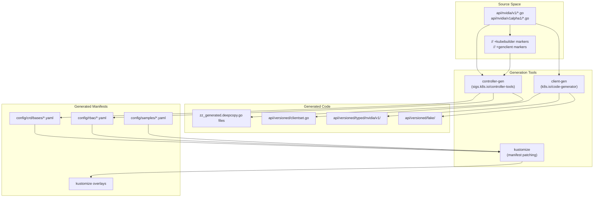
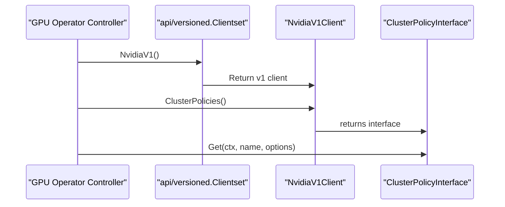
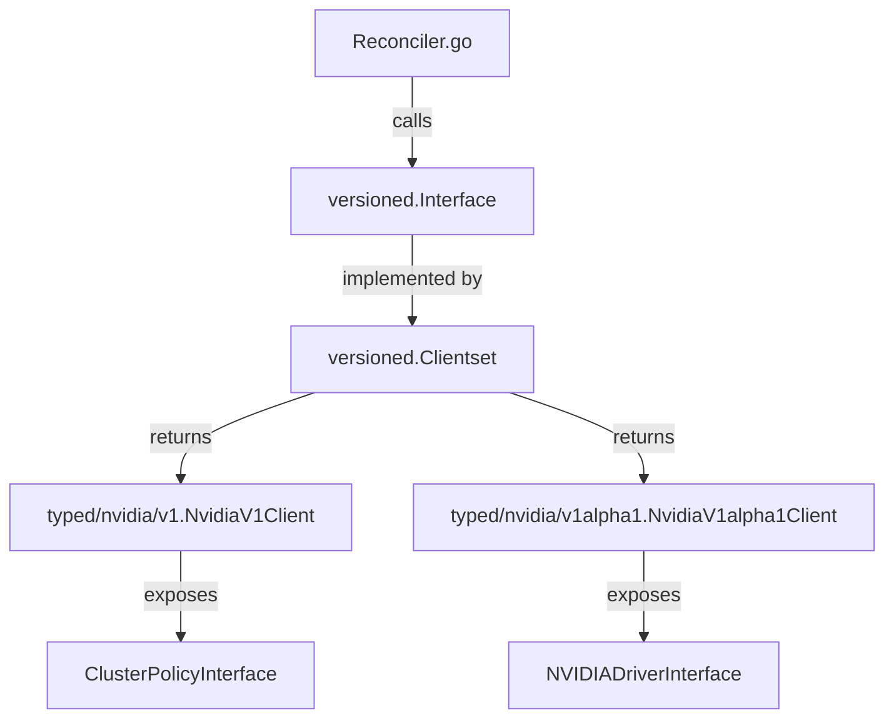

<!-- source: DeepWiki mcp.deepwiki.com · repo NVIDIA/gpu-operator · page 6.4 Code Generation · fetched 2026-10-26 -->

# Code Generation

<details>
<summary>Relevant source files</summary>

The following files were used as context for generating this wiki page:

- [.gitignore](.gitignore)
- [PROJECT](PROJECT)
- [THIRD_PARTY_NOTICES.md](THIRD_PARTY_NOTICES.md)
- [api/nvidia/v1alpha1/groupversion_info.go](api/nvidia/v1alpha1/groupversion_info.go)
- [api/versioned/clientset.go](api/versioned/clientset.go)
- [api/versioned/fake/clientset_generated.go](api/versioned/fake/clientset_generated.go)
- [api/versioned/typed/nvidia/v1/clusterpolicy.go](api/versioned/typed/nvidia/v1/clusterpolicy.go)
- [api/versioned/typed/nvidia/v1/fake/fake_clusterpolicy.go](api/versioned/typed/nvidia/v1/fake/fake_clusterpolicy.go)
- [api/versioned/typed/nvidia/v1/fake/fake_nvidia_client.go](api/versioned/typed/nvidia/v1/fake/fake_nvidia_client.go)
- [api/versioned/typed/nvidia/v1/nvidia_client.go](api/versioned/typed/nvidia/v1/nvidia_client.go)
- [api/versioned/typed/nvidia/v1alpha1/fake/fake_gpucluster.go](api/versioned/typed/nvidia/v1alpha1/fake/fake_gpucluster.go)
- [api/versioned/typed/nvidia/v1alpha1/fake/fake_nvidia_client.go](api/versioned/typed/nvidia/v1alpha1/fake/fake_nvidia_client.go)
- [api/versioned/typed/nvidia/v1alpha1/fake/fake_nvidiadriver.go](api/versioned/typed/nvidia/v1alpha1/fake/fake_nvidiadriver.go)
- [api/versioned/typed/nvidia/v1alpha1/generated_expansion.go](api/versioned/typed/nvidia/v1alpha1/generated_expansion.go)
- [api/versioned/typed/nvidia/v1alpha1/gpucluster.go](api/versioned/typed/nvidia/v1alpha1/gpucluster.go)
- [api/versioned/typed/nvidia/v1alpha1/nvidia_client.go](api/versioned/typed/nvidia/v1alpha1/nvidia_client.go)
- [api/versioned/typed/nvidia/v1alpha1/nvidiadriver.go](api/versioned/typed/nvidia/v1alpha1/nvidiadriver.go)
- [config/crd/kustomization.yaml](config/crd/kustomization.yaml)
- [config/samples/kustomization.yaml](config/samples/kustomization.yaml)
- [tools/generate-third-party-notices.sh](tools/generate-third-party-notices.sh)
- [tools/go.mod](tools/go.mod)
- [tools/go.sum](tools/go.sum)
- [tools/tools.go](tools/tools.go)

</details>


## Purpose and Scope

This document details the GPU Operator project's code generation ecosystem. It covers the automated generation of Kubernetes CustomResourceDefinitions (CRDs), typed Go clientsets, deepcopy functions, RBAC manifests, and third-party notices. Additionally, it highlights the tooling, data flow, and file outputs that form the foundation for consistent API and manifest management.

## Overview

The GPU Operator relies on a set of Kubernetes standard code generation tools combined with kustomize-based manifest composition to automate:

- CRD manifests generated from annotated Go API type definitions
- DeepCopy methods for API runtime compatibility
- Strongly typed Kubernetes clientsets for API interaction
- RBAC manifests derived from controller markers for permission management
- Kustomize manifests for patching and composing deployment artifacts
- Third-party notices listing OSS dependencies and licenses

This automation centralizes the source of truth to Go types and markup, reducing manual manifest drift and ensuring compatibility across project components.

## Code Generation Tooling

### Tools Module and Versions

- The tool dependencies are managed inside a dedicated Go module located at `tools/go.mod` [tools/go.mod:1-12]().
- This module pulls specific versions of:
  - `controller-tools` (for `controller-gen`)
  - `k8s.io/code-generator` (for `client-gen`)
  - `sigs.k8s.io/kustomize` (for manifest overlay)
  - Coverage tools like `gcov2lcov`
- The actual installed tools are declared via blank imports in the file `tools/tools.go`, guarded by a `//go:build tools` build tag to avoid inclusion in build binaries [tools/tools.go:1-29]().

```go
//go:build tools
package tools

import (
	_ "github.com/google/go-licenses/v2"
	_ "github.com/jandelgado/gcov2lcov"
	_ "golang.org/x/tools/cmd/goimports"
	_ "k8s.io/code-generator/cmd/client-gen"
	_ "sigs.k8s.io/controller-tools/cmd/controller-gen"
	_ "sigs.k8s.io/kustomize/kustomize/v5"
)
```

### Key Tools Used

| Tool                      | Purpose                                      | Version                |
|---------------------------|----------------------------------------------|------------------------|
| controller-gen            | Generate CRDs, DeepCopy funcs, RBAC manifests | v0.22.0 (in go.mod)    |
| client-gen                | Generate typed Kubernetes clientsets         | v0.37.1                |
| kustomize (kustomize/v5) | Compose and patch manifests                    | v5.8.1                 |
| go-licenses               | Generate third-party OSS notices              | v2.0.1 (via go-licenses) |

## Code Generation Pipeline and Data Flow

The GPU Operator code generation workflow transforms Go API source types and annotations into generated code and configuration artifacts.



**Explanation:**

- Source API Go files in `api/nvidia/v1` and `api/nvidia/v1alpha1` define CRD types and controller markers.
- `controller-gen` parses these to generate `DeepCopy` funcs, CRD YAMLs, and RBAC manifests.
- `client-gen` reads the types and generates versioned typed clientsets and fake clients for testing.
- `kustomize` merges, patches, and produces fully rendered manifests, including samples.
- The final manifests are used for deployment and testing.

**Sources:** [tools/tools.go:1-29](), [tools/go.mod:1-12](), [PROJECT:1-34]()

## Typed Clientset Generation and Structure

The typed Kubernetes clients generated by `client-gen` enable the operator to interact programmatically and type-safely with managed CRDs.

### Clientset Design

- Located in the `api/versioned/` directory, this clientset aggregates clients for multiple API versions.

- Key files and packages:
  - `api/versioned/clientset.go` defines the `Clientset` struct and interfaces for `NvidiaV1` and `NvidiaV1alpha1` clients [api/versioned/clientset.go:19-133]().
  - `api/versioned/typed/nvidia/v1/` and `v1alpha1/` contain API version specific clients like `NvidiaV1Client` and `NvidiaV1alpha1Client`.
  - Fake clients that mock the API for unit testing reside in `api/versioned/fake/`.

### Versioned Clients

| API Version | Generated Client Package                          | Main Client Struct            | Key Resources Managed                          |
|-------------|-------------------------------------------------|------------------------------|-----------------------------------------------|
| v1          | `api/versioned/typed/nvidia/v1/nvidia_client.go` | `NvidiaV1Client`             | `ClusterPolicy` CRD                           |
| v1alpha1    | `api/versioned/typed/nvidia/v1alpha1/nvidia_client.go` | `NvidiaV1alpha1Client`       | `NVIDIADriver`, `GPUCluster` CRDs             |

### Clientset Usage Example

The reconciler obtains client interfaces as:

```go
clientset := versionedClientset.NvidiaV1()
clusterPolicyClient := clientset.ClusterPolicies()
```

This allows calling API methods like `Get`, `List`, `Create`, etc. for CR instances programmatically.

### Data Flow: Typed Client Interaction



**Sources:** [api/versioned/clientset.go:19-133](), [api/versioned/typed/nvidia/v1/nvidia_client.go:29-41](), [api/versioned/typed/nvidia/v1alpha1/nvidia_client.go:29-46](), [api/versioned/fake/clientset_generated.go:39-108]()

## Manifest Generation: CRDs and RBAC

### CRD Generation

- `controller-gen` uses Go API type definitions with kubebuilder annotations to auto-generate CustomResourceDefinition manifests located under `config/crd/bases/`.
- The `PROJECT` file governs what resource definitions are processed [PROJECT:1-34]():

```yaml
resources:
- api:
    crdVersion: v1
  controller: true
  domain: com
  group: nvidia
  kind: ClusterPolicy
  path: github.com/NVIDIA/gpu-operator/api/v1
  version: v1

- api:
    crdVersion: v1
  controller: true
  domain: com
  group: nvidia
  kind: NVIDIADriver
  path: github.com/NVIDIA/gpu-operator/api/v1alpha1
  version: v1alpha1

- api:
    crdVersion: v1
  controller: true
  domain: com
  group: nvidia
  kind: GPUCluster
  path: github.com/NVIDIA/gpu-operator/api/v1alpha1
  version: v1alpha1
```

- Primary CRDs generated: `ClusterPolicy` (v1), `NVIDIADriver` & `GPUCluster` (v1alpha1).

### RBAC Manifest Generation

- RBAC manifests are auto-generated based on kubebuilder RBAC markers present in controller source code.
- These ensure the operator has the precise permission sets needed based on resource verbs and API groups marked in Go code.
- The resulting RBAC YAML files are placed in `config/rbac/`.

### Kustomization and Sample manifests

- The generated CRDs, RBAC, and sample manifests are wired together and optionally patched with kustomize overlays (e.g., webhook patches, namespace changes).
- `kustomization.yaml` files in `config/crd` and `config/samples` orchestrate inheritance and layering of these manifests [config/crd/kustomization.yaml](), [config/samples/kustomization.yaml]().

**Sources:** [PROJECT:1-34](), [config/crd/kustomization.yaml](), [config/samples/kustomization.yaml]()

## DeepCopy Functions Generation

- To satisfy Kubernetes runtime interfaces, deepcopy functions are generated for all API types.
- This is performed by `controller-gen` using the `// +kubebuilder:object:root=true` and `// +k8s:deepcopy-gen` annotations in API files.
- These are placed as `zz_generated.deepcopy.go` files adjacent to the API type definitions (`api/nvidia/v1/zz_generated.deepcopy.go`).

## Third-Party Notices Generation

- The project ships a comprehensive `THIRD_PARTY_NOTICES.md` file listing all Go module dependencies with their license texts.
- It is generated by the script `tools/generate-third-party-notices.sh`, which uses the `go-licenses` tool to collect licenses per platform architecture.
- The script cross-references vendor metadata (`vendor/modules.txt`) and multiplatform targets ensuring compliance for multi-arch builds.
- This guarantees that all statically linked OSS dependencies in commands (like `gpu-operator`, `manage-crds`, etc.) have their licenses documented [tools/generate-third-party-notices.sh:1-183]().

## Summary of Key Generated Artifacts

| Artifact Category       | Tool           | Output Location / Package                     |
|------------------------|----------------|----------------------------------------------|
| DeepCopy functions     | controller-gen | `api/nvidia/v1/zz_generated.deepcopy.go`     |
| CRD manifests          | controller-gen | `config/crd/bases/nvidia.com_clusterpolicies.yaml` etc. |
| RBAC manifests         | controller-gen | `config/rbac/role.yaml`                       |
| Typed clientset        | client-gen     | `api/versioned/clientset.go`                   |
| Versioned clients      | client-gen     | `api/versioned/typed/nvidia/v1/` and `v1alpha1/` |
| Fake clients           | client-gen     | `api/versioned/fake/`                          |
| Third-party notices    | go-licenses + shell script | `THIRD_PARTY_NOTICES.md`          |

---

# Overview Diagrams Bridging Natural Language and Code Entities

## Mapping Tools, APIs, and Output Artifacts

```mermaid
graph LR
	"API_Go_Types[api/nvidia/v1/*.go & v1alpha1/*.go]" --> "ControllerGen[controller-gen]"
	"API_Go_Types" --> "ClientGen[client-gen]"
	"ControllerGen" --> "DeepCopyFuncs[zz_generated.deepcopy.go]"
	"ControllerGen" --> "CRD_Manifests[config/crd/bases/*.yaml]"
	"ControllerGen" --> "RBAC_Manifests[config/rbac/*.yaml]"
	"ClientGen" --> "TypedClientset[api/versioned/clientset.go]"
	"ClientGen" --> "VersionedClients[api/versioned/typed/nvidia/v1 & v1alpha1]"
	"ClientGen" --> "FakeClients[api/versioned/fake/]"
	"CRD_Manifests" --> "Kustomize[config/crd/kustomization.yaml]"
	"RBAC_Manifests" --> "Kustomize"
	"Kustomize" --> "FinalManifests[deployment & sample manifests]"
	"ShellScript[tools/generate-third-party-notices.sh]" --> "ThirdPartyNotices[THIRD_PARTY_NOTICES.md]"
```

## Typed Clientset Call Path



---

# References and Sources

- [tools/go.mod:1-12]()
- [tools/tools.go:1-29]()
- [PROJECT:1-34]()
- [api/versioned/clientset.go:19-133]()
- [api/versioned/typed/nvidia/v1/nvidia_client.go:29-41]()
- [api/versioned/typed/nvidia/v1alpha1/nvidia_client.go:29-46]()
- [api/versioned/fake/clientset_generated.go:39-108]()
- [tools/generate-third-party-notices.sh:1-183]()
- [config/crd/kustomization.yaml]()
- [config/samples/kustomization.yaml]()

---

