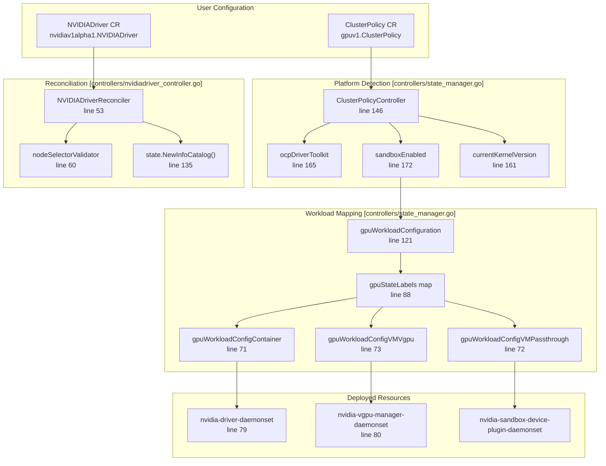
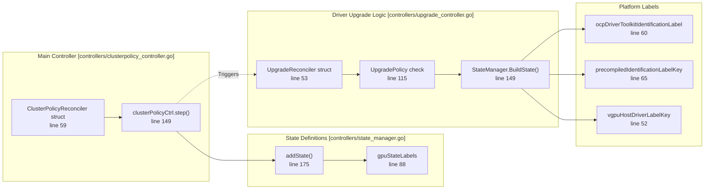

<!-- source: DeepWiki mcp.deepwiki.com · repo NVIDIA/gpu-operator · page 7 Advanced Topics · fetched 2026-10-26 -->

# Advanced Topics

<details>
<summary>Relevant source files</summary>

The following files were used as context for generating this wiki page:

- [assets/state-sandbox-device-plugin/0100_service_account.yaml](assets/state-sandbox-device-plugin/0100_service_account.yaml)
- [assets/state-sandbox-device-plugin/0200_role.yaml](assets/state-sandbox-device-plugin/0200_role.yaml)
- [assets/state-sandbox-device-plugin/0210_clusterrole.yaml](assets/state-sandbox-device-plugin/0210_clusterrole.yaml)
- [assets/state-sandbox-device-plugin/0300_rolebinding.yaml](assets/state-sandbox-device-plugin/0300_rolebinding.yaml)
- [assets/state-sandbox-device-plugin/0310_clusterrolebinding.yaml](assets/state-sandbox-device-plugin/0310_clusterrolebinding.yaml)
- [assets/state-sandbox-device-plugin/0410_scc.openshift.yaml](assets/state-sandbox-device-plugin/0410_scc.openshift.yaml)
- [assets/state-sandbox-device-plugin/0500_daemonset.yaml](assets/state-sandbox-device-plugin/0500_daemonset.yaml)
- [assets/state-vgpu-manager/0500_daemonset.yaml](assets/state-vgpu-manager/0500_daemonset.yaml)
- [multi-arch.mk](multi-arch.mk)
- [native-only.mk](native-only.mk)

</details>


This page covers advanced use cases and specialized configurations for the NVIDIA GPU Operator. These topics build upon the core architecture and component deployments to support complex production environments, heterogeneous infrastructure, and specialized workload requirements.

For basic deployment instructions, see [Deployment](#5). For component-specific documentation, see [Components](#4). For the Custom Resource API reference, see [ClusterPolicy](#3.1) and [NVIDIADriver](#3.2).

The advanced topics covered in detail on the following pages include:  
- **[Multi-Architecture Support](#7.1)**: ARM64 and AMD64 image builds and manifest creation.  
- **[OpenShift Integration](#7.2)**: Driver Toolkit, SecurityContextConstraints, and cluster-specific features.  
- **[Driver Upgrades](#7.3)**: Automated upgrade orchestration with minimal workload disruption.  
- **[Heterogeneous Clusters](#7.4)**: Managing multiple OS/kernel versions with node pools.  
- **[Virtualization and Sandboxing](#7.5)**: vGPU, VFIO, Kata containers, and confidential computing.

---

## Configuration Surface for Advanced Features

The GPU Operator exposes advanced configurations primarily through the `ClusterPolicy` and `NVIDIADriver` Custom Resources. These CRs enable detailed control over driver versions, deployment modes, and feature toggles for standard and specialized workloads such as virtualization and sandboxing.

The operator internalizes different configuration flags and labels to detect platform capabilities, workload types, and kernel versions, dynamically adjusting deployment manifests accordingly.

### Configuration Flow to Code Entities

The diagram below maps the relationship between user-facing configuration and the internal code entities responsible for processing and reconciling states:



This mapping illustrates the layered processing from CR configurations down to the controller logic and ultimately manifests deployed to the cluster.

**Sources:**  
- [controllers/state_manager.go:70-173]()  
- [controllers/nvidiadriver_controller.go:53-153]()

---

## Advanced Feature State Management

The operator uses a modular state management approach where each advanced feature is implemented as a discrete state within the reconciliation logic. The `ClusterPolicyController` orchestrates these states, enabling flexible handling of environment-specific variations like OpenShift, virtualization, and driver upgrades.

The following diagram shows key controller structs and major interactions managing advanced features:



This architecture permits extensibility to new advanced features without disrupting existing core functionality.

**Sources:**  
- [controllers/clusterpolicy_controller.go:59-150]()  
- [controllers/state_manager.go:52-113]()  
- [controllers/upgrade_controller.go:53-150]()

---

## OpenShift-Specific Configuration Flow

The GPU Operator has specialized support for OpenShift clusters to leverage platform-specific features and security models:

- **Driver Toolkit (DTK)**: The operator can leverage the OpenShift Driver Toolkit when `ocpDriverToolkit.enabled` is true. This mechanism detects the host kernel version and RHCOS version to build compatible driver binaries within the cluster [controllers/state_manager.go:128-143]().

- **SecurityContextConstraints (SCC)**: OpenShift requires special SCC configurations for components like the Sandbox Device Plugin and DCGM to enable privileged container execution and access to host devices [assets/state-sandbox-device-plugin/0500_daemonset.yaml:9](), [assets/state-dcgm/0310_scc.openshift.yaml:16-32]().

- **Monitoring Namespace Labeling**: The operator auto-labels its namespace for OpenShift cluster monitoring integration [controllers/state_manager.go:63-64]().

For detailed configuration and operating procedures in OpenShift environments, see [OpenShift Integration](#7.2).

**Sources:**  
- [controllers/state_manager.go:128-143]()  
- [assets/state-dcgm/0310_scc.openshift.yaml:16-32]()  
- [assets/state-sandbox-device-plugin/0500_daemonset.yaml:8-9]()

---

## Heterogeneous Cluster Node Pool Architecture

In environments with heterogeneous infrastructure — varying OS versions or kernel versions — the operator supports deploying multiple `NVIDIADriver` CR instances to target different node pools:

- **Node Selection and Validation**: The `NVIDIADriverReconciler` validates `nodeSelector` fields to ensure no overlaps that would cause driver conflicts on the same nodes [controllers/nvidiadriver_controller.go:143-153]().

- **Precompiled Drivers**: Support for precompiled driver container images enables offline or customized driver deployments, although this currently has limitations with features like GPUDirect Storage or GDRCopy [controllers/nvidiadriver_controller.go:155-163]().

- **Kernel Version Tracking**: The `ClusterPolicyController` tracks kernel versions in a map to coordinate driver deployment strategies properly [controllers/state_manager.go:160-161]().

For full details on managing heterogeneous clusters with node pools and driver configurations, see [Heterogeneous Clusters](#7.4).

**Sources:**  
- [controllers/nvidiadriver_controller.go:143-163]()  
- [controllers/state_manager.go:160-161]()

---

## Virtualization and Sandboxing

The operator supports advanced GPU virtualization and container sandboxing scenarios:

- **vGPU Manager**: When configured for `vm-vgpu` workloads, the operator deploys a specialized vGPU manager DaemonSet (`nvidia-vgpu-manager-daemonset`) to handle vGPU device lifecycle and configuration [controllers/state_manager.go:108-109]().

- **Sandbox Device Plugin**: For both VM passthrough (`vm-passthrough`) and vGPU modes, the operator deploys the sandbox device plugin DaemonSet (`nvidia-sandbox-device-plugin-daemonset`) offering device plugins compatible with sandbox runtimes [assets/state-sandbox-device-plugin/0500_daemonset.yaml:1-20]().

- **Validation Init Containers**: The plugin Pod includes `vfio-pci-validation` and `vgpu-devices-validation` init containers to ensure host readiness before starting privileged containers [assets/state-sandbox-device-plugin/0500_daemonset.yaml:27-59]().

- **Sandbox Workload Support**: It extends support for Kata containers and KubeVirt through specialized device plugins (e.g., Kata device plugin) and Kernel Confidentiality (CC) Manager components.

For comprehensive virtualization and sandboxing configuration details, see [Virtualization and Sandboxing](#7.5).

**Sources:**  
- [controllers/state_manager.go:99-112]()  
- [assets/state-sandbox-device-plugin/0500_daemonset.yaml:1-59]()  

---

## Driver Upgrade Policy Configuration

The operator provides an automated driver upgrade mechanism with minimal disruption to workloads:

- **Automatic Upgrades Controlled by Policy**: The `UpgradeReconciler` reads the `UpgradePolicy` flags (e.g., `AutoUpgrade`) from the `ClusterPolicy` and manages the upgrade flow accordingly [controllers/upgrade_controller.go:115-116]().

- **Node Draining and Pod Eviction**: The upgrade process can drain nodes while respecting configured pod selectors to avoid evicting critical workloads [controllers/upgrade_controller.go:67-72]().

- **Dynamic Upgrade Concurrency**: The maximum allowed unavailable nodes during upgrade is dynamically computed based on cluster size, balancing speed and stability [controllers/upgrade_controller.go:159-167]().

This mechanism integrates with the k8s-operator-libs framework to coordinate patches and reconciliations of driver components while minimizing downtime.

For further details, see [Driver Upgrades](#7.3).

**Sources:**  
- [controllers/upgrade_controller.go:67-72]()  
- [controllers/upgrade_controller.go:115-127]()  
- [controllers/upgrade_controller.go:159-167]()

---

## Multi-Architecture Support

The GPU Operator supports multi-architecture deployments targeting `amd64` and `arm64` processors:

- **Multi-Arch Image Builds**: The build system utilizes multi-arch makefiles and `regctl` to create manifest lists that provide multiple platform images under the same tag [multi-arch.mk:1-24]().

- **Platform Detection in Controllers**: The operator detects the node architecture at reconcile time and selects the appropriate images for the node's architecture [controllers/state_manager.go:17-39]().

- **Makefile Targets**: Separate makefiles (`native-only.mk` vs. `multi-arch.mk`) allow building images for single or multiple architectures with push and attestation options.

For complete build and deployment instructions for multi-architecture support, see [Multi-Architecture Support](#7.1).

**Sources:**  
- [multi-arch.mk:1-24]()  
- [native-only.mk:1-23]()  
- [controllers/state_manager.go:17-39]()

---

# Summary

This page provides a high-level overview of the NVIDIA GPU Operator's advanced topics about multi-architecture support, OpenShift integration, driver upgrades, heterogeneous cluster management, and virtualization/sandboxing. It bridges between the user-facing configuration objects and internal reconciler states and resource manifests.

---

# Appendices

## Sample Deployment Manifest - Sandbox Device Plugin DaemonSet (snippet)

```yaml
apiVersion: apps/v1
kind: DaemonSet
metadata:
  name: nvidia-sandbox-device-plugin-daemonset
  namespace: "FILLED BY THE OPERATOR"
  annotations:
    openshift.io/scc: nvidia-sandbox-device-plugin
spec:
  selector:
    matchLabels:
      app: nvidia-sandbox-device-plugin-daemonset
  template:
    metadata:
      labels:
        app: nvidia-sandbox-device-plugin-daemonset
    spec:
      nodeSelector:
        nvidia.com/gpu.deploy.sandbox-device-plugin: "true"
      tolerations:
        - key: nvidia.com/gpu
          operator: Exists
          effect: NoSchedule
      priorityClassName: system-node-critical
      serviceAccountName: nvidia-sandbox-device-plugin
      initContainers:
        - name: vfio-pci-validation
          image: "FILLED BY THE OPERATOR"
          command: ['sh', '-c']
          args:
            - until [ -f /run/nvidia/validations/workload-type ]; do sleep 5; done;
              if [ "$(cat /run/nvidia/validations/workload-type)" != "vm-passthrough" ]; then exit 0; fi;
              until [ -f /run/nvidia/validations/vfio-pci-ready ]; do sleep 5; done;
          securityContext:
            privileged: true
          volumeMounts:
            - name: run-nvidia-validations
              mountPath: /run/nvidia/validations
              mountPropagation: HostToContainer
      containers:
        - name: nvidia-sandbox-device-plugin-ctr
          image: "FILLED BY THE OPERATOR"
          securityContext:
            privileged: true
          volumeMounts:
            - name: device-plugin
              mountPath: /var/lib/kubelet/device-plugins
            - name: vfio
              mountPath: /dev/vfio
      volumes:
        - name: device-plugin
          hostPath:
            path: /var/lib/kubelet/device-plugins
        - name: run-nvidia-validations
          hostPath:
            path: /run/nvidia/validations
            type: DirectoryOrCreate
        - name: vfio
          hostPath:
            path: /dev/vfio
```

**Sources:**  
- [assets/state-sandbox-device-plugin/0500_daemonset.yaml:1-99]()

---

# See Also

- [Multi-Architecture Support](#7.1)  
- [OpenShift Integration](#7.2)  
- [Driver Upgrades](#7.3)  
- [Heterogeneous Clusters](#7.4)  
- [Virtualization and Sandboxing](#7.5)

---

