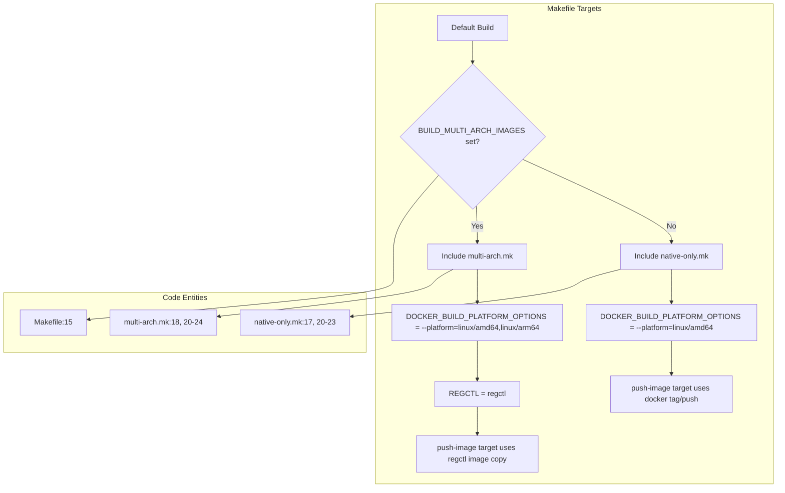
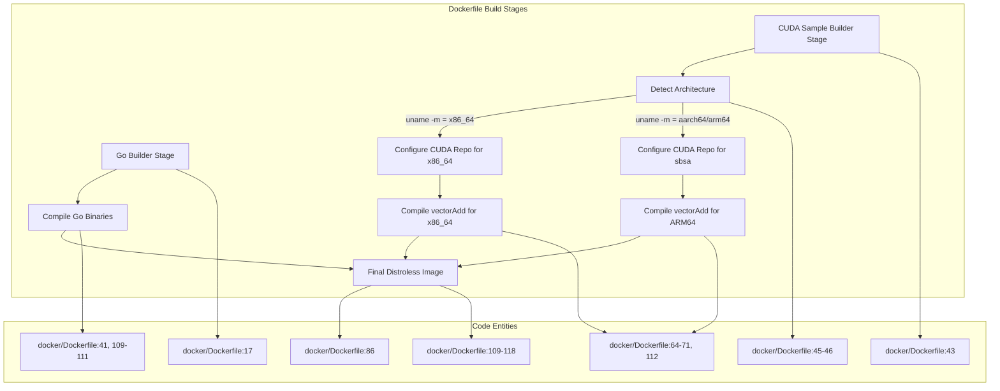

<!-- source: DeepWiki mcp.deepwiki.com · repo NVIDIA/gpu-operator · page 7.1 Multi-Architecture Support · fetched 2026-10-26 -->

# Multi-Architecture Support

Relevant source files

The following files were used as context for generating this wiki page:

- [multi-arch.mk](multi-arch.mk)
- [native-only.mk](native-only.mk)
- [vendor/github.com/regclient/regclient/.osv-scanner.toml](vendor/github.com/regclient/regclient/.osv-scanner.toml)
- [vendor/github.com/regclient/regclient/.version-bump.lock](vendor/github.com/regclient/regclient/.version-bump.lock)
- [vendor/github.com/regclient/regclient/.version-bump.yml](vendor/github.com/regclient/regclient/.version-bump.yml)
- [vendor/github.com/regclient/regclient/Makefile](vendor/github.com/regclient/regclient/Makefile)
- [vendor/github.com/regclient/regclient/config/docker.go](vendor/github.com/regclient/regclient/config/docker.go)
- [vendor/github.com/regclient/regclient/image.go](vendor/github.com/regclient/regclient/image.go)
- [vendor/github.com/regclient/regclient/internal/auth/auth.go](vendor/github.com/regclient/regclient/internal/auth/auth.go)
- [vendor/github.com/regclient/regclient/internal/reghttp/http.go](vendor/github.com/regclient/regclient/internal/reghttp/http.go)
- [vendor/github.com/regclient/regclient/regclient.go](vendor/github.com/regclient/regclient/regclient.go)
- [vendor/github.com/regclient/regclient/release.md](vendor/github.com/regclient/regclient/release.md)
- [vendor/github.com/regclient/regclient/scheme/ocidir/manifest.go](vendor/github.com/regclient/regclient/scheme/ocidir/manifest.go)
- [vendor/github.com/regclient/regclient/scheme/ocidir/ocidir.go](vendor/github.com/regclient/regclient/scheme/ocidir/ocidir.go)
- [vendor/github.com/regclient/regclient/scheme/reg/referrer.go](vendor/github.com/regclient/regclient/scheme/reg/referrer.go)
- [vendor/github.com/regclient/regclient/types/manifest/manifest.go](vendor/github.com/regclient/regclient/types/manifest/manifest.go)
- [vendor/github.com/regclient/regclient/types/platform/cpuinfo_x86.go](vendor/github.com/regclient/regclient/types/platform/cpuinfo_x86.go)
- [vendor/github.com/regclient/regclient/types/platform/platform.go](vendor/github.com/regclient/regclient/types/platform/platform.go)
- [vendor/github.com/regclient/regclient/types/ref/ref.go](vendor/github.com/regclient/regclient/types/ref/ref.go)

## Purpose and Scope

This document explains how the NVIDIA GPU Operator supports multiple CPU architectures (AMD64 and ARM64). It covers the build system configuration, CI/CD pipelines for multi-architecture image builds, Docker manifest creation using `regctl`, and architecture-specific compilation logic within the Docker multi-stage build process.

The GPU Operator ensures that a single image reference (e.g., `nvcr.io/nvidia/cloud-native/gpu-operator:v26.3.1`) can be deployed across heterogeneous clusters containing both x86_64 and ARM64 nodes.

## Supported Architectures

The GPU Operator officially supports and builds for two primary CPU architectures, as defined in the build configuration and metadata:

| Architecture | Platform Identifier | Primary Use Cases |
|--------------|---------------------|-------------------|
| AMD64 (x86_64) | `linux/amd64` | Traditional x86-based servers, data center GPU nodes. |
| ARM64 (aarch64) | `linux/arm64` | ARM-based servers (e.g., NVIDIA Grace CPU, AWS Graviton with GPUs). |

**Sources:** [multi-arch.mk:18](), [native-only.mk:17]()

## Build System Architecture

### Build Mode Selection

The build system supports two modes controlled by the `BUILD_MULTI_ARCH_IMAGES` variable in the main [Makefile:15]().

- **Native-Only Mode**: When `BUILD_MULTI_ARCH_IMAGES` is `false` (default), the build uses native architecture settings for single-architecture builds. This is reflected in `native-only.mk` where `DOCKER_BUILD_PLATFORM_OPTIONS` defaults to `--platform=linux/amd64` [native-only.mk:17]().
- **Multi-Arch Mode**: When set to `true`, the build system enables multi-platform build options for Docker and bundle images. In this mode, `multi-arch.mk` is included, setting `DOCKER_BUILD_PLATFORM_OPTIONS` to `--platform=linux/amd64,linux/arm64` [multi-arch.mk:18]().

**Sources:** [Makefile:15](), [native-only.mk:17](), [multi-arch.mk:18]()

### Multi-Architecture Makefile Logic

The `Makefile` defines the platforms and tools required for manifest list creation.

The `DOCKER_BUILD_PLATFORM_OPTIONS` variable is dynamically set based on the build mode.
- In native-only mode, it targets `linux/amd64` [native-only.mk:17](). The `push-image` target then uses standard `docker tag` and `docker push` commands [native-only.mk:20-23]().
- In multi-arch mode, it targets `linux/amd64,linux/arm64` [multi-arch.mk:18](). The `push-image` target leverages `regctl image copy` to create and push manifest lists, ensuring a single image tag points to multiple architecture-specific images [multi-arch.mk:20-24]().

**Sources:** [native-only.mk:17-23](), [multi-arch.mk:18-24]()

## CI/CD Multi-Architecture Pipelines

### GitHub Actions Workflow

The GitHub Actions CI pipeline manages complex multi-stage builds.

1. **Variables & Config**: The workflow initializes environment variables and performs configuration checks [github/workflows/ci.yaml:62]().
2. **Image Builds**: The `image-builds` job handles the creation of the operator images [github/workflows/ci.yaml:61-73]().
3. **Release**: The `release` job pushes the finalized multi-arch images to the registry [github/workflows/ci.yaml:88-98]().

**Sources:** [.github/workflows/ci.yaml:61-98]()

### GitLab CI Workflow

The GitLab CI pipeline utilizes `docker buildx` for multi-architecture builds.

- **Buildx Setup**: The `.buildx-setup` template installs `docker-buildx` v0.15.1 and creates a builder supporting multiple platforms [.common-ci.yml:72-80]().
- **Emulation**: It uses `multiarch/qemu-user-static` to allow the runner to build ARM64 binaries on AMD64 hardware unless `SKIP_QEMU_SETUP` is set [.common-ci.yml:82]().
- **Global Flag**: Sets `BUILD_MULTI_ARCH_IMAGES: "true"` globally [.common-ci.yml:11]().

**Sources:** [.common-ci.yml:11, 72-82](), [.nvidia-ci.yml:18]()

## Docker Multi-Stage Build Process

The `docker/Dockerfile` implements a multi-stage build that handles architecture-specific logic for Go binaries and CUDA samples.

### Architecture Handling in Dockerfile

#### 1. Go Builder Stage
The Go builder stage [docker/Dockerfile:17]() compiles the operator binaries. Go's toolchain automatically targets the architecture of the build environment. The `make cmds` target builds the core binaries: `gpu-operator`, `manage-crds`, and `nvidia-validator` [docker/Dockerfile:41, 109-111]().

#### 2. CUDA Sample Builder Stage
This stage [docker/Dockerfile:43]() includes explicit architecture detection to configure the correct NVIDIA package repositories:
- `amd64` maps to `x86_64`.
- `aarch64` or `arm64` maps to `sbsa` (Server-Based System Architecture) [docker/Dockerfile:45-46]().

The stage compiles the `vectorAdd` sample, which is architecture-specific native CUDA code used for node validation [docker/Dockerfile:64-71, 112]().

#### 3. Final Distroless Stage
The final image uses `nvcr.io/nvidia/distroless/cc:v4.0.6` [docker/Dockerfile:86](). This base image is used because the `vectorAdd` sample application depends on C/C++ libraries [docker/Dockerfile:84-85](). Binaries and assets are copied from the previous stages into the final image [docker/Dockerfile:109-118]().

**Sources:** [docker/Dockerfile:17-118]()

## Build Tools and Dependencies

### Regctl
The `regctl` tool is used for manifest manipulation and registry operations. It is a command-line utility from the `regclient` project [vendor/github.com/regclient/regclient/release.md:1]().
- In GitLab CI, it is downloaded during the `.regctl-setup` phase [.common-ci.yml:138-145]().
- It is used to log in to registries and push images using `make push-image` [.common-ci.yml:114-120]().
- The `regctl image copy` command is specifically used in multi-arch builds to create and manage manifest lists [multi-arch.mk:23-24](). This command copies an image, including its manifest list, from a source to a destination, ensuring all associated platform-specific images are also copied [vendor/github.com/regclient/regclient/image.go:118-129]().
- It can verify if a specific manifest list exists before pulling [.nvidia-ci.yml:46]().

**Sources:** [multi-arch.mk:20-24](), [vendor/github.com/regclient/regclient/release.md:1](), [vendor/github.com/regclient/regclient/image.go:118-129](), [.common-ci.yml:72-82, 138-145](), [.nvidia-ci.yml:46-49]()

### Docker Buildx
Buildx is the primary engine for multi-platform builds in the GitLab environment, configured with platforms `linux/amd64,linux/arm64` [.common-ci.yml:80]().

**Sources:** [.common-ci.yml:72-82]()

## Cross-Platform Deployment Considerations

### Manifest Selection
When a user deploys the GPU Operator using the standard image tag, the container runtime (Docker or containerd) inspects the manifest list and automatically pulls the layers corresponding to the node's architecture.

### Bundle Multi-Arch Support
The Operator Lifecycle Manager (OLM) bundle also supports multiple architectures.
- The `build-bundle-image` target in the [Makefile:132-137]() uses the `BUNDLE_IMAGE_BUILD_PLATFORM_OPTIONS` which defaults to `--platform=linux/amd64,linux/arm64` [Makefile:64]().
- The bundle metadata specifies compatibility with OpenShift versions and provides labels for the package [bundle/metadata/annotations.yaml:7, 17]().

**Sources:** [Makefile:64, 132-137](), [bundle/metadata/annotations.yaml:1-17](), [docker/bundle.Dockerfile:7-12]()

---

