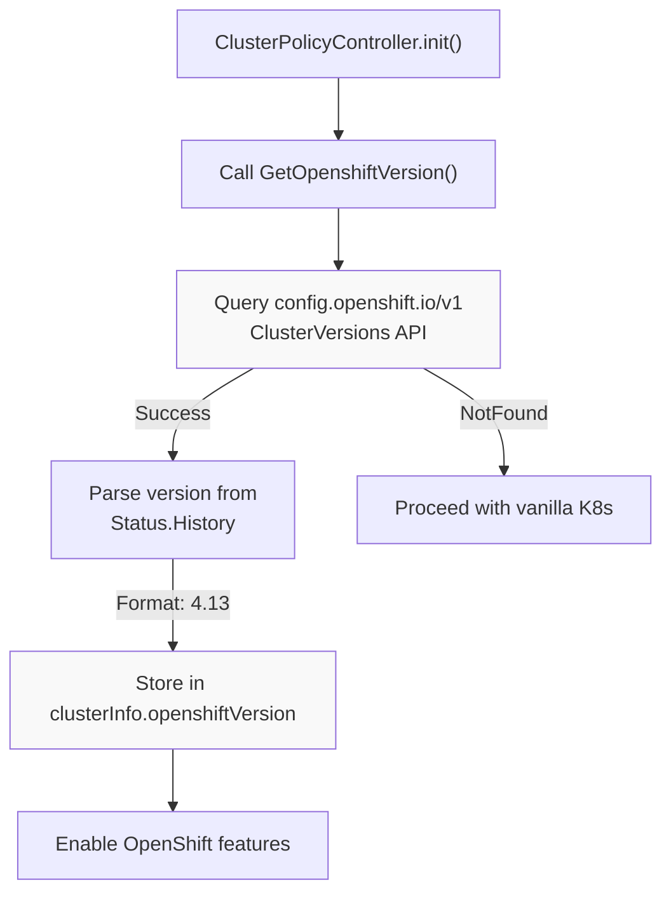
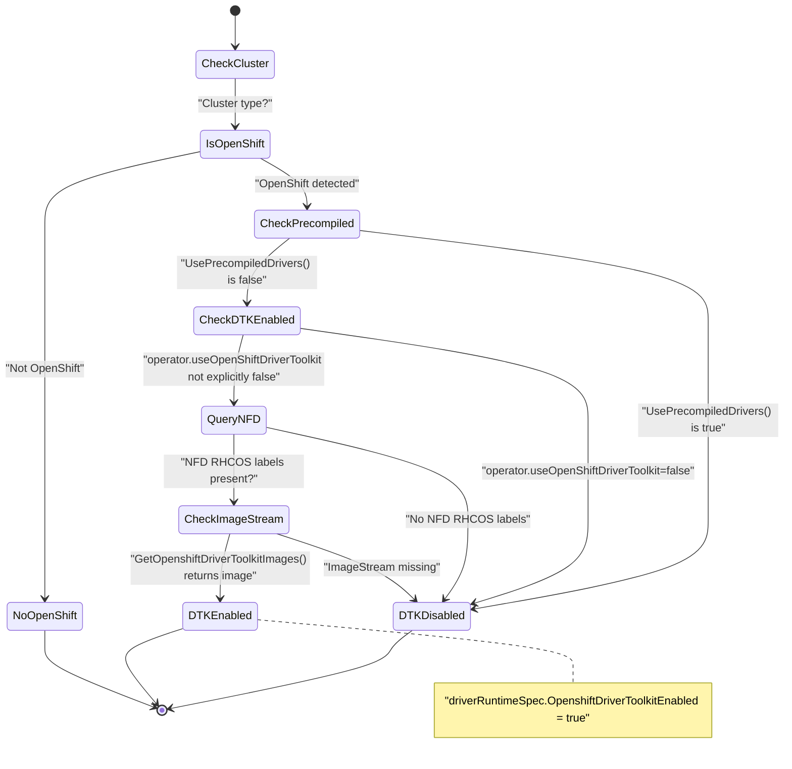
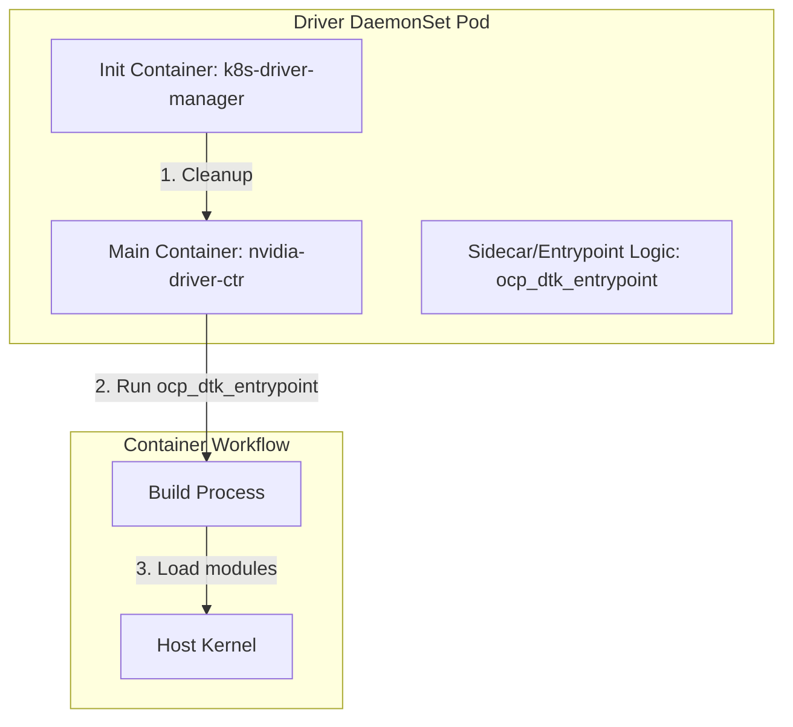
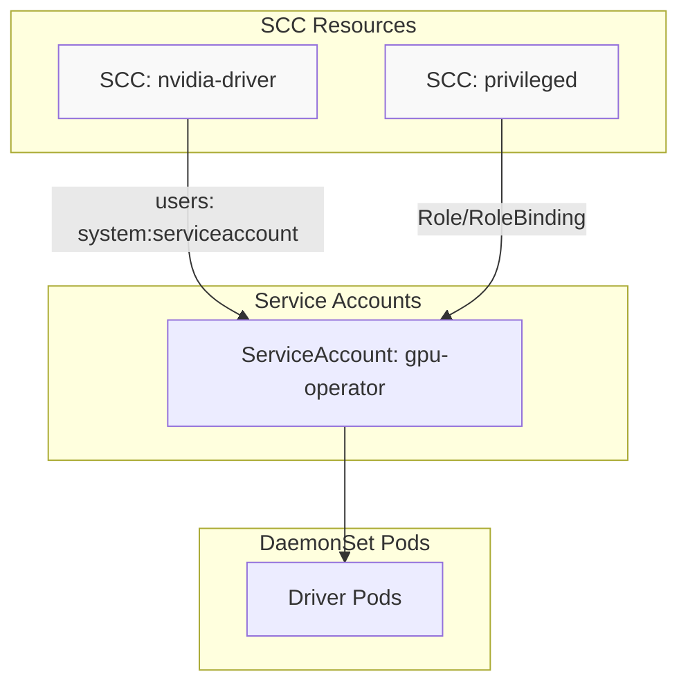
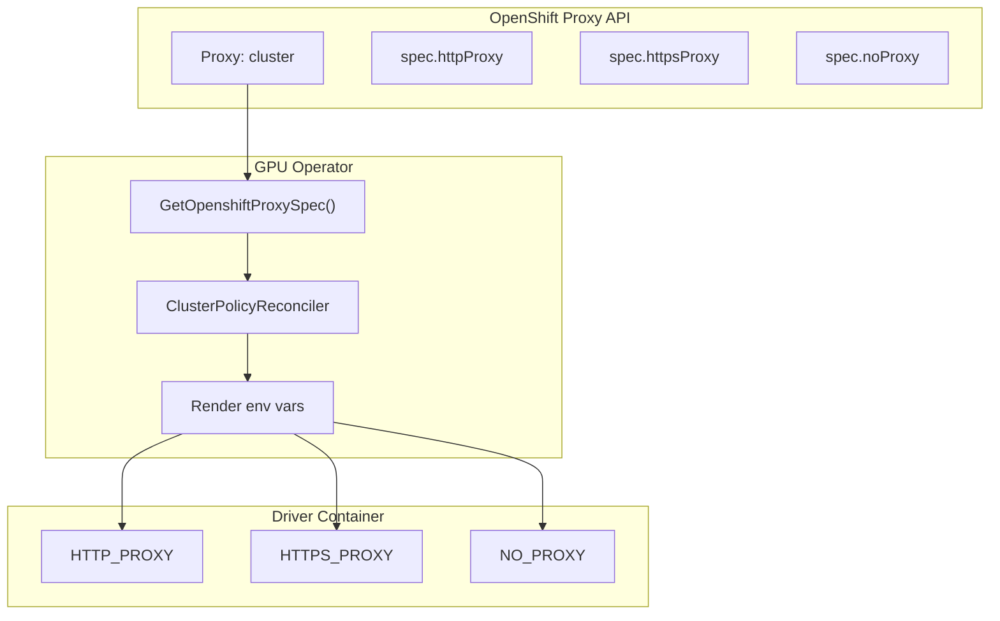

<!-- source: DeepWiki mcp.deepwiki.com · repo NVIDIA/gpu-operator · page 7.2 OpenShift Integration · fetched 2026-10-26 -->

# OpenShift Integration

<details>
<summary>Relevant source files</summary>

The following files were used as context for generating this wiki page:

- [controllers/clusterinfo/clusterinfo.go](controllers/clusterinfo/clusterinfo.go)
- [deployments/gpu-operator/templates/_helpers.tpl](deployments/gpu-operator/templates/_helpers.tpl)
- [deployments/gpu-operator/templates/operator.yaml](deployments/gpu-operator/templates/operator.yaml)
- [deployments/gpu-operator/templates/readonlyfs_scc.openshift.yaml](deployments/gpu-operator/templates/readonlyfs_scc.openshift.yaml)
- [deployments/gpu-operator/templates/role.yaml](deployments/gpu-operator/templates/role.yaml)
- [deployments/gpu-operator/templates/rolebinding.yaml](deployments/gpu-operator/templates/rolebinding.yaml)
- [deployments/gpu-operator/templates/serviceaccount.yaml](deployments/gpu-operator/templates/serviceaccount.yaml)
- [internal/consts/consts.go](internal/consts/consts.go)
- [internal/render/render.go](internal/render/render.go)
- [internal/state/driver.go](internal/state/driver.go)
- [internal/state/driver_test.go](internal/state/driver_test.go)
- [internal/state/driver_volumes.go](internal/state/driver_volumes.go)
- [internal/state/types.go](internal/state/types.go)
- [vendor/github.com/openshift/api/config/v1/types_cluster_version.go](vendor/github.com/openshift/api/config/v1/types_cluster_version.go)
- [vendor/github.com/openshift/api/config/v1/types_infrastructure.go](vendor/github.com/openshift/api/config/v1/types_infrastructure.go)
- [vendor/github.com/openshift/api/config/v1/zz_generated.deepcopy.go](vendor/github.com/openshift/api/config/v1/zz_generated.deepcopy.go)
- [vendor/github.com/openshift/api/config/v1/zz_generated.featuregated-crd-manifests.yaml](vendor/github.com/openshift/api/config/v1/zz_generated.featuregated-crd-manifests.yaml)
- [vendor/github.com/openshift/api/config/v1/zz_generated.swagger_doc_generated.go](vendor/github.com/openshift/api/config/v1/zz_generated.swagger_doc_generated.go)
- [vendor/github.com/openshift/api/config/v1alpha1/zz_generated.deepcopy.go](vendor/github.com/openshift/api/config/v1alpha1/zz_generated.deepcopy.go)
- [vendor/github.com/openshift/api/config/v1alpha1/zz_generated.swagger_doc_generated.go](vendor/github.com/openshift/api/config/v1alpha1/zz_generated.swagger_doc_generated.go)

</details>


## Purpose and Scope

This document describes OpenShift-specific features and integration points in the GPU Operator. OpenShift Container Platform (OCP) requires specialized handling for driver compilation, security policies, and cluster configuration that differs from standard Kubernetes deployments. The GPU Operator automatically detects OpenShift environments and enables these features accordingly.

For general deployment information, see [Helm Chart Deployment](). For driver upgrade mechanisms, see [Driver Upgrades]().

---

## OpenShift Detection and Version Retrieval

The GPU Operator automatically detects whether it is running on OpenShift by querying the `config.openshift.io/v1` API. This detection occurs during controller initialization and determines which platform-specific features to enable.

### Version Detection Process



**Version Detection Implementation**

The operator identifies the platform by checking for the presence of OpenShift-specific API groups. During `ClusterPolicyController` initialization, it attempts to retrieve the cluster version to set the `n.openshift` string field.

Key behaviors:
- `clusterinfo.GetOpenshiftVersion()` [controllers/clusterinfo/clusterinfo.go:133-141]() returns an empty string (`""`) if not running on OpenShift.
- It extracts the major.minor version (e.g., `"4.13"`) from completed history in the `ClusterVersion` resource [controllers/clusterinfo/clusterinfo.go:203-214]().
- The `openshiftVersion` field in `driverRuntimeSpec` [internal/state/driver.go:71]() is populated with this value.
- This detection is used to gate OpenShift-specific objects like `SecurityContextConstraints` in templates [internal/state/types.go:75]().

**Sources:** [controllers/clusterinfo/clusterinfo.go:133-141](), [controllers/clusterinfo/clusterinfo.go:203-214](), [internal/state/driver.go:71](), [internal/state/types.go:75]()

---

## OpenShift Driver Toolkit (DTK)

The OpenShift Driver Toolkit is a container image that provides the necessary kernel headers and build tools to compile NVIDIA drivers on-the-fly for specific Red Hat CoreOS (RHCOS) kernel versions. This eliminates the need for precompiled drivers and enables automatic driver compatibility with OpenShift cluster updates.

### When Driver Toolkit is Used



**Driver Toolkit Enablement Logic**

The operator enables DTK when all conditions are met:

1. **Running on OpenShift**: Detected via `clusterinfo.GetOpenshiftVersion()` [internal/state/driver_volumes.go:180-183]().
2. **Precompiled drivers disabled**: `cr.Spec.UsePrecompiledDrivers()` returns `false` [internal/state/driver_volumes.go:146]().
3. **NFD labels present**: GPU nodes have `feature.node.kubernetes.io/system-os_release.ID` and `feature.node.kubernetes.io/system-os_release.VERSION_ID` labels indicating RHCOS [internal/state/driver.go:52-54]().
4. **ImageStream exists**: The operator looks for the `openshift.driver-toolkit` identification value [internal/consts/consts.go:46]() using `clusterinfo.GetOpenshiftDriverToolkitImages()` [controllers/clusterinfo/clusterinfo.go:143-151]().

**Sources:** [internal/state/driver.go:52-54](), [internal/state/driver_volumes.go:146](), [internal/state/driver_volumes.go:180-183](), [internal/consts/consts.go:46](), [controllers/clusterinfo/clusterinfo.go:143-151]()

### DTK Container Architecture

When DTK is enabled, the operator modifies the driver DaemonSet to use the toolkit for module compilation.



**DTK Container Specification**

The driver container uses a specific entrypoint `ocp_dtk_entrypoint` when running on OpenShift with DTK enabled.

Key aspects:
- **RHCOS version**: Passed via `openshift.driver-toolkit.rhcos` label [internal/consts/consts.go:45]().
- **Privileged**: Required to load/unload kernel modules during build (`privileged: true`) [internal/state/driver_test.go:1200-1202]().
- **Labels**: DaemonSets are labeled with `openshift.driver-toolkit: "true"` [internal/consts/consts.go:46]().

**Sources:** [internal/consts/consts.go:45](), [internal/consts/consts.go:46](), [internal/state/driver_test.go:1200-1202]()

---

## SecurityContextConstraints (SCC)

OpenShift uses SecurityContextConstraints (SCC) to control pod security permissions. The GPU Operator creates dedicated SCCs or uses existing privileged SCCs for driver and other privileged components.

### SCC Architecture



**SCC Annotation on DaemonSets**

Driver DaemonSets are annotated to reference their SCC to ensure the correct policy is applied by the OpenShift admission controller. The `openshift.io/scc` annotation is applied to the metadata of the DaemonSet. The `readonlyfs_scc.openshift.yaml` template [deployments/gpu-operator/templates/readonlyfs_scc.openshift.yaml]() defines a specific SCC for the GPU Operator.

**Sources:** [deployments/gpu-operator/templates/readonlyfs_scc.openshift.yaml]()

---

## Proxy Configuration Support

OpenShift clusters often operate behind corporate proxies. The GPU Operator automatically propagates cluster-wide proxy settings to driver containers.

### Proxy Configuration Flow



**Proxy Environment Variable Injection**

Proxy settings are injected into driver containers as environment variables. This is crucial for environments where the driver must be downloaded or compiled using external repositories. The `driverRuntimeSpec.OpenshiftProxySpec` [internal/state/driver.go:72]() holds the proxy configuration retrieved via `clusterinfo.GetOpenshiftProxySpec()` [controllers/clusterinfo/clusterinfo.go:153-159]().

**Sources:** [internal/state/driver.go:72](), [controllers/clusterinfo/clusterinfo.go:153-159]()

---

## Namespace Configuration

The GPU Operator configures the operator namespace with OpenShift-specific labels for monitoring and security.

### Namespace Monitoring

On OpenShift, the operator enables cluster monitoring for the GPU operator namespace by applying the `openshift.io/cluster-monitoring=true` label. This is handled by the `clusterinfo.OpenshiftNamespace` constant [internal/consts/consts.go:43]().

**Sources:** [internal/consts/consts.go:43]()

---

## Upgrade Controller Compatibility

The automated driver upgrade controller (`UpgradeReconciler`) uses different label selectors on OpenShift when DTK is enabled.

**Upgrade Label Logic**

When DTK is enabled on OpenShift, the standard `app=nvidia-driver-daemonset` label is not constant because it can change based on the RHCOS version. In this scenario, the `UpgradeReconciler` switches to using the Driver Toolkit identification labels to select the managed nodes.

| Environment | Label Key | Label Value |
|-------------|-----------|-------------|
| Standard | `app` | `nvidia-driver-daemonset` |
| OpenShift + DTK | `openshift.driver-toolkit` | `true` |

**Sources:** [internal/consts/consts.go:46]()

---

## Configuration Summary

### Key Driver Rendering Data for OpenShift

The operator uses a set of internal flags and labels to manage OpenShift-specific state.

| Code Entity | Type | Description |
|-------------|-------------------|--------------------------------------------------------------------------------------------------------------------------------------------------------------------------------------------------------------------------------------------------------------------------------------------------------------------------------------------------------------------------------------------------------------------------------------------------------------------------------------------------------------------------------------------------------------------------------------------------------------------------------------------------------------------------------------------------------------------------------------------------------------------------------------------------------------------------------------------------------------------------------------------------------------------------------------------------------------------------------------------------------------------------------------------------------------------------------------------------------------------------------------------------------------------------------------------------------------------------------------------------------------------------------------------------------------------------------------------------------------------------------------------------------------------------------------------------------------------------------------------------------------------------------------------------------------------------------------------------------------------------------------------------------------------------------------------------------------------------------------------------------------------------------------------------------------------------------------------------------------------------------------------------------------------------------------------------------------------------------------------------------------------------------------------------------------------------------------------------------------------------------------------------------------------------------------------------------------------------------------------------------------------------------------------------------------------------------------------------------------------------------------------------------------------------------------------------------------------------------------------------------------------------------------------------------------------------------------------------------------------------------------------------------------------------------------------------------------------------------------------------------------------------------------------------------------------------------------------------------------------------------------------------------------------------------------------------------------------------------------------------------------------------------------------------------------------------------------------------------------------------------------------------------------------------------------------------------------------------------------------------------------------------------------------------------------------------------------------------------------------------------------------------------------------------------------------------------------------------------------------------------------------------------------------------------------------------------------------------------------------------------------------------------------------------------------------------------------------------------------------------------------------------------------------------------------------------------------------------------------------------------------------------------------------------------------------------------------------------------------------------------------------------------------------------------------------------------------------------------------------------------------------------------------------------------------------------------------------------------------------------------------------------------------------------------------------------------------------------------------------------------------------------------------------------------------------------------------------------------------------------------------------------------------------------------------------------------------------------------------------------------------------------------------------------------------------------------------------------------------------------------------------------------------------------------------------------------------------------------------------------------------------------------------------------------------------------------------------------------------------------------------------------------------------------------------------------------------------------------------------------------------------------------------------------------------------------------------------------------------------------------------------------------------------------------------------------------------------------------------------------------------------------------------------------------------------------------------------------------------------------------------------------------------------------------------------------------------------------------------------------------------------------------------------------------------------------------------------------------------------------------------------------------------------------------------------------------------------------------------------------------------------------------------------------------------------------------------------------------------------------------------------------------------------------------------------------------------------------------------------------------------------------------------------------------------------------------------------------------------------------------------------------------------------------------------------------------------------------------------------------------------------------------------------------------------------------------------------------------------------------------------------------------------------------------------------------------------------------------------------------------------------------------------------------------------------------------------------------------------------------------------------------------------------------------------------------------------------------------------------------------------------------------------------------------------------------------------------------------------------------------------------------------------------------------------------------------------------------------------------------------------------------------------------------------------------------------------------------------------------------------------------------------------------------------------------------------------------------------------------------------------------------------------------------------------------------------------------------------------------------------------------------------------------------------------------------------------------------------------------------------------------------------------------------------------------------------------------------------------------------------------------------------------------------------------------------------------------------------------------------------------------------------------------------------------------------------------------------------------------------------------------------------------------------------------------------------------------------------------------------------------------------------------------------------------------------------------------------------------------------------------------------------------------------------------------------------------------------------------------------------------------------------------------------------------------------------------------------------------------------------------------------------------------------------------------------------------------------------------------------------------------------------------------------------------------------------------------------------------------------------------------------------------------------------------------------------------------------------------------------------------------------------------------------------------------------------------------------------------------------------------------------------------------------------------------------------------------------------------------------------------------------------------------------------------------------------------------------------------------------------------------------------------------------------------------------------------------------------------------------------------------------------------------------------------------------------------------------------------------------------------------------------------------------------------------------------------------------------------------------------------------------------------------------------------------------------------------------------------------------------------------------------------------------------------------------------------------------------------------------------------------------------------------------------------------------------------------------------------------------------------------------------------------------------------------------------------------------------------------------------------------------------------------------------------------------------------------------------------------------------------------------------------------------------------------------------------------------------------------------------------------------------------------------------------------------------------------------------------------------------------------------------------------------------------------------------------------------------------------------------------------------------------------------------------------------------------------------------------------------------------------------------------------------------------------------------------------------------------------------------------------------------------------------------------------------------------------------------------------------------------------------------------------------------------------------------------------------------------------------------------------------------------------------------------------------------------------------------------------------------------------------------------------------------------------------------------------------------------------------------------------------------------------------------------------------------------------------------------------------------------------------------------------------------------------------------------------------------------------------------------------------------------------------------------------------------------------------------------------------------------------------------------------------------------------------------------------------------------------------------------------------------------------------------------------------------------------------------------------------------------------------------------------------------------------------------------------------------------------------------------------------------------------------------------------------------------------------------------------------------------------------------------------------------------------------------------------------------------------------------------------------------------------------------------------------------------------------------------------------------------------------------------------------------------------------------------------------------------------------------------------------------------------------------------------------------------------------------------------------------------------------------------------------------------------------------------------------------------------------------------------------------------------------------------------------------------------------------------------------------------------------------------------------------------------------------------------------------------------------------------------------------------------------------------------------------------------------------------------------------------------------------------------------------------------------------------------------------------------------------------------------------------------------------------------------------------------------------------------------------------------------------------------------------------------------------------------------------------------------------------------------------------------------------------------------------------------------------------------------------------------------------------------------------------------------------------------------------------------------------------------------------------------------------------------------------------------------------------------------------------------------------------------------------------------------------------------------------------------------------------------------------------------------------------------------------------------------------------------------------------------------------------------------------------------------------------------------------------------------------------------------------------------------------------------------------------------------------------------------------------------------------------------------------------------------------------------------------------------------------------------------------------------------------------------------------------------------------------------------------------------------------------------------------------------------------------------------------------------------------------------------------------------------------------------------------------------------------------------------------------------------------------------------------------------------------------------------------------------------------------------------------------------------------------------------------------------------------------------------------------------------------------------------------------------------------------------------------------------------------------------------------------------------------------------------------------------------------------------------------------------------------------------------------------------------------------------------------------------------------------------------------------------------------------------------------------------------------------------------------------------------------------------------------------------------------------------------------------------------------------------------------------------------------------------------------------------------------------------------------------------------------------------------------------------------------------------------------------------------------------------------------------------------------------------------------------------------------------------------------------------------------------------------------------------------------------------------------------------------------------------------------------------------------------------------------------------------------------------------------------------------------------------------------------------------------------------------------------------------------------------------------------------------------------------------------------------------------------------------------------------------------------------------------------------------------------------------------------------------------------------------------------------------------------------------------------------------------------------------------------------------------------------------------------------------------------------------------------------------------------------------------------------------------------------------------------------------------------------------------------------------------------------------------------------------------------------------------------------------------------------------------------------------------------------------------------------------------------------------------------------------------------------------------------------------------------------------------------------------------------------------------------------------------------------------------------------------------------------------------------------------------------------------------------------------------------------------------------------------------------------------------------------------------------------------------------------------------------------------------------------------------------------------------------------------------------------------------------------------------------------------------------------------------------------------------------------------------------------------------------------------------------------------------------------------------------------------------------------------------------------------------------------------------------------------------------------------------------------------------------------------------------------------------------------------------------------------------------------------------------------------------------------------------------------------------------------------------------------------------------------------------------------------------------------------------------------------------------------------------------------------------------------------------------------------------------------------------------------------------------------------------------------------------------------------------------------------------------------------------------------------------------------------------------------------------------------------------------------------------------------------------------------------------------------------------------------------------------------------------------------------------------------------------------------------------------------------------------------------------------------------------------------------------------------------------------------------------------------------------------------------------------------------------------------------------------------------------------------------------------------------------------------------------------------------------------------------------------------------------------------------------------------------------------------------------------------------------------------------------------------------------------------------------------------------------------------------------------------------------------------------------------------------------------------------------------------------------------------------------------------------------------------------------------------------------------------------------------------------------------------------------------------------------------------------------------------------------------------------------------------------------------------------------------------------------------------------------------------------------------------------------------------------------------------------------------------------------------------------------------------------------------------------------------------------------------------------------------------------------------------------------------------------------------------------------------------------------------------------------------------------------------------------------------------------------------------------------------------------------------------------------------------------------------------------------------------------------------------------------------------------------------------------------------------------------------------------------------------------------------------------------------------------------------------------------------------------------------------------------------------------------------------------------------------------------------------------------------------------------------------------------------------------------------------------------------------------------------------------------------------------------------------------------------------------------------------------------------------------------------------------------------------------------------------------------------------------------------------------------------------------------------------------------------------------------------------------------------------------------------------------------------------------------------------------------------------------------------------------------------------------------------------------------------------------------------------------------------------------------------------------------------------------------------------------------------------------------------------------------------------------------------------------------------------------------------------------------------------------------------------------------------------------------------------------------------------------------------------------------------------------------------------------------------------------------------------------------------------------------------------------------------------------------------------------------------------------------------------------------------------------------------------------------------------------------------------------------------------------------------------------------------------------------------------------------------------------------------------------------------------------------------------------------------------------------------------------------------------------------------------------------------------------------------------------------------------------------------------------------------------------------------------------------------------------------------------------------------------------------------------------------------------------------------------------------------------------------------------------------------------------------------------------------------------------------------------------------------------------------------------------------------------------------------------------------------------------------------------------------------------------------------------------------------------------------------------------------------------------------------------------------------------------------------------------------------------------------------------------------------------------------------------------------------------------------------------------------------------------------------------------------------------------------------------------------------------------------------------------------------------------------------------------------------------------------------------------------------------------------------------------------------------------------------------------------------------------------------------------------------------------------------------------------------------------------------------------------------------------------------------------------------------------------------------------------------------------------------------------------------------------------------------------------------------------------------------------------------------------------------------------------------------------------------------------------------------------------------------------------------------------------------------------------------------------------------------------------------------------------------------------------------------------------------------------------------------------------------------------------------------------------------------------------------------------------------------------------------------------------------------------------------------------------------------------------------------------------------------------------------------------------------------------------------------------------------------------------------------------------------------------------------------------------------------------------------------------------------------------------------------------------------------------------------------------------------------------------------------------------------------------------------------------------------------------------------------------------------------------------------------------------------------------------------------------------------------------------------------------------------------------------------------------------------------------------------------------------------------------------------------------------------------------------------------------------------------------------------------------------------------------------------------------------------------------------------------------------------------------------------------------------------------------------------------------------------------------------------------------------------------------------------------------------------------------------------------------------------------------------------------------------------------------------------------------------------------------------------------------------------------------------------------------------------------------------------------------------------------------------------------------------------------------------------------------------------------------------------------------------------------------------------------------------------------------------------------------------------------------------------------------------------------------------------------------------------------------------------------------------------------------------------------------------1. Overview — Introduce the NVIDIA GPU Operator, its purpose, high-level architecture, key components, and links to child pages for deeper exploration.
  1.1. Getting Started — Quick install via Helm, prerequisites (NFD, container runtime), the examples/ directory, and first ClusterPolicy deployment.
  1.2. Repository Layout — Map the directory structure: api/, controllers/, internal/, assets/, manifests/, deployments/, cmd/, bundle/, config/, tests/, and the binaries built from cmd/.
2. Architecture — Overview of the overall system architecture, control flow, and design patterns. Links to child pages for core concepts, component architecture, and the configuration/transformation system.
  2.1. Core Concepts — Explain controllers, state management, reconciliation loops, the State interface pattern (state_skel), conditions tracking, resource manager, and node info utilities.
  2.2. Component Architecture — Detail the layered component dependencies (driver, toolkit, device plugin, monitoring, etc.), the assets/ and manifests/ directory structure, and how each state maps to Kubernetes resources.
  2.3. Configuration and Transformation System — Explain how values.yaml flows through Helm templates, CRs, and the transformation functions in object_controls.go, plus the manifest renderer in internal/render.
3. Custom Resources — Overview of the Custom Resource Definitions that users interact with, linking to child pages for ClusterPolicy, NVIDIADriver, and GPUCluster.
  3.1. ClusterPolicy — Comprehensive reference for the ClusterPolicy CRD, the primary configuration API — all spec fields, status conditions, and usage examples.
  3.2. NVIDIADriver — Document the NVIDIADriver CRD for advanced driver configuration scenarios, node selectors, driver types, and status conditions.
  3.3. GPUCluster and ComputeDomain — Document the newer GPUCluster CRD and resource.nvidia.com ComputeDomain/ComputeDomainClique CRDs, the gpucluster_controller, cleanup-gpuclusters utility, and how GPUCluster relates to ClusterPolicy.
4. Components — Overview of each GPU Operator component, linking to child pages for driver management, toolkit, device plugin, MIG, monitoring, validation, GFD, and DRA.
  4.1. Driver Management — Explain NVIDIA driver deployment via DaemonSet, node pools, precompiled drivers, OpenShift Driver Toolkit, driver volumes, and the k8s-driver-manager init container.
  4.2. Container Toolkit — Document the NVIDIA Container Toolkit component for container runtime integration, CDI support, NRI plugin, and runtime configuration.
  4.3. Device Plugin — Explain the Kubernetes device plugin for GPU resource management and scheduling, MPS configuration, and device plugin config maps.
  4.4. MIG Manager — Document Multi-Instance GPU management, partitioning configurations, MIG strategies, and the MIG manager DaemonSet.
  4.5. Monitoring and DCGM — Explain DCGM integration, DCGM Exporter metrics collection, Prometheus ServiceMonitors, operator metrics, and OpenShift monitoring specifics.
  4.6. Validation — Document the operator validator and sandbox validator components, the nvidia-validator binary, CUDA workload validation, and node status exporter.
  4.7. GPU Feature Discovery — Explain GPU feature detection and node labeling via GFD DaemonSet, NodeFeatureRules, the nodelabeling controller, and integration with NFD.
  4.8. DRA Driver — Document the Dynamic Resource Allocation driver state: kubelet plugin DaemonSet, controller deployment, DeviceClasses (gpu, mig, compute-domains, vfio-gpu), ResourceSlices policy, and DRA validation.
5. Deployment — Overview of deploying the GPU Operator in different environments, linking to child pages for Helm and OLM deployment methods.
  5.1. Helm Chart Deployment — Document Helm-based installation, chart structure, values.yaml configuration, NFD sub-chart integration, RBAC templates, and CRD lifecycle hooks.
  5.2. OLM Bundle Deployment — Document the Operator Lifecycle Manager bundle, ClusterServiceVersion, bundle Dockerfile, config/ kustomize manifests, and OLM-based installation on OpenShift.
6. Development — Overview guide for developers working on the GPU Operator codebase, linking to child pages for build system, CI/CD, testing, and code generation.
  6.1. Build System — Explain the multi-stage Docker build, Makefiles (native-only.mk, multi-arch.mk), versions.mk version injection, vendored dependencies, and the manage-crds utility.
  6.2. CI/CD Pipelines — Document GitHub Actions and GitLab CI workflows, multi-arch image builds, security scanning, NGC publishing, Renovate/Dependabot, cherry-pick automation, and release processes.
  6.3. Testing — Explain unit tests, golden-file manifest tests, E2E tests (shell-based and Ginkgo-based), Holodeck infrastructure provisioning, and test execution scripts.
  6.4. Code Generation — Document controller-gen, client-gen, kustomize, manifest generation tooling, generated typed clientsets in api/versioned, and third-party notices generation.
7. Advanced Topics — Overview of advanced use cases and specialized configurations, linking to child pages for multi-arch, OpenShift, driver upgrades, heterogeneous clusters, and virtualization.
  7.1. Multi-Architecture Support — Explain ARM64 and AMD64 image builds, manifest list creation with regctl, cross-platform deployment, and multi-arch Makefile targets.
  7.2. OpenShift Integration — Document OpenShift-specific features including Driver Toolkit, SecurityContextConstraints, proxy support, OCP monitoring namespace, and version detection.
  7.3. Driver Upgrades — Explain automated driver upgrades, upgrade policies, node draining, the UpgradeReconciler, k8s-operator-libs integration, and zero-downtime strategies.
  7.4. Heterogeneous Clusters — Document node pools, per-OS/kernel driver deployment, precompiled driver support, and the nodepool logic for targeting different node configurations.
  7.5. Virtualization and Sandboxing — Explain vGPU, VFIO manager, sandbox workloads (KubeVirt/Kata), sandbox device plugin, Kata device plugin, CC Manager, and confidential computing support.
8. Troubleshooting — Common issues, debugging techniques, log collection via the must-gather script, NVAIE helper scripts, and diagnostic commands.
9. API Reference — Complete reference for all CRD fields, values.yaml options, configuration parameters, and the gpuop-cfg validation tool.
10. Glossary — Definitions of codebase-specific terms, jargon, abbreviations, and domain concepts an onboarding engineer needs, each with code pointers to relevant files, types, and functions.
```

---

