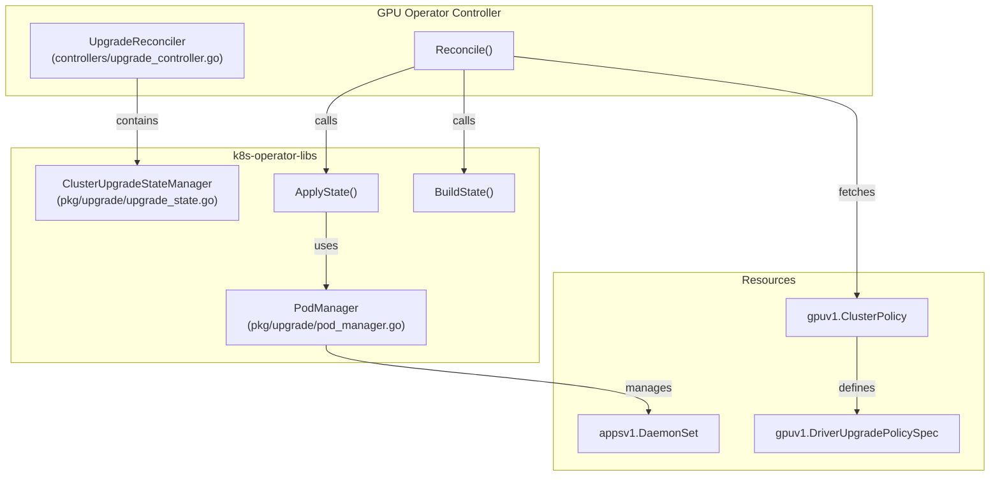

<!-- source: DeepWiki mcp.deepwiki.com · repo NVIDIA/gpu-operator · page 7.3 Driver Upgrades · fetched 2026-10-26 -->

# Driver Upgrades

<details>
<summary>Relevant source files</summary>

The following files were used as context for generating this wiki page:

- [api/nvidia/v1alpha1/nvidiadriver_types_test.go](api/nvidia/v1alpha1/nvidiadriver_types_test.go)
- [controllers/clusterpolicy_controller.go](controllers/clusterpolicy_controller.go)
- [controllers/nvidiadriver_controller.go](controllers/nvidiadriver_controller.go)
- [controllers/nvidiadriver_controller_test.go](controllers/nvidiadriver_controller_test.go)
- [controllers/upgrade_controller.go](controllers/upgrade_controller.go)
- [deployments/gpu-operator/templates/gpucluster.yaml](deployments/gpu-operator/templates/gpucluster.yaml)
- [internal/config/driver_config_digest.go](internal/config/driver_config_digest.go)
- [internal/config/driver_config_digest_test.go](internal/config/driver_config_digest_test.go)
- [internal/predicates/restart_only.go](internal/predicates/restart_only.go)
- [internal/predicates/restart_only_test.go](internal/predicates/restart_only_test.go)
- [internal/state/manager.go](internal/state/manager.go)
- [internal/state/metrics.go](internal/state/metrics.go)
- [internal/validator/validator.go](internal/validator/validator.go)
- [internal/validator/validator_suite_test.go](internal/validator/validator_suite_test.go)
- [internal/validator/validator_test.go](internal/validator/validator_test.go)
- [vendor/github.com/NVIDIA/k8s-operator-libs/pkg/upgrade/common_manager.go](vendor/github.com/NVIDIA/k8s-operator-libs/pkg/upgrade/common_manager.go)
- [vendor/github.com/NVIDIA/k8s-operator-libs/pkg/upgrade/consts.go](vendor/github.com/NVIDIA/k8s-operator-libs/pkg/upgrade/consts.go)
- [vendor/github.com/NVIDIA/k8s-operator-libs/pkg/upgrade/pod_manager.go](vendor/github.com/NVIDIA/k8s-operator-libs/pkg/upgrade/pod_manager.go)
- [vendor/github.com/NVIDIA/k8s-operator-libs/pkg/upgrade/upgrade_inplace.go](vendor/github.com/NVIDIA/k8s-operator-libs/pkg/upgrade/upgrade_inplace.go)
- [vendor/github.com/NVIDIA/k8s-operator-libs/pkg/upgrade/upgrade_state.go](vendor/github.com/NVIDIA/k8s-operator-libs/pkg/upgrade/upgrade_state.go)
- [vendor/github.com/NVIDIA/k8s-operator-libs/pkg/upgrade/util.go](vendor/github.com/NVIDIA/k8s-operator-libs/pkg/upgrade/util.go)

</details>


This document explains the automated driver upgrade functionality in the NVIDIA GPU Operator. It covers upgrade policies, orchestration strategies, node draining, the `UpgradeReconciler`, and integration with `k8s-operator-libs`.

## Overview

The GPU Operator supports automated driver upgrades through the `UpgradeReconciler` controller, which orchestrates rolling updates of driver DaemonSets across GPU nodes. The upgrade system provides fine-grained control over upgrade parallelism, workload disruption, and node draining to minimize impact on running GPU workloads.

Driver upgrades are triggered when:
- The driver version in `ClusterPolicy` or `NVIDIADriver` CR changes.
- Driver configuration parameters change (e.g., kernel module type).
- Driver image tags are updated, changing the controller revision hash [vendor/github.com/NVIDIA/k8s-operator-libs/pkg/upgrade/pod_manager.go:83-89]().

The upgrade system operates independently from Kubernetes' standard DaemonSet rolling update mechanism to provide enhanced control over GPU workload handling.

**Sources:** [controllers/upgrade_controller.go:52-57](), [vendor/github.com/NVIDIA/k8s-operator-libs/pkg/upgrade/pod_manager.go:83-89]()

## Upgrade Controller Architecture

The `UpgradeReconciler` uses the `ClusterUpgradeStateManager` from the `github.com/NVIDIA/k8s-operator-libs/pkg/upgrade` package to manage node upgrade states [controllers/upgrade_controller.go:52-57](). Each node progresses through a state machine, with states tracked via node labels formatted as `nvidia.com/<driver-name>-driver-upgrade-state` [vendor/github.com/NVIDIA/k8s-operator-libs/pkg/upgrade/consts.go:20-21]().

### Code Entity Mapping: Upgrade Reconciliation

The following diagram bridges the high-level upgrade logic to the specific code entities in the controller and the integration library.

Title: Upgrade Controller Entity Mapping

**Sources:** [controllers/upgrade_controller.go:52-57](), [controllers/upgrade_controller.go:88-103](), [vendor/github.com/NVIDIA/k8s-operator-libs/pkg/upgrade/upgrade_state.go:35-53](), [vendor/github.com/NVIDIA/k8s-operator-libs/pkg/upgrade/pod_manager.go:53-60]()

## Upgrade Workflow and State Management

The `UpgradeReconciler` progresses nodes through a state machine defined in `k8s-operator-libs`. The operator specifically manages the transition between detection and execution.

### State Transitions

1.  **Detection**: The controller fetches the `ClusterPolicy` and checks if `AutoUpgrade` is enabled [controllers/upgrade_controller.go:88-123]().
2.  **Label Selection**: It determines which driver pods to target. If using the `NVIDIADriver` CRD, it looks for `app.kubernetes.io/component=nvidia-driver` [controllers/upgrade_controller.go:135-138](). Otherwise, it defaults to `app=nvidia-driver-daemonset` [controllers/upgrade_controller.go:132-133]().
3.  **State Building**: The `StateManager.BuildState` function is called to assess the current cluster status and map pods to nodes [controllers/upgrade_controller.go:149-150]().
4.  **Parallelism Calculation**: It calculates `maxUnavailable` nodes based on the `ClusterPolicy` spec to ensure cluster stability during the rollout [controllers/upgrade_controller.go:160-167]().

Title: Driver Upgrade State Machine
```mermaid
stateDiagram-v2
    direction LR
    state "upgrade-required" as URQ
    state "cordon-required" as CRQ
    state "pod-deletion-required" as PDR
    state "drain-required" as DRQ
    state "pod-restart-required" as PRR
    state "validation-required" as VRQ
    state "uncordon-required" as UCR
    state "upgrade-done" as DONE

    [*] --> URQ: New Version Detected
    URQ --> CRQ: Start Upgrade
    CRQ --> PDR: Node Cordoned
    PDR --> DRQ: Pods Filtered
    DRQ --> PRR: Node Drained
    PRR --> VRQ: Driver Loaded
    VRQ --> UCR: Validation Passed
    UCR --> DONE: Node Uncordoned
    DONE --> [*]
    
    URQ --> "upgrade-failed": Error
```
**Sources:** [vendor/github.com/NVIDIA/k8s-operator-libs/pkg/upgrade/consts.go:49-82](), [controllers/upgrade_controller.go:115-127](), [controllers/upgrade_controller.go:160-167]()

## Implementation Details

### UpgradeReconciler Structure
The `UpgradeReconciler` holds a reference to the `ClusterUpgradeStateManager` which abstracts the heavy lifting of node state transitions [controllers/upgrade_controller.go:52-57]().

### Node Draining and Pod Eviction
The operator integrates with `k8s-operator-libs` to perform node draining via the `PodManager`. It specifically avoids draining pods with the label `nvidia.com/gpu-driver-upgrade-drain.skip!=true` [controllers/upgrade_controller.go:72](). The `PodManagerImpl.SchedulePodEviction` function [vendor/github.com/NVIDIA/k8s-operator-libs/pkg/upgrade/pod_manager.go:122-125]() uses a `PodDeletionFilter` [vendor/github.com/NVIDIA/k8s-operator-libs/pkg/upgrade/pod_manager.go:75-81]() to determine which pods to delete.

### Zero-Downtime Strategies
To achieve zero-downtime (or minimal impact), the operator:
1.  **Filters Pods**: Uses a `PodDeletionFilter` to determine which pods should be evicted during drain [vendor/github.com/NVIDIA/k8s-operator-libs/pkg/upgrade/pod_manager.go:75-81]().
2.  **MaxUnavailable**: Strictly respects the `MaxUnavailable` setting from `ClusterPolicy` to limit how many nodes are upgraded simultaneously [controllers/upgrade_controller.go:160-167]().
3.  **Validation**: Supports a `validation-required` state where the operator can wait for a validation pod to confirm driver health before proceeding [vendor/github.com/NVIDIA/k8s-operator-libs/pkg/upgrade/consts.go:74-76]().

### Driver DaemonSet Discovery Logic
The controller identifies driver DaemonSets using specific labels:
- `DriverLabelKey`: `app` [controllers/upgrade_controller.go:63]()
- `DriverLabelValue`: `nvidia-driver-daemonset` [controllers/upgrade_controller.go:65]()
- `AppComponentLabelKey`: `app.kubernetes.io/component` [controllers/upgrade_controller.go:69]()
- `AppComponentLabelValue`: `nvidia-driver` [controllers/upgrade_controller.go:71]()

**Sources:** [controllers/upgrade_controller.go:60-72](), [vendor/github.com/NVIDIA/k8s-operator-libs/pkg/upgrade/pod_manager.go:122-157]()

## Integration with NVIDIADriver CRD

When `useNvidiaDriverCRD` is enabled in `ClusterPolicy`, the `UpgradeReconciler` shifts its discovery logic to use the `app.kubernetes.io/component=nvidia-driver` label [controllers/upgrade_controller.go:135-138](). The `NVIDIADriverReconciler` is responsible for deploying these DaemonSets and ensuring they are correctly labeled for the upgrade controller [controllers/nvidiadriver_controller.go:124-132]().

The `NVIDIADriverReconciler` also includes a `nodeSelectorValidator` [controllers/nvidiadriver_controller.go:67]() to prevent multiple `NVIDIADriver` instances from targeting the same node or having conflicting node selectors [controllers/nvidiadriver_controller.go:149-161](). This ensures that only one driver is deployed per GPU node. The `Validate` method of `nodeSelectorValidator` checks for conflicts and multiple default drivers [internal/validator/validator.go:52-103]().

Title: Driver Resource Discovery Flow
```mermaid
graph LR
    subgraph "ClusterPolicy Configuration"
        CP["ClusterPolicy"]
        UP["UpgradePolicy"]
    end

    subgraph "Upgrade Controller Discovery"
        UR["UpgradeReconciler"]
        DS_Legacy["DS (app=nvidia-driver-daemonset)"]
        DS_New["DS (app.kubernetes.io/component=nvidia-driver)"]
    end

    subgraph "NVIDIADriver Management"
        NDR["NVIDIADriverReconciler"]
        NSV["nodeSelectorValidator"]
    end

    CP -- "contains" --> UP
    UR -- "watches" --> CP
    UR -- "targets (Legacy)" --> DS_Legacy
    UR -- "targets (NVIDIADriver CRD)" --> DS_New
    NDR -- "deploys" --> DS_New
    NDR -- "uses" --> NSV
    NSV -- "validates" --> "NVIDIADriver.spec.nodeSelector"
```
**Sources:** [controllers/upgrade_controller.go:129-147](), [controllers/nvidiadriver_controller.go:124-132](), [controllers/nvidiadriver_controller.go:149-161](), [internal/validator/validator.go:52-103]()

## Limitations

1.  **Sandbox Workloads**: Advanced driver upgrade policies are **not supported** when `sandboxWorkloads.enabled=true`. In this case, the controller removes node upgrade state labels and skips reconciliation [controllers/upgrade_controller.go:105-113]().
2.  **Manual Cleanup**: If `autoUpgrade` is disabled, the controller removes node upgrade state labels to prevent nodes from being stuck in a transitional state [controllers/upgrade_controller.go:115-123]().

**Sources:** [controllers/upgrade_controller.go:105-123]()

---

