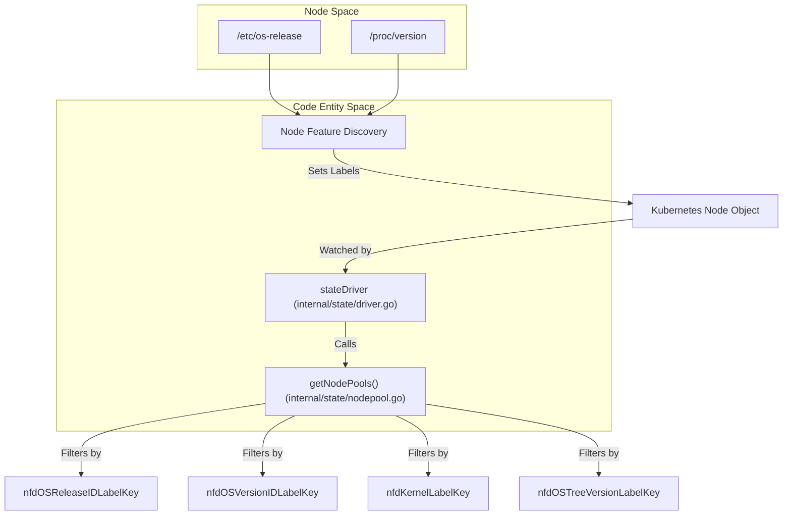
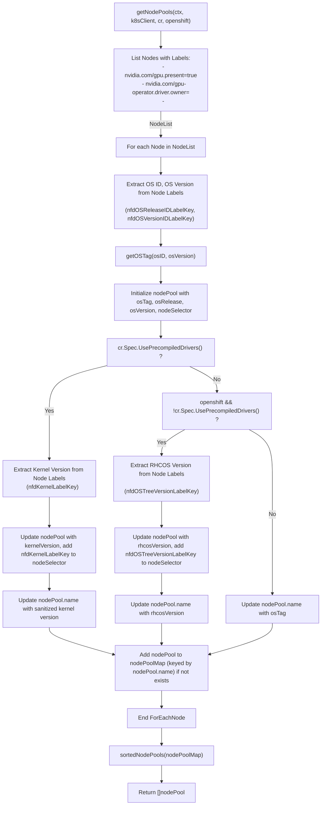

<!-- source: DeepWiki mcp.deepwiki.com · repo NVIDIA/gpu-operator · page 7.4 Heterogeneous Clusters · fetched 2026-10-26 -->

# Heterogeneous Clusters

<details>
<summary>Relevant source files</summary>

The following files were used as context for generating this wiki page:

- [controllers/clusterinfo/clusterinfo.go](controllers/clusterinfo/clusterinfo.go)
- [controllers/clusterinfo/clusterinfo_test.go](controllers/clusterinfo/clusterinfo_test.go)
- [controllers/state_manager_test.go](controllers/state_manager_test.go)
- [deployments/gpu-operator/templates/validations.yaml](deployments/gpu-operator/templates/validations.yaml)
- [internal/consts/consts.go](internal/consts/consts.go)
- [internal/render/render.go](internal/render/render.go)
- [internal/state/driver.go](internal/state/driver.go)
- [internal/state/driver_test.go](internal/state/driver_test.go)
- [internal/state/driver_volumes.go](internal/state/driver_volumes.go)
- [internal/state/nodepool.go](internal/state/nodepool.go)
- [internal/state/nodepool_test.go](internal/state/nodepool_test.go)
- [internal/state/types.go](internal/state/types.go)

</details>


This document explains how the NVIDIA GPU Operator manages heterogeneous Kubernetes clusters where nodes run different operating systems, OS versions, or kernel versions. In such environments, GPU drivers must be matched to each node's specific kernel version, requiring the operator to deploy multiple driver configurations simultaneously.

**Scope**: This page covers node pool detection, per-OS/kernel driver deployment, precompiled driver support, and OpenShift Driver Toolkit integration.

## Overview

A heterogeneous cluster contains GPU nodes with different:
- Operating systems (Ubuntu, RHEL, RHCOS, Rocky Linux, SLES)
- OS versions (Ubuntu 20.04, Ubuntu 22.04, RHEL 8, RHEL 9)
- Kernel versions (e.g., 5.4.0-150-generic)
- RHCOS versions in OpenShift (different OSTREE versions)

The GPU Operator addresses this by:
1. Using Node Feature Discovery (NFD) to label nodes with OS and kernel information [internal/state/driver.go:53-55]().
2. Grouping nodes into logical "node pools" based on these labels [internal/state/nodepool.go:50-100]().
3. Deploying one driver DaemonSet per node pool with appropriate driver images [internal/state/driver.go:134-167]().
4. Using node selectors to target each DaemonSet to its corresponding nodes [manifests/state-driver/0500_daemonset.yaml:71-85]().

**Sources**: [internal/state/driver.go:53-61](), [internal/state/driver.go:134-167](), [internal/state/nodepool.go:50-100](), [manifests/state-driver/0500_daemonset.yaml:71-85]()

## Node Feature Discovery Integration

The GPU Operator depends on Node Feature Discovery (NFD) to label nodes with system information. These labels are critical for identifying node pools.

### NFD Label Schema

NFD applies labels to nodes that the operator uses to identify node pools:

| Label | Purpose | Code Constant |
|-------|---------|---------------|
| `feature.node.kubernetes.io/system-os_release.ID` | OS distribution identifier | `nfdOSReleaseIDLabelKey` [internal/state/driver.go:54]() |
| `feature.node.kubernetes.io/system-os_release.VERSION_ID` | OS version | `nfdOSVersionIDLabelKey` [internal/state/driver.go:55]() |
| `feature.node.kubernetes.io/kernel-version.full` | Complete kernel version string | `nfdKernelLabelKey` [internal/state/nodepool.go:35]() |
| `feature.node.kubernetes.io/system-os_release.OSTREE_VERSION` | RHCOS version (OpenShift only) | `nfdOSTreeVersionLabelKey` [internal/state/nodepool.go:36]() |

**NFD Label Discovery Flow**



**Sources**: [internal/state/driver.go:53-55](), [internal/state/nodepool.go:35-36](), [internal/state/nodepool.go:50-100]()

## Node Pool Architecture

The operator groups nodes into "node pools" - logical groups of nodes that share the same OS, OS version, and optionally kernel version. Each node pool receives its own driver DaemonSet.

### Node Pool Data Structure

The `nodePool` struct (defined in `internal/state/nodepool.go`) represents a group of homogeneous nodes. The `stateDriver` uses this information to populate `driverRenderData` [internal/state/driver.go:91-101]().

```go
type driverRenderData struct {
	Driver            *driverSpec
	GDS               *gdsDriverSpec
	GPUDirectRDMA     *nvidiav1alpha1.GPUDirectRDMASpec
	GDRCopy           *gdrcopyDriverSpec
	Runtime           *driverRuntimeSpec
	Openshift         *openshiftSpec
	Precompiled       *precompiledSpec
	AdditionalConfigs *additionalConfigs
	HostRoot          string
}
```

**Sources**: [internal/state/driver.go:91-101](), [internal/state/nodepool.go:30-45]()

### Node Pool Detection Logic

The logic for grouping nodes resides in `getNodePools` [internal/state/nodepool.go:50-150](). It iterates through all nodes matching the `NVIDIADriver` node selector and creates unique pools based on:
1. OS ID and Version (`nfdOSReleaseIDLabelKey`, `nfdOSVersionIDLabelKey`).
2. Kernel Version (if `cr.Spec.UsePrecompiledDrivers()` is enabled, using `nfdKernelLabelKey`).
3. OSTREE Version (if on OpenShift and `cr.Spec.UsePrecompiledDrivers()` is disabled, using `nfdOSTreeVersionLabelKey`).



**Sources**: [internal/state/nodepool.go:50-150](), [internal/state/driver.go:266-280](), [internal/state/nodepool.go:162-172]()

## DaemonSet Per Node Pool

For each node pool, the operator renders and deploys a separate driver DaemonSet. This is handled in the `Sync` loop of the `stateDriver` [internal/state/driver.go:134-167]().

### DaemonSet Naming and Labels

The operator generates unique DaemonSet names using pool-specific information to avoid collisions. The `manifests/state-driver/0500_daemonset.yaml` template uses these values:

- **Name**: `{{ .Driver.AppName }}` (e.g., `nvidia-gpu-driver-ubuntu22.04-7c6d7bd86b`) [manifests/state-driver/0500_daemonset.yaml:26]()
- **Node Selector**:
  - `nvidia.com/gpu.deploy.driver: "true"` [manifests/state-driver/0500_daemonset.yaml:75]()
  - `feature.node.kubernetes.io/kernel-version.full: {{ .Precompiled.KernelVersion }}` (if precompiled) [manifests/state-driver/0500_daemonset.yaml:84]()
  - `feature.node.kubernetes.io/system-os_release.ID: {{ .NodeSelector["feature.node.kubernetes.io/system-os_release.ID"] }}` [manifests/state-driver/0500_daemonset.yaml:77]()
  - `feature.node.kubernetes.io/system-os_release.VERSION_ID.major: {{ .NodeSelector["feature.node.kubernetes.io/system-os_release.VERSION_ID.major"] }}` (for RHEL/Rocky/OL) [manifests/state-driver/0500_daemonset.yaml:80]()
  - `feature.node.kubernetes.io/system-os_release.VERSION_ID: {{ .NodeSelector["feature.node.kubernetes.io/system-os_release.VERSION_ID"] }}` (for other OSes) [manifests/state-driver/0500_daemonset.yaml:78]()
  - `feature.node.kubernetes.io/system-os_release.OSTREE_VERSION: {{ .NodeSelector["feature.node.kubernetes.io/system-os_release.OSTREE_VERSION"] }}` (for OpenShift RHCOS) [manifests/state-driver/0500_daemonset.yaml:81]()

**Sources**: [manifests/state-driver/0500_daemonset.yaml:5-32](), [manifests/state-driver/0500_daemonset.yaml:71-85](), [internal/state/driver.go:495-520](), [internal/state/testdata/golden/driver-minimal.yaml:144]()

### Config Digesting

To ensure DaemonSets restart when configuration changes, the operator computes a hash of the driver configuration using `ConfigDigest` [internal/state/driver.go:105-107]().

```go
func (d *driverRenderData) ConfigDigest() string {
	return utils.GetObjectHashIgnoreEmptyKeys(buildDriverInstallConfig(d))
}
```

This digest is injected as an environment variable `DRIVER_CONFIG_DIGEST` into the `k8s-driver-manager` and `nvidia-driver-ctr` containers [manifests/state-driver/0500_daemonset.yaml:165-166]().

**Sources**: [internal/state/driver.go:105-107](), [manifests/state-driver/0500_daemonset.yaml:165-166](), [internal/state/testdata/golden/driver-minimal.yaml:188]()

## Precompiled Driver Support

Precompiled drivers allow the operator to pull images containing pre-built kernel modules, skipping the compilation step on the node.

### Implementation Details

When `usePrecompiled` is true, the `stateDriver` populates the `precompiledSpec` with the node's kernel version [internal/state/driver.go:81-84]().

```go
type precompiledSpec struct {
	KernelVersion          string
	SanitizedKernelVersion string
}
```

The `SanitizedKernelVersion` is used in labels and image tags to ensure they are valid Kubernetes identifiers [manifests/state-driver/0500_daemonset.yaml:9]().

**Sources**: [internal/state/driver.go:81-84](), [manifests/state-driver/0500_daemonset.yaml:8-10](), [internal/state/testdata/golden/driver-precompiled.yaml:144]()

## OpenShift Driver Toolkit (DTK) Integration

In OpenShift environments, the operator can leverage the Driver Toolkit to build drivers.

### Logic Flow

1. **Detection**: The `stateDriver` checks `OpenshiftDriverToolkitEnabled` [internal/state/driver.go:72]().
2. **RHCOS Matching**: It matches the node's `OSTREE_VERSION` to a specific RHCOS version [manifests/state-driver/0500_daemonset.yaml:81]().
3. **Image Injection**: The `openshiftSpec` is populated with the `ToolkitImage` [internal/state/driver.go:77]().

The DaemonSet template configures the `nvidia-driver-ctr` to use the `ocp_dtk_entrypoint` [internal/state/testdata/golden/driver-openshift-drivertoolkit.yaml:231]().

**Sources**: [internal/state/driver.go:76-79](), [manifests/state-driver/0500_daemonset.yaml:48-53](), [internal/state/testdata/golden/driver-openshift-drivertoolkit.yaml:228-231]()

## Stale DaemonSet Cleanup

As nodes are added or removed, or as kernel versions change, node pools evolve. The `stateDriver` includes a cleanup mechanism to remove DaemonSets that no longer target any active nodes.

### `cleanupStaleDriverDaemonsets`

This function [internal/state/driver.go:186-210]() is called during the `stateDriver.Sync` operation [internal/state/driver.go:145-148](). It:
1. Builds a set of desired DaemonSet names from the objects rendered for the current node pools [internal/state/driver.go:191-196]().
2. Lists all DaemonSets owned by the `NVIDIADriver` CR [internal/state/driver.go:198-202]().
3. Iterates through the existing DaemonSets and deletes any that are not in the set of desired DaemonSets [internal/state/driver.go:204-209]().

**Sources**: [internal/state/driver.go:186-210](), [internal/state/driver.go:145-148]()

## Additional Configurations and Volumes

The operator mounts OS-specific repository and certificate paths to the driver container to allow it to fetch dependencies (e.g., `gcc`, `make`) when not using precompiled drivers.

### OS Path Mapping

The operator maintains maps for repository and certificate paths across supported distributions:

| OS | Repo Config Path | Cert Config Path |
|----|------------------|------------------|
| Ubuntu | `/etc/apt/sources.list.d` | `/usr/local/share/ca-certificates` |
| RHEL/RHCOS | `/etc/yum.repos.d` | `/etc/pki/ca-trust/extracted/pem` |
| SLES | `/etc/zypp/repos.d` | `/etc/pki/trust/anchors` |

These mappings are defined in `RepoConfigPathMap` and `CertConfigPathMap` [internal/state/driver_volumes.go:34-60](). The `getDriverAdditionalConfigs` function uses these maps to create `VolumeMounts` and `Volumes` for the driver DaemonSet [internal/state/driver_volumes.go:140-173]().

**Sources**: [internal/state/driver_volumes.go:34-60](), [internal/state/driver_volumes.go:140-173]()

## Implementation Summary Table

| Feature | Code Entity | File Path |
|---------|-------------|-----------|
| Node Pool Logic | `getNodePools` | [internal/state/nodepool.go:50-150]() |
| Driver Rendering | `stateDriver.Sync` | [internal/state/driver.go:134-167]() |
| Precompiled Support | `precompiledSpec` | [internal/state/driver.go:81-84]() |
| Cleanup Logic | `cleanupStaleDriverDaemonsets` | [internal/state/driver.go:186-210]() |
| DTK Integration | `openshiftSpec` | [internal/state/driver.go:76-79]() |
| Volume Mapping | `RepoConfigPathMap`, `CertConfigPathMap` | [internal/state/driver_volumes.go:34-60]() |

**Sources**: [internal/state/driver.go:1-210](), [internal/state/nodepool.go:1-150](), [internal/state/driver_volumes.go:1-171]()

---

