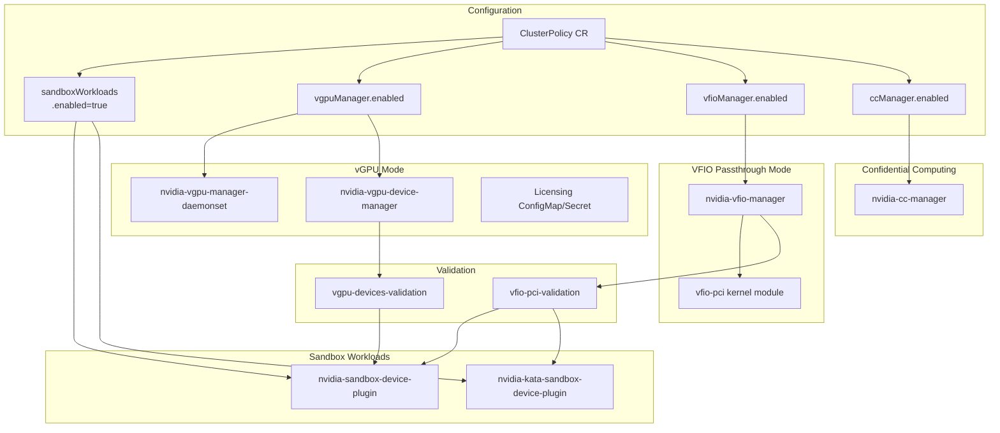
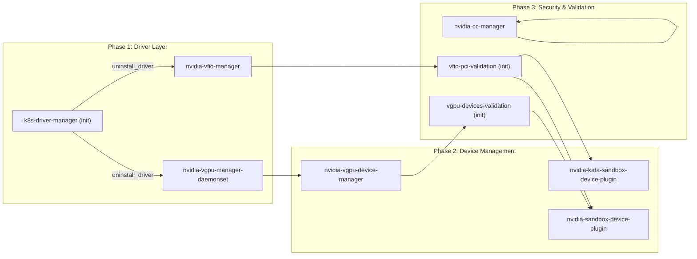

<!-- source: DeepWiki mcp.deepwiki.com · repo NVIDIA/gpu-operator · page 7.5 Virtualization and Sandboxing · fetched 2026-10-26 -->

# Virtualization and Sandboxing

<details>
<summary>Relevant source files</summary>

The following files were used as context for generating this wiki page:

- [assets/state-cc-manager/0100_service_account.yaml](assets/state-cc-manager/0100_service_account.yaml)
- [assets/state-cc-manager/0200_role.yaml](assets/state-cc-manager/0200_role.yaml)
- [assets/state-cc-manager/0210_clusterrole.yaml](assets/state-cc-manager/0210_clusterrole.yaml)
- [assets/state-cc-manager/0300_rolebinding.yaml](assets/state-cc-manager/0300_rolebinding.yaml)
- [assets/state-cc-manager/0310_clusterrolebinding.yaml](assets/state-cc-manager/0310_clusterrolebinding.yaml)
- [assets/state-cc-manager/0400_scc.openshift.yaml](assets/state-cc-manager/0400_scc.openshift.yaml)
- [assets/state-cc-manager/0500_daemonset.yaml](assets/state-cc-manager/0500_daemonset.yaml)
- [assets/state-kata-device-plugin/0100_service_account.yaml](assets/state-kata-device-plugin/0100_service_account.yaml)
- [assets/state-kata-device-plugin/0200_role.yaml](assets/state-kata-device-plugin/0200_role.yaml)
- [assets/state-kata-device-plugin/0210_clusterrole.yaml](assets/state-kata-device-plugin/0210_clusterrole.yaml)
- [assets/state-kata-device-plugin/0300_rolebinding.yaml](assets/state-kata-device-plugin/0300_rolebinding.yaml)
- [assets/state-kata-device-plugin/0310_clusterrolebinding.yaml](assets/state-kata-device-plugin/0310_clusterrolebinding.yaml)
- [assets/state-kata-device-plugin/0410_scc.openshift.yaml](assets/state-kata-device-plugin/0410_scc.openshift.yaml)
- [assets/state-kata-device-plugin/0500_daemonset.yaml](assets/state-kata-device-plugin/0500_daemonset.yaml)
- [assets/state-sandbox-device-plugin/0100_service_account.yaml](assets/state-sandbox-device-plugin/0100_service_account.yaml)
- [assets/state-sandbox-device-plugin/0200_role.yaml](assets/state-sandbox-device-plugin/0200_role.yaml)
- [assets/state-sandbox-device-plugin/0210_clusterrole.yaml](assets/state-sandbox-device-plugin/0210_clusterrole.yaml)
- [assets/state-sandbox-device-plugin/0300_rolebinding.yaml](assets/state-sandbox-device-plugin/0300_rolebinding.yaml)
- [assets/state-sandbox-device-plugin/0310_clusterrolebinding.yaml](assets/state-sandbox-device-plugin/0310_clusterrolebinding.yaml)
- [assets/state-sandbox-device-plugin/0410_scc.openshift.yaml](assets/state-sandbox-device-plugin/0410_scc.openshift.yaml)
- [assets/state-sandbox-device-plugin/0500_daemonset.yaml](assets/state-sandbox-device-plugin/0500_daemonset.yaml)
- [assets/state-vfio-manager/0400_scc.openshift.yaml](assets/state-vfio-manager/0400_scc.openshift.yaml)
- [assets/state-vfio-manager/0500_daemonset.yaml](assets/state-vfio-manager/0500_daemonset.yaml)
- [assets/state-vgpu-device-manager/0200_role.yaml](assets/state-vgpu-device-manager/0200_role.yaml)
- [assets/state-vgpu-device-manager/0210_clusterrole.yaml](assets/state-vgpu-device-manager/0210_clusterrole.yaml)
- [assets/state-vgpu-device-manager/0300_rolebinding.yaml](assets/state-vgpu-device-manager/0300_rolebinding.yaml)
- [assets/state-vgpu-device-manager/0500_configmap.yaml](assets/state-vgpu-device-manager/0500_configmap.yaml)
- [assets/state-vgpu-manager/0500_daemonset.yaml](assets/state-vgpu-manager/0500_daemonset.yaml)

</details>


## Purpose and Scope

This document explains how the NVIDIA GPU Operator supports virtualized GPU workloads and sandboxed containers. The operator provides three primary deployment modes for GPU access beyond standard bare-metal containers: **vGPU** (NVIDIA virtual GPU technology for VMs), **VFIO passthrough** (direct GPU assignment to VMs), and **sandboxed containers** (GPU support for Kata Containers and KubeVirt). This page covers the architecture, components, and configuration for these deployment scenarios.

For standard bare-metal GPU driver deployment, see [Driver Management](#4.1). For Multi-Instance GPU partitioning, see [MIG Manager](#4.4). For confidential computing features that often accompany virtualization, see the CC Manager section below.

---

## Architecture Overview

The GPU Operator supports distinct virtualization and sandboxing modes, each with dedicated components managed via the `ClusterPolicy` controller.

### Component Relationship Diagram



**Sources:**
- [assets/state-sandbox-device-plugin/0500_daemonset.yaml:1-99]()
- [assets/state-vgpu-manager/0500_daemonset.yaml:1-164]()
- [assets/state-vfio-manager/0500_daemonset.yaml:1-107]()
- [assets/state-cc-manager/0500_daemonset.yaml:1-65]()
- [assets/state-kata-device-plugin/0500_daemonset.yaml:1-82]()

---

## Component Deployment Flow

The following diagram bridges the high-level virtualization modes to the specific code-defined DaemonSets and their initialization dependencies.



**Sources:**
- [assets/state-vgpu-manager/0500_daemonset.yaml:33-37]()
- [assets/state-vfio-manager/0500_daemonset.yaml:26-30]()
- [assets/state-sandbox-device-plugin/0500_daemonset.yaml:28-50]()
- [assets/state-kata-device-plugin/0500_daemonset.yaml:28-34]()

---

## vGPU Support

### Overview

NVIDIA vGPU technology enables GPU sharing across virtual machines. The Operator manages the host-side requirements for vGPU.

| Component | Purpose | DaemonSet Name |
|-----------|---------|----------------|
| **vGPU Manager** | Installs the vGPU host driver | `nvidia-vgpu-manager-daemonset` |
| **vGPU Device Manager** | Creates vGPU mediated devices (mdevs) | `nvidia-vgpu-device-manager` |

### vGPU Manager

The vGPU Manager replaces the standard NVIDIA driver with the vGPU host driver. It includes a `k8s-driver-manager` init container to ensure clean uninstallation of any existing drivers [assets/state-vgpu-manager/0500_daemonset.yaml:33-37](). The DaemonSet is deployed to nodes with the label `nvidia.com/gpu.deploy.vgpu-manager: "true"` [assets/state-vgpu-manager/0500_daemonset.yaml:22]().

**Implementation Details:**
- **OpenShift Driver Toolkit:** Supports building drivers on RHCOS via the `openshift-driver-toolkit-ctr` sidecar [assets/state-vgpu-manager/0500_daemonset.yaml:95-103]().
- **Firmware Pathing:** Specifically mounts `/sys/module/firmware_class/parameters/path` to ensure the host can locate GSP firmware [assets/state-vgpu-manager/0500_daemonset.yaml:90-91]().
- **Host Privileges:** Requires `hostPID: true` and `hostIPC: true` for host-level driver interaction [assets/state-vgpu-manager/0500_daemonset.yaml:30-31]().
- **Volume Mounts:** Utilizes `run-nvidia` for shared state, `host-os-release` for OS detection, `vfio` for VFIO devices, `cgroup` for cgroup access, and `var-log`/`dev-log` for logging [assets/state-vgpu-manager/0500_daemonset.yaml:77-94]().

**Sources:**
- [assets/state-vgpu-manager/0500_daemonset.yaml:1-164]()
- [internal/state/testdata/golden/driver-vgpu-host-manager.yaml:134-237]()

### vGPU Device Manager

The vGPU Device Manager creates mediated devices based on a provided configuration. The Operator provides a `default-vgpu-devices-config` ConfigMap containing vGPU profiles for hardware like A10, A16, A30, A40, and A100 [assets/state-vgpu-device-manager/0500_configmap.yaml:1-270](). This ConfigMap defines the available vGPU types and their quantities per physical GPU.

**Example Config Structure:**
```yaml
vgpu-configs:
    A10-4Q:
        - devices: all
          vgpu-devices:
            A10-4Q: 6
```
[assets/state-vgpu-device-manager/0500_configmap.yaml:82-85]()

**Sources:**
- [assets/state-vgpu-device-manager/0500_configmap.yaml:1-254]()
- [assets/state-vgpu-device-manager/0210_clusterrole.yaml:1-21]()

---

## VFIO Manager

The VFIO Manager prepares GPUs for direct passthrough to VMs (KubeVirt) or Kata Containers by binding them to the `vfio-pci` driver. The `nvidia-vfio-manager` DaemonSet is deployed to nodes labeled `nvidia.com/gpu.deploy.vfio-manager: "true"` [assets/state-vfio-manager/0500_daemonset.yaml:22]().

**Key Operations:**
- **Driver Uninstallation:** An `initContainer` named `k8s-driver-manager` is used to `uninstall_driver` before the VFIO manager starts, ensuring no conflicts with existing NVIDIA drivers [assets/state-vfio-manager/0500_daemonset.yaml:26-30]().
- **Binding:** The main container executes `vfio-manage bind --all` on startup to detach GPUs from the NVIDIA driver and attach them to VFIO [assets/state-vfio-manager/0500_daemonset.yaml:65](). This command is part of the `vfio-manage` utility.
- **Unbinding:** A `preStop` lifecycle hook runs `vfio-manage unbind --all`, returning GPUs to host control before the container terminates [assets/state-vfio-manager/0500_daemonset.yaml:88-90]().
- **Dependencies:** Requires access to host `/lib/modules` to load the `vfio-pci` module [assets/state-vfio-manager/0500_daemonset.yaml:78-79]() and `/sys` for system-level operations [assets/state-vfio-manager/0500_daemonset.yaml:76-77]().

**Sources:**
- [assets/state-vfio-manager/0500_daemonset.yaml:1-107]()

---

## Sandbox Workloads

### Sandbox Device Plugin

The `nvidia-sandbox-device-plugin` is responsible for exposing GPUs to virtualized workloads, such as those managed by KubeVirt. It is deployed as a DaemonSet to nodes with the label `nvidia.com/gpu.deploy.sandbox-device-plugin: "true"` [assets/state-sandbox-device-plugin/0500_daemonset.yaml:20](). The plugin requires privileged access and mounts `/var/lib/kubelet/device-plugins` to register with Kubelet [assets/state-sandbox-device-plugin/0500_daemonset.yaml:78-79]().

**Validation Logic:**
The plugin uses two init containers to ensure the host is ready for the specific virtualization type:
1. `vfio-pci-validation`: For `vm-passthrough` workloads, it waits for the existence of `/run/nvidia/validations/vfio-pci-ready`, indicating the VFIO manager has prepared the devices [assets/state-sandbox-device-plugin/0500_daemonset.yaml:28-34]().
2. `vgpu-devices-validation`: For `vm-vgpu` workloads, it waits for `/run/nvidia/validations/vgpu-devices-ready`, signaling that vGPU mediated devices are available [assets/state-sandbox-device-plugin/0500_daemonset.yaml:44-50]().
These init containers ensure the device plugin only starts advertising resources when the underlying GPU virtualization setup is complete.

**Sources:**
- [assets/state-sandbox-device-plugin/0500_daemonset.yaml:1-99]()
- [assets/state-sandbox-device-plugin/0200_role.yaml:1-34]()
- [assets/state-sandbox-device-plugin/0210_clusterrole.yaml:1-19]()
- [assets/state-sandbox-device-plugin/0410_scc.openshift.yaml:1-47]()

### Kata Device Plugin

The `nvidia-kata-sandbox-device-plugin` is a specialized variant designed for Kata Containers. It is deployed as a DaemonSet to nodes labeled `nvidia.com/gpu.deploy.kata-sandbox-device-plugin: "true"` [assets/state-kata-device-plugin/0500_daemonset.yaml:20]().

- **CDI Integration:** It mounts `/var/run/cdi` to support Container Device Interface (CDI), which allows Kata Containers to manage device injection into the guest VM [assets/state-kata-device-plugin/0500_daemonset.yaml:69-70]().
- **Validation:** Similar to the generic sandbox device plugin, it includes a `vfio-pci-validation` init container that waits for `vfio-pci-ready` if the workload type is `vm-passthrough` [assets/state-kata-device-plugin/0500_daemonset.yaml:28-34](). This ensures that GPUs are properly bound to the VFIO driver before being exposed to Kata workloads.

**Sources:**
- [assets/state-kata-device-plugin/0500_daemonset.yaml:1-82]()

---

## Confidential Computing Support

### CC Manager

The `nvidia-cc-manager` manages NVIDIA Confidential Computing (CC) settings on GPUs. It is deployed as a DaemonSet on nodes where `nvidia.com/gpu.deploy.cc-manager: "true"` is set [assets/state-cc-manager/0500_daemonset.yaml:22]().

**Key Functions:**
- **Environment Interaction:** The container runs with privileged access and mounts `/sys` and `/run/nvidia` [assets/state-cc-manager/0500_daemonset.yaml:44-47](). This allows it to interact with kernel modules and system files to configure CC modes (e.g., "on", "off", or "devtools") on the hardware.
- **Cleanup:** A `preStop` hook is defined to execute `/bin/rm -f /run/nvidia/validations/.cc-manager-ctr-ready` [assets/state-cc-manager/0500_daemonset.yaml:52-55](). This signals that the CC manager is shutting down and CC features may no longer be actively managed.

**Sources:**
- [assets/state-cc-manager/0500_daemonset.yaml:1-65]()
- [assets/state-cc-manager/0200_role.yaml:1-22]()
- [assets/state-cc-manager/0210_clusterrole.yaml:1-14]()

---

## Validation Summary

Virtualization components utilize a file-based signaling mechanism within the `/run/nvidia/validations/` directory to coordinate between driver setup and device plugin availability. This ensures that dependent components only start once their prerequisites are met.

| Validation File | Producing Component | Consuming Component | Purpose |
|-----------------|---------------------|---------------------|---------|
| `vfio-pci-ready` | `nvidia-vfio-manager` | `nvidia-sandbox-device-plugin`, `nvidia-kata-sandbox-device-plugin` | Signals that GPUs are bound to the `vfio-pci` driver. |
| `vgpu-devices-ready` | `nvidia-vgpu-device-manager` | `nvidia-sandbox-device-plugin` | Indicates that vGPU mediated devices have been successfully created. |
| `.cc-manager-ctr-ready` | `nvidia-cc-manager` | Validator / Monitoring | Signals that the Confidential Computing Manager is active and ready. |

**Sources:**
- [assets/state-sandbox-device-plugin/0500_daemonset.yaml:34-50]()
- [assets/state-kata-device-plugin/0500_daemonset.yaml:34]()
- [assets/state-cc-manager/0500_daemonset.yaml:55]()

---

