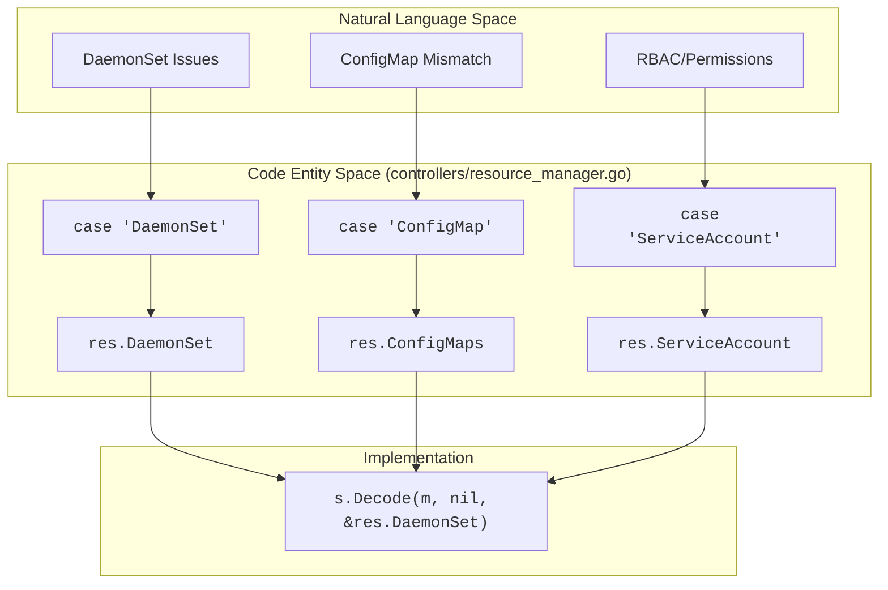
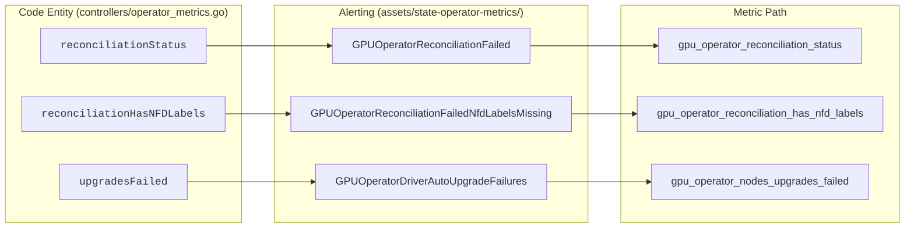

<!-- source: DeepWiki mcp.deepwiki.com · repo NVIDIA/gpu-operator · page 8 Troubleshooting · fetched 2026-10-26 -->

# Troubleshooting

<details>
<summary>Relevant source files</summary>

The following files were used as context for generating this wiki page:

- [hack/must-gather.sh](hack/must-gather.sh)
- [scripts/gpu-operator-nvaie.sh](scripts/gpu-operator-nvaie.sh)
- [tests/cases/experimental-runtime.sh](tests/cases/experimental-runtime.sh)
- [tests/scripts/checks.sh](tests/scripts/checks.sh)
- [tests/scripts/cleanup.sh](tests/scripts/cleanup.sh)
- [tests/scripts/end-to-end.sh](tests/scripts/end-to-end.sh)
- [tests/scripts/install-workload.sh](tests/scripts/install-workload.sh)
- [tests/scripts/launch.sh](tests/scripts/launch.sh)
- [tests/scripts/prerequisites.sh](tests/scripts/prerequisites.sh)
- [tests/scripts/uninstall-operator.sh](tests/scripts/uninstall-operator.sh)
- [tests/scripts/uninstall-workload.sh](tests/scripts/uninstall-workload.sh)
- [tests/scripts/update-clusterpolicy.sh](tests/scripts/update-clusterpolicy.sh)
- [tests/scripts/update-nvidiadriver.sh](tests/scripts/update-nvidiadriver.sh)
- [tests/scripts/verify-disable-operands.sh](tests/scripts/verify-disable-operands.sh)
- [tests/scripts/verify-operand-restarts.sh](tests/scripts/verify-operand-restarts.sh)
- [tests/scripts/verify-operator.sh](tests/scripts/verify-operator.sh)

</details>


This document provides guidance for diagnosing and resolving common issues with the NVIDIA GPU Operator. It covers component state verification, debugging techniques, log collection procedures, and the use of the operator's built-in observability features.

## Diagnostic Commands and Log Collection

### The Must-Gather Script
The GPU Operator includes a comprehensive `must-gather.sh` script used to collect all relevant cluster state, logs, and resource definitions for troubleshooting. This script is the primary tool for diagnostic data collection.

**Functionality of `must-gather.sh`**:
- **Tool Detection**: Detects if running on OpenShift or standard Kubernetes by checking for `kubectl` or `oc` [hack/must-gather.sh:6-14]().
- **Resource Collection**: Collects `ClusterPolicy` and `NVIDIADriver` custom resources [hack/must-gather.sh:94-117](). It also gathers `GPUCluster` resources [hack/must-gather.sh:125-132](), and Dynamic Resource Allocation (DRA) resources like `DeviceClass` and `ResourceSlice` [hack/must-gather.sh:141-168]().
- **Node Identification**: Identifies nodes with NVIDIA PCI devices using NFD labels such as `feature.node.kubernetes.io/pci-10de.present` [hack/must-gather.sh:183-187]().
- **Log Capture**: Captures logs for the operator pod and all operand pods (Driver, Toolkit, Device Plugin, etc.), including previous logs if they crashed [hack/must-gather.sh:232-411]().
- **Virtualization Context**: Inspects KubeVirt and HyperConverged resources if present [hack/must-gather.sh:52-87]().

**Execution**:
```bash
# Run locally (requires kubectl/oc access)
./hack/must-gather.sh

# The script creates an artifact directory (default: /tmp/nvidia-gpu-operator_<timestamp>)
# and populates it with .log, .yaml, and .status files.
```

**Sources**: [hack/must-gather.sh:1-411]()

### Operator Metrics and Alerts
The operator exposes detailed Prometheus metrics via the `OperatorMetrics` struct [controllers/operator_metrics.go:29-50](). These metrics are used to trigger alerts defined in `PrometheusRule` manifests.

| Metric Name | Description | Alert Condition |
| :--- | :--- | :--- |
| `gpu_operator_reconciliation_status` | `1` for success, negative values for errors [controllers/operator_metrics.go:85-95]() | `GPUOperatorReconciliationFailed` [assets/state-operator-metrics/0400_prometheus_rule_openshift.yaml:12-24]() |
| `gpu_operator_reconciliation_has_nfd_labels` | `1` if mandatory kernel labels are found [controllers/operator_metrics.go:110-116]() | `GPUOperatorReconciliationFailedNfdLabelsMissing` [assets/state-operator-metrics/0400_prometheus_rule_openshift.yaml:26-43]() |
| `gpu_operator_openshift_driver_toolkit_enabled` | Status of OCP Driver Toolkit integration [controllers/operator_metrics.go:118-123]() | `GPUOperatorOpenshiftDriverToolkitEnabledImageStreamMissing` [assets/state-operator-metrics/0400_prometheus_rule_openshift.yaml:59-72]() |
| `gpu_operator_nodes_upgrades_failed` | Count of nodes where driver upgrade failed [controllers/operator_metrics.go:174-179]() | `GPUOperatorDriverAutoUpgradeFailures` [assets/state-operator-metrics/0400_prometheus_rule_openshift.yaml:104-116]() |

**Sources**: [controllers/operator_metrics.go:29-194](), [assets/state-operator-metrics/0400_prometheus_rule_openshift.yaml:1-116]()

---

## Common Troubleshooting Scenarios

### 1. NVIDIADriver Node Selector Conflicts
The operator validates that multiple `NVIDIADriver` resources do not target the same node.

**Diagnosis**:
- Check operator logs for validation errors from `nodeSelectorValidator` [internal/validator/validator.go:36-38]().
- The `Validate` function lists all `NVIDIADriver` instances and checks for overlapping node sets [internal/validator/validator.go:47-72]().

**Fix**:
- Ensure the `spec.nodeSelector` in each `NVIDIADriver` CR is mutually exclusive [internal/validator/validator.go:82-90]().

**Sources**: [internal/validator/validator.go:31-90]()

### 2. Node Deployment Failures
The `nvidia-node-status-exporter` (part of the validator component) exports per-node health metrics [assets/state-node-status-exporter/0700_daemonset.yaml:31-38]().

**Alerts to Monitor**:
- **`GPUOperatorNodeDeploymentDriverFailed`**: The driver validation test failed on a specific node [assets/state-node-status-exporter/0800_prometheus_rule_openshift.yaml:25-38]().
- **`GPUOperatorNodeDeploymentToolkitFailed`**: Driver is working, but the container toolkit is not ready [assets/state-node-status-exporter/0800_prometheus_rule_openshift.yaml:39-56]().
- **`GPUOperatorNodeDeploymentCudaFailed`**: CUDA applications cannot run on the node [assets/state-node-status-exporter/0800_prometheus_rule_openshift.yaml:57-73]().

**Sources**: [assets/state-node-status-exporter/0700_daemonset.yaml:1-67](), [assets/state-node-status-exporter/0800_prometheus_rule_openshift.yaml:1-73]()

### 3. Pod Readiness and Restarts
The `tests/scripts/checks.sh` script provides utility functions to verify the readiness and restart counts of pods, which are useful for debugging deployment issues.

**Diagnosis**:
- Use `check_pod_ready "pod-label"` to wait for a pod or DaemonSet to reach a ready state [tests/scripts/checks.sh:3-36]().
- Use `check_pod_deleted "pod-label"` to confirm a pod or DaemonSet has been removed [tests/scripts/checks.sh:38-67]().
- Use `check_no_restarts "pod-label"` to detect if a pod is repeatedly restarting [tests/scripts/checks.sh:70-80](). This is also used for driver pods specifically via `check_no_driver_pod_restarts` [tests/scripts/checks.sh:192-195]().

**Example Usage**:
The `verify-operator.sh` script uses these checks to ensure all core GPU Operator components are running correctly after installation [tests/scripts/verify-operator.sh:14-24](). Similarly, `verify-disable-operands.sh` confirms their deletion [tests/scripts/verify-disable-operands.sh:14-21]().

**Sources**:
- [tests/scripts/checks.sh:1-279]()
- [tests/scripts/verify-operator.sh:1-24]()
- [tests/scripts/verify-disable-operands.sh:1-21]()
- [tests/scripts/verify-operand-restarts.sh:1-23]()

---

## Code Entity to Natural Language Mapping

The following diagrams bridge troubleshooting concepts to specific code entities and resource managers.

### Resource Reconciliation Mapping
This diagram shows how the `ClusterPolicyController` uses `addResourcesControls` to load and manage different Kubernetes resource types during troubleshooting.



**Sources**: [controllers/resource_manager.go:47-64](), [controllers/resource_manager.go:113-187]()

### Metric Collection Flow
This diagram associates the internal `OperatorMetrics` struct fields with the Prometheus alerts that notify administrators of issues.



**Sources**: [controllers/operator_metrics.go:33-47](), [assets/state-operator-metrics/0400_prometheus_rule_openshift.yaml:12-116]()

---

## Advanced Debugging

### Asset Loading Errors
The operator loads manifests from the filesystem. If a component fails to deploy, verify the asset path logic:
- The operator walks the directory specified in `path` [controllers/resource_manager.go:66-79]().
- It filters for OpenShift-specific manifests if `openshiftVersion` is detected [controllers/resource_manager.go:89-91]().
- It uses a `json.NewSerializer` to decode YAML assets into Go structs [controllers/resource_manager.go:109-110]().

**Sources**: [controllers/resource_manager.go:66-110]()

### Node Status Exporter RBAC
If the `nvidia-node-status-exporter` cannot report metrics, check its RBAC permissions:
- It requires `get` and `list` on `pods` [assets/state-node-status-exporter/0200_role.yaml:17-21]().
- It requires `get`, `list`, and `watch` on `daemonsets` to track operand health [assets/state-node-status-exporter/0200_role.yaml:22-29]().
- On OpenShift, it must be granted the `use` verb for `securitycontextconstraints` [assets/state-node-status-exporter/0200_role.yaml:9-14]().

**Sources**: [assets/state-node-status-exporter/0200_role.yaml:1-29]()

### NVAIE Helper Scripts
The `scripts/gpu-operator-nvaie.sh` script provides helper functions for installing and managing the GPU Operator with NVIDIA AI Enterprise (NVAIE) vGPU drivers. This script handles specific configurations related to private registries, licensing, and custom driver naming.

**Key Functions**:
- `create_operator_namespace`: Ensures the target namespace exists [scripts/gpu-operator-nvaie.sh:51-57]().
- `apply_psa_labels`: Applies Pod Security Admission (PSA) labels to the namespace [scripts/gpu-operator-nvaie.sh:59-62]().
- `create_nls_config`: Creates a Kubernetes secret for NVIDIA License System (NLS) licensing, requiring a `client_configuration_token.tok` file [scripts/gpu-operator-nvaie.sh:64-76]().
- `create_ngc_secret`: Creates a Docker registry secret for pulling images from NGC (NVIDIA GPU Cloud) using an API key [scripts/gpu-operator-nvaie.sh:78-89]().
- `install_operator`: Installs or upgrades the GPU Operator Helm chart with NVAIE-specific settings, including private registry, driver image, version, and image pull secrets [scripts/gpu-operator-nvaie.sh:125-141]().

**Prerequisites**:
- Environment variables: `NGC_API_KEY`, `NGC_USER_EMAIL`, `VGPU_DRIVER_VERSION`, `NVAIE_VERSION`, `PRIVATE_REGISTRY` [scripts/gpu-operator-nvaie.sh:32-41]().
- NLS licensing token file `client_configuration_token.tok` in the current directory [scripts/gpu-operator-nvaie.sh:64-68]().

**Sources**: [scripts/gpu-operator-nvaie.sh:1-172]()

---

