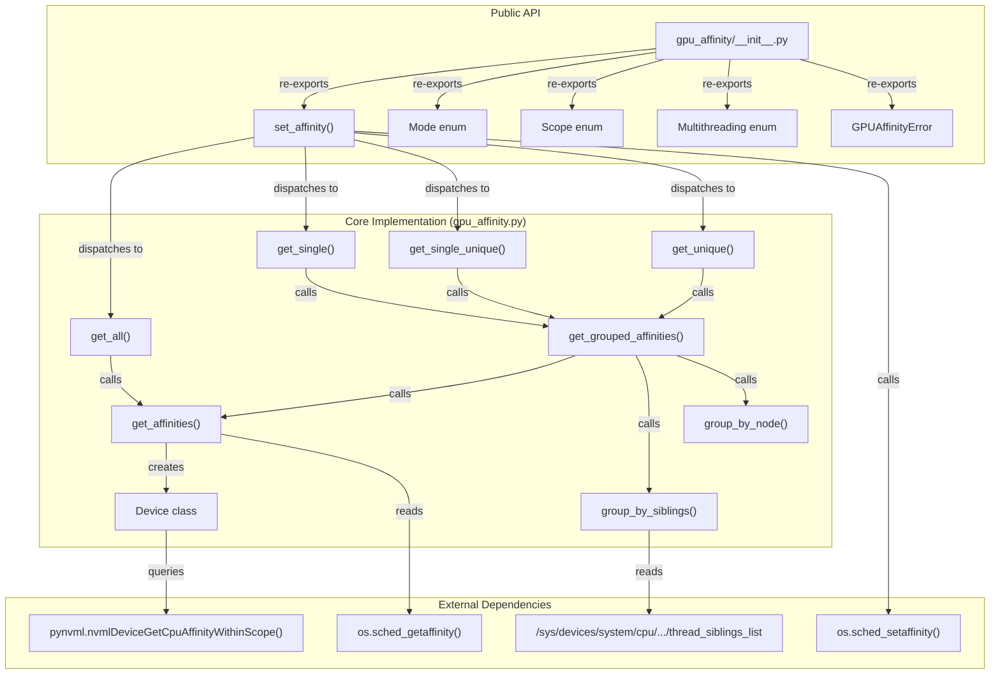
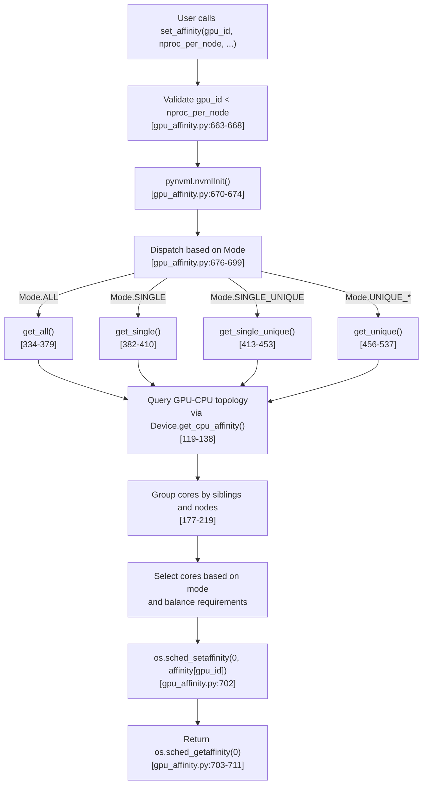

<!-- source: DeepWiki mcp.deepwiki.com · repo NVIDIA/gpu_affinity · page 1 Overview · fetched 2026-10-26 -->

# Overview

Relevant source files

The following files were used as context for generating this wiki page:

- [README.md](README.md)
- [gpu_affinity/__init__.py](gpu_affinity/__init__.py)
- [gpu_affinity/gpu_affinity.py](gpu_affinity/gpu_affinity.py)

This document introduces the `gpu_affinity` repository, describing its purpose, architecture, and intended use cases. The repository provides a Python package for automatically setting CPU process affinity to optimize performance in multi-GPU training workloads.

For detailed information about specific affinity modes and configuration strategies, see [Affinity Modes and Strategies](#2.2). For practical usage examples and integration patterns, see [Usage Examples](#3).

## Purpose and Scope

The `gpu_affinity` package solves a specific problem in multi-GPU deep learning workloads: automatically assigning CPU cores to GPU-bound processes in a way that matches the underlying hardware topology. The package is designed for multi-process single-device training scenarios, where multiple training processes each run on a single GPU (e.g., PyTorch's `DistributedDataParallel`).

The core functionality is exposed through a single function `set_affinity()` defined in [gpu_affinity/gpu_affinity.py:540-711](), which queries hardware topology using NVIDIA's Management Library (pynvml) and applies CPU affinity using OS-level system calls.

**Sources:** [README.md:1-23](), [gpu_affinity/gpu_affinity.py:540-662]()

## Problem Statement

In multi-GPU systems, improper CPU affinity can lead to performance degradation due to:

- Remote NUMA node memory access when a process runs on CPU cores not directly connected to its assigned GPU
- Unnecessary cache coherency traffic across CPU sockets
- Imbalanced workload distribution when some processes receive more CPU cores than others
- Suboptimal memory bandwidth utilization

The `gpu_affinity` package addresses these issues by:

1. Querying the GPU-to-CPU topology from NVML
2. Respecting external restrictions (from `taskset`, `docker --cpuset-cpus`, or `CUDA_VISIBLE_DEVICES`)
3. Handling hyperthreading siblings correctly
4. Ensuring balanced core distribution across processes

**Sources:** [README.md:1-23](), [gpu_affinity/gpu_affinity.py:551-631]()

## Architecture Overview

The following diagram shows the relationship between the main components in the codebase and their dependencies:

**Sources:** [gpu_affinity/__init__.py:15-19](), [gpu_affinity/gpu_affinity.py:540-711](), [gpu_affinity/gpu_affinity.py:300-313]()

## Key Components

### Public API

The public API is exposed through [gpu_affinity/__init__.py]() and consists of:

| Component | Type | Location | Purpose |
|-----------|------|----------|---------|
| `set_affinity()` | Function | [gpu_affinity/gpu_affinity.py:540-711]() | Main entry point for setting CPU affinity |
| `Mode` | Enum | [gpu_affinity/gpu_affinity.py:37-42]() | Defines affinity assignment modes (`ALL`, `SINGLE`, `SINGLE_UNIQUE`, `UNIQUE_INTERLEAVED`, `UNIQUE_CONTIGUOUS`) |
| `Scope` | Enum | [gpu_affinity/gpu_affinity.py:45-47]() | Defines NVML query scope (`NODE`, `SOCKET`) |
| `Multithreading` | Enum | [gpu_affinity/gpu_affinity.py:50-52]() | Controls hyperthreading behavior (`ALL_LOGICAL`, `SINGLE_LOGICAL`) |
| `GPUAffinityError` | Exception | [gpu_affinity/gpu_affinity.py:28-29]() | Exception raised for affinity-related errors |

**Sources:** [gpu_affinity/__init__.py:15-19](), [gpu_affinity/gpu_affinity.py:28-52]()

### Core Implementation Classes

#### Device Class

The `Device` class ([gpu_affinity/gpu_affinity.py:55-138]()) encapsulates interactions with a single GPU through NVML. It handles:

- Device index resolution, including `CUDA_VISIBLE_DEVICES` remapping ([gpu_affinity/gpu_affinity.py:64-105]())
- UUID-based device identification ([gpu_affinity/gpu_affinity.py:77-105]())
- CPU affinity queries via `nvmlDeviceGetCpuAffinityWithinScope()` ([gpu_affinity/gpu_affinity.py:119-138]())

**Sources:** [gpu_affinity/gpu_affinity.py:55-138]()

#### Affinity Mode Functions

The package implements five distinct affinity modes, each with a corresponding function:

| Mode | Function | Lines | Description |
|------|----------|-------|-------------|
| `ALL` | `get_all()` | [334-379]() | Assigns all available physical cores |
| `SINGLE` | `get_single()` | [382-410]() | Assigns first available core (may overlap) |
| `SINGLE_UNIQUE` | `get_single_unique()` | [413-453]() | Assigns single unique core per process |
| `UNIQUE_CONTIGUOUS` | `get_unique()` | [456-537]() | Assigns unique contiguous core ranges |
| `UNIQUE_INTERLEAVED` | `get_unique()` | [456-537]() | Assigns unique interleaved core sets |

**Sources:** [gpu_affinity/gpu_affinity.py:334-537]()

### Topology Query and Grouping Functions

The implementation uses several helper functions to query and organize CPU topology:

| Function | Location | Purpose |
|----------|----------|---------|
| `get_thread_siblings_list()` | [141-157]() | Reads hyperthreading sibling pairs from `/sys/devices/system/cpu/` |
| `group_by_siblings()` | [177-185]() | Groups CPU cores by hyperthreading siblings |
| `group_by_node()` | [188-219]() | Groups cores by NUMA node affinity |
| `get_affinities()` | [300-313]() | Retrieves CPU affinity for all GPUs with specified scope |
| `get_grouped_affinities()` | [316-331]() | Returns nested groupings by socket/node and siblings |

**Sources:** [gpu_affinity/gpu_affinity.py:141-331]()

## Main Workflow

The following diagram illustrates the execution flow when `set_affinity()` is called:

**Sources:** [gpu_affinity/gpu_affinity.py:540-711](), [gpu_affinity/gpu_affinity.py:119-138](), [gpu_affinity/gpu_affinity.py:177-219]()

## Typical Usage Context

The package is designed to be called once per process at the beginning of execution, after command-line argument parsing but before CUDA context creation. The typical integration pattern is:

1. Parse command-line arguments to get local rank (process GPU assignment)
2. Determine total number of GPUs per node via `torch.cuda.device_count()`
3. Call `set_affinity(local_rank, nproc_per_node)`
4. Proceed with model initialization and training

The function returns a set of logical CPU cores on which the process is eligible to run after affinity has been set.

**Sources:** [README.md:41-51](), [README.md:148-177](), [gpu_affinity/gpu_affinity.py:633-662]()

## Environment Considerations

The package interacts with several environment variables and system constraints:

| Environment Variable | Effect | Handled By |
|---------------------|--------|------------|
| `CUDA_VISIBLE_DEVICES` | Restricts visible GPUs; package remaps device indices accordingly | [Device.__init__:64-105]() |
| `KMP_AFFINITY` | Intel OpenMP may reset affinity after fork; recommended to set to `disabled` | Documentation warning ([gpu_affinity.py:627-631]()) |
| `taskset` / `docker --cpuset-cpus` | Restricts available CPU cores; package respects via `os.sched_getaffinity(0)` | [get_affinities:304-309]() |

**Sources:** [gpu_affinity/gpu_affinity.py:64-105](), [gpu_affinity/gpu_affinity.py:304-309](), [gpu_affinity/gpu_affinity.py:627-631]()

## Dependencies

The package depends on:

1. **pynvml** - Python bindings for NVIDIA Management Library, used for GPU-CPU topology queries
2. **Standard library modules**: `os`, `pathlib`, `collections`, `enum`, `itertools`, `operator`, `re`, `typing`
3. **Operating system**: Linux with `/sys/devices/system/cpu/` filesystem and `sched_setaffinity()`/`sched_getaffinity()` support

**Sources:** [gpu_affinity/gpu_affinity.py:15-23](), [README.md:1-23]()

---

