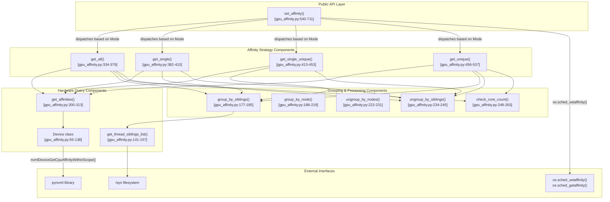
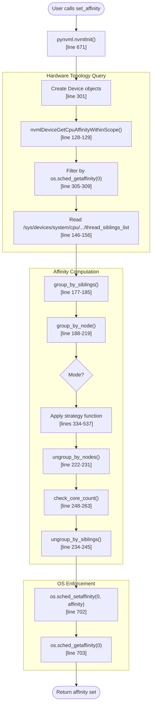
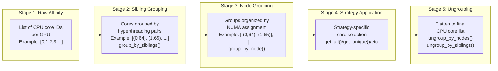
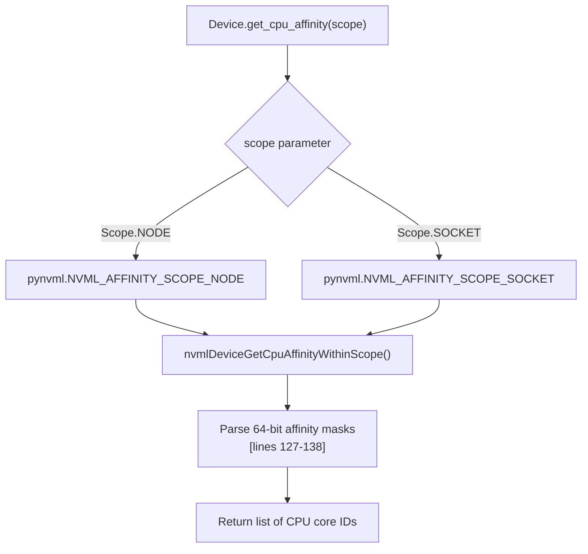

<!-- source: DeepWiki mcp.deepwiki.com · repo NVIDIA/gpu_affinity · page 1.1 System Architecture · fetched 2026-10-26 -->

# System Architecture

Relevant source files

The following files were used as context for generating this wiki page:

- [README.md](README.md)
- [gpu_affinity/gpu_affinity.py](gpu_affinity/gpu_affinity.py)

This document describes the high-level system architecture of the `gpu_affinity` package, including its major components, their relationships, and the data flows that occur when setting CPU affinity for GPU workloads. For detailed API documentation, see [API Reference](#2.1). For information about the different affinity modes and strategies, see [Affinity Modes and Strategies](#2.2).

## Overview

The `gpu_affinity` system is designed around a single primary entry point (`set_affinity`) that orchestrates a multi-stage process to determine and apply optimal CPU core assignments for GPU workloads. The architecture consists of three logical layers:

1. **Hardware Query Layer** - Interfaces with NVIDIA Management Library (pynvml) and OS topology APIs
2. **Affinity Computation Layer** - Processes hardware topology data and applies affinity strategies
3. **OS Enforcement Layer** - Sets CPU affinity using OS-level system calls

The system is implemented primarily in a single module ([gpu_affinity/gpu_affinity.py:1-712]()) with a clean separation of concerns between hardware querying, affinity calculation, and affinity enforcement.

**Sources:** [gpu_affinity/gpu_affinity.py:1-712](), [README.md:1-179]()

## Component Architecture

The following diagram maps the system's logical components to their implementations in code:

**Sources:** [gpu_affinity/gpu_affinity.py:55-711]()

## Core Components

### Device Class

The `Device` class ([gpu_affinity/gpu_affinity.py:55-138]()) encapsulates interactions with individual GPUs through the NVIDIA Management Library. It handles:

- **Device Indexing** - Resolves logical GPU IDs to physical device handles, respecting `CUDA_VISIBLE_DEVICES` environment variable ([gpu_affinity/gpu_affinity.py:63-106]())
- **UUID Resolution** - Supports both integer indices and UUID string prefixes for device identification ([gpu_affinity/gpu_affinity.py:76-105]())
- **Affinity Queries** - Retrieves CPU affinity recommendations from NVML with configurable scope (NODE or SOCKET) ([gpu_affinity/gpu_affinity.py:119-138]())

### Enumeration Types

The system defines three enumeration types that control affinity behavior:

| Enum Class | Purpose | Values | Location |
|------------|---------|--------|----------|
| `Mode` | Defines affinity distribution strategy | `ALL`, `SINGLE`, `SINGLE_UNIQUE`, `UNIQUE_INTERLEAVED`, `UNIQUE_CONTIGUOUS` | [gpu_affinity/gpu_affinity.py:37-42]() |
| `Scope` | Controls NVML affinity query scope | `NODE`, `SOCKET` | [gpu_affinity/gpu_affinity.py:45-47]() |
| `Multithreading` | Controls hyperthreading sibling inclusion | `ALL_LOGICAL`, `SINGLE_LOGICAL` | [gpu_affinity/gpu_affinity.py:50-52]() |

**Sources:** [gpu_affinity/gpu_affinity.py:32-52]()

### Affinity Strategy Functions

Each `Mode` value corresponds to a specific strategy function that computes CPU core assignments:

| Function | Mode | Strategy |
|----------|------|----------|
| `get_all()` | `Mode.ALL` | Assigns all recommended cores to each process |
| `get_single()` | `Mode.SINGLE` | Assigns first recommended core (may be shared) |
| `get_single_unique()` | `Mode.SINGLE_UNIQUE` | Assigns one unique core per process |
| `get_unique()` | `Mode.UNIQUE_CONTIGUOUS` / `Mode.UNIQUE_INTERLEAVED` | Distributes unique subsets of cores |

**Sources:** [gpu_affinity/gpu_affinity.py:334-537]()

## Data Flow and Processing Pipeline

The following diagram illustrates the data flow from hardware topology queries through affinity computation to OS enforcement:

**Sources:** [gpu_affinity/gpu_affinity.py:540-711](), [gpu_affinity/gpu_affinity.py:300-313](), [gpu_affinity/gpu_affinity.py:141-157]()

## Multi-Stage Grouping Architecture

The affinity computation employs a hierarchical grouping strategy to handle hardware topology complexity:

This multi-stage approach ensures that:
1. Hyperthreading siblings are kept together or separated based on `Multithreading` setting
2. NUMA locality is preserved when distributing cores
3. Balanced distribution is achieved across GPUs sharing the same NUMA node

**Sources:** [gpu_affinity/gpu_affinity.py:177-245](), [gpu_affinity/gpu_affinity.py:188-219]()

## Hardware Topology Integration

The system integrates with two primary hardware topology information sources:

### NVML Integration

The `Device.get_cpu_affinity()` method ([gpu_affinity/gpu_affinity.py:119-138]()) queries NVML for GPU-specific CPU recommendations:

The affinity data from NVML is returned as an array of 64-bit integers ([gpu_affinity/gpu_affinity.py:56-61]()), which are converted to a list of CPU core indices.

**Sources:** [gpu_affinity/gpu_affinity.py:55-138]()

### Sysfs Integration

The `get_thread_siblings_list()` function ([gpu_affinity/gpu_affinity.py:141-157]()) reads hyperthreading topology from the Linux sysfs filesystem:

- **Path Pattern**: `/sys/devices/system/cpu/cpu*/topology/thread_siblings_list`
- **Content Format**: Comma-separated core pairs (e.g., "0,64")
- **Parsing**: Regular expression extracts integer pairs ([gpu_affinity/gpu_affinity.py:148-155]())
- **Output**: List of 2-tuples representing hyperthreading sibling pairs

**Sources:** [gpu_affinity/gpu_affinity.py:141-157]()

## Error Handling and Validation

The system implements multiple validation checkpoints:

### Input Validation

- **GPU ID bounds check**: Ensures `gpu_id < nproc_per_node` ([gpu_affinity/gpu_affinity.py:663-668]())
- **CUDA_VISIBLE_DEVICES validation**: Verifies device indices and UUIDs are valid ([gpu_affinity/gpu_affinity.py:64-105]())

### Hardware Query Validation

- **NVML initialization**: Wraps `pynvml.nvmlInit()` with error handling ([gpu_affinity/gpu_affinity.py:670-674]())
- **Device handle acquisition**: Catches exceptions when getting NVML device handles ([gpu_affinity/gpu_affinity.py:107-111]())

### Affinity Validation

The `check_affinities()` function ([gpu_affinity/gpu_affinity.py:281-297]()) enforces two invariants:

1. **Non-empty affinities**: All GPU affinity lists must contain at least one core
2. **Disjoint or identical sets**: CPU core sets must be either completely identical or completely disjoint (no partial overlap)

### Core Count Validation

The `check_core_count()` function ([gpu_affinity/gpu_affinity.py:248-263]()) ensures:
- Each process receives at least `min_physical_cores` physical cores
- Affinity lists are trimmed to `max_physical_cores` if specified

**Sources:** [gpu_affinity/gpu_affinity.py:248-263](), [gpu_affinity/gpu_affinity.py:281-297](), [gpu_affinity/gpu_affinity.py:663-674]()

## External Dependencies

| Dependency | Purpose | Usage Pattern |
|------------|---------|---------------|
| `pynvml` | NVIDIA Management Library bindings | GPU enumeration, CPU affinity queries |
| `os.sched_setaffinity()` | OS-level affinity setting | Set process CPU affinity mask |
| `os.sched_getaffinity()` | OS-level affinity query | Get current/available CPU cores |
| `/sys` filesystem | CPU topology information | Read hyperthreading sibling relationships |

The system gracefully handles missing dependencies with appropriate error messages encapsulated in `GPUAffinityError` exceptions ([gpu_affinity/gpu_affinity.py:28-29]()).

**Sources:** [gpu_affinity/gpu_affinity.py:25](), [gpu_affinity/gpu_affinity.py:305](), [gpu_affinity/gpu_affinity.py:702-709](), [gpu_affinity/gpu_affinity.py:146]()

---

