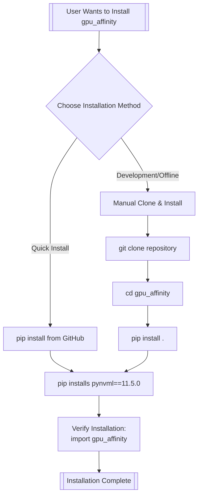
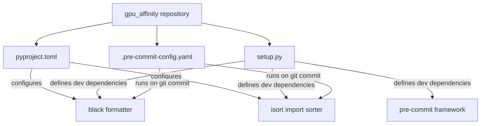
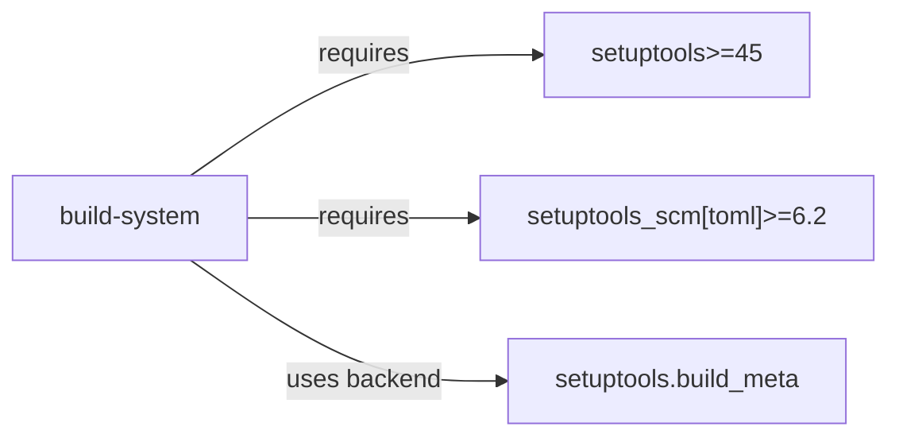
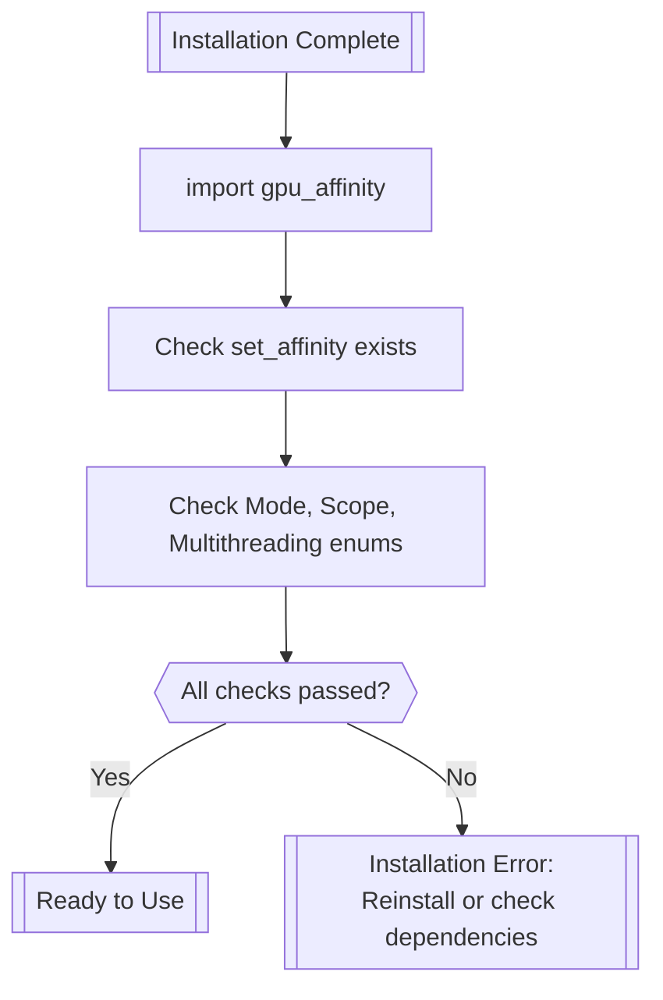

<!-- source: DeepWiki mcp.deepwiki.com · repo NVIDIA/gpu_affinity · page 1.2 Installation and Setup · fetched 2026-10-26 -->

# Installation and Setup

<details>
<summary>Relevant source files</summary>

The following files were used as context for generating this wiki page:

- [README.md](README.md)
- [pyproject.toml](pyproject.toml)
- [requirements.txt](requirements.txt)
- [setup.py](setup.py)

</details>


This document provides comprehensive instructions for installing the `gpu_affinity` package, configuring dependencies, and setting up a development environment. This page covers installation for end users who want to use the package in their applications, as well as setup procedures for contributors who want to develop and test changes to the codebase.

For information about the core API and how to use the package in your code, see [API Reference](#2.1). For development workflow and contribution guidelines, see [Development and Contribution Guide](#5).

---

## Prerequisites

The `gpu_affinity` package has the following prerequisites:

| Requirement | Version/Details | Purpose |
|------------|----------------|---------|
| Python | ≥ 3.6 | Runtime environment |
| Operating System | Linux (POSIX) | Required for CPU affinity system calls |
| NVIDIA GPU | Any CUDA-capable GPU | Target hardware for affinity optimization |
| NVIDIA Drivers | Recent drivers supporting NVML | Required for GPU topology queries |

The package is designed specifically for Linux systems and relies on POSIX-compliant system calls for setting CPU affinity ([sched_setaffinity](https://linux.die.net/man/2/sched_setaffinity)). It will not function on Windows or macOS.

**Sources:** [setup.py:42-44](), [README.md:1-11]()

---

## Installation Methods

The `gpu_affinity` package can be installed using two primary methods: directly from GitHub using pip, or through manual cloning and installation.

### Installation Workflow



**Sources:** [README.md:24-39]()

### Using pip from GitHub

This is the recommended method for end users who want to use the package in their applications.

```bash
pip install git+https://github.com/NVIDIA/gpu_affinity
```

This command instructs pip to:
1. Clone the repository from GitHub
2. Build the package using the configuration in [setup.py]()
3. Install the package and its dependencies into the current Python environment

**Sources:** [README.md:26-31]()

### Manual Installation

Manual installation is useful for development, offline environments, or when you need to inspect the source code before installation.

```bash
git clone https://github.com/NVIDIA/gpu_affinity
cd gpu_affinity
pip install .
```

The manual installation process:
1. Clones the repository to your local filesystem
2. Changes to the repository directory
3. Installs the package from the local source using pip

**Sources:** [README.md:33-39]()

---

## Dependencies

### Runtime Dependencies

The `gpu_affinity` package has a single runtime dependency defined in both [requirements.txt]() and [setup.py:21-23]():


| Dependency | Version | Purpose |
|-----------|---------|---------|
| `pynvml` | 11.5.0 | Python bindings for NVIDIA Management Library (NVML), used to query GPU topology and CPU-GPU affinity information |

The `pynvml` library provides the interface to NVML, which is used by `gpu_affinity` to:
- Query CPU cores associated with each GPU
- Determine NUMA node and socket topology
- Retrieve hardware-specific affinity recommendations

**Sources:** [requirements.txt:1](), [setup.py:21-23]()

### Development Dependencies

For contributors and developers, additional dependencies are required for code formatting, linting, and pre-commit hooks. These are defined as extras in [setup.py:45-51]():

```bash
pip install -e ".[dev]"
```

This installs the following development tools:

| Tool | Version | Purpose |
|------|---------|---------|
| `black` | 23.10.1 | Code formatter for consistent style |
| `isort` | 5.10.1 | Import sorter for organized imports |
| `pre-commit` | 3.5.0 | Framework for managing pre-commit hooks |

**Sources:** [setup.py:45-51]()

---

## Development Environment Setup

This section is relevant for contributors who plan to modify the `gpu_affinity` codebase. For general usage, skip to the Verification section.

### Development Installation

Install the package in editable mode with development dependencies:

```bash
git clone https://github.com/NVIDIA/gpu_affinity
cd gpu_affinity
pip install -e ".[dev]"
```

The `-e` flag installs the package in "editable" mode, meaning changes to the source code are immediately reflected without reinstalling.

### Development Tool Configuration



The development tools are configured through [pyproject.toml:5-24]():

**Black Configuration** ([pyproject.toml:5-7]()):
- `skip-string-normalization = true`: Preserves single vs. double quote choices
- `line-length = 79`: PEP 8 compliant line length

**Isort Configuration** ([pyproject.toml:9-11]()):
- `force_single_line = true`: Each import on its own line
- `extra_standard_library = ["pkg_resources"]`: Treats `pkg_resources` as standard library

**Sources:** [pyproject.toml:5-24](), [setup.py:45-51]()

### Pre-commit Hooks

Install and enable pre-commit hooks to automatically format code before each commit:

```bash
pre-commit install
```

This configures Git to run `black` and `isort` automatically before each commit, ensuring code style consistency. The hooks are defined in `.pre-commit-config.yaml` (not shown in the provided files, but referenced by the development dependencies).

For more details on the development workflow, see [Development and Contribution Guide](#5) and [Code Style and Tooling](#5.1).

**Sources:** [setup.py:49]()

---

## Build System Configuration

The package uses modern Python packaging standards defined in [pyproject.toml:1-3]():



| Component | Version | Purpose |
|-----------|---------|---------|
| `setuptools` | ≥ 45 | Build backend for packaging |
| `setuptools_scm` | ≥ 6.2 | Version management from git tags |
| Build backend | `setuptools.build_meta` | PEP 517 compliant build backend |

The `setuptools_scm` configuration ([pyproject.toml:13-14]()) uses `fallback_version = "0.0.0"` when the package is installed outside of a git repository.

**Sources:** [pyproject.toml:1-14]()

---

## Package Metadata

The package is configured in [setup.py:25-52]() with the following metadata:

| Attribute | Value | Description |
|-----------|-------|-------------|
| `name` | `gpu_affinity` | Package name for PyPI and imports |
| `version` | `0.1.0` | Current version |
| `author` | `NVIDIA Corporation` | Package maintainer |
| `packages` | `['gpu_affinity']` | Python packages to install |
| `license` | `Apache2` | Open source license |
| `python_requires` | `>=3.6` | Minimum Python version |

The package is classified as:
- License: Apache Software License
- Programming Language: Python 3, Python 3.6
- Operating System: POSIX :: Linux

**Sources:** [setup.py:25-44]()

---

## Verification

After installation, verify that the package is correctly installed and can be imported:

```python
import gpu_affinity

# Check that the main function is accessible
print(gpu_affinity.set_affinity)

# Check that enums are accessible
print(gpu_affinity.Mode.UNIQUE_CONTIGUOUS)
print(gpu_affinity.Scope.NODE)
print(gpu_affinity.Multithreading.ALL_LOGICAL)
```

If the imports succeed without errors, the package is correctly installed.

### Verification Workflow



**Sources:** [README.md:43-46]()

---

## Environment Considerations

Once installed, be aware of these environment considerations when using the package:

### OpenMP Configuration

Intel's OpenMP implementation can interfere with CPU affinity settings. Set the following environment variable before running your application:

```bash
export KMP_AFFINITY=disabled
```

This prevents OpenMP from resetting the affinity configured by `gpu_affinity.set_affinity()` after fork operations (e.g., in PyTorch DataLoader workers).

**Sources:** [README.md:142-146]()

### CUDA_VISIBLE_DEVICES

The package correctly handles GPU device reordering when the `CUDA_VISIBLE_DEVICES` environment variable is set. No special configuration is needed.

**Sources:** [README.md:22]()

---

## Next Steps

After installation:
- For API usage details, see [API Reference](#2.1)
- For practical examples, see [Usage Examples](#3)
- For understanding affinity modes, see [Affinity Modes and Strategies](#2.2)
- For development contributions, see [Development and Contribution Guide](#5)

---

