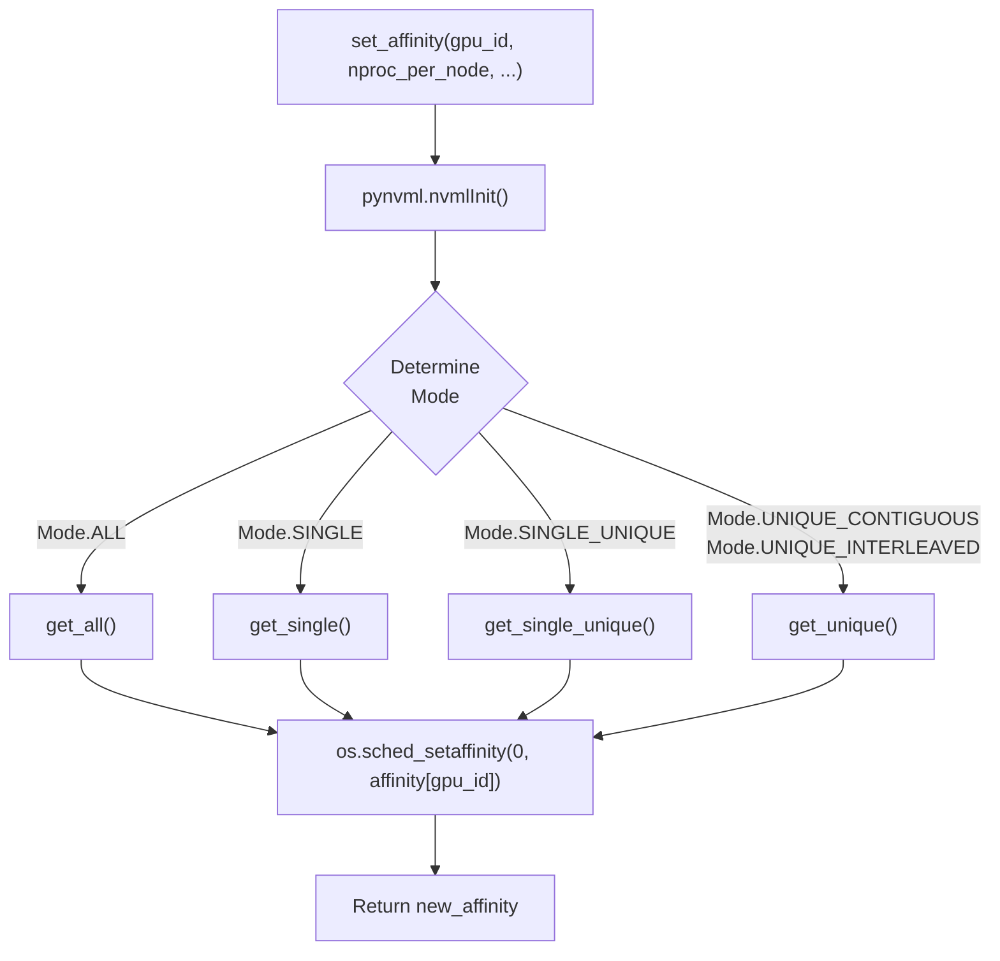
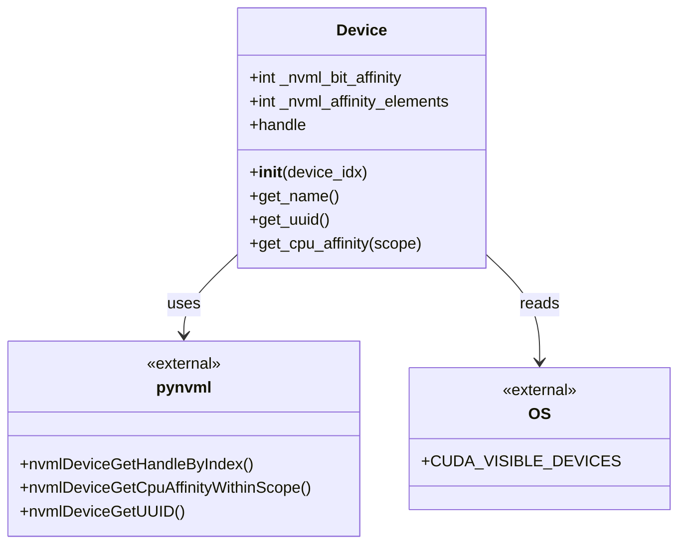
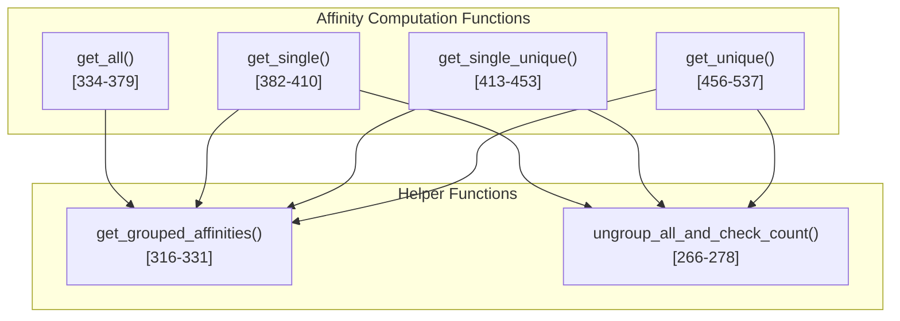
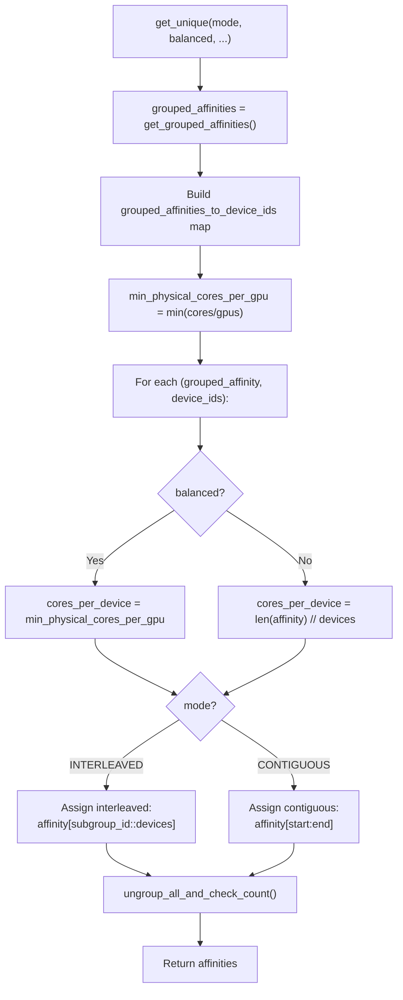
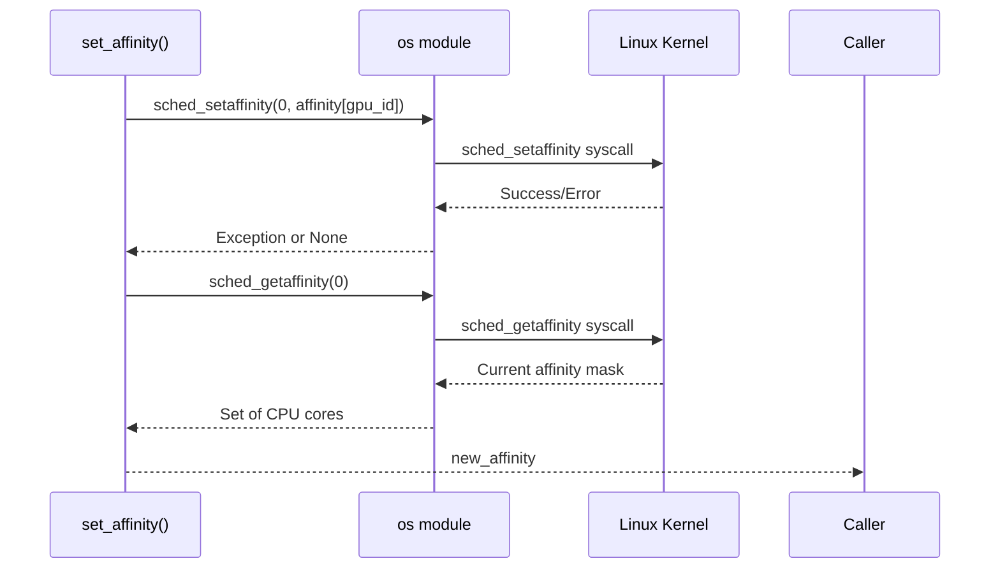

<!-- source: DeepWiki mcp.deepwiki.com · repo NVIDIA/gpu_affinity · page 2 Core Functionality · fetched 2026-10-26 -->

# Core Functionality

Relevant source files

The following files were used as context for generating this wiki page:

- [README.md](README.md)
- [gpu_affinity/gpu_affinity.py](gpu_affinity/gpu_affinity.py)

This page describes the core logic and algorithms implemented in `gpu_affinity` for determining and setting CPU affinity for GPU workloads. It covers the main processing pipeline, hardware querying, core selection algorithms, and the application of affinity settings to the operating system.

For detailed API documentation of the public interface, see [API Reference](#2.1). For in-depth discussion of affinity modes and their use cases, see [Affinity Modes and Strategies](#2.2). For details on hardware topology interaction, see [Hardware Topology and Integration](#2.3).

## Core Processing Pipeline

The `set_affinity` function [gpu_affinity/gpu_affinity.py:540-711]() orchestrates the entire affinity assignment process. The pipeline follows these stages:

**Sources:** [gpu_affinity/gpu_affinity.py:540-711]()

The function validates inputs [gpu_affinity/gpu_affinity.py:663-668](), initializes the NVIDIA Management Library [gpu_affinity/gpu_affinity.py:670-674](), dispatches to the appropriate affinity computation function based on the `mode` parameter [gpu_affinity/gpu_affinity.py:676-699](), and applies the resulting affinity to the current process using OS APIs [gpu_affinity/gpu_affinity.py:701-709]().

## Hardware Query and Device Management

### Device Class

The `Device` class [gpu_affinity/gpu_affinity.py:55-138]() encapsulates GPU device management and affinity querying through `pynvml`. It handles `CUDA_VISIBLE_DEVICES` remapping and provides methods to query GPU-CPU affinity relationships.

**Sources:** [gpu_affinity/gpu_affinity.py:55-138]()

#### CUDA_VISIBLE_DEVICES Handling

The `Device.__init__` method [gpu_affinity/gpu_affinity.py:63-111]() implements sophisticated device index remapping:

1. Checks if `CUDA_VISIBLE_DEVICES` is set [gpu_affinity/gpu_affinity.py:64-71]()
2. Attempts to parse elements as integer indices [gpu_affinity/gpu_affinity.py:72-75]()
3. Falls back to UUID prefix matching if parsing as integers fails [gpu_affinity/gpu_affinity.py:76-105]()
4. Validates that exactly one device matches the UUID prefix [gpu_affinity/gpu_affinity.py:91-104]()

#### CPU Affinity Querying

The `get_cpu_affinity` method [gpu_affinity/gpu_affinity.py:119-138]() queries recommended CPU cores for a GPU using `pynvml`:

1. Maps `Scope` enum to `pynvml` scope constants [gpu_affinity/gpu_affinity.py:120-125]()
2. Calls `nvmlDeviceGetCpuAffinityWithinScope` [gpu_affinity/gpu_affinity.py:128-130]()
3. Converts the returned bit mask to a list of core IDs [gpu_affinity/gpu_affinity.py:127-137]()

**Sources:** [gpu_affinity/gpu_affinity.py:55-138]()

## Core Selection and Grouping

### Thread Sibling Detection

The system detects hyperthreading sibling relationships by reading from `/sys/devices/system/cpu/cpu*/topology/thread_siblings_list`:

| Function | Purpose | Location |
|----------|---------|----------|
| `get_thread_siblings_list()` | Reads `/sys` to build pairs of hyperthreading siblings | [gpu_affinity/gpu_affinity.py:141-157]() |
| `build_thread_siblings_dict()` | Converts sibling pairs into a lookup dictionary | [gpu_affinity/gpu_affinity.py:160-166]() |

**Sources:** [gpu_affinity/gpu_affinity.py:141-166]()

### Core Grouping Operations

The affinity computation pipeline transforms flat lists of CPU core IDs through multiple grouping stages:

```mermaid
graph LR
    A["Raw Core IDs<br/>[0,1,2,3,4,5,...]"]
    B["Grouped by Siblings<br/>[(0,16),(1,17),...]"]
    C["Grouped by Node<br/>[(0,16,8),(1,17,9),...]"]
    D["Ungrouped by Node<br/>[0,16,8,1,17,9,...]"]
    E["Ungrouped by Siblings<br/>[0,16,1,17,...] or [0,1,...]"]
    F["Final Affinity<br/>[0,16,1,17,...]"]
    
    A -->|"group_by_siblings()"| B
    B -->|"group_by_node()"| C
    C -->|"ungroup_by_nodes()"| D
    D -->|"ungroup_by_siblings()"| E
    E -->|"check_core_count()"| F
```

**Sources:** [gpu_affinity/gpu_affinity.py:177-278]()

#### Grouping Functions

| Function | Purpose | Key Logic |
|----------|---------|-----------|
| `group_by_siblings()` | Groups cores into hyperthreading pairs | [gpu_affinity/gpu_affinity.py:177-185]() |
| `group_by_node()` | Distributes socket cores across NUMA nodes | [gpu_affinity/gpu_affinity.py:188-219]() |
| `ungroup_by_nodes()` | Flattens node groups based on scope | [gpu_affinity/gpu_affinity.py:222-231]() |
| `ungroup_by_siblings()` | Flattens sibling groups based on multithreading mode | [gpu_affinity/gpu_affinity.py:234-245]() |

The `group_by_node` function [gpu_affinity/gpu_affinity.py:188-219]() implements a sophisticated algorithm to interleave socket-scope cores with node-scope cores, ensuring that cores with direct GPU access are prioritized.

**Sources:** [gpu_affinity/gpu_affinity.py:169-245]()

### Affinity Validation

The `check_affinities` function [gpu_affinity/gpu_affinity.py:281-297]() validates that computed affinities satisfy invariants:

1. The affinity list is non-empty [gpu_affinity/gpu_affinity.py:282-285]()
2. Each individual affinity is non-empty [gpu_affinity/gpu_affinity.py:287-289]()
3. Core sets are either identical or disjoint [gpu_affinity/gpu_affinity.py:291-297]()

The `check_core_count` function [gpu_affinity/gpu_affinity.py:248-263]() validates and trims affinities based on `min_physical_cores` and `max_physical_cores` constraints.

**Sources:** [gpu_affinity/gpu_affinity.py:248-297]()

## Affinity Assignment Algorithms

The system provides five distinct affinity assignment modes implemented as separate functions:

**Sources:** [gpu_affinity/gpu_affinity.py:300-537]()

### Mode: ALL

The `get_all` function [gpu_affinity/gpu_affinity.py:334-379]() assigns all available cores recommended by `pynvml`:

1. Queries affinities from hardware [gpu_affinity/gpu_affinity.py:353]()
2. Groups cores by hyperthreading siblings [gpu_affinity/gpu_affinity.py:355]()
3. Prioritizes cores with direct GPU access (node-scope cores) [gpu_affinity/gpu_affinity.py:357-373]()
4. Validates and trims based on core count constraints [gpu_affinity/gpu_affinity.py:375-376]()
5. Ungroups siblings based on multithreading mode [gpu_affinity/gpu_affinity.py:378]()

**Sources:** [gpu_affinity/gpu_affinity.py:334-379]()

### Mode: SINGLE and SINGLE_UNIQUE

Both functions follow a similar pattern using `get_grouped_affinities`:

**`get_single()` [gpu_affinity/gpu_affinity.py:382-410]():**
- Retrieves grouped affinities [gpu_affinity/gpu_affinity.py:402]()
- Ungroups and selects the first core [gpu_affinity/gpu_affinity.py:403-409]()
- Multiple GPUs may share the same core

**`get_single_unique()` [gpu_affinity/gpu_affinity.py:413-453]():**
- Retrieves grouped affinities [gpu_affinity/gpu_affinity.py:433]()
- Assigns unique cores by tracking assigned groups [gpu_affinity/gpu_affinity.py:435-443]()
- Each GPU gets a distinct core

**Sources:** [gpu_affinity/gpu_affinity.py:382-453]()

### Mode: UNIQUE_CONTIGUOUS and UNIQUE_INTERLEAVED

The `get_unique` function [gpu_affinity/gpu_affinity.py:456-537]() implements both unique assignment modes with sophisticated core distribution logic:

**Sources:** [gpu_affinity/gpu_affinity.py:456-537]()

The function builds a mapping from unique core sets to device IDs [gpu_affinity/gpu_affinity.py:483-486](), computes the minimum cores per GPU [gpu_affinity/gpu_affinity.py:490-495](), and distributes cores either:

- **Interleaved:** Cores assigned with stride pattern `[subgroup_id::devices_per_group]` [gpu_affinity/gpu_affinity.py:513-516]()
- **Contiguous:** Cores assigned in sequential blocks [gpu_affinity/gpu_affinity.py:517-524]()

When `balanced=True`, all processes receive equal core counts [gpu_affinity/gpu_affinity.py:504-508]().

**Sources:** [gpu_affinity/gpu_affinity.py:456-537]()

## OS Affinity Application

After computing the target affinity list, `set_affinity` applies it using OS-level APIs:

**Sources:** [gpu_affinity/gpu_affinity.py:701-711]()

The function performs three operations:

1. **Set affinity:** Calls `os.sched_setaffinity(0, affinity[gpu_id])` [gpu_affinity/gpu_affinity.py:702]() to restrict the process to the computed core set
2. **Verify affinity:** Calls `os.sched_getaffinity(0)` [gpu_affinity/gpu_affinity.py:703]() to retrieve the actual applied affinity
3. **Error handling:** Catches `OSError` (system call failures) and `AttributeError` (unsupported platforms) [gpu_affinity/gpu_affinity.py:704-709]()

The function returns the verified affinity set, which may differ from the requested set if the OS restricts available cores.

**Sources:** [gpu_affinity/gpu_affinity.py:701-711]()

## Error Handling

All errors are raised as `GPUAffinityError` exceptions [gpu_affinity/gpu_affinity.py:28-29](). The system validates and reports errors at multiple stages:

| Error Condition | Location | Error Message Pattern |
|-----------------|----------|----------------------|
| Invalid `gpu_id` | [gpu_affinity/gpu_affinity.py:663-668]() | `gpu_id={x} should be smaller than nproc_per_node={y}` |
| NVML initialization failure | [gpu_affinity/gpu_affinity.py:670-674]() | `Error while initializing pynvml` |
| Device handle retrieval failure | [gpu_affinity/gpu_affinity.py:107-111]() | `Unable to get NVML handle for device {x}` |
| Insufficient cores | [gpu_affinity/gpu_affinity.py:253-258]() | `Number of available physical cores for GPU {x} is less than...` |
| Affinity set violation | [gpu_affinity/gpu_affinity.py:294-297]() | `Sets of cores should be either identical or disjoint` |
| OS affinity call failure | [gpu_affinity/gpu_affinity.py:704-709]() | `Error while calling os affinity functions` |

**Sources:** [gpu_affinity/gpu_affinity.py:28-29](), [gpu_affinity/gpu_affinity.py:663-709]()

---

