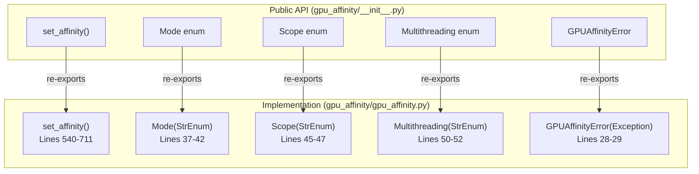
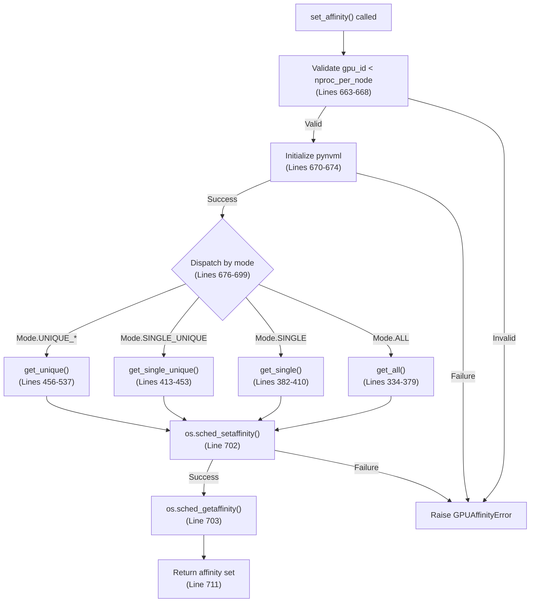
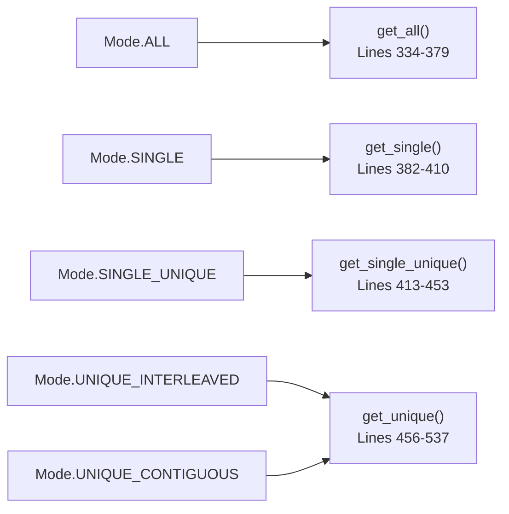
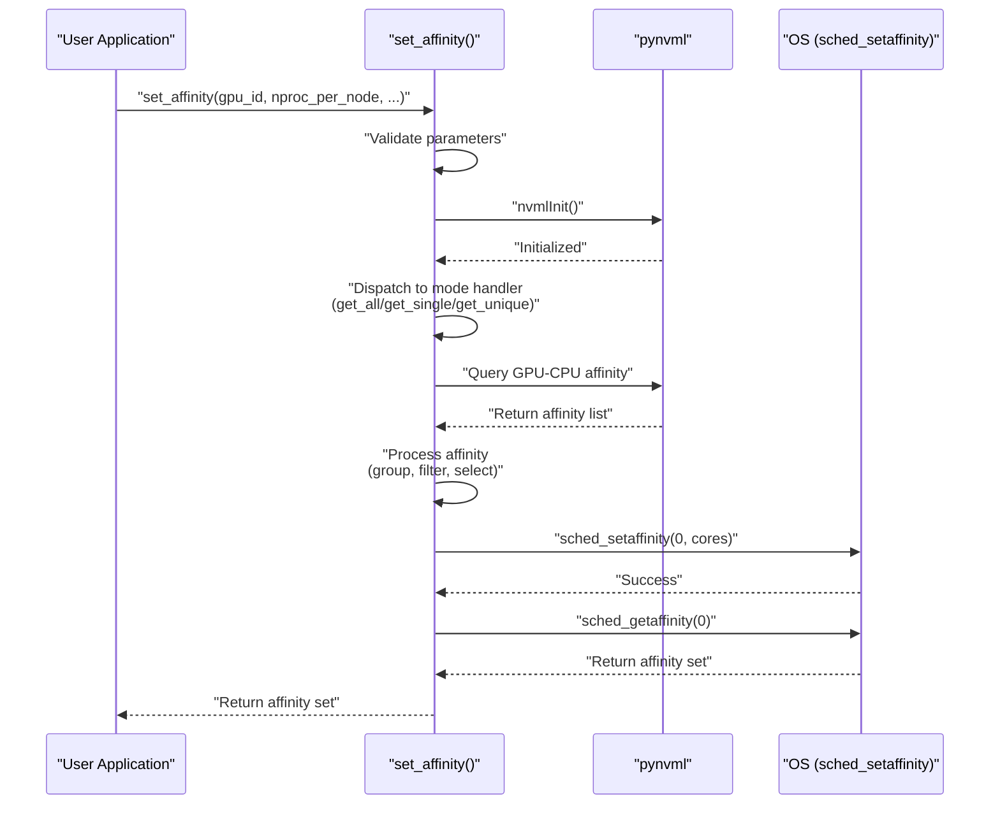

<!-- source: DeepWiki mcp.deepwiki.com · repo NVIDIA/gpu_affinity · page 2.1 API Reference · fetched 2026-10-26 -->

# API Reference

<details>
<summary>Relevant source files</summary>

The following files were used as context for generating this wiki page:

- [README.md](README.md)
- [gpu_affinity/__init__.py](gpu_affinity/__init__.py)
- [gpu_affinity/gpu_affinity.py](gpu_affinity/gpu_affinity.py)

</details>


This document provides detailed technical documentation for all public API components exposed by the `gpu_affinity` package. The API consists of a single primary function (`set_affinity`), three enumeration types for configuration, and one exception class for error handling. For information about how these components are used in practice, see [Usage Examples](#3). For details on the underlying hardware topology interactions, see [Hardware Topology and Integration](#2.3).

The complete public API is exported through [gpu_affinity/__init__.py:15-19](), which re-exports all symbols from the core implementation module.

---

## API Surface Overview

The following diagram maps the public API symbols to their definitions in the codebase:



**Sources:** [gpu_affinity/__init__.py:1-20](), [gpu_affinity/gpu_affinity.py:28-52](), [gpu_affinity/gpu_affinity.py:540-711]()

---

## Main Entry Point

### `set_affinity()`

The primary function for setting CPU affinity for GPU processes. This function must be called once per process, typically at application startup before any CUDA context is created.

**Function Signature:**

```python
def set_affinity(
    gpu_id: int,
    nproc_per_node: int,
    *,
    mode: Mode = Mode.UNIQUE_CONTIGUOUS,
    scope: Scope = Scope.NODE,
    multithreading: Multithreading = Multithreading.ALL_LOGICAL,
    balanced: bool = True,
    min_physical_cores: int = 1,
    max_physical_cores: Optional[int] = None,
) -> set
```

**Implementation:** [gpu_affinity/gpu_affinity.py:540-711]()

#### Parameters

| Parameter | Type | Default | Description |
|-----------|------|---------|-------------|
| `gpu_id` | `int` | *Required* | Index of the GPU assigned to this process, ranging from `0` to `nproc_per_node - 1` |
| `nproc_per_node` | `int` | *Required* | Total number of processes (GPUs) per node |
| `mode` | `Mode` | `Mode.UNIQUE_CONTIGUOUS` | Affinity assignment strategy (see [Mode Enumeration](#mode-enumeration)) |
| `scope` | `Scope` | `Scope.NODE` | Hardware scope for affinity queries via pynvml (see [Scope Enumeration](#scope-enumeration)) |
| `multithreading` | `Multithreading` | `Multithreading.ALL_LOGICAL` | Hyperthreading configuration (see [Multithreading Enumeration](#multithreading-enumeration)) |
| `balanced` | `bool` | `True` | When `True`, assigns equal number of physical cores to each process. Only affects `UNIQUE_INTERLEAVED` and `UNIQUE_CONTIGUOUS` modes |
| `min_physical_cores` | `int` | `1` | Minimum required physical cores per process. Raises `GPUAffinityError` if insufficient cores are available |
| `max_physical_cores` | `Optional[int]` | `None` | Maximum physical cores per process. When set, the assigned core list is truncated to this limit |

#### Return Value

Returns a `set` of integers representing the logical CPU core IDs on which the process is eligible to run after affinity has been set. This is obtained via `os.sched_getaffinity(0)` after calling `os.sched_setaffinity()`.

**Implementation detail:** [gpu_affinity/gpu_affinity.py:701-711]()

#### Exceptions

The function raises `GPUAffinityError` in the following scenarios:

| Condition | Error Location | Description |
|-----------|----------------|-------------|
| `gpu_id >= nproc_per_node` | [Line 663-668]() | Invalid `gpu_id` parameter |
| pynvml initialization failure | [Line 670-674]() | Cannot initialize NVIDIA Management Library |
| Unknown affinity mode | [Line 699]() | Invalid `mode` parameter value |
| OS affinity function error | [Line 704-706]() | Error calling `os.sched_setaffinity()` or `os.sched_getaffinity()` |
| OS affinity unavailable | [Line 707-709]() | Platform does not support affinity functions |
| Insufficient cores | [Line 252-258]() | Available physical cores less than `min_physical_cores` |
| Invalid CUDA_VISIBLE_DEVICES | [Line 67-71](), [Line 92-104]() | Device index out of bounds or UUID mismatch |

**Sources:** [gpu_affinity/gpu_affinity.py:540-711](), [gpu_affinity/gpu_affinity.py:28-29](), [gpu_affinity/gpu_affinity.py:248-263]()

#### Execution Flow



**Sources:** [gpu_affinity/gpu_affinity.py:540-711](), [gpu_affinity/gpu_affinity.py:334-537]()

---

## Enumerations

All enumeration types inherit from `StrEnum` (defined at [gpu_affinity/gpu_affinity.py:32-34]()), which allows enum values to be treated as strings.

### Mode Enumeration

The `Mode` enum defines strategies for assigning CPU cores to GPU processes.

**Definition:** [gpu_affinity/gpu_affinity.py:37-42]()

| Enum Value | String Value | Description |
|------------|--------------|-------------|
| `Mode.ALL` | `'all'` | Assigns all available physical CPU cores recommended by pynvml for the GPU |
| `Mode.SINGLE` | `'single'` | Assigns the first available physical core (multiple GPUs may share the same core) |
| `Mode.SINGLE_UNIQUE` | `'single_unique'` | Assigns a single unique physical core to each GPU |
| `Mode.UNIQUE_INTERLEAVED` | `'unique_interleaved'` | Assigns unique cores with interleaved indexing pattern |
| `Mode.UNIQUE_CONTIGUOUS` | `'unique_contiguous'` | Assigns unique cores with contiguous indexing pattern (default, recommended for DGX) |

#### Mode Implementation Mapping



**Sources:** [gpu_affinity/gpu_affinity.py:37-42](), [gpu_affinity/gpu_affinity.py:676-699]()

### Scope Enumeration

The `Scope` enum defines the hardware topology level for affinity queries through pynvml.

**Definition:** [gpu_affinity/gpu_affinity.py:45-47]()

| Enum Value | String Value | pynvml Constant | Description |
|------------|--------------|-----------------|-------------|
| `Scope.NODE` | `'node'` | `NVML_AFFINITY_SCOPE_NODE` | Queries CPU affinity at NUMA node level |
| `Scope.SOCKET` | `'socket'` | `NVML_AFFINITY_SCOPE_SOCKET` | Queries CPU affinity at processor socket level |

The scope determines which CPU cores are considered "close" to a GPU. The mapping to pynvml constants occurs in the `Device.get_cpu_affinity()` method at [gpu_affinity/gpu_affinity.py:119-125]().

**Important:** On DGX A100 systems, `Scope.NODE` restricts execution to CPU cores with direct GPU access (approximately half the cores), while `Scope.SOCKET` includes all cores in the socket. See [gpu_affinity/gpu_affinity.py:620-625]() for the warning about this behavior.

**Sources:** [gpu_affinity/gpu_affinity.py:45-47](), [gpu_affinity/gpu_affinity.py:119-138]()

### Multithreading Enumeration

The `Multithreading` enum controls whether hyperthreading siblings are included in the affinity mask.

**Definition:** [gpu_affinity/gpu_affinity.py:50-52]()

| Enum Value | String Value | Description |
|------------|--------------|-------------|
| `Multithreading.ALL_LOGICAL` | `'all_logical'` | Includes all logical cores (all hyperthreading siblings) for assigned physical cores |
| `Multithreading.SINGLE_LOGICAL` | `'single_logical'` | Includes only one logical core per physical core (excludes hyperthreading siblings) |

The ungrouping logic based on this parameter is implemented in `ungroup_by_siblings()` at [gpu_affinity/gpu_affinity.py:234-245]().

**Sources:** [gpu_affinity/gpu_affinity.py:50-52](), [gpu_affinity/gpu_affinity.py:234-245]()

---

## Exception Classes

### GPUAffinityError

Custom exception class for all errors raised by the `gpu_affinity` package.

**Definition:** [gpu_affinity/gpu_affinity.py:28-29]()

```python
class GPUAffinityError(Exception):
    pass
```

This exception is raised in the following scenarios (see table in [Exceptions](#exceptions) section above). All error messages are constructed to provide clear context about the failure condition, including relevant parameter values and system state.

**Usage pattern in codebase:**
- Direct raises: [Line 71](), [Line 97](), [Line 103](), [Line 125](), [Line 253](), [Line 284](), [Line 294](), [Line 526](), [Line 668](), [Line 699]()
- Raises with exception chaining: [Line 111](), [Line 674](), [Line 706](), [Line 709]()

**Sources:** [gpu_affinity/gpu_affinity.py:28-29](), [gpu_affinity/gpu_affinity.py:67-111](), [gpu_affinity/gpu_affinity.py:663-709]()

---

## API Usage Pattern

The typical calling pattern for the API is shown below:



**Sources:** [gpu_affinity/gpu_affinity.py:540-711](), [gpu_affinity/gpu_affinity.py:300-537]()

---

## Internal vs. Public API Boundary

The following components are **not** part of the public API and should not be relied upon by external code:

- `Device` class ([Line 55-138]())
- Helper functions: `get_thread_siblings_list()`, `build_thread_siblings_dict()`, `group_by_siblings()`, etc.
- Mode-specific implementation functions: `get_all()`, `get_single()`, `get_single_unique()`, `get_unique()`
- `StrEnum` base class

Only the symbols exported in [gpu_affinity/__init__.py:15-19]() constitute the stable public API.

**Sources:** [gpu_affinity/__init__.py:1-20](), [gpu_affinity/gpu_affinity.py:1-712]()

---

