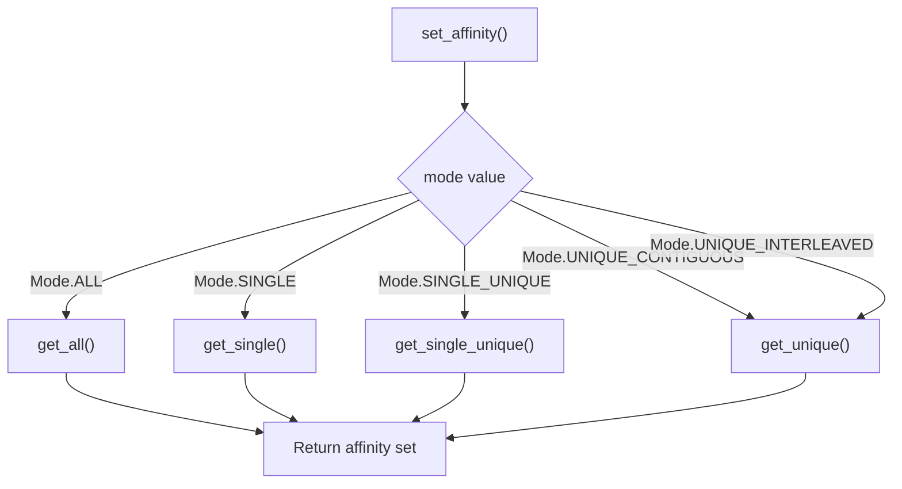
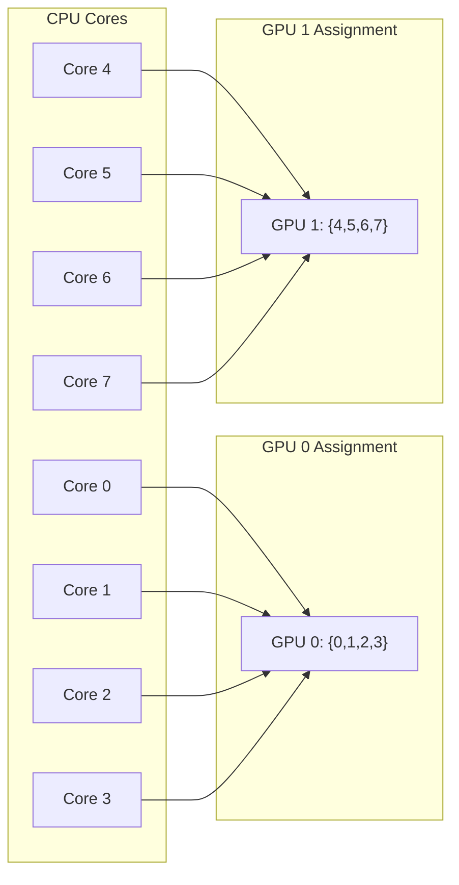
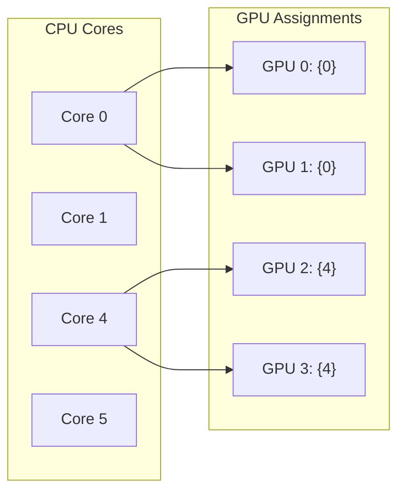
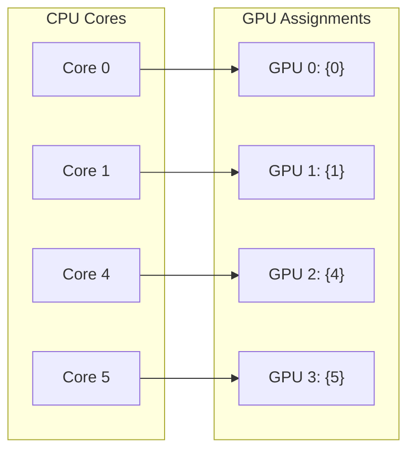
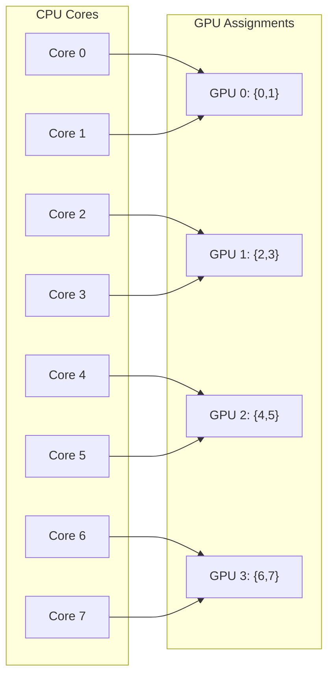
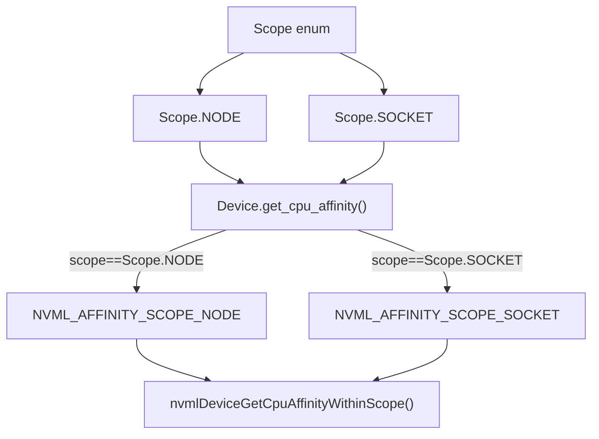
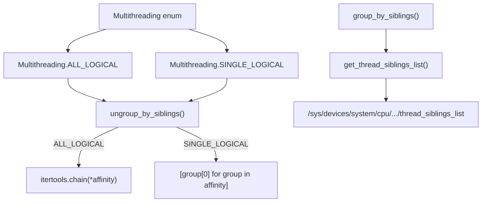
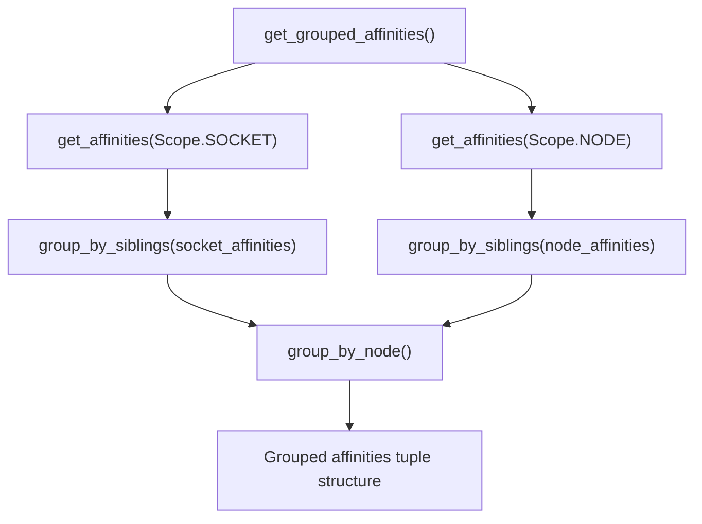

<!-- source: DeepWiki mcp.deepwiki.com · repo NVIDIA/gpu_affinity · page 2.2 Affinity Modes and Strategies · fetched 2026-10-26 -->

# Affinity Modes and Strategies

<details>
<summary>Relevant source files</summary>

The following files were used as context for generating this wiki page:

- [README.md](README.md)
- [gpu_affinity/gpu_affinity.py](gpu_affinity/gpu_affinity.py)

</details>


## Purpose and Scope

This document describes the different affinity assignment modes, scope options, and multithreading strategies available in the `gpu_affinity` package. These configuration options control how CPU cores are allocated to GPU processes, enabling fine-tuned performance optimization for different hardware architectures and workload characteristics.

For information about the public API and function signatures, see [API Reference](#2.1). For details on how the system interacts with hardware topology through pynvml and system files, see [Hardware Topology and Integration](#2.3).

## Configuration Parameters Overview

The `set_affinity()` function accepts three primary configuration enums that control affinity assignment behavior:

| Parameter | Enum Class | Purpose |
|-----------|------------|---------|
| `mode` | `Mode` | Determines the CPU core allocation strategy per GPU process |
| `scope` | `Scope` | Defines the hardware scope for pynvml affinity queries |
| `multithreading` | `Multithreading` | Controls whether hyperthreading siblings are included |

These parameters work together to produce the final affinity assignment, with additional options (`balanced`, `min_physical_cores`, `max_physical_cores`) providing further refinement.

**Sources:** [gpu_affinity/gpu_affinity.py:37-53](), [gpu_affinity/gpu_affinity.py:540-617]()

## Affinity Mode Strategies

### Mode Enum and Dispatch Logic



The `Mode` enum defines five distinct affinity strategies, each implemented by a dedicated function in [gpu_affinity/gpu_affinity.py:334-537](). The main `set_affinity()` function dispatches to the appropriate implementation based on the selected mode at [gpu_affinity/gpu_affinity.py:676-697]().

**Sources:** [gpu_affinity/gpu_affinity.py:37-43](), [gpu_affinity/gpu_affinity.py:676-699]()

### Mode.ALL

**Implementation:** `get_all()` function at [gpu_affinity/gpu_affinity.py:334-379]()

This mode assigns all available physical CPU cores recommended by pynvml for each GPU. Multiple GPU processes receive identical (overlapping) CPU core assignments.



**Key Characteristics:**
- Each process receives all cores from its GPU's NUMA node or socket
- Cores are sorted with NUMA-local cores prioritized (see [gpu_affinity/gpu_affinity.py:362-373]())
- Respects `min_physical_cores` and `max_physical_cores` constraints

**Use Case:** Workloads where maximum CPU resource availability per GPU is desired, such as data preprocessing pipelines with limited inter-process communication.

**Sources:** [gpu_affinity/gpu_affinity.py:334-379](), [README.md:78-79]()

### Mode.SINGLE

**Implementation:** `get_single()` function at [gpu_affinity/gpu_affinity.py:382-410]()

This mode assigns the first available physical CPU core from each GPU's recommended core list. Multiple GPUs may share the same CPU core.



**Key Characteristics:**
- Uses grouped affinities from `get_grouped_affinities()` at [gpu_affinity/gpu_affinity.py:402]()
- Cores are ungrouped by `ungroup_all_and_check_count()` at [gpu_affinity/gpu_affinity.py:403-409]()
- Defaults to 1 physical core per GPU (`max_physical_cores=1`)

**Use Case:** Minimal CPU overhead scenarios or testing environments where core overlap is acceptable.

**Sources:** [gpu_affinity/gpu_affinity.py:382-410](), [README.md:80-83]()

### Mode.SINGLE_UNIQUE

**Implementation:** `get_single_unique()` function at [gpu_affinity/gpu_affinity.py:413-453]()

This mode assigns a single unique physical CPU core to each GPU process, ensuring no core overlap between GPUs.



**Key Characteristics:**
- Maintains `assigned_groups` set to track allocated core groups at [gpu_affinity/gpu_affinity.py:436-443]()
- Iterates through grouped affinity, assigning first unassigned group to each GPU
- Ensures disjoint core sets across all GPU processes

**Use Case:** Applications requiring strict CPU isolation between GPU processes with minimal resource allocation.

**Sources:** [gpu_affinity/gpu_affinity.py:413-453](), [README.md:84-86]()

### Mode.UNIQUE_CONTIGUOUS

**Implementation:** `get_unique()` function at [gpu_affinity/gpu_affinity.py:456-537]() with `mode=Mode.UNIQUE_CONTIGUOUS`

This is the **default and recommended mode** for deep learning training on DGX systems. It assigns unique, contiguous blocks of CPU cores to each GPU process.



**Core Assignment Logic:**
The contiguous assignment is implemented at [gpu_affinity/gpu_affinity.py:517-524]():
```
unique_grouped_affinity = grouped_affinity[
    subgroup_id * cores_per_device : (subgroup_id + 1) * cores_per_device
]
```

**Key Characteristics:**
- Cores are assigned in contiguous blocks per GPU
- Supports `balanced=True` to equalize cores across all GPUs at [gpu_affinity/gpu_affinity.py:490-508]()
- Optimizes cache locality and memory access patterns

**Use Case:** Deep learning training workloads where contiguous memory access and cache coherency are critical for performance.

**Sources:** [gpu_affinity/gpu_affinity.py:456-537](), [gpu_affinity/gpu_affinity.py:517-524](), [README.md:91-97]()

### Mode.UNIQUE_INTERLEAVED

**Implementation:** `get_unique()` function at [gpu_affinity/gpu_affinity.py:456-537]() with `mode=Mode.UNIQUE_INTERLEAVED`

This mode assigns unique CPU cores using an interleaved (round-robin) pattern across GPU processes.


**Core Assignment Logic:**
The interleaved assignment is implemented at [gpu_affinity/gpu_affinity.py:513-516]():
```
unique_grouped_affinity = grouped_affinity[subgroup_id::devices_per_group]
```

**Key Characteristics:**
- Cores are distributed in a round-robin fashion
- May reduce cache locality but can balance memory bandwidth usage
- Also supports `balanced=True` option

**Use Case:** Workloads with irregular memory access patterns where spreading cores may reduce contention on specific memory controllers.

**Sources:** [gpu_affinity/gpu_affinity.py:456-537](), [gpu_affinity/gpu_affinity.py:513-516](), [README.md:87-90]()

## Mode Comparison Table

| Mode | Core Overlap | Assignment Pattern | Cores per GPU | Recommended Use |
|------|--------------|-------------------|---------------|-----------------|
| `ALL` | Yes | All available | All (variable) | Maximum CPU availability |
| `SINGLE` | Yes | First core only | 1 (fixed) | Minimal overhead |
| `SINGLE_UNIQUE` | No | First unique per GPU | 1 (fixed) | CPU isolation, minimal resources |
| `UNIQUE_CONTIGUOUS` | No | Contiguous blocks | Balanced/variable | **DL training (recommended)** |
| `UNIQUE_INTERLEAVED` | No | Round-robin | Balanced/variable | Memory bandwidth balancing |

**Sources:** [gpu_affinity/gpu_affinity.py:37-43](), [README.md:77-97]()

## Scope Modes

### Scope Enum and Hardware Mapping



The `Scope` enum is defined at [gpu_affinity/gpu_affinity.py:45-48]() and controls the hardware granularity for CPU affinity queries through pynvml.

**Sources:** [gpu_affinity/gpu_affinity.py:45-48](), [gpu_affinity/gpu_affinity.py:119-138]()

### Scope.NODE

**NVML Constant:** `pynvml.NVML_AFFINITY_SCOPE_NODE` at [gpu_affinity/gpu_affinity.py:123]()

This scope restricts CPU affinity queries to the NUMA node directly connected to the GPU.

**Hardware Behavior:**
- On systems with NUMA architecture, each GPU is associated with specific NUMA nodes
- Returns only CPU cores with direct (local) memory access to the GPU
- Minimizes remote NUMA memory access latency

**DGX A100 Consideration:**
On NVIDIA DGX A100 systems, only half of the CPU cores have direct GPU access. Using `Scope.NODE` limits execution to these cores, which also restricts available memory bandwidth to 50%. This is documented in the warnings at [gpu_affinity/gpu_affinity.py:620-625]().

**Use Case:** Latency-sensitive workloads where NUMA-local memory access is critical.

**Sources:** [gpu_affinity/gpu_affinity.py:119-123](), [README.md:100-101](), [README.md:135-140]()

### Scope.SOCKET

**NVML Constant:** `pynvml.NVML_AFFINITY_SCOPE_SOCKET` at [gpu_affinity/gpu_affinity.py:121]()

This scope extends CPU affinity queries to the entire processor socket containing the GPU's NUMA node.

**Hardware Behavior:**
- Returns all CPU cores on the processor socket, including those not directly attached to the GPU's NUMA node
- Allows access to the full CPU and memory bandwidth of the socket
- May introduce some remote NUMA memory access overhead

**DGX A100 Recommendation:**
The documentation explicitly recommends `Scope.SOCKET` for DGX A100 systems to utilize all available CPU cores and memory bandwidth (see [README.md:135-140]()).

**Use Case:** Workloads requiring maximum CPU and memory bandwidth, especially on DGX A100 systems.

**Sources:** [gpu_affinity/gpu_affinity.py:119-123](), [README.md:102-103](), [README.md:135-140]()

## Multithreading Strategies

### Multithreading Enum and Sibling Handling



The `Multithreading` enum is defined at [gpu_affinity/gpu_affinity.py:50-53]() and controls whether hyperthreading siblings are included in the final affinity assignment.

**Sources:** [gpu_affinity/gpu_affinity.py:50-53](), [gpu_affinity/gpu_affinity.py:234-245]()

### Hyperthreading Sibling Detection

The system reads hyperthreading topology from `/sys/devices/system/cpu/cpu*/topology/thread_siblings_list` at [gpu_affinity/gpu_affinity.py:141-157]():

**Process:**
1. `get_thread_siblings_list()` reads system files using pathlib glob pattern
2. Parses sibling pairs using regex pattern `r'(\d+)\D(\d+)'`
3. Returns list of tuples representing physical core and its hyperthreading sibling
4. `build_thread_siblings_dict()` creates lookup dictionary at [gpu_affinity/gpu_affinity.py:160-166]()

**Sources:** [gpu_affinity/gpu_affinity.py:141-166]()

### Multithreading.ALL_LOGICAL

This mode includes all hyperthreading siblings (logical cores) for each physical core in the affinity set.

**Implementation:**
The ungrouping logic at [gpu_affinity/gpu_affinity.py:236-238]() flattens the grouped affinity structure:
```python
affinities = [list(itertools.chain(*affinity)) for affinity in affinities]
```

**Example:**
- Physical cores assigned: `{0, 2, 4, 6}`
- Hyperthreading siblings: `{(0,1), (2,3), (4,5), (6,7)}`
- Final affinity: `{0, 1, 2, 3, 4, 5, 6, 7}` (all logical cores)

**Use Case:** Default mode. Provides maximum thread parallelism for workloads that can effectively utilize hyperthreading.

**Sources:** [gpu_affinity/gpu_affinity.py:234-238](), [README.md:105-107]()

### Multithreading.SINGLE_LOGICAL

This mode includes only one logical core (the first) from each physical core, excluding hyperthreading siblings.

**Implementation:**
The ungrouping logic at [gpu_affinity/gpu_affinity.py:239-242]() selects only the first element:
```python
affinities = [[group[0] for group in affinity] for affinity in affinities]
```

**Example:**
- Physical cores assigned: `{0, 2, 4, 6}`
- Hyperthreading siblings: `{(0,1), (2,3), (4,5), (6,7)}`
- Final affinity: `{0, 2, 4, 6}` (only primary logical cores)

**Use Case:** Workloads where hyperthreading provides minimal benefit or may cause performance degradation due to resource contention.

**Sources:** [gpu_affinity/gpu_affinity.py:234-245](), [README.md:108-110]()

## Grouped Affinity Processing Pipeline

The unique modes (`SINGLE_UNIQUE`, `UNIQUE_CONTIGUOUS`, `UNIQUE_INTERLEAVED`) use a sophisticated grouping mechanism to organize CPU cores before final assignment:



### Grouping Steps

1. **Retrieve Raw Affinities:** Both socket and node scope affinities are fetched at [gpu_affinity/gpu_affinity.py:317-322]()

2. **Group by Siblings:** Each affinity list is organized into tuples of hyperthreading siblings at [gpu_affinity/gpu_affinity.py:177-185]()

3. **Group by Node:** Socket affinities are subdivided based on node-assigned cores using `group_by_node()` at [gpu_affinity/gpu_affinity.py:188-219](). This function:
   - Creates mapping of socket cores to node-assigned cores
   - Distributes unassigned cores round-robin to node cores
   - Produces nested tuple structure: `(((core, sibling), ...), ...)`

4. **Ungroup for Final Assignment:** The grouped structure is ungrouped by `ungroup_by_nodes()` and `ungroup_by_siblings()` at [gpu_affinity/gpu_affinity.py:222-245]() based on scope and multithreading settings

**Sources:** [gpu_affinity/gpu_affinity.py:316-331](), [gpu_affinity/gpu_affinity.py:177-185](), [gpu_affinity/gpu_affinity.py:188-219](), [gpu_affinity/gpu_affinity.py:222-245]()

## Balanced Assignment

The `balanced` parameter (default `True`) ensures equal physical core counts across all GPU processes. This is implemented in `get_unique()` at [gpu_affinity/gpu_affinity.py:490-508]():

**Algorithm:**
1. Compute `min_physical_cores_per_gpu` across all GPUs sharing a socket at [gpu_affinity/gpu_affinity.py:490-495]()
2. If `balanced=True`, trim each GPU's grouped affinity to `min_physical_cores_per_gpu * devices_per_group` cores at [gpu_affinity/gpu_affinity.py:504-508]()
3. Otherwise, allow unequal distribution based on available cores

**Example:**
- Socket with 16 cores shared by 3 GPUs
- `min_physical_cores_per_gpu = 16 // 3 = 5`
- Each GPU receives exactly 5 cores (15 cores used, 1 unused)

**Sources:** [gpu_affinity/gpu_affinity.py:490-510](), [README.md:121-124]()

## Core Count Constraints

Two parameters control the minimum and maximum physical cores assigned per GPU:

### min_physical_cores

Default value: `1`

Enforced by `check_core_count()` at [gpu_affinity/gpu_affinity.py:248-258](). Raises `GPUAffinityError` if any GPU has fewer cores available than the specified minimum.

### max_physical_cores

Default value: `None` (no limit)

Enforced by `check_core_count()` at [gpu_affinity/gpu_affinity.py:260-263](). Trims the affinity list to the first `max_physical_cores` physical cores if specified.

**Sources:** [gpu_affinity/gpu_affinity.py:248-263](), [README.md:125-131]()

## Mode Selection Guidelines

### Decision Matrix

| Workload Characteristic | Recommended Mode | Scope | Multithreading |
|-------------------------|------------------|-------|----------------|
| DL training on DGX | `UNIQUE_CONTIGUOUS` | `SOCKET` (A100), `NODE` (others) | `ALL_LOGICAL` |
| Minimal CPU usage | `SINGLE` or `SINGLE_UNIQUE` | `NODE` | `SINGLE_LOGICAL` |
| Maximum CPU availability | `ALL` | `SOCKET` | `ALL_LOGICAL` |
| Memory bandwidth balancing | `UNIQUE_INTERLEAVED` | `SOCKET` | `ALL_LOGICAL` |
| NUMA-sensitive workload | Any unique mode | `NODE` | `ALL_LOGICAL` |

### System-Specific Recommendations

**NVIDIA DGX A100:**
- Use `scope=Scope.SOCKET` to access all CPU cores and memory bandwidth
- Documented warning at [README.md:135-140]()

**General DGX Systems:**
- Use `mode=Mode.UNIQUE_CONTIGUOUS` (default)
- Documented recommendation at [README.md:96-97]()

**Custom Hardware:**
- Experiment with different modes and measure performance
- Consider NUMA topology and memory access patterns

**Sources:** [README.md:96-97](), [README.md:135-140](), [gpu_affinity/gpu_affinity.py:581-582]()

---

