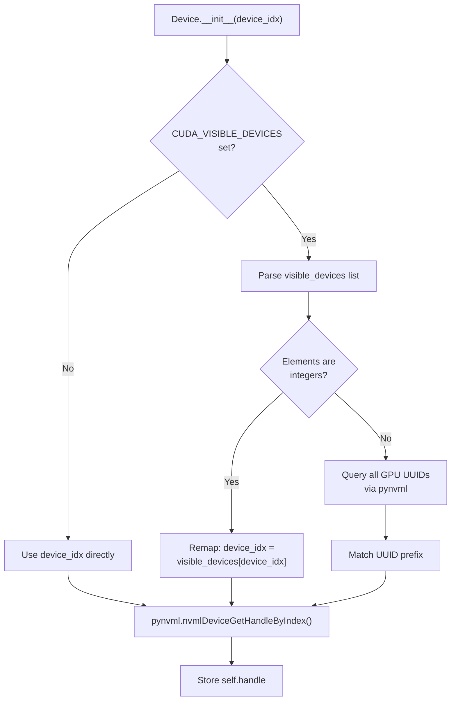
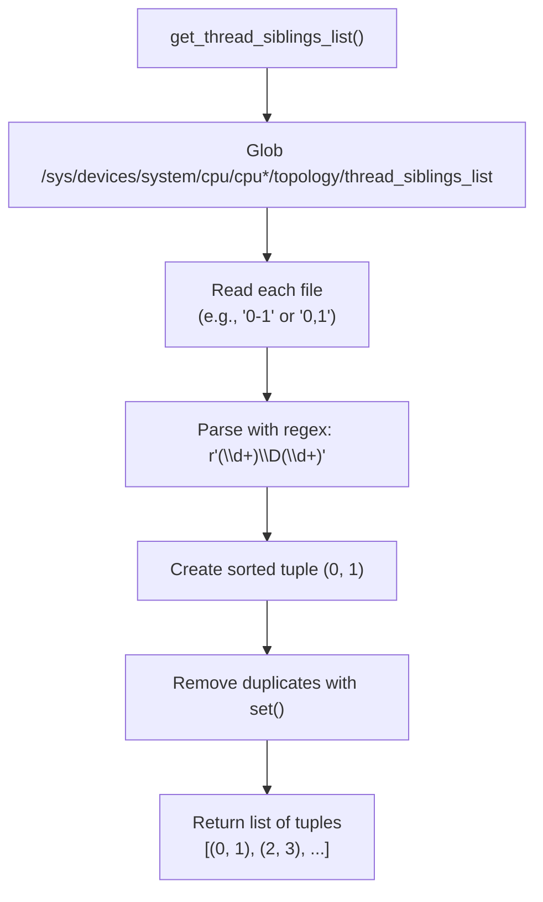
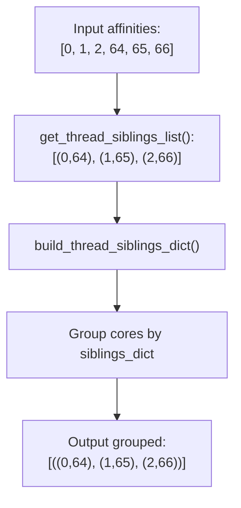
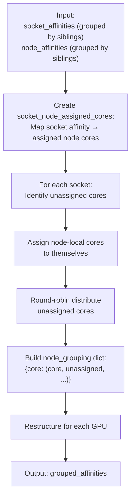
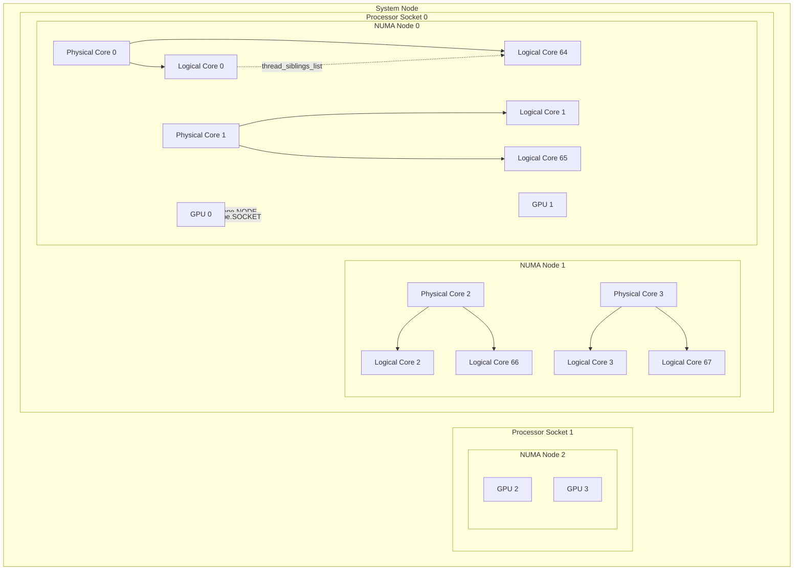
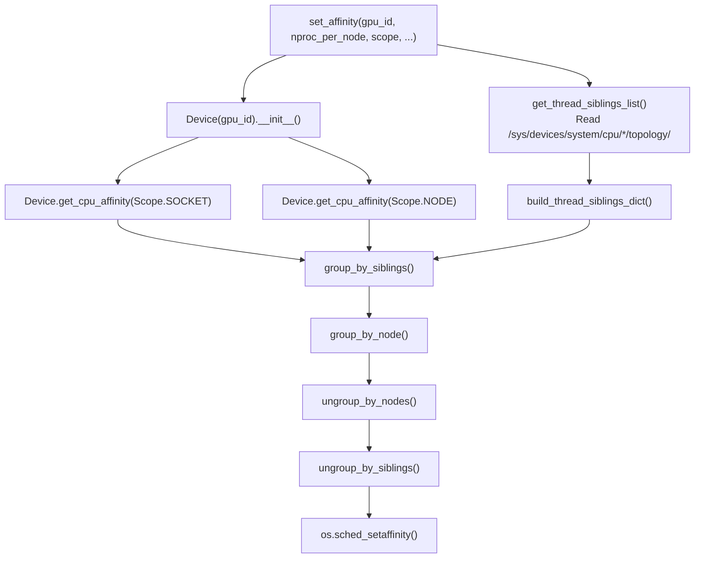

<!-- source: DeepWiki mcp.deepwiki.com · repo NVIDIA/gpu_affinity · page 2.3 Hardware Topology and Integration · fetched 2026-10-26 -->

# Hardware Topology and Integration

<details>
<summary>Relevant source files</summary>

The following files were used as context for generating this wiki page:

- [README.md](README.md)
- [gpu_affinity/gpu_affinity.py](gpu_affinity/gpu_affinity.py)
- [requirements.txt](requirements.txt)

</details>


This document details how `gpu_affinity` discovers and interacts with hardware topology, including NUMA nodes, processor sockets, hyperthreading, and GPU-CPU affinity. It covers the integration with NVIDIA Management Library (NVML) via `pynvml`, the discovery of CPU topology from the operating system, and the internal data structures used to organize and group CPU cores.

For information about how this topology information is used to assign affinities, see [Affinity Modes and Strategies](#2.2). For the public API interface, see [API Reference](#2.1).

---

## NVML Integration

The `gpu_affinity` package relies on the NVIDIA Management Library (NVML) to query the CPU cores that have optimal affinity for each GPU. This integration is primarily handled through the `Device` class and uses the `pynvml` Python bindings.

### Device Class

The `Device` class [gpu_affinity/gpu_affinity.py:55-138]() encapsulates all interactions with a single GPU device through NVML. It handles device index resolution, including remapping through `CUDA_VISIBLE_DEVICES`, and provides methods to query GPU properties and CPU affinity.

**Key components:**

| Component | Purpose |
|-----------|---------|
| `Device.__init__(device_idx)` | Initializes device handle, resolving `CUDA_VISIBLE_DEVICES` if set |
| `Device.get_cpu_affinity(scope)` | Queries CPU cores with optimal affinity for this GPU at given scope |
| `Device.get_name()` | Returns GPU name |
| `Device.get_uuid()` | Returns GPU UUID |

#### CUDA_VISIBLE_DEVICES Handling

The `Device` constructor [gpu_affinity/gpu_affinity.py:63-106]() implements sophisticated handling of the `CUDA_VISIBLE_DEVICES` environment variable, supporting both integer indices and UUID prefixes:

1. **Integer indices**: If `CUDA_VISIBLE_DEVICES=1,3`, device index 0 maps to physical GPU 1
2. **UUID prefixes**: If `CUDA_VISIBLE_DEVICES=GPU-abc123`, the code matches against full UUIDs from NVML



**Sources:** [gpu_affinity/gpu_affinity.py:63-111]()

### CPU Affinity Queries

The `Device.get_cpu_affinity()` method [gpu_affinity/gpu_affinity.py:119-138]() queries NVML for the set of CPU cores that have optimal affinity for the GPU. This method:

1. Converts the `Scope` enum to the corresponding NVML scope constant
2. Calls `pynvml.nvmlDeviceGetCpuAffinityWithinScope()`
3. Decodes the returned bitmask into a list of CPU core indices

#### Affinity Bitmask Decoding

NVML returns CPU affinity as an array of 64-bit integers representing a bitmask. The code [gpu_affinity/gpu_affinity.py:127-138]() converts this to a list of core indices:


**Sources:** [gpu_affinity/gpu_affinity.py:119-138]()

### Scope Modes

The `Scope` enum [gpu_affinity/gpu_affinity.py:45-47]() defines two hardware scope levels for affinity queries:

| Scope | NVML Constant | Hardware Level | Description |
|-------|---------------|----------------|-------------|
| `Scope.NODE` | `NVML_AFFINITY_SCOPE_NODE` | NUMA Node | CPU cores in the same NUMA node as the GPU |
| `Scope.SOCKET` | `NVML_AFFINITY_SCOPE_SOCKET` | Processor Socket | CPU cores in the same processor socket as the GPU |

The scope determines which CPU cores NVML considers to have optimal affinity. On systems like DGX A100, where only half the CPU cores are directly connected to GPUs via NVLink, `Scope.NODE` restricts to those directly connected cores, while `Scope.SOCKET` includes all cores in the socket.

**Sources:** [gpu_affinity/gpu_affinity.py:45-47](), [gpu_affinity/gpu_affinity.py:119-125](), [README.md:135-140]()

---

## CPU Topology Discovery

Beyond GPU-CPU affinity from NVML, the system must understand the CPU's internal topology, particularly hyperthreading relationships. This information comes from the Linux kernel's sysfs interface.

### Thread Siblings (Hyperthreading)

Modern CPUs implement simultaneous multithreading (SMT), commonly called hyperthreading on Intel processors. Each physical core typically has two logical cores (hardware threads) that share execution resources.

The `get_thread_siblings_list()` function [gpu_affinity/gpu_affinity.py:141-157]() discovers these relationships by reading from `/sys/devices/system/cpu/cpu*/topology/thread_siblings_list`:



Each file contains a string like `"0-1"` or `"0,1"`, indicating cores 0 and 1 are hyperthreading siblings. The function returns a list of 2-tuples representing these pairs.

**Example output:**
```python
[(0, 64), (1, 65), (2, 66), (3, 67), ...]  # Physical core 0 has logical cores 0 and 64
```

**Sources:** [gpu_affinity/gpu_affinity.py:141-157]()

### Thread Siblings Dictionary

The `build_thread_siblings_dict()` function [gpu_affinity/gpu_affinity.py:160-166]() converts the list of sibling tuples into a dictionary for efficient lookup:

```python
# Input: [(0, 64), (1, 65), (2, 66)]
# Output: {0: (0, 64), 64: (0, 64), 1: (1, 65), 65: (1, 65), ...}
```

This allows bidirectional lookup: given any logical core ID, quickly find its sibling tuple.

**Sources:** [gpu_affinity/gpu_affinity.py:160-166]()

---

## Topology Grouping and Organization

The system organizes CPU cores into hierarchical groups based on both hyperthreading relationships and NUMA node associations. These groupings enable the various affinity modes to assign cores intelligently.

### Grouping by Siblings

The `group_by_siblings()` function [gpu_affinity/gpu_affinity.py:177-185]() takes a list of affinities (one per GPU) and groups each affinity's cores by their hyperthreading siblings:



**Before grouping:**
```python
[[0, 1, 2, 64, 65, 66]]  # Flat list of core IDs
```

**After grouping:**
```python
[[((0, 64), (1, 65), (2, 66))]]  # Cores grouped by sibling pairs
```

This structure allows the affinity assignment logic to easily include or exclude hyperthreading siblings based on the `Multithreading` mode.

**Sources:** [gpu_affinity/gpu_affinity.py:177-185]()

### Grouping by Node

The `group_by_node()` function [gpu_affinity/gpu_affinity.py:188-219]() performs more complex grouping that considers both socket-level and node-level affinities. This function:

1. Identifies which cores from the node-level affinity are actually assigned
2. Distributes unassigned cores from the socket to GPUs in a round-robin fashion
3. Groups cores so that node-local cores are grouped together



This grouping ensures that when using `Scope.SOCKET`, cores from outside the GPU's NUMA node are still accessible but properly organized.

**Sources:** [gpu_affinity/gpu_affinity.py:188-219]()

### Combined Topology Structure

The `get_grouped_affinities()` function [gpu_affinity/gpu_affinity.py:316-331]() combines all topology information into a unified structure:

```python
# For each GPU, creates a nested structure:
[
    (  # GPU 0
        ((physical_core_0_logical_0, physical_core_0_logical_1), ...),  # Node group 0
        ((physical_core_1_logical_0, physical_core_1_logical_1), ...),  # Node group 1
        ...
    ),
    ...
]
```

**Hierarchy:**
- **Outer list**: One element per GPU
- **Middle tuple**: Groups of cores (node-level grouping)
- **Inner tuple**: Hyperthreading siblings

This structure is then "ungrouped" based on the selected `Scope` and `Multithreading` modes by `ungroup_by_nodes()` [gpu_affinity/gpu_affinity.py:222-231]() and `ungroup_by_siblings()` [gpu_affinity/gpu_affinity.py:234-245]().

**Sources:** [gpu_affinity/gpu_affinity.py:316-331](), [gpu_affinity/gpu_affinity.py:222-231](), [gpu_affinity/gpu_affinity.py:234-245]()

---

## Hardware Architecture Model

The following diagram illustrates the hardware topology layers that `gpu_affinity` navigates:

**Hardware Topology Layers**



**Topology Query Flow**



**Sources:** [gpu_affinity/gpu_affinity.py:55-138](), [gpu_affinity/gpu_affinity.py:141-157](), [gpu_affinity/gpu_affinity.py:177-219](), [gpu_affinity/gpu_affinity.py:540-711]()

---

## Integration Points Summary

The following table summarizes the key integration points between `gpu_affinity` and hardware topology:

| Integration Point | Code Entity | Purpose | Data Source |
|-------------------|-------------|---------|-------------|
| GPU Handle | `Device.__init__()` | Obtain NVML device handle | `pynvml.nvmlDeviceGetHandleByIndex()` |
| GPU-CPU Affinity | `Device.get_cpu_affinity()` | Query CPU cores optimal for GPU | `pynvml.nvmlDeviceGetCpuAffinityWithinScope()` |
| Hyperthreading | `get_thread_siblings_list()` | Discover logical core pairs | `/sys/devices/system/cpu/cpu*/topology/thread_siblings_list` |
| Available Cores | `get_affinities()` | Filter to available cores | `os.sched_getaffinity(0)` |
| Affinity Setting | `set_affinity()` | Apply affinity to process | `os.sched_setaffinity()` |

**Sources:** [gpu_affinity/gpu_affinity.py:55-138](), [gpu_affinity/gpu_affinity.py:141-157](), [gpu_affinity/gpu_affinity.py:300-313](), [gpu_affinity/gpu_affinity.py:540-711]()

---

