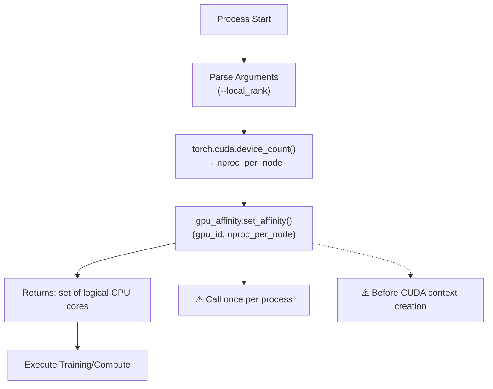
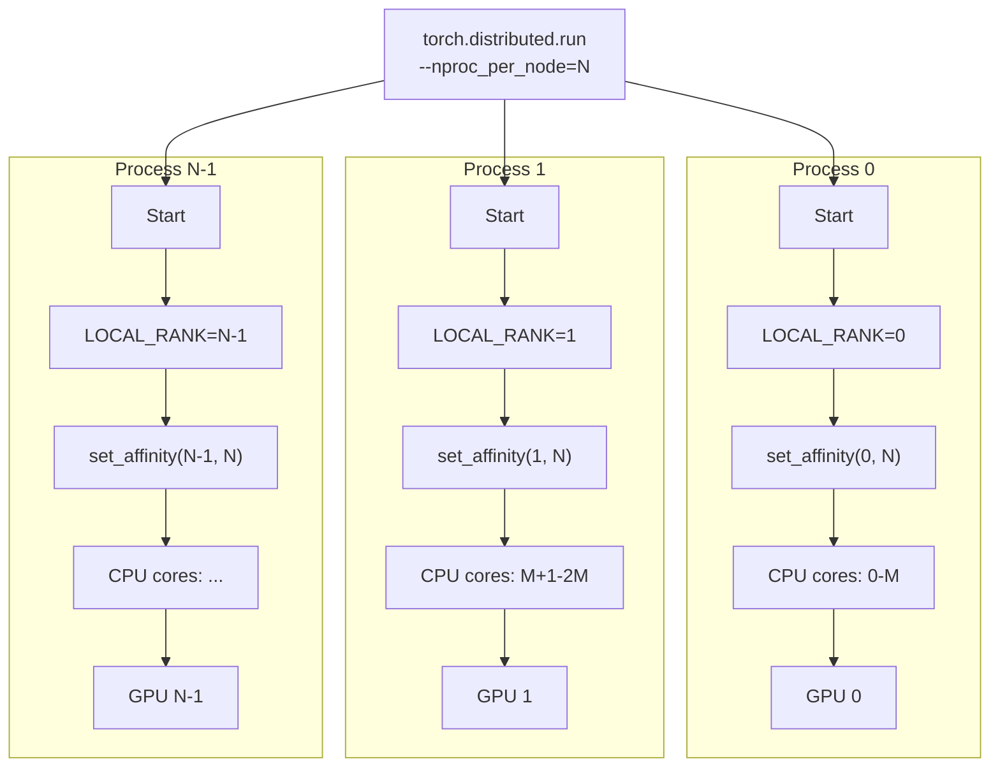
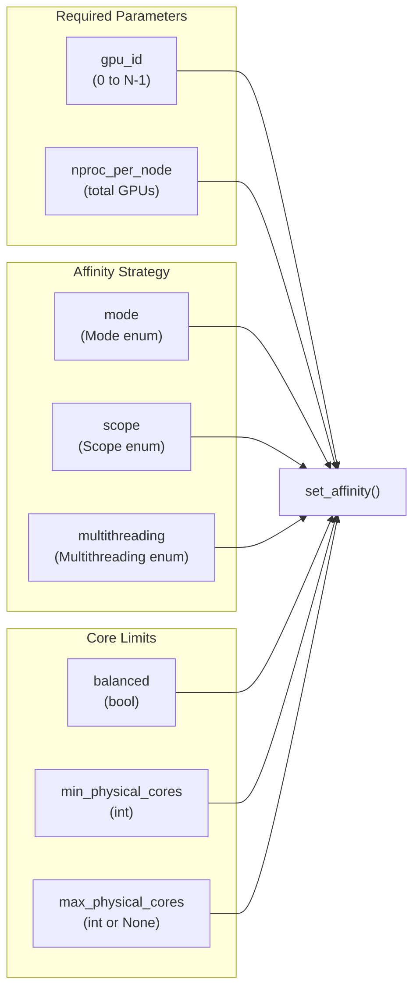
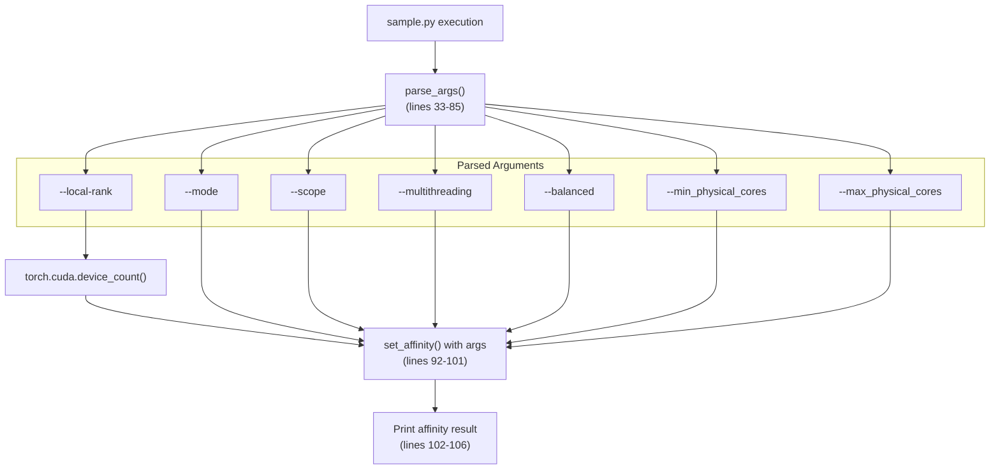
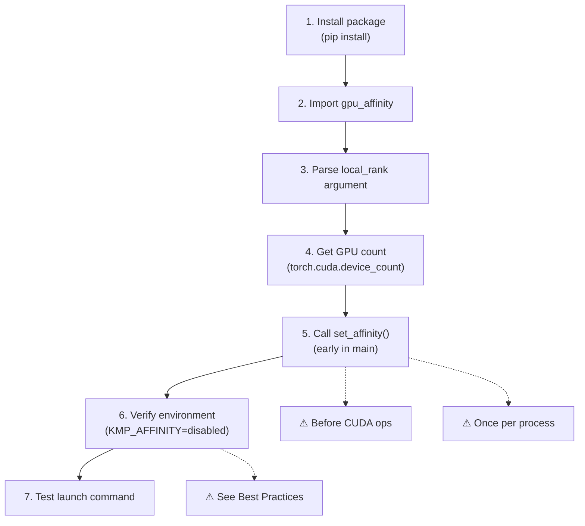

<!-- source: DeepWiki mcp.deepwiki.com · repo NVIDIA/gpu_affinity · page 3 Usage Examples · fetched 2026-10-26 -->

# Usage Examples

<details>
<summary>Relevant source files</summary>

The following files were used as context for generating this wiki page:

- [README.md](README.md)
- [examples/sample/sample.py](examples/sample/sample.py)

</details>


This page demonstrates practical usage of the `gpu_affinity` package in real-world scenarios. Examples range from simple single-file integration to full command-line applications with configurable affinity parameters. For detailed information about the API parameters and affinity strategies, see [API Reference](#2.1) and [Affinity Modes and Strategies](#2.2). For the provided CLI sample application, see [Sample CLI Application](#3.1).

## Basic Usage Pattern

The fundamental usage pattern involves calling `gpu_affinity.set_affinity()` early in the process initialization, after parsing command-line arguments but before any significant computation or CUDA context creation.

### Minimal Example

The simplest integration follows this pattern, as documented in [README.md:148-177]():

```python
import argparse
import os
import gpu_affinity
import torch

def main():
    parser = argparse.ArgumentParser()
    parser.add_argument(
        '--local_rank',
        type=int,
        default=os.getenv('LOCAL_RANK', 0),
    )
    args = parser.parse_args()

    nproc_per_node = torch.cuda.device_count()

    affinity = gpu_affinity.set_affinity(args.local_rank, nproc_per_node)
    print(f'{args.local_rank}: core affinity: {affinity}')

if __name__ == '__main__':
    main()
```

This example uses default parameters (`Mode.UNIQUE_CONTIGUOUS`, `Scope.NODE`, `Multithreading.ALL_LOGICAL`) which are optimized for DGX training workloads.

**Sources:** [README.md:148-177]()

### Initialization Workflow



**Key Requirements:**
- Call `set_affinity()` exactly once per process
- Call before any CUDA operations or significant compute
- Call after parsing the `local_rank` or GPU ID parameter

**Sources:** [README.md:43-50]()

## Distributed Training Example

For multi-GPU training using PyTorch's `DistributedDataParallel`, the typical launch pattern uses `torch.distributed.run`:

### Launch Command

```bash
python -m torch.distributed.run --nproc_per_node <#GPUs> example.py
```

This launcher automatically sets the `LOCAL_RANK` environment variable for each process, which can be read via `os.getenv('LOCAL_RANK', 0)`.

**Sources:** [README.md:175-176]()

### Multi-Process Execution Flow



Each process receives a unique `LOCAL_RANK` and is assigned a unique, non-overlapping subset of CPU cores.

**Sources:** [README.md:148-177]()

## Advanced Configuration Examples

The `set_affinity()` function accepts multiple parameters to customize affinity behavior. The following examples demonstrate common configuration patterns.

### Function Signature and Parameters

The complete function signature from [README.md:55-65]():

```python
def set_affinity(
    gpu_id: int,
    nproc_per_node: int,
    *,
    mode: Mode = Mode.UNIQUE_CONTIGUOUS,
    scope: Scope = Scope.NODE,
    multithreading: Multithreading = Multithreading.ALL_LOGICAL,
    balanced: bool = True,
    min_physical_cores: int = 1,
    max_physical_cores: Optional[int] = None,
)
```

**Sources:** [README.md:55-65]()

### Configuration Parameter Mapping



**Sources:** [README.md:112-131](), [examples/sample/sample.py:92-101]()

### Mode Examples

Different affinity modes control how CPU cores are distributed across processes:

| Mode | Description | Use Case | Example Call |
|------|-------------|----------|--------------|
| `Mode.ALL` | All available cores for each GPU | Maximum CPU resources per GPU | `set_affinity(gpu_id, nproc, mode=Mode.ALL)` |
| `Mode.SINGLE` | First available core (may overlap) | Minimal affinity setting | `set_affinity(gpu_id, nproc, mode=Mode.SINGLE)` |
| `Mode.SINGLE_UNIQUE` | One unique core per GPU | Single-threaded CPU work | `set_affinity(gpu_id, nproc, mode=Mode.SINGLE_UNIQUE)` |
| `Mode.UNIQUE_INTERLEAVED` | Unique cores, interleaved pattern | Load balancing across sockets | `set_affinity(gpu_id, nproc, mode=Mode.UNIQUE_INTERLEAVED)` |
| `Mode.UNIQUE_CONTIGUOUS` | Unique cores, contiguous pattern | **Default, recommended for DGX** | `set_affinity(gpu_id, nproc, mode=Mode.UNIQUE_CONTIGUOUS)` |

**Sources:** [README.md:77-98](), [examples/sample/sample.py:46-50]()

### Scope Examples

Scope determines which CPU cores are considered by `pynvml` when querying hardware topology:

```python
# NUMA node scope (default) - restricts to cores directly connected to GPU
affinity = gpu_affinity.set_affinity(
    gpu_id,
    nproc_per_node,
    scope=gpu_affinity.Scope.NODE
)

# Socket scope - includes all cores on the processor socket
affinity = gpu_affinity.set_affinity(
    gpu_id,
    nproc_per_node,
    scope=gpu_affinity.Scope.SOCKET
)
```

| Scope | CPU Cores Included | DGX A100 Behavior |
|-------|-------------------|-------------------|
| `Scope.NODE` | Cores in same NUMA node as GPU | Uses half the CPU cores (directly connected) |
| `Scope.SOCKET` | All cores in processor socket | Uses all CPU cores |

**Important:** On DGX A100, `Scope.NODE` restricts to the 50% of cores with direct GPU access. Use `Scope.SOCKET` to utilize all cores, as noted in [README.md:135-140]().

**Sources:** [README.md:99-102](), [README.md:135-140](), [examples/sample/sample.py:60-64]()

### Multithreading Examples

Control whether hyperthreading siblings are included:

```python
# Include all logical cores (default) - includes hyperthreading siblings
affinity = gpu_affinity.set_affinity(
    gpu_id,
    nproc_per_node,
    multithreading=gpu_affinity.Multithreading.ALL_LOGICAL
)

# Single logical core only - excludes hyperthreading siblings
affinity = gpu_affinity.set_affinity(
    gpu_id,
    nproc_per_node,
    multithreading=gpu_affinity.Multithreading.SINGLE_LOGICAL
)
```

| Multithreading Mode | Hyperthreading Behavior | Typical Result |
|---------------------|-------------------------|----------------|
| `Multithreading.ALL_LOGICAL` | Includes all logical cores for each physical core | 2× core count on systems with 2-way SMT |
| `Multithreading.SINGLE_LOGICAL` | One logical core per physical core | Physical core count only |

**Sources:** [README.md:104-110](), [examples/sample/sample.py:53-57]()

### Core Limit Examples

Control the number of cores assigned to each process:

```python
# Set minimum cores (raises error if insufficient)
affinity = gpu_affinity.set_affinity(
    gpu_id,
    nproc_per_node,
    min_physical_cores=4
)

# Set maximum cores (trims core list)
affinity = gpu_affinity.set_affinity(
    gpu_id,
    nproc_per_node,
    max_physical_cores=8
)

# Disable balanced assignment
affinity = gpu_affinity.set_affinity(
    gpu_id,
    nproc_per_node,
    balanced=False
)
```

| Parameter | Type | Default | Behavior |
|-----------|------|---------|----------|
| `min_physical_cores` | `int` | `1` | Raises `GPUAffinityError` if fewer cores available |
| `max_physical_cores` | `int` or `None` | `None` | Limits cores to first N if not `None` |
| `balanced` | `bool` | `True` | Ensures equal physical cores per process |

**Sources:** [README.md:112-131](), [examples/sample/sample.py:67-82]()

## Full CLI Example Integration

The provided sample application in [examples/sample/sample.py:1-111]() demonstrates a complete integration with command-line argument parsing:



### Sample Application Arguments

The sample application accepts the following command-line arguments, as defined in [examples/sample/sample.py:39-82]():

| Argument | Type | Default | Choices | Description |
|----------|------|---------|---------|-------------|
| `--local-rank` | `int` | `LOCAL_RANK` env or `0` | - | Process rank for multi-process training |
| `--mode` | `Mode` enum | `UNIQUE_CONTIGUOUS` | All `Mode` values | Affinity mode |
| `--scope` | `Scope` enum | `NODE` | All `Scope` values | Affinity scope |
| `--multithreading` | `Multithreading` enum | `ALL_LOGICAL` | All `Multithreading` values | Multithreading mode |
| `--balanced` | `bool` | `True` | - | Enable balanced core assignment |
| `--min_physical_cores` | `int` | `1` | - | Minimum physical cores required |
| `--max_physical_cores` | `int` or `None` | `None` | - | Maximum physical cores to assign |

**Sources:** [examples/sample/sample.py:39-82]()

### Sample Launch Commands

```bash
# Basic launch with defaults
python -m torch.distributed.run --nproc_per_node 8 examples/sample/sample.py

# Custom mode
python -m torch.distributed.run --nproc_per_node 8 examples/sample/sample.py \
    --mode UNIQUE_INTERLEAVED

# Socket scope for DGX A100
python -m torch.distributed.run --nproc_per_node 8 examples/sample/sample.py \
    --scope SOCKET

# Disable hyperthreading
python -m torch.distributed.run --nproc_per_node 8 examples/sample/sample.py \
    --multithreading SINGLE_LOGICAL

# Limit to 4 physical cores per process
python -m torch.distributed.run --nproc_per_node 8 examples/sample/sample.py \
    --max_physical_cores 4

# Combined custom configuration
python -m torch.distributed.run --nproc_per_node 8 examples/sample/sample.py \
    --mode UNIQUE_CONTIGUOUS \
    --scope SOCKET \
    --multithreading ALL_LOGICAL \
    --balanced true \
    --min_physical_cores 2 \
    --max_physical_cores 16
```

**Sources:** [examples/sample/sample.py:1-111](), [README.md:175-176]()

## Return Value Usage

The `set_affinity()` function returns a set of logical CPU core IDs on which the process is eligible to run:

```python
affinity = gpu_affinity.set_affinity(args.local_rank, nproc_per_node)
# affinity is a set[int], e.g., {0, 1, 2, 3, 64, 65, 66, 67}

print(f'Process assigned to {len(affinity)} logical CPU cores')
print(f'Core IDs: {sorted(affinity)}')
```

The returned set can be used for:
- Verification logging
- Custom affinity adjustments
- Debugging affinity issues

**Sources:** [README.md:133](), [examples/sample/sample.py:102-106]()

## Integration Checklist

When integrating `gpu_affinity` into an application:



1. **Install the package** - See [Installation and Setup](#1.2)
2. **Import at module level** - `import gpu_affinity`
3. **Parse rank parameter** - From CLI args or environment
4. **Get GPU count** - Using `torch.cuda.device_count()` or equivalent
5. **Call `set_affinity()`** - Early in `main()`, after arg parsing, before CUDA
6. **Set environment variables** - See [Best Practices and Caveats](#3.2)
7. **Test with distributed launcher** - Verify affinity across all processes

**Sources:** [README.md:41-50]()

---

