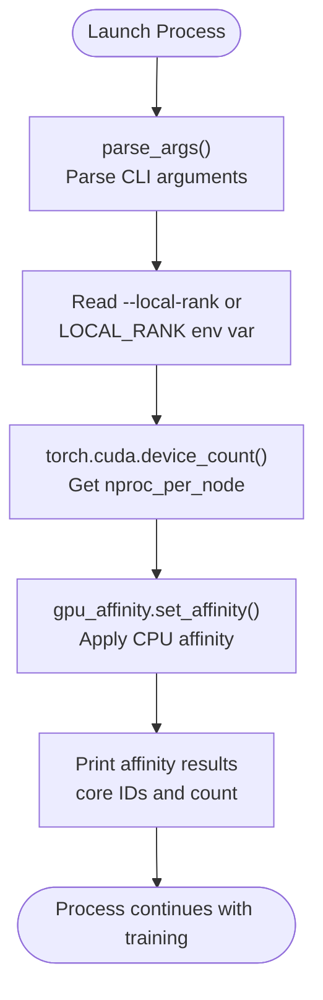
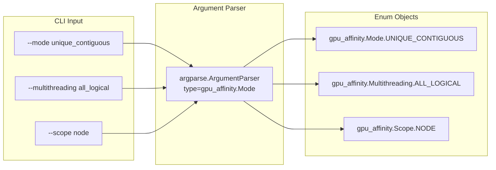
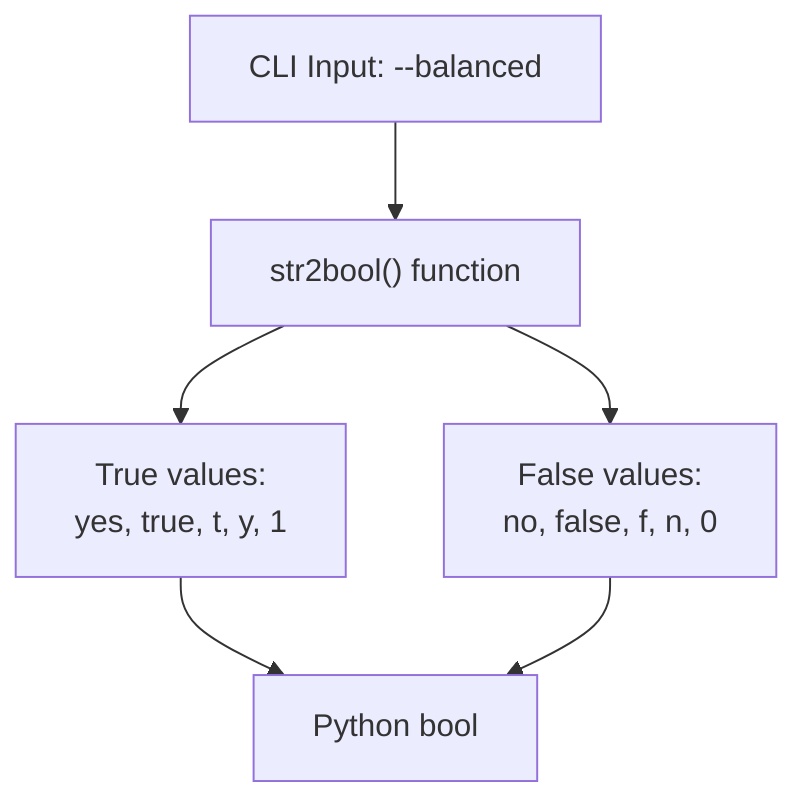
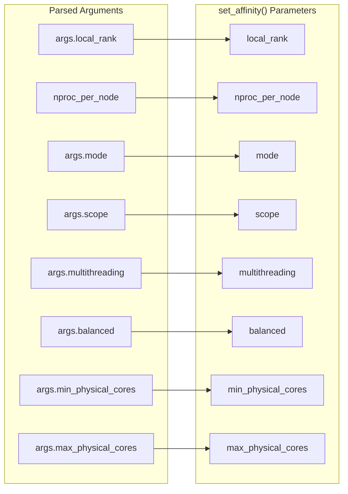
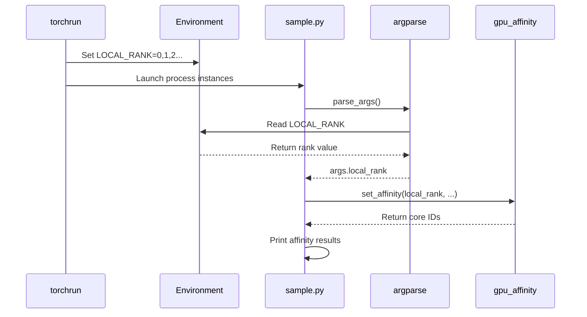
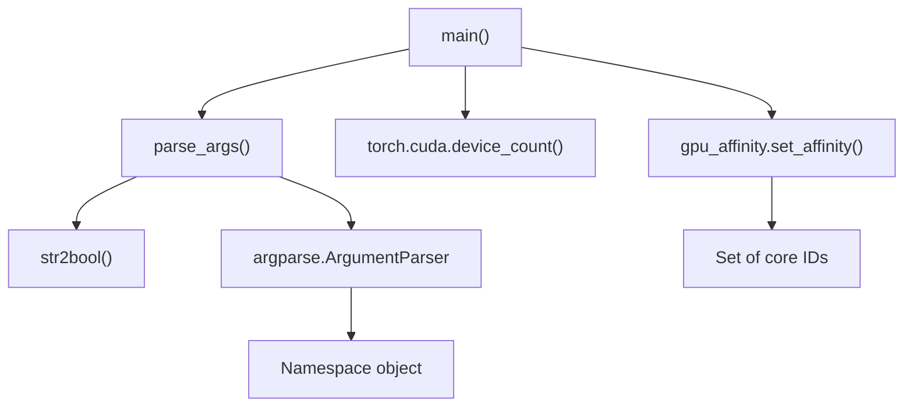

<!-- source: DeepWiki mcp.deepwiki.com · repo NVIDIA/gpu_affinity · page 3.1 Sample CLI Application · fetched 2026-10-26 -->

# Sample CLI Application

<details>
<summary>Relevant source files</summary>

The following files were used as context for generating this wiki page:

- [examples/sample/sample.py](examples/sample/sample.py)

</details>


This document describes the sample command-line application provided in [examples/sample/sample.py](). This application demonstrates practical integration of the `gpu_affinity` package with PyTorch distributed training workloads. It shows how to parse command-line arguments, detect GPU topology, and apply CPU affinity settings in a multi-process training scenario.

For detailed information about the `set_affinity()` API and its parameters, see [API Reference](#2.1). For understanding the various modes and strategies, see [Affinity Modes and Strategies](#2.2).

---

## Purpose and Architecture

The sample CLI application serves as a reference implementation for integrating `gpu_affinity` into distributed training workflows. It demonstrates:

- Parsing command-line arguments for affinity configuration
- Reading environment variables for multi-process coordination
- Detecting hardware topology using PyTorch
- Calling `gpu_affinity.set_affinity()` with appropriate parameters
- Reporting affinity results for verification

### Application Flow



Sources: [examples/sample/sample.py:88-106]()

---

## Command-Line Arguments

The sample application accepts the following arguments, all of which correspond directly to parameters of `gpu_affinity.set_affinity()`:

| Argument | Type | Default | Description |
|----------|------|---------|-------------|
| `--local-rank` | `int` | `LOCAL_RANK` env or `0` | Process rank within the node for multi-process training |
| `--mode` | `gpu_affinity.Mode` | `UNIQUE_CONTIGUOUS` | Affinity assignment mode |
| `--multithreading` | `gpu_affinity.Multithreading` | `ALL_LOGICAL` | Hyperthreading strategy |
| `--scope` | `gpu_affinity.Scope` | `NODE` | CPU topology scope for affinity |
| `--min_physical_cores` | `int` | `1` | Minimum physical cores per process |
| `--max_physical_cores` | `int` | `None` | Maximum physical cores per process |
| `--balanced` | `bool` | `True` | Whether to balance core allocation across sockets/NUMA nodes |

Sources: [examples/sample/sample.py:33-85]()

### Argument Type Conversions

The application uses Python enums from the `gpu_affinity` package as argument types. The `argparse` module automatically converts string inputs to the appropriate enum values by leveraging the enum's string representation.



Sources: [examples/sample/sample.py:46-65]()

### Boolean Argument Helper

The application includes a `str2bool()` helper function that converts various string representations of boolean values to Python boolean types. This enables flexible command-line usage:



Sources: [examples/sample/sample.py:22-30]()

---

## Integration with gpu_affinity

The core integration occurs in the `main()` function, which orchestrates the affinity assignment process:

### Step 1: Parse Arguments

[examples/sample/sample.py:89]() calls `parse_args()` to extract all command-line parameters into an `args` namespace object.

### Step 2: Detect GPU Count

[examples/sample/sample.py:91]() uses `torch.cuda.device_count()` to determine `nproc_per_node`, which represents the total number of GPU devices (and thus processes) on the current node.

### Step 3: Set Affinity

[examples/sample/sample.py:92-101]() invokes `gpu_affinity.set_affinity()` with the following parameter mapping:



Sources: [examples/sample/sample.py:92-101]()

### Step 4: Report Results

[examples/sample/sample.py:102-106]() prints the assigned affinity, including:
- The process rank (`args.local_rank`)
- The sorted list of CPU core IDs assigned to this process
- The total count of logical cores assigned

---

## Usage Examples

### Single-Process Execution

Run the sample for a single process (rank 0) with default settings:

```bash
python examples/sample/sample.py
```

### Multi-Process Execution with torchrun

Launch multiple processes using PyTorch's distributed launcher:

```bash
torchrun --nproc_per_node=8 examples/sample/sample.py
```

Each process receives a unique `LOCAL_RANK` environment variable automatically set by `torchrun`, which the sample application reads at [examples/sample/sample.py:42]().

### Custom Configuration

Override default affinity settings:

```bash
python examples/sample/sample.py \
    --mode unique_interleaved \
    --scope socket \
    --multithreading single_logical \
    --balanced false \
    --min_physical_cores 4
```

### Execution Flow with Environment Variables



Sources: [examples/sample/sample.py:40-44](), [examples/sample/sample.py:88-106]()

---

## Output Interpretation

The sample application prints two types of output:

### Arguments Display

The parsed arguments are printed at [examples/sample/sample.py:90](), showing all configuration values:

```
Namespace(local_rank=0, mode=<Mode.UNIQUE_CONTIGUOUS: 1>, multithreading=<Multithreading.ALL_LOGICAL: 1>, scope=<Scope.NODE: 1>, min_physical_cores=1, max_physical_cores=None, balanced=True)
```

### Affinity Assignment Display

The actual affinity assignment is printed at [examples/sample/sample.py:102-106]():

```
rank 0: core affinity: [0, 1, 2, 3, 88, 89, 90, 91], num logical cores: 8
```

This output indicates:
- **Process rank**: The local rank within the node (0 in this example)
- **Core affinity**: The specific CPU core IDs assigned to this process (sorted)
- **Logical core count**: Total number of cores available to this process

---

## Code Structure

The application is organized into three primary functions:



Sources: [examples/sample/sample.py:22-110]()

### Function Responsibilities

| Function | Lines | Purpose |
|----------|-------|---------|
| `str2bool()` | [22-30]() | Convert string representations to boolean values |
| `parse_args()` | [33-85]() | Define and parse all command-line arguments |
| `main()` | [88-106]() | Orchestrate affinity assignment and display results |

Sources: [examples/sample/sample.py:22-110]()

---

## Extension Points

The sample application can be extended for custom use cases:

1. **Additional Parameters**: Add more command-line arguments by extending `parse_args()` and passing them to `set_affinity()`
2. **Custom Validation**: Implement validation logic after parsing but before calling `set_affinity()`
3. **Logging Integration**: Replace print statements with structured logging
4. **Configuration Files**: Load default values from configuration files before parsing command-line arguments
5. **Integration with Training Loops**: Use the returned affinity set for additional validation or monitoring within training code

Sources: [examples/sample/sample.py:33-106]()

---

