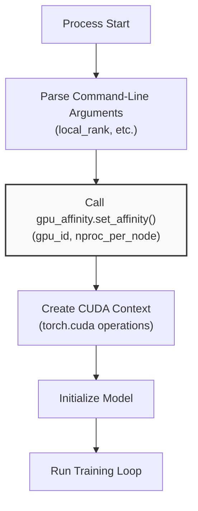
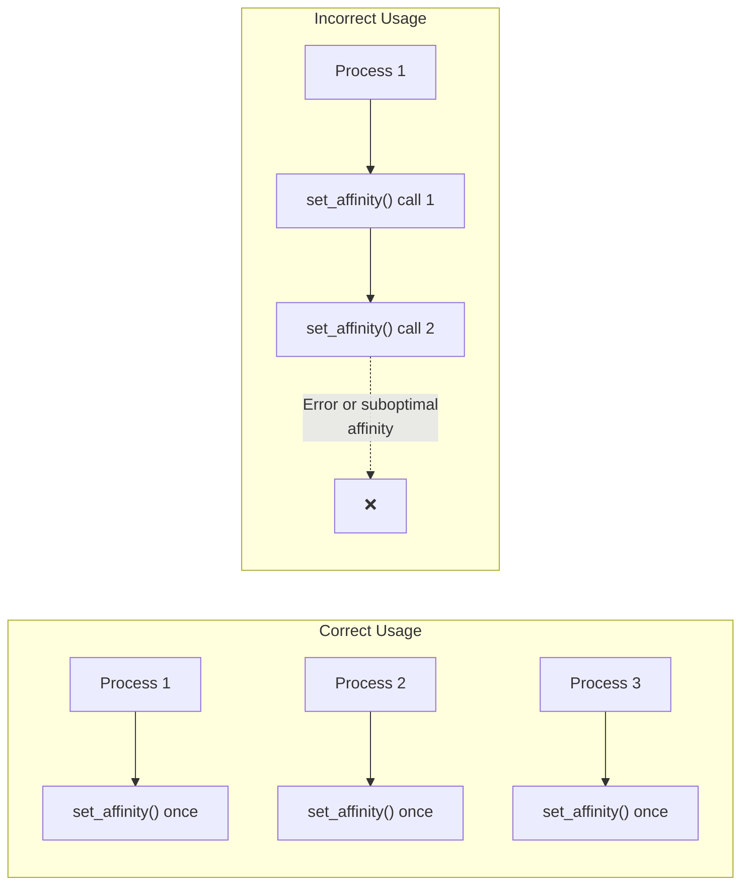
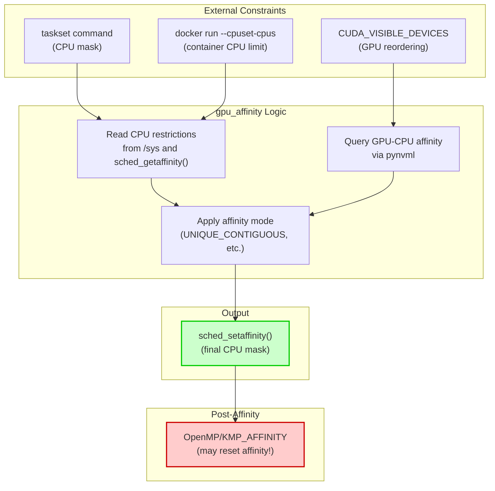
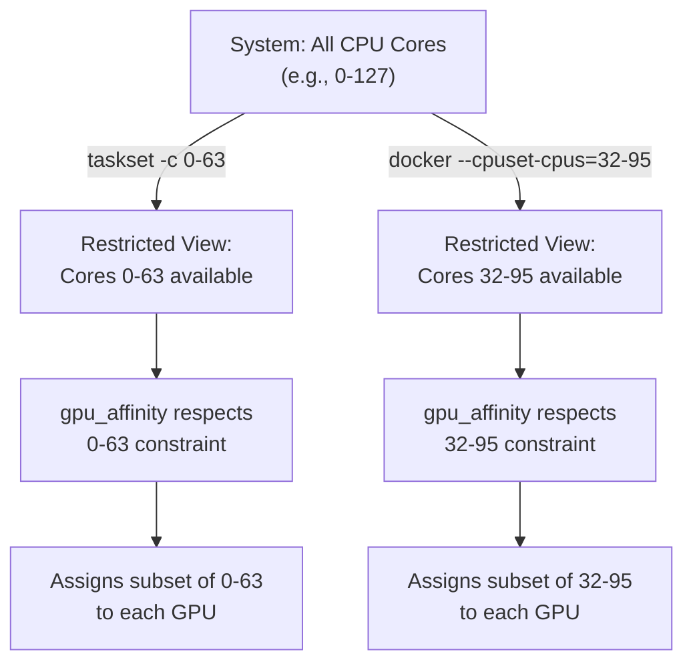
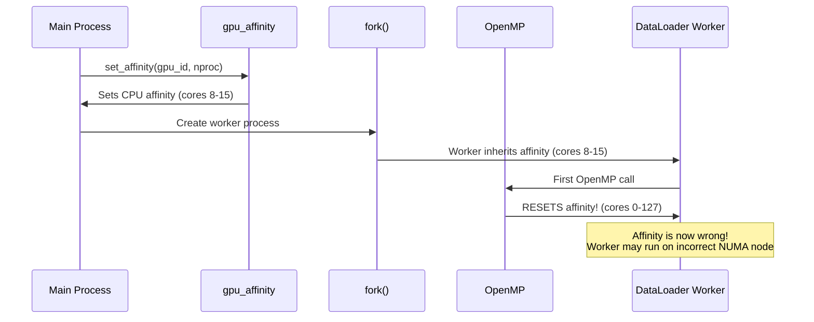
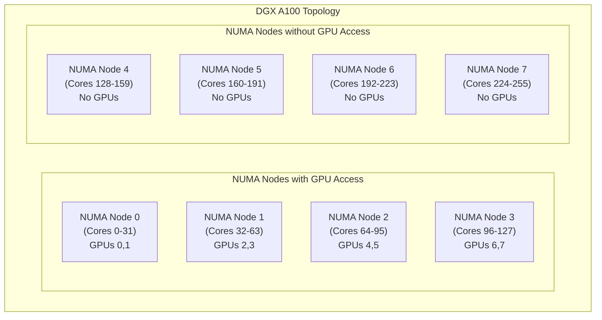
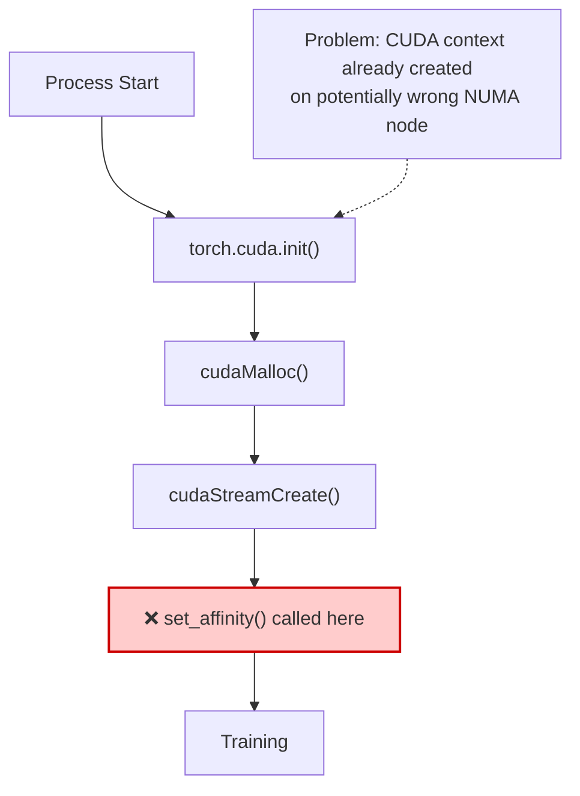
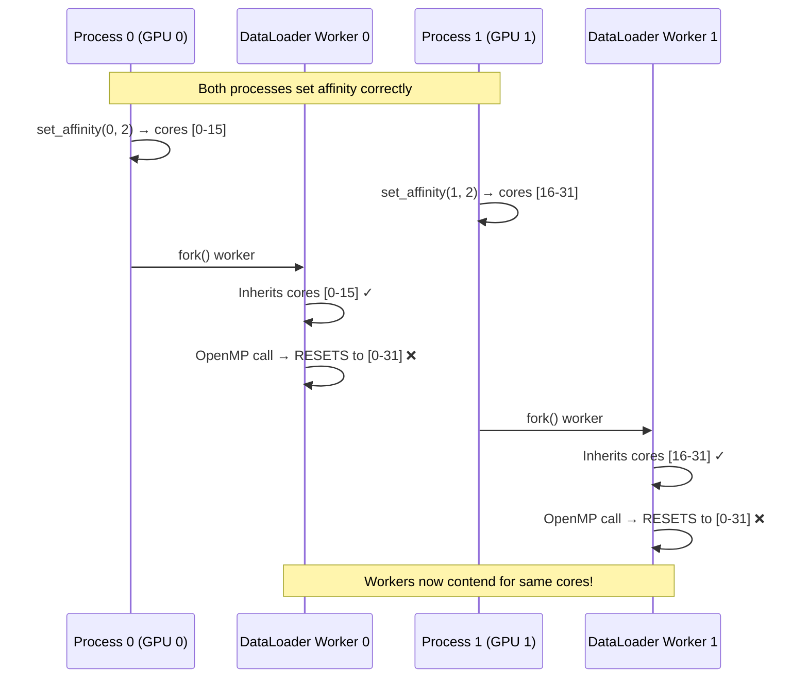
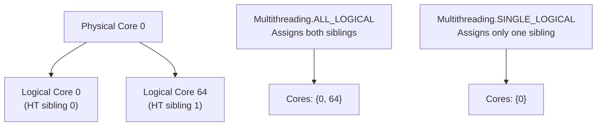

<!-- source: DeepWiki mcp.deepwiki.com · repo NVIDIA/gpu_affinity · page 3.2 Best Practices and Caveats · fetched 2026-10-26 -->

# Best Practices and Caveats

<details>
<summary>Relevant source files</summary>

The following files were used as context for generating this wiki page:

- [README.md](README.md)

</details>


## Purpose and Scope

This page documents best practices, common pitfalls, and important caveats when using the `gpu_affinity` package in production workloads. It covers initialization patterns, environment variable interactions, hardware-specific considerations, and performance optimization techniques. For detailed API documentation, see [API Reference](#2.1). For information about affinity modes and strategies, see [Affinity Modes and Strategies](#2.2).

---

## Initialization Best Practices

### Calling `set_affinity()` Correctly

The `set_affinity()` function must be called **exactly once per process** and at the correct point in your application lifecycle.

#### Correct Initialization Order



**Key Requirements:**

| Requirement | Rationale |
|------------|-----------|
| Call after argument parsing | Requires `gpu_id` and `nproc_per_node` parameters |
| Call before CUDA context creation | Affinity should be set before any GPU operations |
| Call before significant compute | Ensures affinity is established before workload begins |
| Call exactly once per process | Multiple calls may result in errors or suboptimal affinity |

**Sources:** [README.md:43-50]()

### Single-Call Constraint



The restriction against multiple calls exists because:
- Each call recalculates CPU core assignments based on current system state
- Multiple calls may conflict with each other's affinity settings
- OS affinity API (`sched_setaffinity`) expects a single, stable assignment per process

**Sources:** [README.md:48-50]()

### Recommended Main Function Pattern

```python
def main():
    # Step 1: Parse arguments
    parser = argparse.ArgumentParser()
    parser.add_argument('--local_rank', type=int, default=os.getenv('LOCAL_RANK', 0))
    args = parser.parse_args()
    
    # Step 2: Determine process count
    nproc_per_node = torch.cuda.device_count()
    
    # Step 3: Set affinity IMMEDIATELY
    affinity = gpu_affinity.set_affinity(args.local_rank, nproc_per_node)
    
    # Step 4: Now safe to perform GPU operations
    torch.cuda.set_device(args.local_rank)
    model = Model().cuda()
    # ... rest of initialization
```

**Sources:** [README.md:148-177]()

---

## Environment Variable Interactions

### Critical Environment Variables

The `gpu_affinity` package interacts with several environment variables that affect CPU and GPU assignment. Understanding these interactions is essential for correct behavior.



**Sources:** [README.md:14-22]()

### `CUDA_VISIBLE_DEVICES` Support

The package correctly handles GPU device reordering via `CUDA_VISIBLE_DEVICES`:

| Scenario | GPU ID Mapping | Behavior |
|----------|---------------|----------|
| No `CUDA_VISIBLE_DEVICES` | GPU 0 → Physical GPU 0 | Direct mapping to hardware GPUs |
| `CUDA_VISIBLE_DEVICES=2,3` | GPU 0 → Physical GPU 2<br/>GPU 1 → Physical GPU 3 | Affinity queries respect reordering |
| `CUDA_VISIBLE_DEVICES=3,1,0,2` | GPU 0 → Physical GPU 3<br/>GPU 1 → Physical GPU 1 | Arbitrary reordering supported |

The `pynvml` queries automatically use the correct physical GPU indices, ensuring CPU affinity matches the actual hardware topology.

**Sources:** [README.md:22]()

### CPU Constraint Respect

The package respects external CPU restrictions:



The implementation reads the current process affinity via `os.sched_getaffinity()` and intersects it with the recommended cores from `pynvml`, ensuring it never violates external constraints.

**Sources:** [README.md:14-15]()

---

## OpenMP and `KMP_AFFINITY` Warning

### Critical Intel OpenMP Issue

**WARNING:** Intel's OpenMP implementation has a problematic behavior that can override the affinity set by `gpu_affinity.set_affinity()`.



### The Problem

Intel OpenMP (`libiomp5`) resets the process CPU affinity on the first call to an OpenMP function after a `fork()`. This commonly occurs with:
- PyTorch `DataLoader` workers (which are forked from the main process)
- Any multi-processing patterns that use `fork`
- NumPy/SciPy operations in worker processes (if they use OpenMP-accelerated libraries)

**Sources:** [README.md:142-146]()

### The Solution

Set the `KMP_AFFINITY` environment variable to `disabled`:

```bash
# In your launch script or environment
export KMP_AFFINITY=disabled

# Or inline with your command
KMP_AFFINITY=disabled python -m torch.distributed.run --nproc_per_node 8 train.py
```

| `KMP_AFFINITY` Value | Behavior | Recommendation |
|---------------------|----------|----------------|
| `disabled` | OpenMP does not manage affinity | **Recommended** - preserves `gpu_affinity` settings |
| `compact`, `scatter`, etc. | OpenMP controls affinity | Conflicts with `gpu_affinity` |
| (unset) | Default OpenMP behavior | May reset affinity after fork |

**Sources:** [README.md:142-146]()

---

## Hardware-Specific Considerations

### DGX A100 NUMA Topology

NVIDIA DGX A100 systems have a unique NUMA topology where **only half of the CPU cores have direct access to GPUs**.



### Scope Selection Impact

| `Scope` Mode | DGX A100 Behavior | CPU Cores Used | Memory Bandwidth | Recommendation |
|-------------|-------------------|----------------|------------------|----------------|
| `Scope.NODE` | Restricts to GPU-connected NUMA nodes only | 50% (128 cores) | 50% | Default - sufficient for most DL workloads |
| `Scope.SOCKET` | Uses all cores in socket (may span multiple NUMA nodes) | 100% (256 cores) | 100% | Use for CPU-intensive models |

**Critical Decision Point:**

```python
# Conservative approach (default) - GPU-local cores only
affinity = gpu_affinity.set_affinity(
    gpu_id, 
    nproc_per_node,
    scope=gpu_affinity.Scope.NODE  # Only GPU-connected cores
)

# Aggressive approach - all available cores
affinity = gpu_affinity.set_affinity(
    gpu_id, 
    nproc_per_node,
    scope=gpu_affinity.Scope.SOCKET  # All cores in socket
)
```

**Trade-offs:**

- `Scope.NODE`: Lower latency for GPU-CPU communication, reduced CPU resources
- `Scope.SOCKET`: More CPU cores and memory bandwidth, potentially higher latency for GPU operations

**Sources:** [README.md:135-140]()

### DGX A100 Best Practice

For most deep learning training workloads on DGX A100:
1. Start with `scope=Scope.NODE` (default)
2. Profile your workload
3. If CPU-bound (e.g., heavy data preprocessing), consider `scope=Scope.SOCKET`
4. Monitor NUMA memory traffic to detect cross-NUMA access

**Sources:** [README.md:135-140]()

---

## Common Pitfalls and Debugging

### Pitfall 1: Late Affinity Setting



**Symptom:** Inconsistent performance, cross-NUMA memory traffic

**Solution:** Always call `set_affinity()` before any CUDA operations

**Sources:** [README.md:45-47]()

### Pitfall 2: Multiple Affinity Calls

```python
# ❌ WRONG: Multiple calls
affinity1 = gpu_affinity.set_affinity(gpu_id, nproc_per_node, mode=Mode.ALL)
# ... some code ...
affinity2 = gpu_affinity.set_affinity(gpu_id, nproc_per_node, mode=Mode.UNIQUE_CONTIGUOUS)
# Result: Undefined behavior, may raise error or use suboptimal affinity
```

**Symptom:** Errors, warnings, or cores assigned differently than expected

**Solution:** Call `set_affinity()` exactly once per process

**Sources:** [README.md:48-50]()

### Pitfall 3: Ignoring Return Value

```python
# ❌ Suboptimal: Not checking assigned cores
gpu_affinity.set_affinity(gpu_id, nproc_per_node)

# ✓ Better: Verify and log assigned cores
affinity = gpu_affinity.set_affinity(gpu_id, nproc_per_node)
print(f"Process {gpu_id} assigned to CPU cores: {sorted(affinity)}")
```

**Why this matters:** Logging affinity helps debug:
- Whether affinity is balanced across processes
- If external constraints (taskset, docker) are interfering
- NUMA node assignments in multi-socket systems

**Sources:** [README.md:133](), [README.md:168-169]()

### Pitfall 4: Fork Without `KMP_AFFINITY=disabled`



**Symptom:** Performance degradation when using `DataLoader` with `num_workers > 0`

**Solution:** Set `KMP_AFFINITY=disabled` before launching

**Sources:** [README.md:142-146]()

---

## Performance Optimization

### Verifying Affinity Settings

Use the return value of `set_affinity()` to verify correct assignment:

```python
import gpu_affinity
import os

def main():
    # ... argument parsing ...
    
    affinity = gpu_affinity.set_affinity(args.local_rank, nproc_per_node)
    
    # Verify and log
    current_affinity = os.sched_getaffinity(0)
    assert affinity == current_affinity, "Affinity mismatch!"
    
    print(f"GPU {args.local_rank}: Assigned to {len(affinity)} CPU cores")
    print(f"  Physical cores: {sorted(affinity)}")
```

### Monitoring Affinity in Production


**Checklist for Production:**

- [ ] Log assigned cores for each process
- [ ] Verify balanced assignment (equal cores per GPU)
- [ ] Check for NUMA boundary crossings (use `numactl --hardware`)
- [ ] Monitor cross-NUMA memory bandwidth
- [ ] Profile with `nsys` or `nvidia-smi` to verify GPU utilization

**Sources:** [README.md:168-169]()

### Balanced vs. Unbalanced Assignment

The `balanced=True` parameter (default) ensures equal physical cores per GPU:

| Scenario | `balanced=True` | `balanced=False` |
|----------|----------------|------------------|
| 8 GPUs, 64 cores | Each GPU gets 8 cores | Variable allocation (e.g., 12,10,8,8,7,7,6,6) |
| Performance | Consistent across GPUs | May have stragglers |
| Recommendation | **Default for training** | Only for specialized workloads |

**Sources:** [README.md:121-124]()

### Physical vs. Logical Cores



**Recommendation Matrix:**

| Workload Type | Multithreading Mode | Rationale |
|--------------|-------------------|-----------|
| GPU-bound (typical DL training) | `ALL_LOGICAL` (default) | GPU is bottleneck, more CPU threads help with data loading |
| CPU-bound preprocessing | `SINGLE_LOGICAL` | Avoid hyperthreading overhead, maximize single-thread perf |
| Mixed workloads | `ALL_LOGICAL` | Better throughput for parallel operations |

**Sources:** [README.md:104-110]()

---

## Summary Checklist

### Pre-Deployment Checklist

- [ ] Call `set_affinity()` immediately after argument parsing
- [ ] Call `set_affinity()` before any CUDA operations
- [ ] Set `KMP_AFFINITY=disabled` in environment
- [ ] Choose appropriate `scope` for hardware (DGX A100: consider `Scope.SOCKET`)
- [ ] Log assigned cores for each process
- [ ] Verify balanced assignment across GPUs
- [ ] Test with `DataLoader` workers (`num_workers > 0`)
- [ ] Profile for NUMA effects and cross-NUMA traffic

### Runtime Validation

```python
def validate_affinity_setup(gpu_id, affinity):
    """Validate affinity configuration at runtime."""
    import os
    
    # Check affinity was actually set
    current = os.sched_getaffinity(0)
    assert current == affinity, f"Affinity mismatch: {current} != {affinity}"
    
    # Check KMP_AFFINITY
    kmp = os.getenv('KMP_AFFINITY', 'not_set')
    if kmp != 'disabled':
        print(f"WARNING: KMP_AFFINITY={kmp}, should be 'disabled'")
    
    # Log assignment
    print(f"GPU {gpu_id}: {len(affinity)} cores assigned: {sorted(affinity)}")
```

**Sources:** [README.md:14-177]()

---

**Key Takeaways:**

1. Initialize affinity **early and once** per process
2. Set `KMP_AFFINITY=disabled` to prevent OpenMP interference
3. Choose `Scope.NODE` vs `Scope.SOCKET` based on DGX A100 workload requirements
4. Always log and verify assigned cores
5. Test with realistic workload patterns (DataLoader workers, etc.)

---

