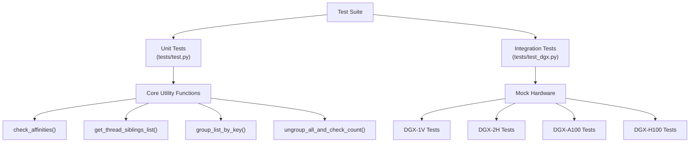
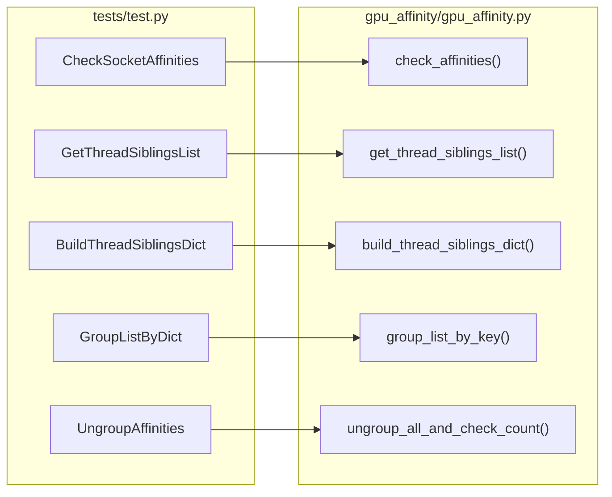
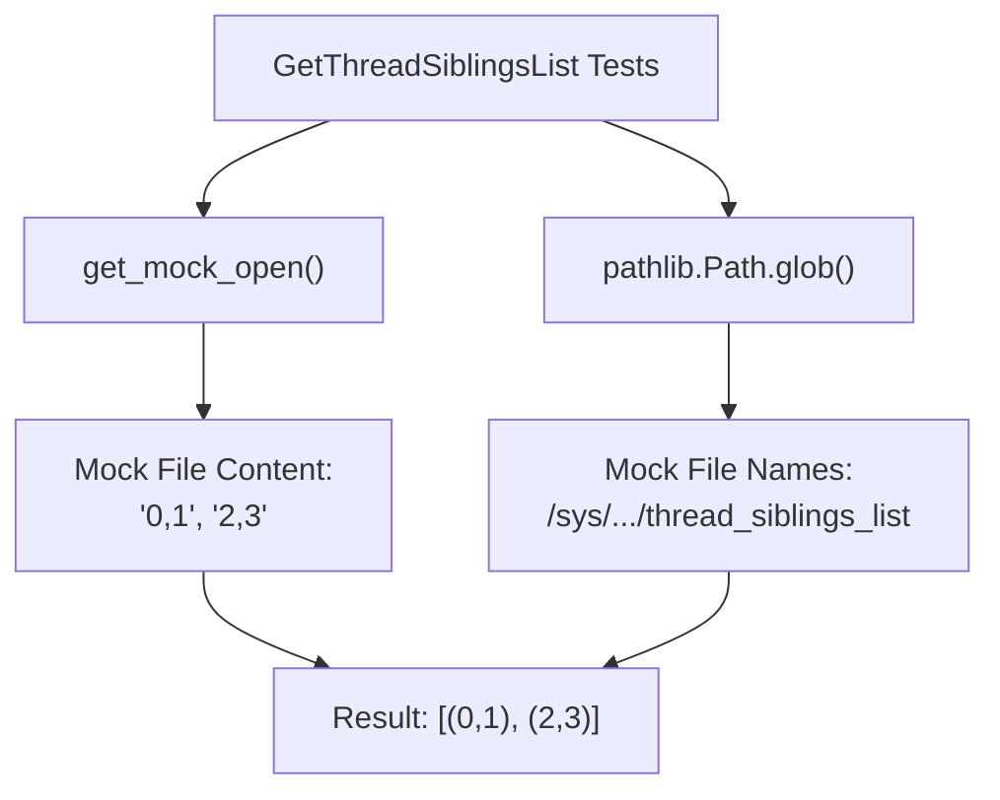
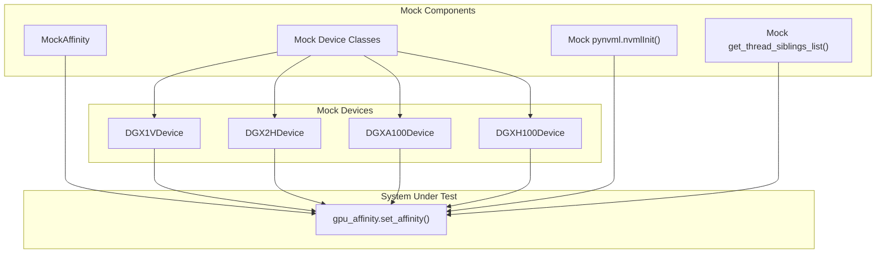
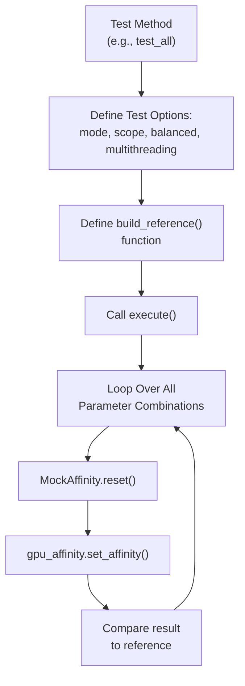
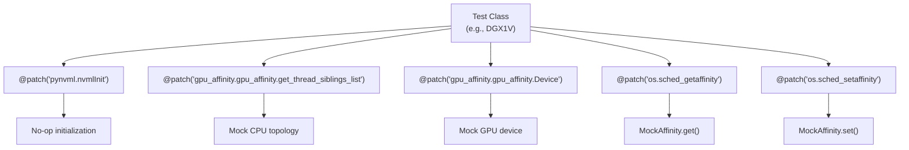
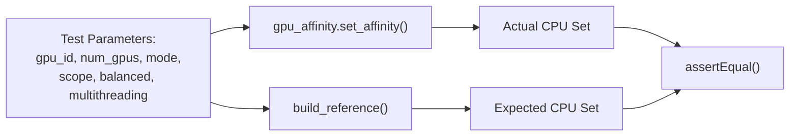
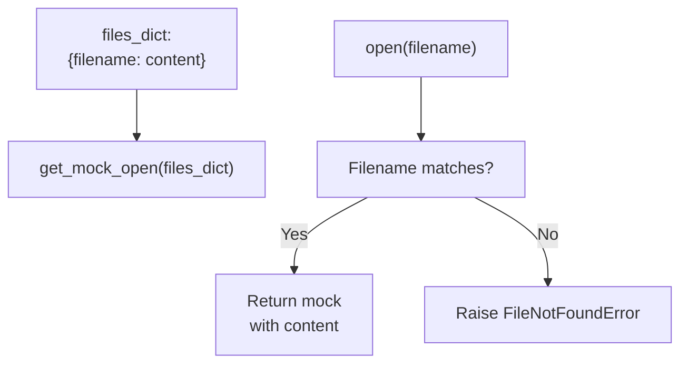

<!-- source: DeepWiki mcp.deepwiki.com · repo NVIDIA/gpu_affinity · page 4 Testing and Validation · fetched 2026-10-26 -->

# Testing and Validation

<details>
<summary>Relevant source files</summary>

The following files were used as context for generating this wiki page:

- [tests/test.py](tests/test.py)
- [tests/test_dgx.py](tests/test_dgx.py)

</details>


This document describes the testing strategy, test suite structure, and validation approach for the `gpu_affinity` package. The test suite ensures that CPU affinity assignment logic works correctly across different hardware configurations, affinity modes, and system topologies.

For information on the core affinity logic being tested, see [Core Functionality](#2). For development workflow and contributing tests, see [Development and Contribution Guide](#5).

## Testing Strategy Overview

The `gpu_affinity` test suite employs a two-tier testing strategy to validate both low-level utility functions and high-level affinity assignment behavior:



**Sources:** [tests/test.py:1-161](), [tests/test_dgx.py:1-1174]()

### Test Organization

| Test Type | File | Purpose | Coverage |
|-----------|------|---------|----------|
| Unit Tests | `tests/test.py` | Validates individual utility functions with minimal dependencies | Core logic functions |
| Integration Tests | `tests/test_dgx.py` | Validates end-to-end affinity assignment on simulated DGX hardware | Complete workflows |

The test suite uses Python's `unittest` framework and extensive mocking to simulate hardware topologies without requiring physical GPU hardware.

**Sources:** [tests/test.py:16](), [tests/test_dgx.py:16-17]()

## Unit Tests

Unit tests focus on validating individual utility functions that support the core affinity assignment logic. These tests use mocking to isolate functionality and avoid dependencies on actual hardware.

### Test Classes and Coverage



**Sources:** [tests/test.py:39-161]()

### Affinity Validation Tests

The `CheckSocketAffinities` test class validates the `check_affinities()` function, which ensures that affinity assignments across GPUs are either disjoint or identical (no partial overlap):

- **`test_disjoint`**: Verifies acceptance of non-overlapping affinity sets
- **`test_identical`**: Verifies acceptance of identical affinity sets across GPUs
- **`test_overlap`**: Verifies that partial overlap raises `GPUAffinityError`
- **`test_single`**: Validates single GPU affinity assignment

**Sources:** [tests/test.py:39-56]()

### Thread Sibling Tests

The `GetThreadSiblingsList` test class validates reading and parsing of hyperthreading topology from `/sys/devices/system/cpu/*/topology/thread_siblings_list`:



Key test cases:
- **`test_mocked_simple`**: Tests parsing distinct hyperthreading pairs
- **`test_mocked_duplicates`**: Tests deduplication of sibling pairs

The mock helper function `get_mock_open()` simulates file system reads without actual file I/O.

**Sources:** [tests/test.py:22-30](), [tests/test.py:58-87]()

### Grouping and Ungrouping Tests

The `BuildThreadSiblingsDict` and `GroupListByDict` test classes validate data structure transformations:

| Function | Input | Output | Test Coverage |
|----------|-------|--------|---------------|
| `build_thread_siblings_dict()` | `[(0,1), (2,3)]` | `{0:(0,1), 1:(0,1), 2:(2,3), 3:(2,3)}` | 1-item, 2-item lists |
| `group_list_by_key()` | `[0,1,2,3]` with key function | `[(0,1), (2,3)]` | Simple, missing dict entries |

The `UngroupAffinities` test class validates the `ungroup_all_and_check_count()` function, which expands grouped CPU cores based on multithreading mode:

- **`test_simple_all_logical`**: Tests expansion with `ALL_LOGICAL` mode (includes hyperthreads)
- **`test_simple_single_logical`**: Tests expansion with `SINGLE_LOGICAL` mode (excludes hyperthreads)
- **`test_unknown_mode`**: Verifies error handling for invalid modes

**Sources:** [tests/test.py:89-161]()

## Integration Tests (DGX Hardware Simulation)

Integration tests validate complete affinity assignment workflows by simulating specific DGX hardware configurations. These tests use comprehensive mocking to replicate the behavior of real NVIDIA DGX systems without requiring physical hardware.

### Mock Infrastructure



**Sources:** [tests/test_dgx.py:22-147]()

#### MockAffinity Class

The `MockAffinity` class simulates OS-level CPU affinity operations (`os.sched_setaffinity` and `os.sched_getaffinity`):

- **`reset(num_cores)`**: Initializes all cores as available
- **`set(pid, mask)`**: Sets the CPU affinity mask
- **`get(pid)`**: Retrieves the current CPU affinity mask

This mock tracks affinity state in-memory, allowing tests to verify that `set_affinity()` correctly calls the OS API.

**Sources:** [tests/test_dgx.py:22-36]()

#### Mock Device Classes

Each DGX hardware variant has a mock device class that replicates GPU-to-CPU affinity topology:

| Mock Class | Hardware | GPUs | Physical Cores | Hyperthread Offset |
|------------|----------|------|----------------|-------------------|
| `DGX1VDevice` | DGX-1 (Volta) | 8 | 40 | 40 |
| `DGX2HDevice` | DGX-2 (Volta) | 16 | 48 | 48 |
| `DGXA100Device` | DGX A100 | 8 | 128 | 128 |
| `DGXH100Device` | DGX H100 | 8 | 112 | 112 |

Each device class implements `get_cpu_affinity(scope)` to return the appropriate CPU list based on GPU ID and affinity scope (NODE or SOCKET).

**Sources:** [tests/test_dgx.py:45-122]()

Example topology implementation for DGX-1V:

```
Device 0-3: CPUs 0-19, 40-59 (Socket 0)
Device 4-7: CPUs 20-39, 60-79 (Socket 1)
```

**Sources:** [tests/test_dgx.py:45-60]()

### Test Execution Pattern

All integration test classes follow a consistent execution pattern using the `execute()` method:



**Sources:** [tests/test_dgx.py:163-199](), [tests/test_dgx.py:365-400]()

Each test method:
1. Defines parameter combinations (mode, scope, balanced, multithreading)
2. Provides a `build_reference()` function that computes expected affinity for each GPU
3. Calls `execute()` which iterates over all combinations
4. For each combination, resets affinity state, calls `set_affinity()`, and validates results

### DGX-Specific Test Coverage

Each DGX test class validates all affinity modes across different parameter combinations:

#### Tested Affinity Modes

| Mode | Description | Test Methods |
|------|-------------|-------------|
| `Mode.ALL` | All CPUs in scope | `test_all` variants |
| `Mode.SINGLE` | Single CPU (shared across GPUs) | `test_single` |
| `Mode.SINGLE_UNIQUE` | One unique CPU per GPU | `test_single_unique` |
| `Mode.UNIQUE_CONTIGUOUS` | Unique, contiguous CPU ranges per GPU | `test_unique_contiguous` variants |
| `Mode.UNIQUE_INTERLEAVED` | Unique, interleaved CPUs per GPU | `test_unique_interleaved` variants |

**Sources:** [tests/test_dgx.py:200-348](), [tests/test_dgx.py:402-590]()

#### Parameter Combinations

Each test typically validates all combinations of:
- **Scope**: `Scope.NODE`, `Scope.SOCKET`
- **Balanced**: `True`, `False`
- **Multithreading**: `Multithreading.ALL_LOGICAL`, `Multithreading.SINGLE_LOGICAL`

This exhaustive testing ensures correct behavior across diverse configuration scenarios.

**Sources:** [tests/test_dgx.py:201-207]()

### Special Test Cases

#### DGX A100 Scope Differences

DGX A100 has distinct behavior for NODE vs. SOCKET scope due to its NVSwitch topology. Tests are split accordingly:

- **`test_all_node`**: Tests NODE scope (NUMA-local CPUs)
- **`test_all_socket`**: Tests SOCKET scope (all CPUs in socket)
- **`test_all_socket_max63`**: Tests `max_physical_cores` limiting

**Sources:** [tests/test_dgx.py:644-743]()

Example reference builder for DGX A100 with NODE scope:

```
GPU 0-1: CPUs 48-63  (NUMA node local to GPUs 0-1)
GPU 2-3: CPUs 16-31  (NUMA node local to GPUs 2-3)
GPU 4-5: CPUs 112-127 (NUMA node local to GPUs 4-5)
GPU 6-7: CPUs 80-95  (NUMA node local to GPUs 6-7)
```

**Sources:** [tests/test_dgx.py:653-664]()

## Running Tests

The test suite uses Python's standard `unittest` framework. Tests can be executed using:

```bash
# Run all tests
python -m unittest discover tests/

# Run unit tests only
python -m unittest tests.test

# Run DGX integration tests only
python -m unittest tests.test_dgx

# Run specific test class
python -m unittest tests.test_dgx.DGX1V

# Run specific test method
python -m unittest tests.test_dgx.DGX1V.test_all
```

### Test Decorators and Patches

Integration tests use extensive `@unittest.mock.patch` decorators to mock external dependencies:



**Sources:** [tests/test_dgx.py:149-156]()

The patches are applied at class level, affecting all test methods within the class. This ensures consistent mocking across the entire test suite for each hardware configuration.

## Test Coverage and Validation

### Coverage Matrix

The test suite provides comprehensive coverage across multiple dimensions:

| Dimension | Coverage |
|-----------|----------|
| **Affinity Modes** | ALL, SINGLE, SINGLE_UNIQUE, UNIQUE_CONTIGUOUS, UNIQUE_INTERLEAVED |
| **Scopes** | NODE, SOCKET |
| **Multithreading** | ALL_LOGICAL, SINGLE_LOGICAL |
| **Balanced Mode** | True, False |
| **Hardware** | DGX-1V, DGX-2H, DGX-A100, DGX-H100 |
| **GPU Count** | 8 (DGX-1V, A100, H100), 16 (DGX-2H) |

**Sources:** [tests/test_dgx.py:157-1174]()

### Validation Strategy



**Sources:** [tests/test_dgx.py:190-198]()

Each test:
1. Computes expected CPU affinity using reference functions
2. Calls `set_affinity()` with test parameters
3. Compares actual result to expected result using `assertEqual()`
4. Uses `subTest()` to provide detailed failure messages with parameter combinations

### Error Condition Testing

Unit tests verify error handling for invalid inputs:

- **Overlapping affinities**: `test_overlap` verifies `GPUAffinityError` is raised for partial overlaps
- **Unknown modes**: `test_unknown_mode` verifies error handling for invalid multithreading modes

**Sources:** [tests/test.py:48-51](), [tests/test.py:155-160]()

## Mock Utilities and Helpers

### File System Mocking

The `get_mock_open()` function creates a mock for `builtins.open` that simulates reading multiple files:



This enables testing of functions that read from `/sys/devices/system/cpu/*/topology/thread_siblings_list` without actual file I/O.

**Sources:** [tests/test.py:22-30]()

### Helper Functions

- **`thread_siblings_lists_fnames(N)`**: Generates list of thread sibling file paths for N CPUs
- **`cores_set(start, stop, step, offset)`**: Creates CPU core sets for reference building
- **`build_get_thread_siblings_list(system)`**: Returns appropriate siblings list generator for hardware type

**Sources:** [tests/test.py:32-36](), [tests/test_dgx.py:38-147]()

## Test Maintenance and Extension

### Adding Tests for New Hardware

To add tests for a new hardware configuration:

1. Create a new device mock class implementing `get_cpu_affinity(scope)`
2. Create a corresponding siblings list generator function
3. Add a new test class with `@unittest.mock.patch` decorators
4. Implement test methods following the existing pattern
5. Define reference builders for expected affinity results

**Sources:** [tests/test_dgx.py:45-147]()

### Modifying Existing Tests

When modifying core affinity logic:
1. Update reference builders in integration tests to match new behavior
2. Add new test cases for new parameters or edge cases
3. Ensure all parameter combinations are covered in `execute()` calls
4. Verify error handling tests remain valid

**Sources:** [tests/test_dgx.py:163-199]()

---

