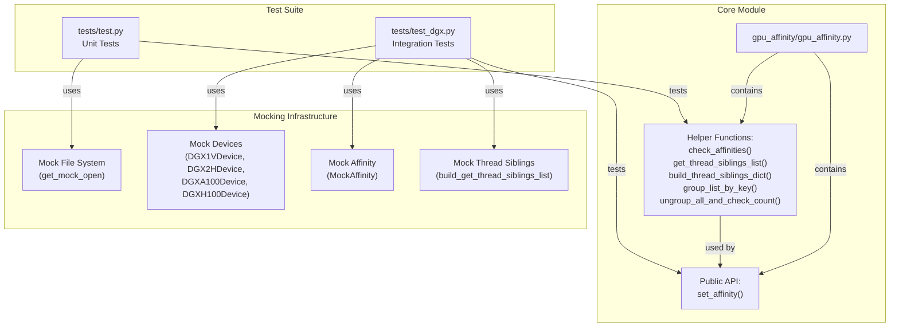
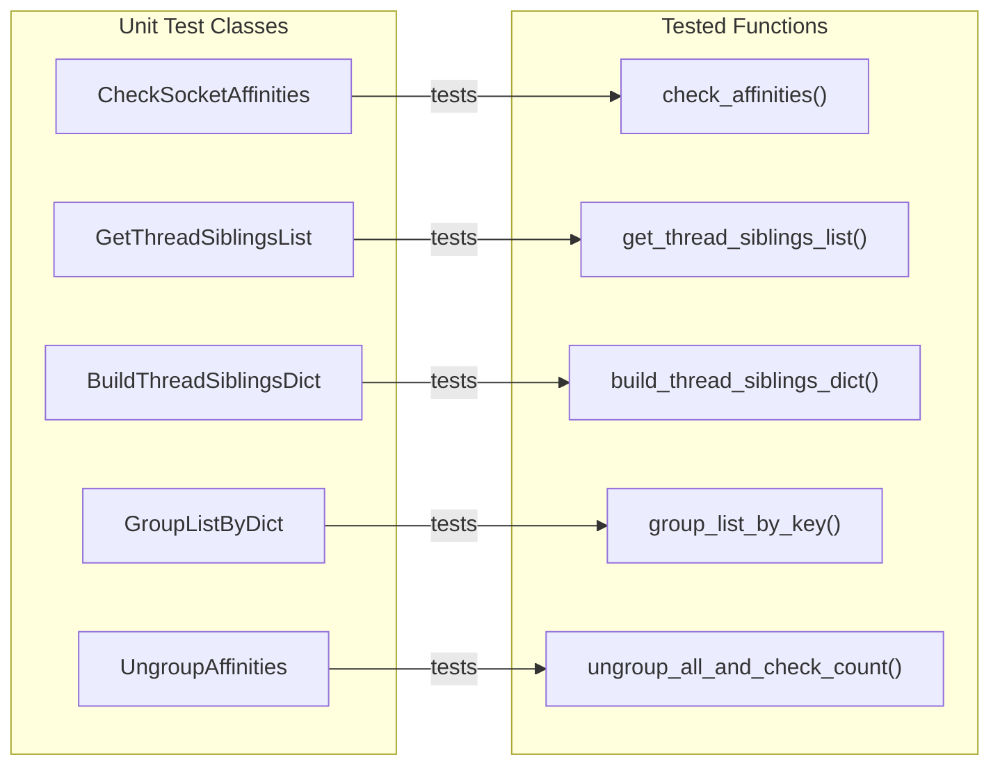
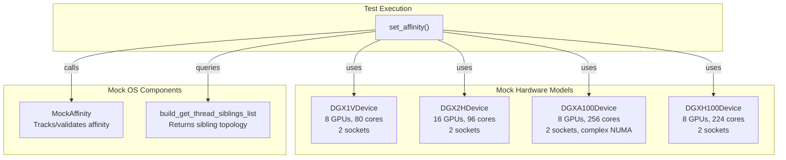
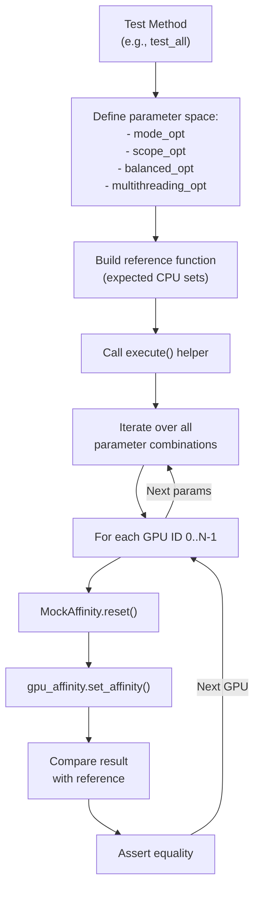
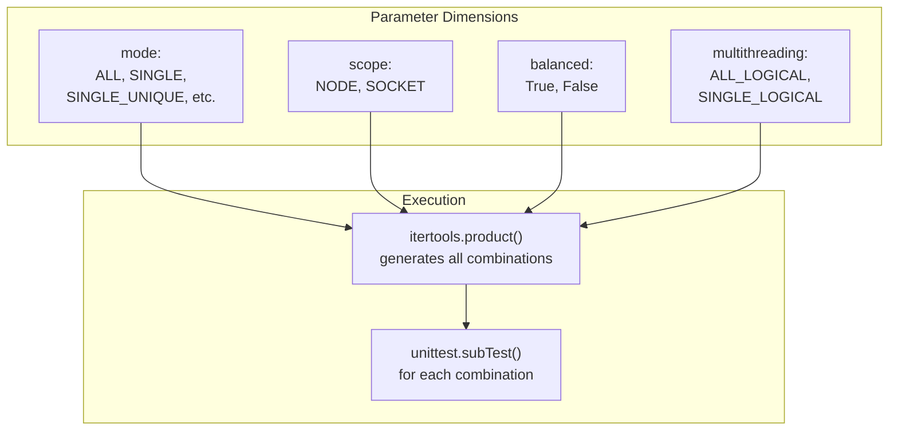

<!-- source: DeepWiki mcp.deepwiki.com · repo NVIDIA/gpu_affinity · page 4.1 Unit and Integration Tests · fetched 2026-10-26 -->

# Unit and Integration Tests

<details>
<summary>Relevant source files</summary>

The following files were used as context for generating this wiki page:

- [tests/test.py](tests/test.py)
- [tests/test_dgx.py](tests/test_dgx.py)

</details>


This page details the structure, organization, and purpose of the test suite in the `gpu_affinity` repository. The tests are split into unit tests that validate individual helper functions and integration tests that simulate complete affinity assignment workflows on different hardware configurations, particularly DGX systems.

For information about running the tests and interpreting results, see the parent page [Testing and Validation](#4). For contribution guidelines including testing requirements, see [Development and Contribution Guide](#5).

---

## Test Suite Organization

The test suite is organized into two main test files, each serving a distinct purpose:

| File | Type | Purpose | Test Count |
|------|------|---------|------------|
| `tests/test.py` | Unit Tests | Tests individual helper functions and internal logic | ~15 test methods |
| `tests/test_dgx.py` | Integration Tests | Tests complete affinity workflows on simulated DGX hardware | ~60+ test method variations |

Both test files use Python's `unittest` framework and extensive mocking to simulate hardware and OS behavior without requiring actual GPU hardware.

**Sources:** [tests/test.py:1-161](), [tests/test_dgx.py:1-1174]()

---

## Test Architecture



**Sources:** [tests/test.py:15-161](), [tests/test_dgx.py:15-1174]()

---

## Unit Tests (test.py)

The unit test file focuses on testing individual helper functions in isolation. These functions are internal implementation details that support the main `set_affinity()` function.

### Test Classes and Coverage



**Sources:** [tests/test.py:39-161]()

### CheckSocketAffinities Test Class

Tests the `gpu_affinity.gpu_affinity.check_affinities()` function, which validates that CPU affinity assignments across GPUs don't have problematic overlaps.

**Test Cases:**
- `test_disjoint`: Validates that completely separate affinity sets pass validation [tests/test.py:40-42]()
- `test_identical`: Validates that identical affinity sets are allowed [tests/test.py:44-46]()
- `test_overlap`: Verifies that partially overlapping affinities raise `GPUAffinityError` [tests/test.py:48-51]()
- `test_single`: Tests single GPU affinity assignment [tests/test.py:53-55]()

**Sources:** [tests/test.py:39-56]()

### GetThreadSiblingsList Test Class

Tests the `gpu_affinity.gpu_affinity.get_thread_siblings_list()` function, which reads hyperthreading sibling information from `/sys/devices/system/cpu/`.

**Mocking Strategy:**
The tests use `get_mock_open()` helper to mock file system reads and `pathlib.Path.glob` to simulate the presence of CPU topology files.

**Test Cases:**
- `test_mocked_simple`: Simulates 2 CPUs with different sibling pairs, expects `[(0, 1), (2, 3)]` [tests/test.py:62-73]()
- `test_mocked_duplicates`: Tests deduplication when multiple CPUs report the same sibling tuple [tests/test.py:75-86]()

**Sources:** [tests/test.py:22-87]()

### BuildThreadSiblingsDict Test Class

Tests the `gpu_affinity.gpu_affinity.build_thread_siblings_dict()` function, which converts a list of sibling tuples into a lookup dictionary.

**Test Cases:**
- `test_1_item`: Single sibling pair `[(0, 1)]` → `{0: (0, 1), 1: (0, 1)}` [tests/test.py:90-95]()
- `test_2_item`: Two sibling pairs with proper bidirectional mapping [tests/test.py:97-104]()

**Sources:** [tests/test.py:89-105]()

### GroupListByDict Test Class

Tests the `gpu_affinity.gpu_affinity.group_list_by_key()` function, which groups CPU core IDs based on their hyperthreading relationships.

**Test Cases:**
- `test_simple_1`: Groups cores `[0, 1]` into `[(0, 1)]` when they're siblings [tests/test.py:108-115]()
- `test_simple_2`: Groups four cores into two sibling pairs [tests/test.py:117-124]()
- `test_missing_dict`: Handles missing dictionary entries by treating each core individually [tests/test.py:126-133]()

**Sources:** [tests/test.py:107-134]()

### UngroupAffinities Test Class

Tests the `gpu_affinity.gpu_affinity.ungroup_all_and_check_count()` function, which flattens grouped affinities based on multithreading mode.

**Test Cases:**
- `test_simple_all_logical`: With `Multithreading.ALL_LOGICAL`, includes all hyperthreads [tests/test.py:137-144]()
- `test_simple_single_logical`: With `Multithreading.SINGLE_LOGICAL`, includes only one hyperthread per physical core [tests/test.py:146-153]()
- `test_unknown_mode`: Validates error handling for invalid multithreading modes [tests/test.py:155-160]()

**Sources:** [tests/test.py:136-161]()

---

## Integration Tests (test_dgx.py)

The integration test file simulates complete end-to-end affinity assignment workflows on different DGX hardware configurations. These tests validate that the entire affinity calculation pipeline produces correct CPU core assignments for various combinations of parameters.

### Mock Infrastructure



**Sources:** [tests/test_dgx.py:22-147]()

### MockAffinity Class

Simulates OS-level CPU affinity operations (`os.sched_getaffinity` and `os.sched_setaffinity`).

**Key Methods:**
- `reset(num_cores)`: Initializes affinity to all available cores [tests/test_dgx.py:24-25]()
- `set(pid, mask)`: Records the affinity mask for validation [tests/test_dgx.py:28-30]()
- `get(pid)`: Returns the current affinity mask [tests/test_dgx.py:32-35]()

**Sources:** [tests/test_dgx.py:22-36]()

### Mock Device Classes

Each mock device class simulates the `get_cpu_affinity()` method that would normally be provided by `pynvml`. The implementations encode the actual CPU-GPU topology of real DGX systems.

#### DGX1VDevice

Simulates DGX-1 with Volta GPUs:
- GPUs 0-3: Socket 0 (cores 0-19, 40-59)
- GPUs 4-7: Socket 1 (cores 20-39, 60-79)

**Sources:** [tests/test_dgx.py:45-60]()

#### DGX2HDevice

Simulates DGX-2 with HGX-2 baseboard:
- GPUs 0-7: Socket 0 (cores 0-23, 48-71)
- GPUs 8-15: Socket 1 (cores 24-47, 72-95)

**Sources:** [tests/test_dgx.py:62-77]()

#### DGXA100Device

Simulates DGX A100 with complex NUMA topology:
- Supports both `SOCKET` and `NODE` scopes
- Socket scope: 4 GPUs per socket
- Node scope: 2 GPUs per NUMA node with specific core ranges

**Sources:** [tests/test_dgx.py:79-105]()

#### DGXH100Device

Simulates DGX H100:
- GPUs 0-3: Socket 0 (cores 0-55, 112-167)
- GPUs 4-7: Socket 1 (cores 56-111, 168-223)

**Sources:** [tests/test_dgx.py:107-122]()

### Test Execution Pattern

All integration test classes follow a common pattern with extensive parameterization:



**Sources:** [tests/test_dgx.py:163-199]()

### Test Coverage by Mode

Each DGX test class validates all five affinity modes:

| Mode | Test Method | Description |
|------|-------------|-------------|
| `Mode.ALL` | `test_all` / `test_all_node` / `test_all_socket` | All processes get all cores in scope |
| `Mode.SINGLE` | `test_single` | All processes get the first core only |
| `Mode.SINGLE_UNIQUE` | `test_single_unique` | Each process gets a unique single core |
| `Mode.UNIQUE_CONTIGUOUS` | `test_unique_contiguous` | Each process gets unique contiguous cores |
| `Mode.UNIQUE_INTERLEAVED` | `test_unique_interleaved` | Each process gets unique interleaved cores |

**Sources:** [tests/test_dgx.py:200-1173]()

### Test Parameterization

Each test method validates multiple parameter combinations using `itertools.product`:



This approach generates extensive test coverage: for example, `test_all` on DGX1V tests 2×2×2×2 = 16 parameter combinations across 8 GPUs = 128 individual assertions.

**Sources:** [tests/test_dgx.py:173-198]()

### Reference Building Functions

Each test defines a `build_reference(offset)` function that computes the expected CPU core sets for each GPU. The `offset` parameter is used to include hyperthread siblings when `multithreading=ALL_LOGICAL`.

**Example from DGX1V test_all:**
```python
def build_reference(offset):
    reference = {
        0: cores_set(0, 20, offset=offset),   # GPU 0: cores 0-19 (+ 40-59 if offset)
        1: cores_set(0, 20, offset=offset),   # GPU 1: same as GPU 0
        # ... etc for all 8 GPUs
    }
    return reference
```

The `cores_set()` helper function [tests/test_dgx.py:38-42]() generates the expected set of core IDs, optionally including hyperthread offsets.

**Sources:** [tests/test_dgx.py:209-220]()

---

## Mock Patching Strategy

The integration tests use extensive `unittest.mock.patch` decorators to replace real system dependencies:

```mermaid
graph TD
    subgraph "Real Dependencies"
        PYNVML["pynvml.nvmlInit()"]
        DEVICE["gpu_affinity.gpu_affinity.Device"]
        GETAFF["os.sched_getaffinity()"]
        SETAFF["os.sched_setaffinity()"]
        GETSIBS["get_thread_siblings_list()"]
    end
    
    subgraph "Mock Replacements"
        MOCKNVML["lambda: None"]
        MOCKDEVICE["DGXXXDevice classes"]
        MOCKGETAFF["MockAffinity.get()"]
        MOCKSETAFF["MockAffinity.set()"]
        MOCKGETSIBS["build_get_thread_siblings_list()"]
    end
    
    PYNVML -.->|@patch| MOCKNVML
    DEVICE -.->|@patch| MOCKDEVICE
    GETAFF -.->|@patch| MOCKGETAFF
    SETAFF -.->|@patch| MOCKSETAFF
    GETSIBS -.->|@patch| MOCKGETSIBS
```

**Decorator Stack Example (DGX1V):**
```python
@unittest.mock.patch('pynvml.nvmlInit', new=lambda: None)
@unittest.mock.patch('gpu_affinity.gpu_affinity.get_thread_siblings_list', 
                     new=build_get_thread_siblings_list('dgx1v'))
@unittest.mock.patch('gpu_affinity.gpu_affinity.Device', new=DGX1VDevice)
@unittest.mock.patch('os.sched_getaffinity', create=True, new=MockAffinity.get)
@unittest.mock.patch('os.sched_setaffinity', create=True, new=MockAffinity.set)
class DGX1V(unittest.TestCase):
    # test methods...
```

**Sources:** [tests/test_dgx.py:149-157]()

---

## Test Validation Approach

### Unit Tests
Unit tests validate individual functions with known inputs and expected outputs:
- Use `self.assertEqual()` for exact matches
- Use `self.assertRaises()` for error cases
- Mock file system operations to avoid dependencies on actual hardware

### Integration Tests
Integration tests validate complete workflows:
1. **Setup**: Reset mock affinity to all cores available
2. **Execute**: Call `gpu_affinity.set_affinity()` with specific parameters
3. **Assert**: Compare returned affinity set against precomputed reference
4. **Parameterize**: Test all combinations of mode, scope, balanced, and multithreading

The use of `unittest.subTest()` [tests/test_dgx.py:190]() ensures that all parameter combinations are tested even if some fail, providing comprehensive feedback.

**Sources:** [tests/test_dgx.py:163-199](), [tests/test.py:39-161]()

---

## Hardware Topology Simulation

The integration tests simulate realistic hardware topologies:

| System | Physical Cores | Logical Cores | GPUs | Sockets | Special Features |
|--------|----------------|---------------|------|---------|------------------|
| DGX-1V | 40 | 80 | 8 | 2 | Simple dual-socket |
| DGX-2H | 48 | 96 | 16 | 2 | High GPU count |
| DGX A100 | 128 | 256 | 8 | 2 | Complex NUMA, node-level affinity |
| DGX H100 | 112 | 224 | 8 | 2 | Latest architecture |

Each mock device's `get_cpu_affinity()` method returns CPU core lists that match the actual hardware topology of these systems, ensuring tests validate behavior on real-world configurations.

**Sources:** [tests/test_dgx.py:45-122]()

---

## Running the Tests

To run the test suite:

```bash
# Run all tests
python -m unittest discover tests/

# Run only unit tests
python -m unittest tests.test

# Run only integration tests
python -m unittest tests.test_dgx

# Run specific test class
python -m unittest tests.test_dgx.DGXA100

# Run specific test method
python -m unittest tests.test_dgx.DGXA100.test_all_node
```

The tests do not require actual GPU hardware due to the comprehensive mocking strategy.

**Sources:** [tests/test.py:1-161](), [tests/test_dgx.py:1-1174]()

---

