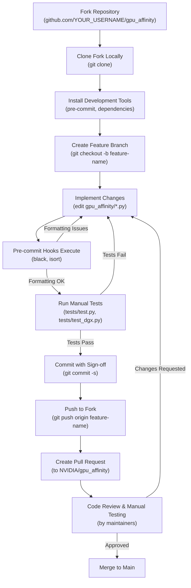
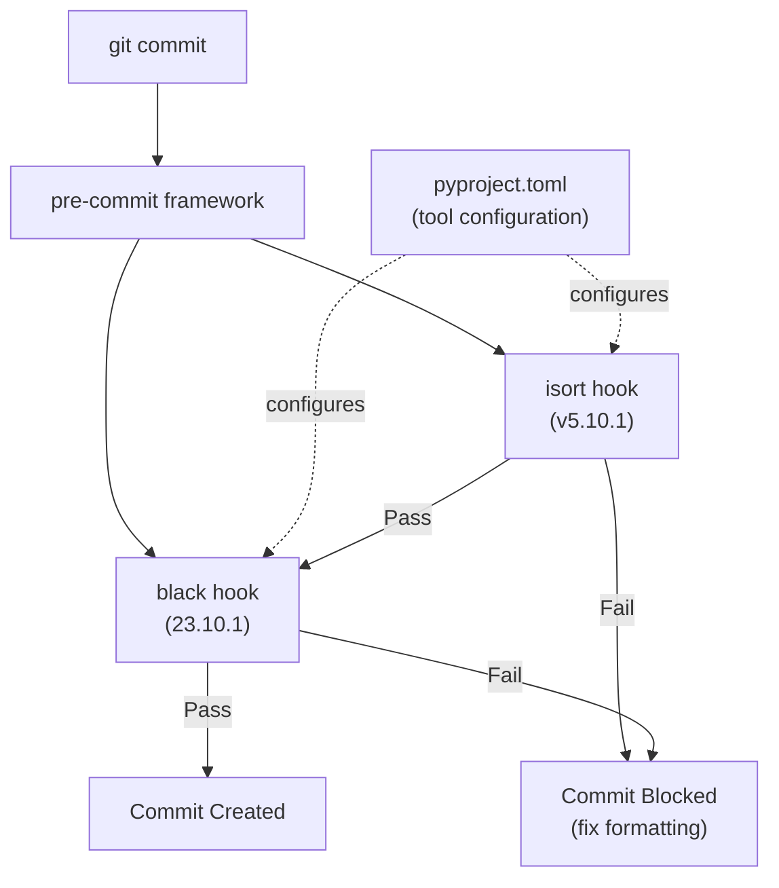
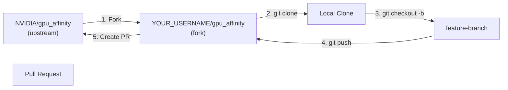
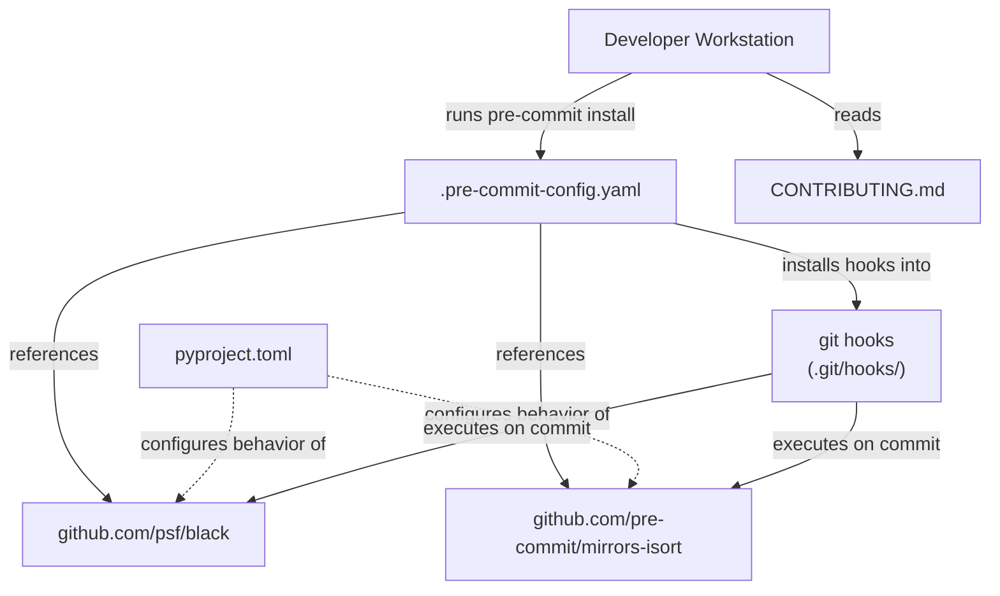

<!-- source: DeepWiki mcp.deepwiki.com · repo NVIDIA/gpu_affinity · page 5 Development and Contribution Guide · fetched 2026-10-26 -->

# Development and Contribution Guide

<details>
<summary>Relevant source files</summary>

The following files were used as context for generating this wiki page:

- [.pre-commit-config.yaml](.pre-commit-config.yaml)
- [CONTRIBUTING.md](CONTRIBUTING.md)
- [pyproject.toml](pyproject.toml)

</details>


This document provides an overview of the development workflow, code quality requirements, and contribution process for the `gpu_affinity` repository. It is intended for developers who wish to contribute bug fixes, enhancements, or new features to the project.

For detailed information about code style enforcement and tooling configuration, see [Code Style and Tooling](#5.1). For step-by-step instructions on submitting contributions, see [How to Contribute](#5.2).

## Purpose and Scope

This guide covers:
- Development environment setup for contributors
- Code quality standards and automated enforcement
- Pre-commit hook requirements
- High-level contribution workflow
- Commit signing requirements
- Manual testing expectations

It does not cover end-user installation or usage, which are documented in [Installation and Setup](#1.2) and [Usage Examples](#3).

## Development Workflow Overview

The development workflow for `gpu_affinity` follows a fork-and-pull-request model with automated code quality checks enforced via pre-commit hooks. Since the repository does not have CI/CD automation, manual testing is required before pull requests can be accepted.



**Sources:** [CONTRIBUTING.md:1-79]()

## Environment Setup for Contributors

Contributors must set up the following tools before beginning development:

### Required Tools

| Tool | Purpose | Installation Command |
|------|---------|---------------------|
| `pre-commit` | Automated code formatting checks | `pip install pre-commit` |
| `black` | Python code formatter | Installed via pre-commit hook |
| `isort` | Import statement sorter | Installed via pre-commit hook |
| `pynvml` | NVIDIA Management Library | `pip install pynvml` (runtime dependency) |

### Pre-commit Hook Installation

Pre-commit hooks are **mandatory** for all contributions. Contributions that have not used pre-commit will not be reviewed.

```bash
# Navigate to repository root
cd gpu_affinity

# Install pre-commit tool
pip install pre-commit

# Install the git hooks
pre-commit install
```

Once installed, pre-commit hooks will automatically run on every `git commit`, enforcing code style before commits are created.

**Sources:** [CONTRIBUTING.md:65-79](), [.pre-commit-config.yaml:1-12]()

## Code Quality Standards

The repository enforces strict code quality standards through automated tooling configured in `pyproject.toml` and `.pre-commit-config.yaml`.



### Black Configuration

The `black` formatter enforces consistent Python code style with the following settings:

| Setting | Value | Purpose |
|---------|-------|---------|
| `skip-string-normalization` | `true` | Preserves single quotes in strings |
| `line-length` | `79` | Maintains PEP 8 line length standard |

These settings are defined in [pyproject.toml:5-7]().

### Isort Configuration

The `isort` import sorter enforces consistent import ordering:

| Setting | Value | Purpose |
|---------|-------|---------|
| `force_single_line` | `true` | Each import on its own line |
| `extra_standard_library` | `["pkg_resources"]` | Treats `pkg_resources` as stdlib |

These settings are defined in [pyproject.toml:9-11]().

### Pylint Configuration

While not enforced by pre-commit, `pylint` configuration is available for optional static analysis. The following checks are disabled to reduce noise:

- `missing-function-docstring`
- `missing-class-docstring`
- `missing-module-docstring`
- `broad-except`
- `invalid-name`
- `logging-fstring-interpolation`

Configuration is in [pyproject.toml:16-24]().

**Sources:** [.pre-commit-config.yaml:1-12](), [pyproject.toml:1-25]()

## Contribution Process Overview

Contributions follow a standard GitHub fork-and-pull-request workflow with additional requirements for commit signing and manual testing.



### Step-by-Step Process

1. **Fork the repository** via GitHub UI
2. **Clone your fork** locally:
   ```bash
   git clone https://github.com/YOUR_USERNAME/gpu_affinity.git
   ```
3. **Create a feature branch**:
   ```bash
   git checkout -b feature-name
   ```
4. **Make changes** to code (typically in `gpu_affinity/gpu_affinity.py`)
5. **Run pre-commit checks** (automatic on commit)
6. **Test changes manually** using [tests/test.py:1-end]() and [tests/test_dgx.py:1-end]()
7. **Commit with sign-off**:
   ```bash
   git commit -s -m "Description of changes"
   ```
8. **Push to your fork**:
   ```bash
   git push -u origin feature-name
   ```
9. **Create Pull Request** via GitHub UI
10. **Address review feedback** if changes are requested

**Sources:** [CONTRIBUTING.md:1-20]()

## Testing Requirements

Since the repository does not have automated CI/CD, **manual testing is mandatory** before submitting pull requests. The PR will only be accepted after adequate testing has been completed by both the contributor and the reviewing NVIDIA engineer.

### Test Execution

Contributors should run both general unit tests and hardware-specific integration tests:

```bash
# Run general unit tests
python tests/test.py

# Run DGX-specific tests (if applicable)
python tests/test_dgx.py
```

For more information about the test suite structure and coverage, see [Testing and Validation](#4) and [Unit and Integration Tests](#4.1).

**Sources:** [CONTRIBUTING.md:19-20]()

## Commit Sign-off Requirements

All commits **must** be signed off using the Developer Certificate of Origin (DCO). Contributions containing unsigned commits will not be accepted.

### Signing Commits

Use the `--signoff` or `-s` flag when committing:

```bash
git commit -s -m "Add cool feature."
```

This appends the following to your commit message:
```
Signed-off-by: Your Name <your@email.com>
```

### Developer Certificate of Origin

By signing off, you certify that:

- **(a)** The contribution was created in whole or in part by you and you have the right to submit it under the open source license indicated in the file
- **(b)** The contribution is based upon previous work covered under an appropriate open source license and you have the right to submit it with modifications under the same license
- **(c)** The contribution was provided directly to you by someone who certified (a), (b), or (c) and you have not modified it
- **(d)** You understand that the contribution is public and that a record (including personal information) is maintained indefinitely

The full text of the DCO version 1.1 is available in [CONTRIBUTING.md:37-63]().

**Sources:** [CONTRIBUTING.md:22-63]()

## Development Tools and Configuration Files

The following files define the development environment and quality standards:



### Configuration File Summary

| File | Purpose | Key Configurations |
|------|---------|-------------------|
| `.pre-commit-config.yaml` | Defines pre-commit hooks | `isort@v5.10.1`, `black@23.10.1` |
| `pyproject.toml` | Tool configuration | Black line-length: 79, isort single-line imports |
| `CONTRIBUTING.md` | Contribution guidelines | Fork workflow, DCO requirements, pre-commit mandate |

**Sources:** [.pre-commit-config.yaml:1-12](), [pyproject.toml:1-25](), [CONTRIBUTING.md:1-79]()

## Review Process

Pull requests undergo manual review and testing by NVIDIA maintainers:

1. **Automated checks**: Pre-commit hooks must pass (black, isort)
2. **Code review**: Maintainer reviews code for correctness, style, and design
3. **Manual testing**: Maintainer runs tests on appropriate hardware
4. **Feedback cycle**: Changes may be requested; contributor updates PR
5. **Approval and merge**: Once approved, maintainer merges to main branch

Contributors should be prepared to iterate on their changes based on review feedback.

**Sources:** [CONTRIBUTING.md:19-20]()

## Summary

Contributing to `gpu_affinity` requires:

- Forking and cloning the repository
- Installing and using pre-commit hooks (mandatory)
- Following code style enforced by black and isort
- Signing all commits with DCO
- Manually testing changes before submission
- Responding to review feedback

For detailed code style requirements, see [Code Style and Tooling](#5.1). For detailed contribution instructions, see [How to Contribute](#5.2).

**Sources:** [CONTRIBUTING.md:1-79](), [.pre-commit-config.yaml:1-12](), [pyproject.toml:1-25]()

---

