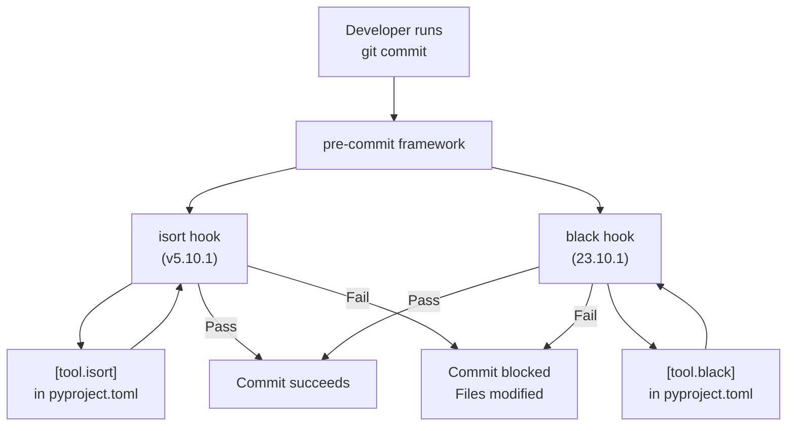
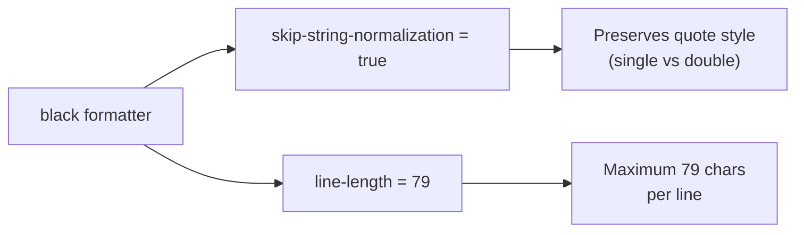
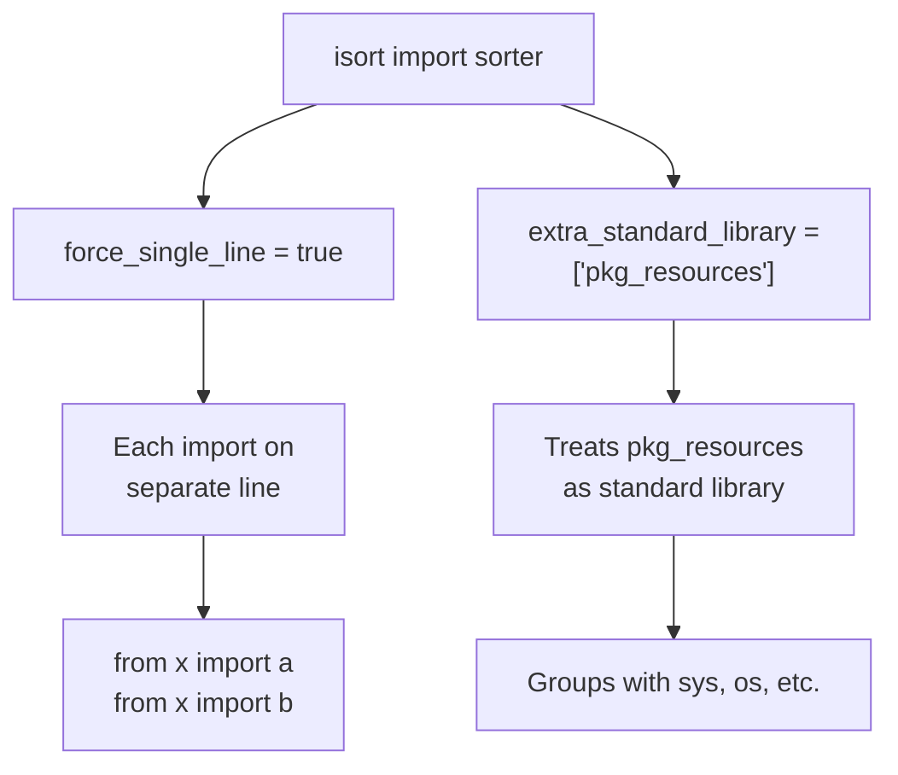
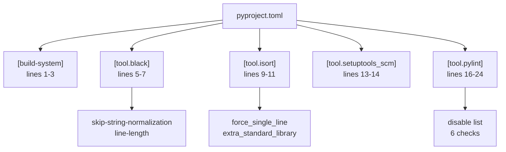
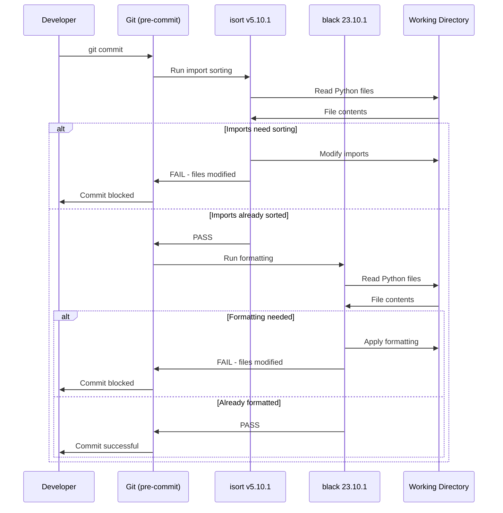

<!-- source: DeepWiki mcp.deepwiki.com · repo NVIDIA/gpu_affinity · page 5.1 Code Style and Tooling · fetched 2026-10-26 -->

# Code Style and Tooling

Relevant source files

The following files were used as context for generating this wiki page:

- [.pre-commit-config.yaml](.pre-commit-config.yaml)
- [pyproject.toml](pyproject.toml)

This document describes the code style standards and automated tooling used in the `gpu_affinity` repository. It covers the configuration and usage of code formatters (`black`, `isort`), linters (`pylint`), and pre-commit hooks that enforce consistent code style across the codebase.

For information about the actual contribution workflow and how to submit changes, see [How to Contribute](#5.2).

---

## Purpose and Scope

The `gpu_affinity` repository uses automated tools to maintain code quality and consistency. This page documents:
- Pre-commit hook configuration and execution
- Code formatting rules and tool configuration
- Import sorting standards
- Linting rules and disabled checks
- How these tools integrate into the development workflow

---

## Tooling Overview

The repository uses three primary tools for code quality:

| Tool | Purpose | Configuration File | Version/Revision |
|------|---------|-------------------|------------------|
| `black` | Code formatter | [pyproject.toml:5-7]() | 23.10.1 |
| `isort` | Import sorter | [pyproject.toml:9-11]() | v5.10.1 |
| `pylint` | Code linter | [pyproject.toml:16-24]() | (not version-pinned) |

These tools are integrated via pre-commit hooks to run automatically before each commit.

**Sources:** [.pre-commit-config.yaml:1-12](), [pyproject.toml:1-25]()

---

## Pre-commit Hook Configuration

### Tool Integration Workflow

The pre-commit configuration defines two hooks that execute sequentially:

1. **isort**: Sorts and organizes import statements
2. **black**: Formats code according to style rules

Both hooks are configured to fail the commit if they need to modify files, requiring the developer to review and re-commit the changes.

**Sources:** [.pre-commit-config.yaml:1-12]()

### Hook Definitions

The `.pre-commit-config.yaml` file defines the following hooks:

| Repository | Hook ID | Version | Purpose |
|------------|---------|---------|---------|
| `https://github.com/pre-commit/mirrors-isort` | `isort` | v5.10.1 | Import sorting |
| `https://github.com/psf/black` | `black` | 23.10.1 | Code formatting |

**Sources:** [.pre-commit-config.yaml:2-10]()

---

## Black Code Formatter

### Configuration

The `black` formatter is configured in the `[tool.black]` section with the following settings:

**Key Configuration Options:**

| Option | Value | Effect |
|--------|-------|--------|
| `skip-string-normalization` | `true` | Preserves single or double quotes as written; black will not normalize to double quotes |
| `line-length` | `79` | Maximum line length set to 79 characters (PEP 8 standard) |

The 79-character line length aligns with PEP 8 recommendations for maximum line length, ensuring code readability in split-screen editors and standard terminal widths.

**Sources:** [pyproject.toml:5-7]()

---

## Isort Import Sorter

### Configuration

The `isort` tool is configured in the `[tool.isort]` section with the following settings:

**Key Configuration Options:**

| Option | Value | Effect |
|--------|-------|--------|
| `force_single_line` | `true` | Forces each import to be on its own line (no multi-import statements) |
| `extra_standard_library` | `["pkg_resources"]` | Treats `pkg_resources` as part of the standard library for sorting purposes |

The `force_single_line` setting ensures imports are easy to review in diffs and prevents merge conflicts. The `extra_standard_library` setting ensures `pkg_resources` is grouped with standard library imports rather than third-party imports.

**Sources:** [pyproject.toml:9-11]()

---

## Pylint Configuration

### Disabled Checks

The `[tool.pylint]` section disables several pylint checks that are either too strict or not applicable to the project's coding style:

| Disabled Check | Reason |
|----------------|--------|
| `missing-function-docstring` | Function docstrings are not required for all functions |
| `missing-class-docstring` | Class docstrings are not required for all classes |
| `missing-module-docstring` | Module docstrings are not required for all modules |
| `broad-except` | Broad exception catching is acceptable in certain contexts |
| `invalid-name` | Variable naming conventions are more flexible |
| `logging-fstring-interpolation` | F-string interpolation is allowed in logging statements |

**Sources:** [pyproject.toml:16-24]()

---

## Code Entity Integration

### Configuration File Structure

The `pyproject.toml` file serves as the central configuration point for all Python tooling in the repository. Each tool reads its configuration from a dedicated section:

- **[tool.black]**: Lines 5-7
- **[tool.isort]**: Lines 9-11
- **[tool.pylint]**: Lines 16-24

**Sources:** [pyproject.toml:1-25]()

---

## Development Workflow Integration

### Tool Execution Order

When a developer attempts to commit code:

1. **isort** runs first, checking and potentially modifying import statements
2. If isort modifies files, the commit is blocked
3. If isort passes, **black** runs next, checking and potentially modifying code formatting
4. If black modifies files, the commit is blocked
5. Only if both tools pass does the commit succeed

This ensures all committed code adheres to the project's style standards.

**Sources:** [.pre-commit-config.yaml:1-12](), [pyproject.toml:5-11]()

---

## Summary Table

### Tool Configuration Reference

| Tool | Config Location | Key Settings | Pre-commit Hook |
|------|----------------|--------------|-----------------|
| `black` | [pyproject.toml:5-7]() | `line-length = 79` `skip-string-normalization = true` | Yes (23.10.1) |
| `isort` | [pyproject.toml:9-11]() | `force_single_line = true` `extra_standard_library = ["pkg_resources"]` | Yes (v5.10.1) |
| `pylint` | [pyproject.toml:16-24]() | 6 checks disabled | No (manual) |

**Sources:** [.pre-commit-config.yaml:1-12](), [pyproject.toml:1-25]()

---

