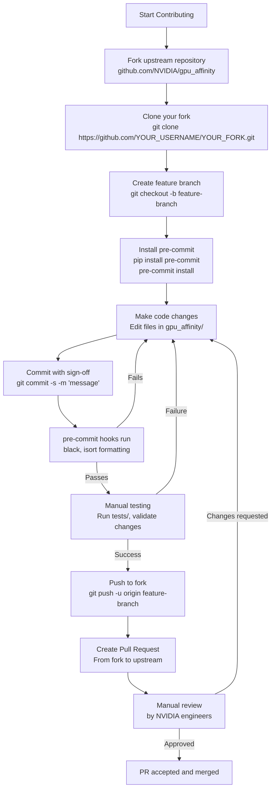
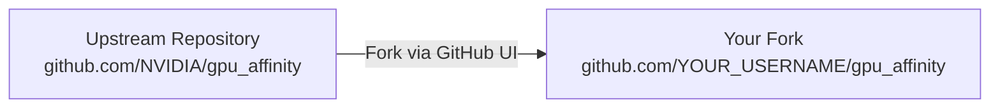
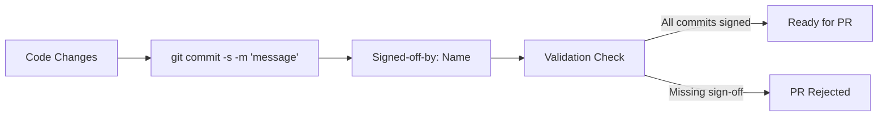
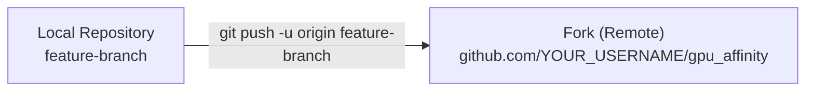
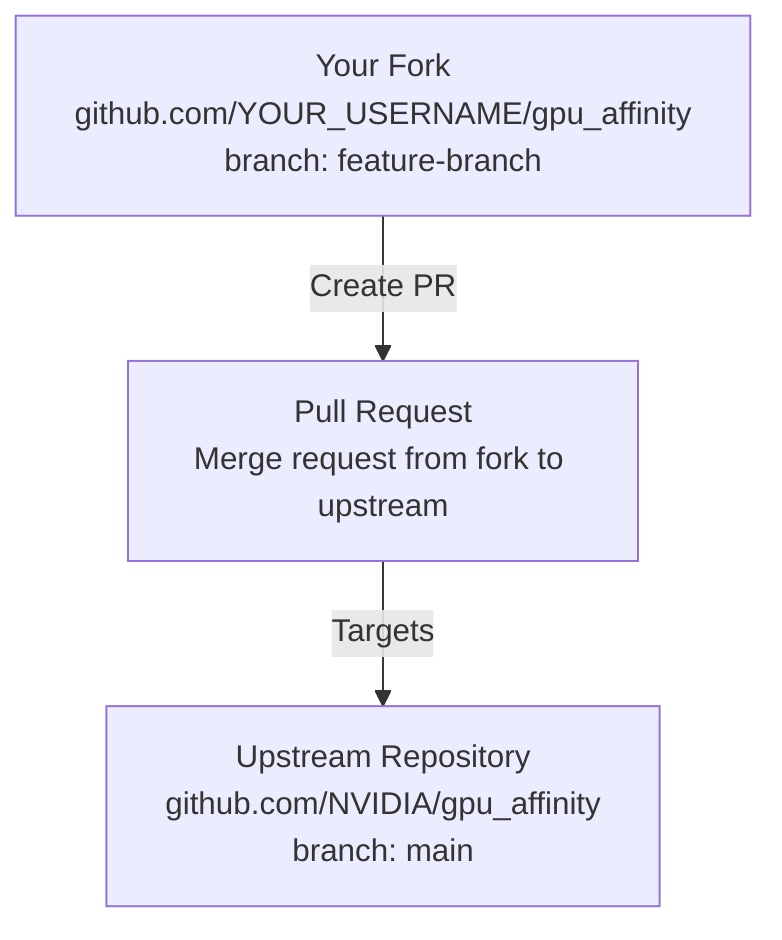
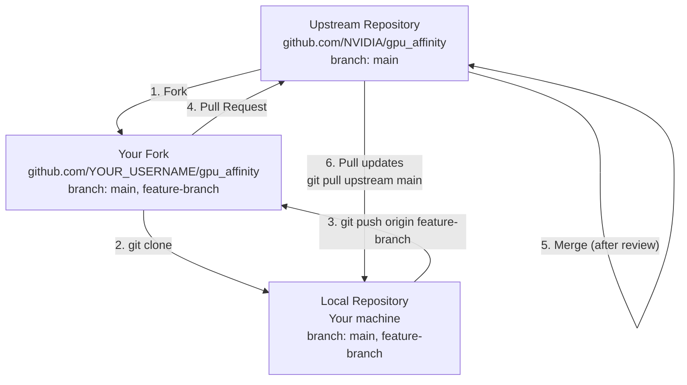

<!-- source: DeepWiki mcp.deepwiki.com · repo NVIDIA/gpu_affinity · page 5.2 How to Contribute · fetched 2026-10-26 -->

# How to Contribute

<details>
<summary>Relevant source files</summary>

The following files were used as context for generating this wiki page:

- [CONTRIBUTING.md](CONTRIBUTING.md)

</details>


## Purpose and Scope

This page provides step-by-step instructions for contributing code to the `gpu_affinity` repository. It covers the complete workflow from forking the repository through submitting a pull request for review. This page focuses on the practical mechanics of the contribution process.

For information about code style requirements and development tooling configuration, see [Code Style and Tooling](#5.1). For testing strategy and validation, see [Testing and Validation](#4).

**Sources:** [CONTRIBUTING.md:1-79]()

---

## Contribution Requirements

All contributions to `gpu_affinity` must meet the following requirements:

| Requirement | Description | Mandatory |
|------------|-------------|-----------|
| **Signed Commits** | All commits must be signed-off using the `-s` flag | Yes |
| **Pre-commit Hooks** | Code must be formatted using pre-commit | Yes |
| **Manual Testing** | Changes must be tested manually (no CI/CD) | Yes |
| **Fork-based Workflow** | Changes must come from personal forks | Yes |

Contributions that do not meet these requirements will not be reviewed or accepted.

**Sources:** [CONTRIBUTING.md:22-69]()

---

## Contribution Workflow Overview

The following diagram illustrates the complete contribution workflow, from initial fork through pull request acceptance:



**Sources:** [CONTRIBUTING.md:1-79]()

---

## Step 1: Fork the Repository

The first step is to create a personal fork of the upstream `gpu_affinity` repository.

1. Navigate to https://github.com/NVIDIA/gpu_affinity
2. Click the "Fork" button in the top-right corner
3. Select your GitHub account as the destination

This creates a copy of the repository under your GitHub account at `https://github.com/YOUR_USERNAME/gpu_affinity`.



**Sources:** [CONTRIBUTING.md:6]()

---

## Step 2: Clone Your Fork

Clone your forked repository to your local development machine:

```bash
git clone https://github.com/YOUR_USERNAME/gpu_affinity.git
cd gpu_affinity
```

This creates a local working copy where you can make changes.

**Sources:** [CONTRIBUTING.md:8-14]()

---

## Step 3: Create a Feature Branch

Create a new branch for your changes. This keeps your work isolated from the main branch:

```bash
git checkout -b feature-branch-name
```

Branch naming conventions:
- Use descriptive names: `fix-cpu-affinity-bug`, `add-new-mode`, `update-documentation`
- Keep branches focused on a single feature or fix
- Checkout from the targeted base branch (typically `main` or `master`)

**Sources:** [CONTRIBUTING.md:12-14]()

---

## Step 4: Make Your Changes

Edit the relevant files in the repository. Changes typically involve modifying:

- **Core logic:** [gpu_affinity/gpu_affinity.py]()
- **Public API:** [gpu_affinity/__init__.py]()
- **Tests:** [tests/test.py](), [tests/test_dgx.py]()
- **Examples:** [examples/sample/sample.py]()
- **Documentation:** `README.md`, wiki pages

Follow the code style requirements documented in [Code Style and Tooling](#5.1).

**Sources:** [CONTRIBUTING.md:17]()

---

## Step 5: Sign Off Your Commits

All commits must be signed-off to certify that you have the right to submit the contribution under the project's license. This is a requirement of the Developer Certificate of Origin (DCO).

### Signing Commits

Use the `--signoff` or `-s` flag when committing:

```bash
git commit -s -m "Add cool feature."
```

This appends a `Signed-off-by` line to your commit message:

```
Signed-off-by: Your Name <your@email.com>
```

### DCO Certification

By signing off, you certify the following (summarized from DCO 1.1):

| Certification | Description |
|--------------|-------------|
| **(a)** | The contribution is your original work or you have the right to submit it |
| **(b)** | The contribution is based on previous work covered by an appropriate open source license |
| **(c)** | The contribution was provided to you by someone who certified (a), (b), or (c) |
| **(d)** | You understand the contribution is public and will be maintained indefinitely |

**Important:** Pull requests containing commits that are not signed-off will not be accepted.



**Sources:** [CONTRIBUTING.md:22-63]()

---

## Step 6: Run Pre-commit Hooks

Before pushing your changes, ensure they pass pre-commit validation. This is **required** and contributions without pre-commit validation will not be reviewed.

### Installing Pre-commit

If not already installed:

```bash
pip install pre-commit
pre-commit install
```

### Automatic Validation

Once installed, pre-commit hooks run automatically on every commit. They will:

1. Run `black` for code formatting
2. Run `isort` for import sorting
3. Perform other configured checks

If hooks fail, your commit will be blocked:

```bash
$ git commit -s -m "Add feature"
black....................................................................Failed
isort....................................................................Failed
```

Fix the issues (often auto-fixed by the hooks) and commit again:

```bash
$ git add -u
$ git commit -s -m "Add feature"
black....................................................................Passed
isort....................................................................Passed
```

### Manual Validation

You can also run pre-commit manually on all files:

```bash
pre-commit run --all-files
```

**Sources:** [CONTRIBUTING.md:65-79]()

---

## Step 7: Test Your Changes

Since there is no automated CI/CD pipeline, you must manually test your changes:

1. **Run the test suite:**
   ```bash
   python -m pytest tests/
   ```

2. **Test specific functionality:**
   ```bash
   python tests/test.py
   python tests/test_dgx.py  # If testing DGX-specific features
   ```

3. **Run the sample application:**
   ```bash
   python examples/sample/sample.py --help
   ```

4. **Test in your target environment:** Validate the changes work in the environment where they will be used (e.g., distributed training workload)

Document your testing approach in the pull request description.

**Sources:** [CONTRIBUTING.md:19]()

---

## Step 8: Push Changes to Your Fork

Push your feature branch to your GitHub fork:

```bash
git push -u origin feature-branch-name
```

The `-u` flag sets up tracking between your local branch and the remote branch.

For subsequent pushes to the same branch:

```bash
git push
```



**Sources:** [CONTRIBUTING.md:13-14]()

---

## Step 9: Create a Pull Request

Once your changes are pushed to your fork and you've completed testing:

1. Navigate to your fork on GitHub: `https://github.com/YOUR_USERNAME/gpu_affinity`
2. GitHub will typically show a prompt: "Compare & pull request"
3. Click the button to initiate a pull request
4. Select the base repository and branch (typically `NVIDIA/gpu_affinity` and `main`)
5. Select your fork and feature branch as the compare branch
6. Fill in the pull request details:
   - **Title:** Clear, concise description of the change
   - **Description:** Detailed explanation including:
     - What changed and why
     - Testing performed
     - Related issues (if any)
     - Breaking changes (if any)

### Pull Request Structure



**Sources:** [CONTRIBUTING.md:17]()

---

## Step 10: Pull Request Review Process

After submitting your pull request:

1. **Manual Review:** NVIDIA engineers will review your code
2. **Manual Testing:** Reviewers will manually test your changes (no automated CI/CD)
3. **Feedback:** You may receive comments requesting changes or clarifications
4. **Iterations:** Make requested changes, commit with sign-off, and push to your branch
5. **Acceptance:** Once approved and testing is complete, the PR will be merged and the issue closed

### Response to Review Feedback

If changes are requested:

```bash
# Make the requested changes
git add <modified-files>
git commit -s -m "Address review feedback"
git push
```

The pull request will automatically update with your new commits.

### Important Notes

| Aspect | Details |
|--------|---------|
| **No CI/CD** | Manual testing is required; no automated pipeline exists |
| **Testing Responsibility** | Both contributor and reviewer share testing responsibility |
| **Pre-commit Required** | All commits must pass pre-commit hooks |
| **Sign-off Required** | All commits must include DCO sign-off |

**Sources:** [CONTRIBUTING.md:19]()

---

## Repository Interaction Model

The following diagram shows how local, fork, and upstream repositories interact during the contribution process:



**Sources:** [CONTRIBUTING.md:1-79]()

---

## Common Commands Reference

Quick reference for common Git commands used during contribution:

```bash
# Fork repository (via GitHub UI)
# Clone your fork
git clone https://github.com/YOUR_USERNAME/gpu_affinity.git

# Create and switch to feature branch
git checkout -b feature-name

# Install pre-commit
pip install pre-commit
pre-commit install

# Make changes, then commit with sign-off
git add <files>
git commit -s -m "Description of changes"

# Run pre-commit manually
pre-commit run --all-files

# Push to your fork
git push -u origin feature-name

# Update your branch with upstream changes (if needed)
git remote add upstream https://github.com/NVIDIA/gpu_affinity.git
git fetch upstream
git rebase upstream/main
git push --force-with-lease
```

**Sources:** [CONTRIBUTING.md:1-79]()

---

## Troubleshooting

### Pre-commit Hooks Fail

If pre-commit hooks fail, the hooks often auto-fix the issues. Stage the fixes and retry:

```bash
git add -u
git commit -s -m "Your message"
```

### Missing Sign-off

If you forgot to sign-off commits, amend the last commit:

```bash
git commit --amend -s --no-edit
git push --force-with-lease
```

For multiple commits, use interactive rebase:

```bash
git rebase -i HEAD~N  # Where N is number of commits
# Mark commits for "edit", then for each:
git commit --amend -s --no-edit
git rebase --continue
```

### Merge Conflicts

If your branch has conflicts with upstream:

```bash
git fetch upstream
git rebase upstream/main
# Resolve conflicts in files
git add <resolved-files>
git rebase --continue
git push --force-with-lease
```

**Sources:** [CONTRIBUTING.md:1-79]()

---

