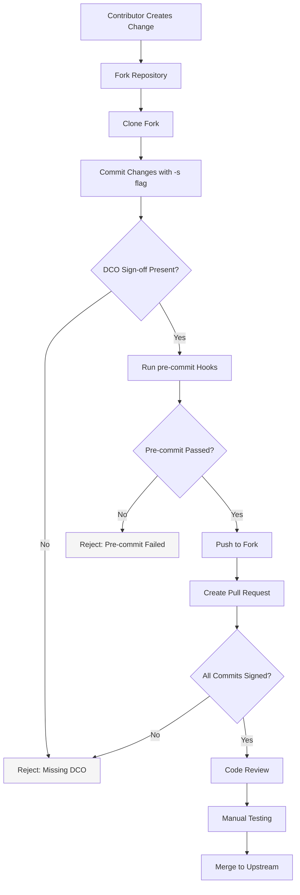
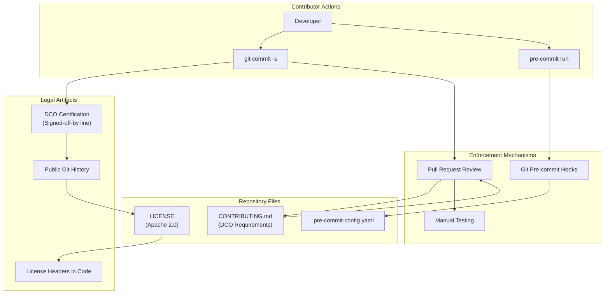

<!-- source: DeepWiki mcp.deepwiki.com · repo NVIDIA/gpu_affinity · page 6 Licensing and Legal · fetched 2026-10-26 -->

# Licensing and Legal

<details>
<summary>Relevant source files</summary>

The following files were used as context for generating this wiki page:

- [CONTRIBUTING.md](CONTRIBUTING.md)
- [LICENSE](LICENSE)

</details>


This document summarizes the licensing terms, contributor requirements, and legal considerations for the `gpu_affinity` repository. It covers the software license under which the code is distributed, the Developer Certificate of Origin (DCO) requirements for contributors, and the compliance workflow for submitting changes.

For information about the development workflow and code style requirements, see [Development and Contribution Guide](#5). For step-by-step contribution instructions, see [How to Contribute](#5.2).

---

## Software License

The `gpu_affinity` repository is distributed under the **Apache License, Version 2.0** (January 2004). This is a permissive open-source license that allows users to freely use, modify, and distribute the software, subject to certain conditions.

### License Summary

| Aspect | Details |
|--------|---------|
| **License Type** | Apache License 2.0 |
| **Copyright Holder** | NVIDIA Corporation |
| **Copyright Years** | 2020-2023 |
| **License URL** | http://www.apache.org/licenses/LICENSE-2.0 |

### Key Permissions

The Apache License 2.0 grants the following permissions:

- **Use**: The software may be used for any purpose, including commercial applications
- **Modification**: Users may create derivative works by modifying the source code
- **Distribution**: Both the original work and derivative works may be distributed
- **Sublicensing**: The work may be sublicensed under compatible terms
- **Patent Grant**: Contributors grant patent licenses for their contributions

### Key Conditions

When using or distributing the software, users must:

1. **Include License**: Provide a copy of the Apache License 2.0 with any distribution [LICENSE:1-191]()
2. **State Changes**: Mark modified files with prominent notices indicating changes [LICENSE:97-98]()
3. **Preserve Notices**: Retain all copyright, patent, trademark, and attribution notices [LICENSE:100-104]()
4. **Include NOTICE**: If a NOTICE file exists, include attribution notices in derivative works [LICENSE:106-121]()

### Disclaimer

The software is provided **"AS IS" without warranties of any kind**, including warranties of merchantability, fitness for a particular purpose, or non-infringement. Contributors are not liable for any damages arising from the use of the software [LICENSE:143-163]().

**Sources:** [LICENSE:1-191]()

---

## Contributor Requirements

All contributors to the `gpu_affinity` repository must comply with specific legal requirements to ensure that contributions are properly authorized and can be legally incorporated into the project.

### Developer Certificate of Origin (DCO)

Contributors must certify their contributions by signing off on commits using the **Developer Certificate of Origin (DCO), Version 1.1**. This certification confirms that:

- **(a)** The contribution was created by the contributor and they have the right to submit it under the open source license
- **(b)** The contribution is based on previous work covered by an appropriate open source license
- **(c)** The contribution was provided by another person who certified (a), (b), or (c)
- **(d)** The contributor understands that the contribution and its record are public and maintained indefinitely

### Sign-Off Requirement

Every commit must include a "Signed-off-by" line to certify compliance with the DCO [CONTRIBUTING.md:22-27]().

| Requirement | Details |
|-------------|---------|
| **Mandatory** | Yes - contributions without sign-off will **not be accepted** |
| **Scope** | All commits in a pull request must be signed off |
| **Format** | `Signed-off-by: Your Name <your@email.com>` |

#### How to Sign Off Commits

Use the `--signoff` or `-s` flag when committing changes:

```bash
git commit -s -m "Add cool feature."
```

This automatically appends the sign-off line to the commit message [CONTRIBUTING.md:28-35]().

### Legal Consequences

The DCO sign-off has legal implications:

- It creates a public, permanent record of the certification [CONTRIBUTING.md:62]()
- It establishes the contributor's agreement to the terms of the DCO [CONTRIBUTING.md:54-63]()
- It provides legal protection for both contributors and the project maintainers

**Sources:** [CONTRIBUTING.md:22-63]()

---

## Contribution Compliance Workflow

The contribution process includes multiple compliance checkpoints to ensure legal and technical requirements are met before code is accepted into the repository.

### Contribution Legal Flow



**Contribution Legal and Compliance Flow**  
This diagram shows the complete workflow from initial contribution through acceptance, highlighting the DCO sign-off checkpoints and pre-commit validation gates.

**Sources:** [CONTRIBUTING.md:1-79]()

### Pull Request Workflow

The standard workflow for contributing changes follows these steps:

1. **Fork the Repository**: Create a personal fork of the upstream repository [CONTRIBUTING.md:6]()
   
2. **Clone and Commit**: Clone the fork, create changes on a branch, and commit with sign-off [CONTRIBUTING.md:8-14]()
   
3. **Format with Pre-commit**: Run pre-commit hooks to ensure code style compliance [CONTRIBUTING.md:17]()
   
4. **Create Pull Request**: Submit a PR from the fork branch to the upstream repository [CONTRIBUTING.md:17]()
   
5. **Review and Test**: The PR undergoes manual review and testing by NVIDIA engineers [CONTRIBUTING.md:19]()

### Pre-commit Requirement

Pre-commit hooks are **mandatory** for all contributions. This is both a technical and process requirement:

| Aspect | Requirement |
|--------|-------------|
| **Installation** | Contributors must install pre-commit locally [CONTRIBUTING.md:71-76]() |
| **Enforcement** | Contributions without pre-commit will **not be reviewed** [CONTRIBUTING.md:69]() |
| **Purpose** | Ensures code passes CI pipeline and accelerates review process [CONTRIBUTING.md:68]() |

Installation commands:
```bash
pip install pre-commit
pre-commit install
```

Once installed, pre-commit hooks automatically check all commits for appropriate formatting [CONTRIBUTING.md:78-79]().

**Sources:** [CONTRIBUTING.md:1-79]()

---

## Legal Compliance Architecture

The following diagram illustrates how legal compliance is enforced at multiple layers in the contribution process.



**Legal Compliance Architecture**  
This diagram shows how licensing and contribution requirements are enforced through documentation, git hooks, and review processes, creating a traceable chain of legal compliance.

**Sources:** [LICENSE:1-191](), [CONTRIBUTING.md:1-79]()

---

## Compliance Checklist

Before submitting a contribution, ensure all legal and compliance requirements are met:

### For All Contributors

- [ ] **Fork created**: Personal fork exists at `github.com/YOUR_USERNAME/gpu_affinity`
- [ ] **DCO understood**: Read and understand the Developer Certificate of Origin [CONTRIBUTING.md:37-63]()
- [ ] **All commits signed**: Every commit includes `Signed-off-by` line with your name and email [CONTRIBUTING.md:22-35]()
- [ ] **Pre-commit installed**: Pre-commit hooks are installed and activated [CONTRIBUTING.md:71-76]()
- [ ] **Pre-commit passed**: All pre-commit checks pass locally before pushing [CONTRIBUTING.md:78-79]()
- [ ] **License preserved**: No modifications to the LICENSE file or copyright notices [LICENSE:178-191]()

### For Code Modifications

- [ ] **Changes marked**: Modified files include prominent notices of changes [LICENSE:97-98]()
- [ ] **Attributions retained**: All copyright, patent, and attribution notices preserved [LICENSE:100-104]()
- [ ] **License compatible**: Any new dependencies use compatible licenses [LICENSE:56-63]()

### For Pull Requests

- [ ] **Branch created**: Changes are on a dedicated branch in your fork [CONTRIBUTING.md:8-14]()
- [ ] **Description clear**: PR description explains the changes and their purpose
- [ ] **Testing ready**: Changes are ready for manual testing by reviewers [CONTRIBUTING.md:19]()

**Sources:** [LICENSE:1-191](), [CONTRIBUTING.md:1-79]()

---

## Summary

The `gpu_affinity` repository operates under a clear legal framework:

1. **Apache License 2.0**: The software is permissively licensed, allowing broad use, modification, and distribution with proper attribution [LICENSE:1-191]()

2. **Developer Certificate of Origin**: All contributors must sign off on commits, certifying their right to contribute the code [CONTRIBUTING.md:22-63]()

3. **Mandatory Compliance**: Contributions without DCO sign-off or pre-commit compliance will not be accepted [CONTRIBUTING.md:26, 69]()

4. **Public Record**: All contributions and certifications become part of the permanent, public git history [CONTRIBUTING.md:62]()

This framework protects both contributors and users while maintaining the open-source nature of the project. Contributors should carefully read the full text of the Apache License 2.0 in [LICENSE:1-191]() and the DCO requirements in [CONTRIBUTING.md:37-63]() before submitting any changes.

For practical guidance on implementing these requirements, see [How to Contribute](#5.2).

**Sources:** [LICENSE:1-191](), [CONTRIBUTING.md:1-79]()