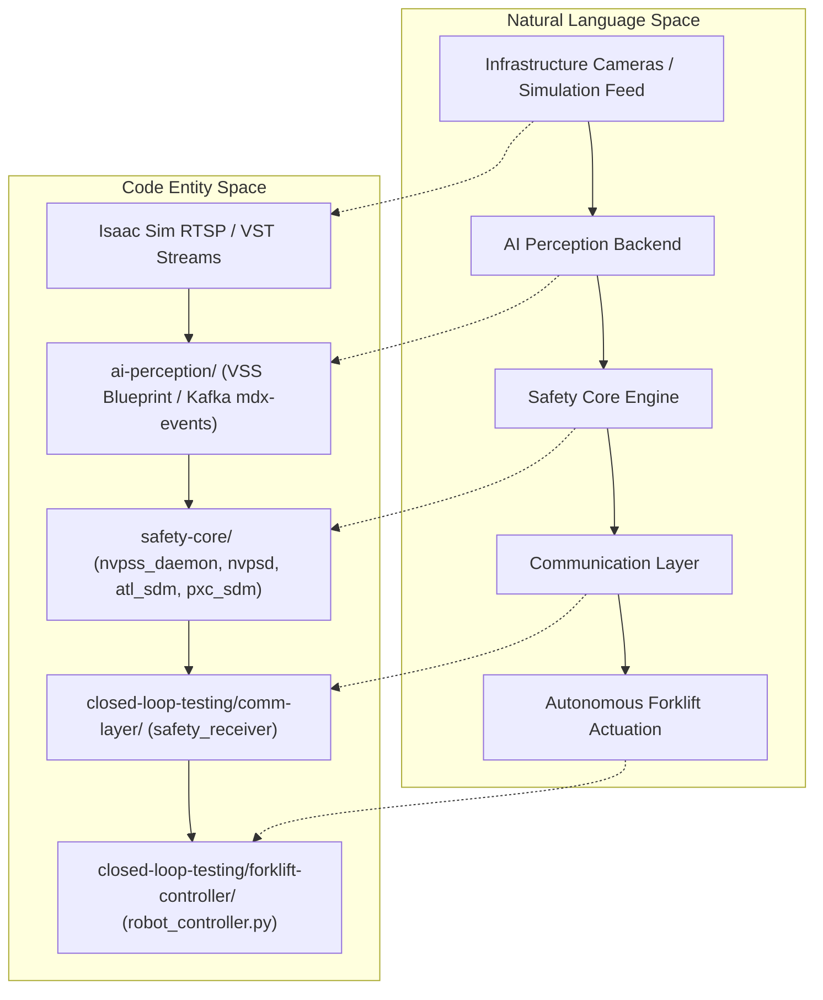
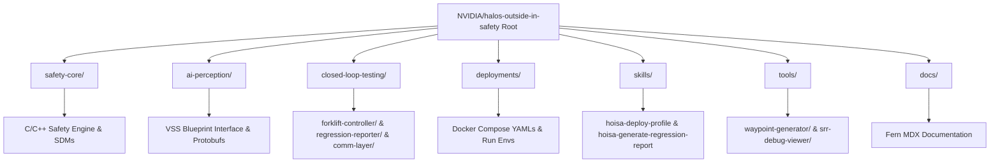

<!-- source: DeepWiki mcp.deepwiki.com · repo NVIDIA/halos-outside-in-safety · page 1 Overview · fetched 2026-11-09 -->

# Overview

Relevant source files

The following files were used as context for generating this wiki page:

- [CHANGELOG.md](CHANGELOG.md)
- [README.md](README.md)
- [ai-perception/README.md](ai-perception/README.md)
- [closed-loop-testing/3rdParty_Licenses.txt](closed-loop-testing/3rdParty_Licenses.txt)
- [closed-loop-testing/regression-reporter/README.md](closed-loop-testing/regression-reporter/README.md)
- [skills/README.md](skills/README.md)
- [skills/hoisa-generate-regression-report/references/03_monitor.md](skills/hoisa-generate-regression-report/references/03_monitor.md)
- [tools/srr-debug-viewer/docs/architecture.md](tools/srr-debug-viewer/docs/architecture.md)
- [tools/srr-debug-viewer/docs/data-schema.md](tools/srr-debug-viewer/docs/data-schema.md)
- [tools/waypoint-generator/README.md](tools/waypoint-generator/README.md)
- [whitepaper/halos-outside-in-safety.md](whitepaper/halos-outside-in-safety.md)

The purpose of this document is to provide a high-level overview of the **NVIDIA Halos Outside-In Safety (HOISA)** codebase, detailing its end-to-end closed-loop architecture, repository organization, and links to detailed child pages. HOISA serves as a reference architecture and open-source on-ramp for physical AI safety, extending robot perception beyond onboard sensors by utilizing fixed infrastructure cameras, AI perception, and dedicated safety logic `[README.md:1-25]`, `[whitepaper/halos-outside-in-safety.md:9-18]()`.

---

## 1. The Perception → Safety → Actuation Closed Loop

Halos Outside-In Safety operates through an end-to-end closed-loop pipeline that integrates vision-based AI perception, deterministic safety decision-making, and robot actuation control `[README.md:37-41]`, `[whitepaper/halos-outside-in-safety.md:53-74]()`. 

**Figure 1**: Mapping natural language components to code entities across the perception-safety-actuation loop.

Sources: `[README.md:37-41]`, `[ai-perception/README.md:8-17]`, `[safety-core/]`

---

## 2. Repository Layout

The repository is partitioned into distinct functional modules supporting runtime safety execution, simulation testing, deployments, developer tools, and agentic skills `[README.md:53-64]()`.

**Figure 2**: Repository layout mapping top-level directories to their internal sub-components.

- **`safety-core/`**: The C/C++ safety engine containing core daemon components (`nvpss_daemon`), decision gateways (`nvpsd`), safety decision makers (`atl_sdm`, `pxc_sdm`), and protocol adapters `[README.md:58]()`.
- **`ai-perception/`**: Perception integration contracts, pointer references to the NVIDIA VSS Blueprint backend, and message codecs `[README.md:57]`, `[ai-perception/README.md:8-17]()`.
- **`closed-loop-testing/`**: Software-in-the-Loop (SIL) and Hardware-in-the-Loop (HIL) harnesses, including Isaac Sim configurations, the communication bridge layer, and the Simulation Regression Reporter (`regression-reporter`) `[README.md:59]`, `[closed-loop-testing/regression-reporter/README.md:1-10]()`.
- **`deployments/`**: Docker Compose configurations (`compose.yaml`), deployment profile environment variable files (`base.env`, `sil.env`, `hil.env`), and cloud launch scripts `[README.md:61]()`.
- **`skills/`**: Agentic deployment and testing skills complying with the `agentskills.io` specification (`hoisa-deploy-profile`, `hoisa-generate-regression-report`) `[skills/README.md:1-15]()`.
- **`tools/`**: Developer tools including the React-based forklift waypoint generator (`waypoint-generator`) and the zero-dependency debug viewer (`srr-debug-viewer`) `[tools/waypoint-generator/README.md:1-15]`, `[tools/srr-debug-viewer/docs/architecture.md:1-15]()`.
- **`docs/`**: Fern-based documentation files in MDX format `[README.md:65-69]()`.

Sources: `[README.md:53-64]`, `[skills/README.md:1-15]`, `[tools/waypoint-generator/README.md:1-15]`

---

## 3. Child Pages and Detailed Topics

For more in-depth documentation, refer to the following child pages:

- **[System Architecture and Data Flow](#1.1)** — Detailed end-to-end flow spanning camera RTSP streams, VSS perception, Kafka `mdx-events`, Safety Core processing (`PSS`/`PSD`/`PSB`), UDP communication, ROS2/OPC UA bridging, and forklift actuation. Covers multi-stack bring-up ordering and component interactions `[CHANGELOG.md:12-43]`, `[ai-perception/README.md:12-17]()`.
- **[Getting Started](#1.2)** — Host prerequisites, NGC artifact access credentials, quick deployment guides, NVIDIA Brev virtual machine setup, and instructions for executing your first Software-in-the-Loop (SIL) run `[README.md:71-100]()`.
- **[Release History and Versioning](#1.3)** — CHANGELOG highlights, `release_metadata.yaml` configurations, known platform limitations, and critical safety/security notices `[CHANGELOG.md:1-48]`, `[README.md:3-5]()`.

Sources: `[CHANGELOG.md:1-48]`, `[README.md:3-100]`, `[ai-perception/README.md:12-17]`

---

