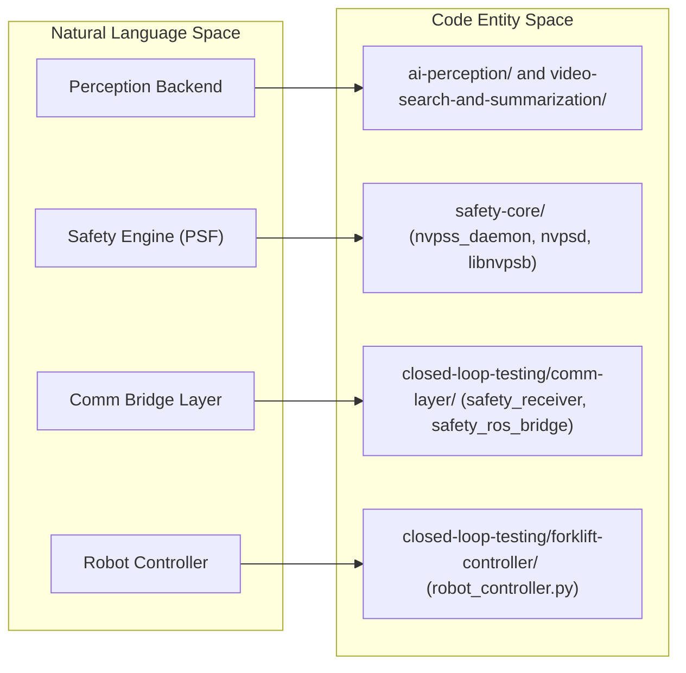
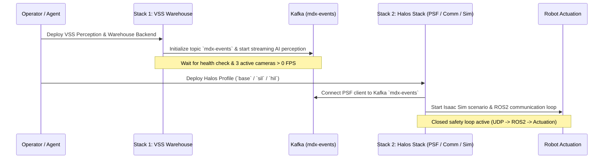

<!-- source: DeepWiki mcp.deepwiki.com · repo NVIDIA/halos-outside-in-safety · page 1.1 System Architecture and Data Flow · fetched 2026-11-09 -->

# System Architecture and Data Flow

<details>
<summary>Relevant source files</summary>

The following files were used as context for generating this wiki page:

- [README.md](README.md)
- [ai-perception/README.md](ai-perception/README.md)
- [assets/sil_warehouse_architecture.png](assets/sil_warehouse_architecture.png)
- [closed-loop-testing/scripts/restart_isaac.sh](closed-loop-testing/scripts/restart_isaac.sh)
- [deployments/scripts/deploy_hoisa_launchable.ipynb](deployments/scripts/deploy_hoisa_launchable.ipynb)
- [skills/README.md](skills/README.md)
- [skills/hoisa-deploy-profile/SKILL.md](skills/hoisa-deploy-profile/SKILL.md)
- [skills/hoisa-deploy-profile/references/halos_deploy.md](skills/hoisa-deploy-profile/references/halos_deploy.md)
- [skills/hoisa-deploy-profile/references/halos_hil.md](skills/hoisa-deploy-profile/references/halos_hil.md)
- [skills/hoisa-deploy-profile/references/test_scenario.md](skills/hoisa-deploy-profile/references/test_scenario.md)
- [skills/hoisa-deploy-profile/references/troubleshooting.md](skills/hoisa-deploy-profile/references/troubleshooting.md)
- [tools/waypoint-generator/README.md](tools/waypoint-generator/README.md)

</details>


This page details the end-to-end architecture and data flow of the Halos Outside-In Safety (HOISA) reference system. It covers the complete pipeline from simulated or physical sensor acquisition through AI perception, safety core decision evaluation, communication translation, and robotic actuation, alongside the mandatory two-stack bring-up ordering sequence.

---

## 1. Overview of the Closed Loop

The HOISA architecture implements a closed-loop safety system where external infrastructure cameras monitor a workspace (such as a warehouse loading dock), AI perception detects objects and spatial interactions, the Safety Core computes safety verdicts (e.g., `MUTE` or `UNMUTE`, `NORMAL`, `REDUCE`, `STOP`), and the communication layer relays these commands via UDP and ROS2 to actuate autonomous equipment like forklifts [README.md:20-36]().

### End-to-End Architectural Flow

```mermaid
graph TD
    subgraph "Simulation / Sensors"
      A["Isaac Sim" / "Hardware RTSP"] -->|"RTSP H264 :8554-8556"| B["VSS Warehouse Perception" / "vss-rtvi-cv"]
    end
    subgraph "Perception Event Bus"
      B -->|"Kafka mdx-events"| C["Safety Core (PSF)" / "nvpss_daemon"]
    end
    subgraph "Safety Decision & Comm"
      C -->|"UDP Port 12346"| D["Communication Layer" / "comm-layer"]
      D -->|"ROS2 /safety/is_muted"| E["Forklift Controller" / "robot_controller.py"]
      E -->|"Isaac Sim Action Graph"| F["Simulated Forklift Actuation"]
    end
```

**Sources:** `README.md`, `skills/hoisa-deploy-profile/SKILL.md`

---

## 2. Component Mapping: Natural Language to Code Entity Space

To facilitate debugging and code navigation, the following diagram maps high-level system components to their corresponding directories, binaries, and code artifacts within the repository structure.



**Sources:** `README.md`, `ai-perception/README.md`, `skills/hoisa-deploy-profile/SKILL.md`

---

## 3. Detailed Data Flow Pipeline

The end-to-end data flow operates across four sequential processing stages, transforming raw video frames into deterministic safety actuations.

### Stage 1: Sensor Ingestion & RTSP Streaming
* **Source Entity**: Isaac Sim simulation harness or physical IP cameras (`closed-loop-testing/`).
* **Implementation**: Isaac Sim self-hosts RTSP streams per camera (H.264 encoded) on ports `8554`, `8555`, and `8556` [skills/hoisa-deploy-profile/references/test_scenario.md:85-91]().
* **Data Flow**: Video feeds are exposed over RTSP (`rtsp://localhost:8554/camera`) and consumed by the perception backend.

### Stage 2: AI Perception & Kafka Event Bus
* **Source Entity**: VSS Warehouse Perception (`ai-perception/`, `video-search-and-summarization`).
* **Implementation**: Containers such as `vss-rtvi-cv` (object detection and tracking) and `vss-behavior-analytics` (ROI and tripwire analytics) process the RTSP streams [skills/hoisa-deploy-profile/SKILL.md:57-59]().
* **Data Flow**: Spatial events and zone incursions are serialized into Metropolis MDX protobuf messages and published to the Kafka event bus under the topic `mdx-events` [ai-perception/README.md:12-16]().

### Stage 3: Safety Core (PSF) Evaluation
* **Source Entity**: Safety Core engine (`safety-core/`).
* **Implementation**: 
  * The event integrator (`nvpss_daemon`) ingests Kafka messages using the MDX message codec (`safety-core/adapters/vss/mdx-msg-codec/`) and client (`safety-core/adapters/vss/mdx-client/`) [ai-perception/README.md:14-16]().
  * The decision gateway (`nvpsd`) evaluates rules defined in configuration files like `nvpss.conf` [skills/hoisa-deploy-profile/references/troubleshooting.md:31-32]().
  * Safety Decision Makers (SDMs), such as Automated Trailer Loading (`atl`) or Proximity Monitoring (`pxc`), compute verdicts [skills/hoisa-deploy-profile/references/halos_deploy.md:84-90]().
* **Data Flow**: Computed safety decisions are dispatched via POSIX IPC (`safecomm`) and packed into 64-byte UDP safety command packets directed to the communication layer [skills/hoisa-deploy-profile/references/halos_hil.md:14]().

### Stage 4: Communication Layer & Robotic Actuation
* **Source Entity**: Communication layer and Forklift Controller (`closed-loop-testing/comm-layer/` and `closed-loop-testing/forklift-controller/`).
* **Implementation**: 
  * The safety receiver (`safety_receiver`) decodes incoming UDP packets (e.g., 0xA5 proximity opcodes).
  * The ROS bridge (`safety_ros_bridge`) publishes state changes to the ROS2 topic `/safety/is_muted`.
  * The robot controller (`robot_controller.py`) consumes the topic and adjusts waypoint path execution, velocity scaling, or emergency stops [skills/hoisa-deploy-profile/references/test_scenario.md:86-89]().
* **Data Flow**: Isaac Sim Action Graphs receive the ROS2 signals, updating the simulated forklift's safety display disc and halting movement when required [skills/hoisa-deploy-profile/references/test_scenario.md:86-89]().

**Sources:** `ai-perception/README.md`, `skills/hoisa-deploy-profile/SKILL.md`, `skills/hoisa-deploy-profile/references/test_scenario.md`, `skills/hoisa-deploy-profile/references/halos_hil.md`

---

## 4. Two-Stack Bring-Up Ordering

Deploying HOISA requires strict adherence to a two-stack bring-up sequence. Attempting to start Stack 2 before Stack 1 is fully initialized and healthy results in connection failures, dropped messages, or cold-start race conditions [skills/hoisa-deploy-profile/references/troubleshooting.md:7-24]().



### Bring-Up Rules
1. **Stack 1 (Perception Backend)**: Must be deployed, started, and verified healthy first. Kafka must be active and serving the `mdx-events` topic, and DeepStream must report active camera sources with current FPS > 0 [skills/hoisa-deploy-profile/SKILL.md:105-110]().
2. **Stack 2 (Halos Safety & Simulation Stack)**: Launched only after Stack 1 health checks pass. This ensures the Safety Core (`safety-core`) can establish its Kafka connection without encountering connection timeouts or stale bootstrap states [skills/hoisa-deploy-profile/references/troubleshooting.md:7-23]().

**Sources:** `skills/hoisa-deploy-profile/SKILL.md`, `skills/hoisa-deploy-profile/references/troubleshooting.md`

---

