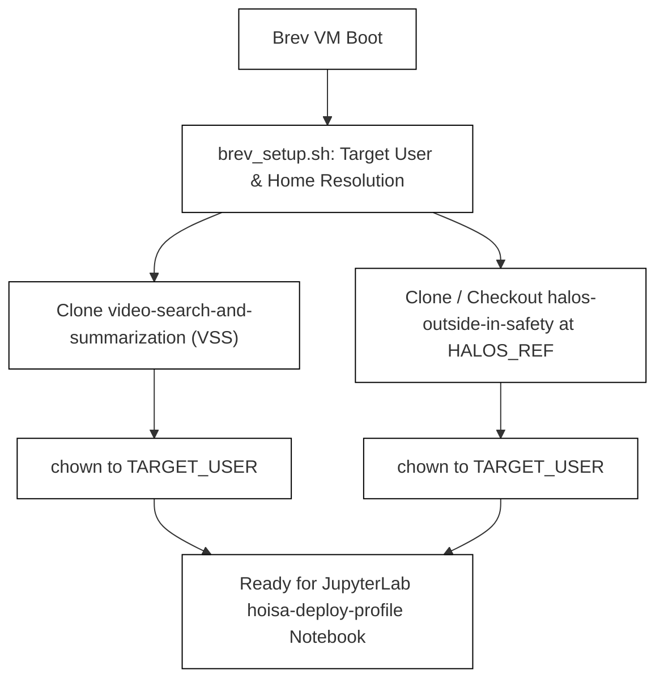
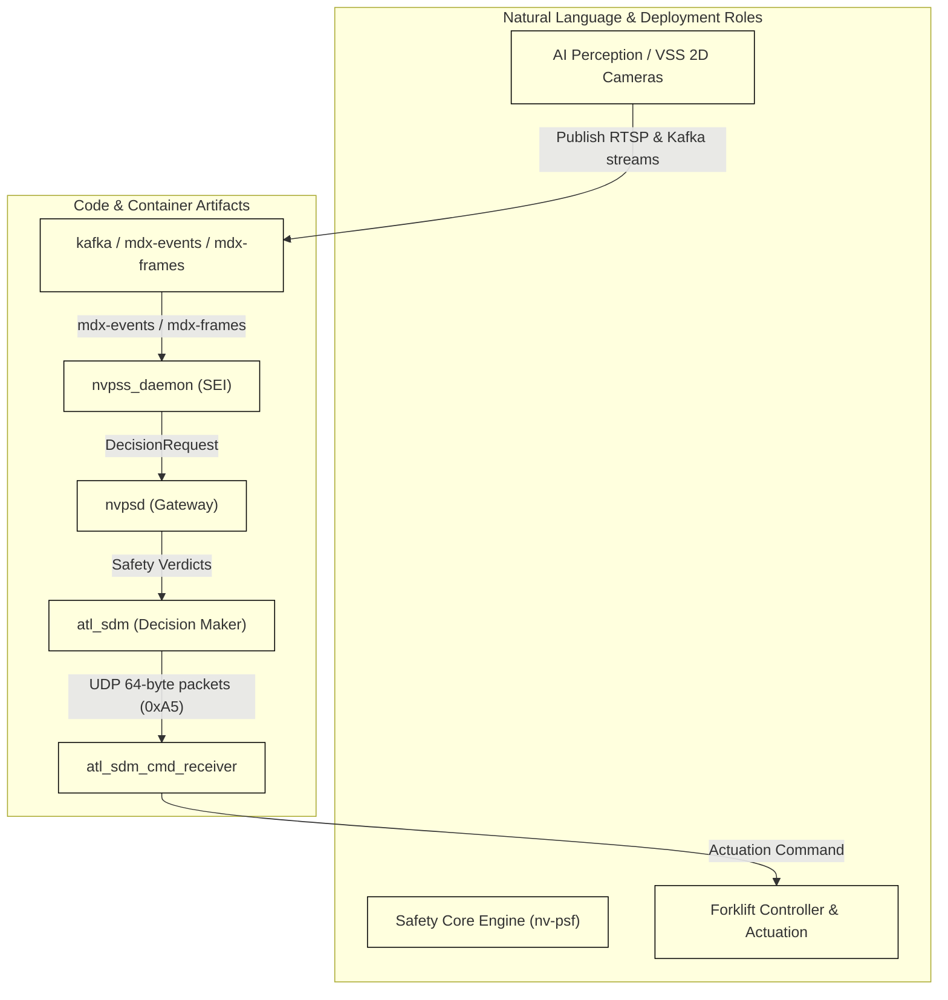

<!-- source: DeepWiki mcp.deepwiki.com · repo NVIDIA/halos-outside-in-safety · page 1.2 Getting Started · fetched 2026-11-09 -->

# Getting Started

<details>
<summary>Relevant source files</summary>

The following files were used as context for generating this wiki page:

- [deployments/scripts/brev_setup.sh](deployments/scripts/brev_setup.sh)
- [docs/deployment/prerequisites.mdx](docs/deployment/prerequisites.mdx)
- [docs/deployment/quick-deployment.mdx](docs/deployment/quick-deployment.mdx)
- [docs/getting-started/agentic-deployment.mdx](docs/getting-started/agentic-deployment.mdx)
- [docs/getting-started/index.mdx](docs/getting-started/index.mdx)
- [docs/getting-started/inference-pipeline.mdx](docs/getting-started/inference-pipeline.mdx)
- [docs/getting-started/prerequisites.mdx](docs/getting-started/prerequisites.mdx)
- [docs/index.mdx](docs/index.mdx)
- [docs/integration/components/ai-monitor.mdx](docs/integration/components/ai-monitor.mdx)
- [docs/integration/components/event-integrator.mdx](docs/integration/components/event-integrator.mdx)
- [docs/integration/components/perception-monitor.mdx](docs/integration/components/perception-monitor.mdx)

</details>


## Purpose and Scope

This page provides full technical details for bringing up the **Halos Outside-In Safety (HOISA)** system from scratch. It covers prerequisites, authentication and downloading of NVIDIA GPU Cloud (NGC) artifacts, rapid virtual machine provisioning via NVIDIA Brev, quick deployment workflows, and executing a first Software-in-the-Loop (SIL) test run.

Sources: `[docs/getting-started/index.mdx:1-22]()`, `[deployments/scripts/brev_setup.sh:1-14]()`

---

## Prerequisites and NGC Artifacts

Before deploying HOISA, the target host must meet specific hardware, software, and container registry access requirements. HOISA depends on NGC artifacts, including the core safety engine containers and Debian packaging resources.

### System Requirements Summary
* **Operating System**: Ubuntu 24.04 (x86-64) or Jetson Linux BSP Rel 38.5 (IGX Thor) `[docs/getting-started/prerequisites.mdx:116-121]()`.
* **Container Runtime**: Docker Engine version 28.3.3 or later (strictly below 29.5.0 to prevent NGC image pull formatting errors) equipped with the NVIDIA Container Toolkit `[docs/getting-started/prerequisites.mdx:124-126]()`, `[docs/getting-started/prerequisites.mdx:140-144]()`.
* **Hardware**: Dedicated NVIDIA GPU with RT cores (e.g., RTX 5090, RTX PRO 6000 Blackwell) when running Isaac Sim in SIL mode, or an NVIDIA IGX Thor platform for hardware-in-the-loop (HIL) / base deployments `[docs/getting-started/prerequisites.mdx:21-75]()`.

### NGC Authentication & Artifact Retrieval
To pull public PSF images and Debian archives (`nvidia/halos-outside-in`), you must authenticate Docker and the NGC CLI using an API key with accepted terms of service:

```bash
docker login nvcr.io -u '$oauthtoken' -p "$NGC_CLI_API_KEY"
ngc config set
```

Sources: `[docs/getting-started/agentic-deployment.mdx:27-42]`, `[docs/deployment/prerequisites.mdx:77-104]()`

---

## NVIDIA Brev VM Setup

For rapid evaluation or when local hardware constraints prevent native bring-up, the automated setup script `deployments/scripts/brev_setup.sh` provisions a cloud GPU instance. It ensures that both the `halos-outside-in-safety` repository and the `video-search-and-summarization` (VSS) perception backend repository are correctly cloned and synchronized.


*Figure 1: Brev VM provisioning workflow executed by `brev_setup.sh`.*

Sources: `[deployments/scripts/brev_setup.sh:1-62]()`

### Implementation Details of Brev Setup
* **User Resolution**: The script determines the non-root interactive user (`$SUDO_USER` or `/home` scan) to ensure permissions are assigned correctly `[deployments/scripts/brev_setup.sh:22-29]()`.
* **Repository Synchronization**: Clones the VSS perception backend into `${TARGET_HOME}/video-search-and-summarization` `[deployments/scripts/brev_setup.sh:34-42]()`.
* **Ref Handling**: Forces the Halos repository to check out the branch defined by `HALOS_REF` (defaulting to `develop`), preventing detached HEAD states or default-branch mismatches `[deployments/scripts/brev_setup.sh:16-20]`, `[deployments/scripts/brev_setup.sh:45-58]()`.

Sources: `[deployments/scripts/brev_setup.sh:1-62]()`

---

## Quick Deployment and Configuration

The quick deployment workflow mounts camera sensor configurations, provisions log pipes, learns environmental baselines, and runs the core safety container (`nv-psf`) alongside AI Perception `[docs/deployment/quick-deployment.mdx:1-136]()`.


*Figure 2: System architecture bridging natural language concepts to concrete execution code entities during deployment.*

### Execution Pipeline Steps
1. **Debian Package Installation**: Downloads the architecture-specific package from NGC and installs host-side command receivers (`atl_sdm_cmd_receiver`) `[docs/deployment/quick-deployment.mdx:28-35]()`.
2. **Sensor Configuration Generation**: Queries VST via REST (`http://127.0.0.1:30888/vst/api/v1`) to construct `sensor_config.conf` mapping `pipelineId`, `sensorName`, and active RTSP stream URLs `[docs/deployment/quick-deployment.mdx:51-88]()`.
3. **Log Directory Preparation**: Pre-creates host bind-mount log files (`psf.log`, `saim.log`, `pcm.log`, `atl_sdm.log`) under `/var/log/psf` with permissive access for the container user `nvidia` `[docs/deployment/quick-deployment.mdx:102-114]()`.
4. **Baseline Learning**: Executes the container with `--saim-mode learn --pcm-mode learn` to capture camera and event normal baselines before active monitoring `[docs/deployment/quick-deployment.mdx:116-136]()`.

Sources: `[docs/deployment/quick-deployment.mdx:1-136]()`

---

## First SIL Run

Software-in-the-Loop (SIL) executes the entire perception-to-safety-to-actuation closed loop on a single host without physical cameras or forklifts, leveraging NVIDIA Isaac Sim `[docs/getting-started/index.mdx:16]`, `[docs/getting-started/agentic-deployment.mdx:14-16]()`.

### Launching SIL Profiles
You can initialize SIL via automated agentic prompts or standard Jupyter notebooks (`deploy_hoisa_launchable.ipynb`) `[deployments/scripts/brev_setup.sh:60-62]`, `[docs/getting-started/agentic-deployment.mdx:90-105]()`:
* **2D SIL Profile**: Uses standard 2D detection and tracking backends paired with the `atl` decision maker `[docs/getting-started/agentic-deployment.mdx:90-96]()`.
* **3D SIL Profile**: Deploys sparse 3D perception applications (e.g., Sparse4D) requiring specialized 3D configuration mounts (`deploymentMode = 3D`) `[docs/getting-started/agentic-deployment.mdx:98-105]`, `[docs/integration/components/event-integrator.mdx:30-31]()`.

Sources: `[docs/getting-started/agentic-deployment.mdx:80-116]`, `[docs/integration/components/event-integrator.mdx:29-32]()`

---
Sources: `[docs/getting-started/index.mdx:1-23]`, `[deployments/scripts/brev_setup.sh:1-63]`, `[docs/getting-started/agentic-deployment.mdx:1-117]`, `[docs/getting-started/prerequisites.mdx:1-152]`, `[docs/deployment/quick-deployment.mdx:1-136]`, `[docs/integration/components/event-integrator.mdx:1-108]`

---

