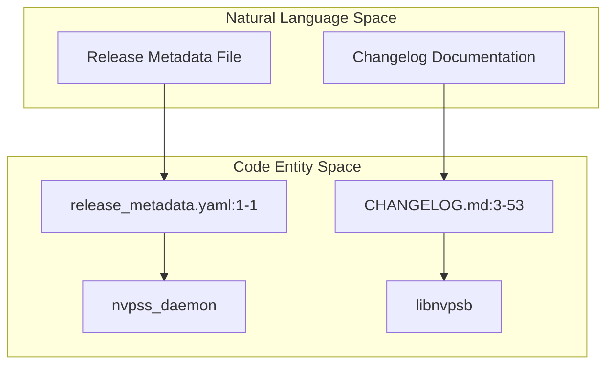
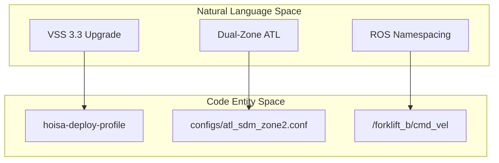
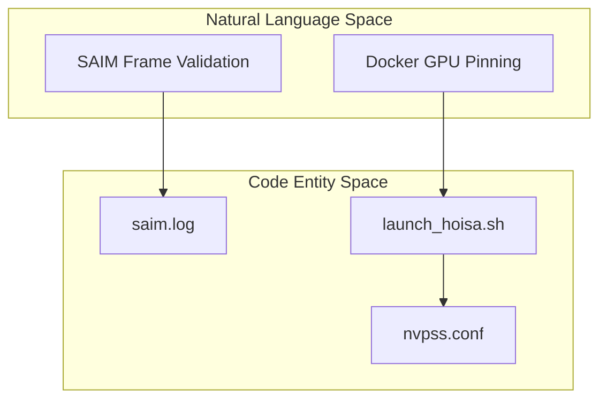

<!-- source: DeepWiki mcp.deepwiki.com · repo NVIDIA/halos-outside-in-safety · page 1.3 Release History and Versioning · fetched 2026-11-09 -->

# Release History and Versioning

Relevant source files

The following files were used as context for generating this wiki page:

- [CHANGELOG.md](CHANGELOG.md)
- [SECURITY.md](SECURITY.md)
- [docs/known-limitations.mdx](docs/known-limitations.mdx)
- [release_metadata.yaml](release_metadata.yaml)

This page details the release versioning metadata, historical changelog highlights, known behavioural limitations across the Safety Core components and simulation harnesses, and product security/safety reporting guidelines for the HOISA codebase.

---

## 1. Release Metadata and Versioning Scheme

The repository tracks its active build and version tag via configuration metadata located at the repository root. The current active version tag for this release is specified as `1.3-26.07.5`.

- **Release Tag Specification**: `release_metadata.yaml:1-1`
- **Versioning Policy**: Semantic versioning combined with build-date/component lineage identifiers linking the Safety Core binaries (`nvpss_daemon`, `libnvpsb`) with simulation and deployment profiles.

### Diagram: Release Artifact Dependency Flow

*Sources: release_metadata.yaml:1-1, CHANGELOG.md:3-53*

---

## 2. Changelog Highlights

Recent development cycles have introduced significant updates spanning VSS integration, Safety Decision Maker (SDM) configurations, multi-zone Automated Trailer Loading (ATL), and namespaced ROS communication surfaces.

### VSS Warehouse 3.3 Integration
- **Profile Targeting**: `hoisa-deploy-profile` targets VSS 3.3.0, deployed via the VSS repository's `vss-build-vision-ai` skill (`CHANGELOG.md:5-7`).
- **Authentication**: Requires explicit `docker login nvcr.io` utilizing an NGC key since `nvcr.io/nvidia/vss-core` 3.3.0 images do not support anonymous pulling (`CHANGELOG.md:8`).
- **Calibration & Models**: Ships with the Sparse4D model and native loading-dock BEV calibration routines (`CHANGELOG.md:10`).

### PSF 1.4 and SDM Configuration Changes
- **Launcher Requirements**: `sil` and `base` configurations target the PSF 1.4 image (`nv-psf-halos-1.4-6b92731`), where the runtime launcher rejects SDMs lacking an explicit event binding (`CHANGELOG.md:25-27`).
- **Configuration Files**: `--sdm-config configs/<PSF_APP>_sdm.conf` mounts `sensor_pipelines_config.conf` (`CHANGELOG.md:29`). The configuration explicitly defines `deploymentMode = 2D` and `enableFusion = true` inside `nvpss.conf` (`CHANGELOG.md:30`).
- **Proximity Event Mapping**: Proximity events have migrated from `EVENT_8/9/10` to `EVENT_12/13/14`, preserving `EVENT_0..11` exclusively for ATL (`CHANGELOG.md:33`).

### Multi-Zone ATL Support
- **Dual-Bay Configuration**: `atl-dual-override.yaml` executes the safety core as `--app atl_dual`, deploying one ATL SDM per trailer bay (`CHANGELOG.md:38-40`).
- **Zone 2 Processing**: Zone 2 operates on `EVENT_6..11` using `configs/atl_sdm_zone2.conf` over port `COMM_UDP_PORT_ZONE2` (`CHANGELOG.md:40`). The communication bridge maps these into specific OPC UA nodes (`Zone2IsMuted`, `Zone2StateJson`) (`CHANGELOG.md:41`).

### ROS Topic Namespacing
- **Topic Renaming**: Multi-forklift support namespaces topics, TF frames, and node names relative to individual vehicle IDs (e.g., `/cmd_vel` is now prefixed as `/forklift_b/cmd_vel`) (`CHANGELOG.md:46-53`).

### Diagram: Changelog Deployment Architecture

*Sources: CHANGELOG.md:5-7, CHANGELOG.md:38-40, CHANGELOG.md:46-53*

---

## 3. Known Limitations and Behavioural Constraints

The Safety Core, launcher scripts, and closed-loop testing harness exhibit specific operational constraints that require defined workarounds.

### Automated Trailer Loading (ATL) Control Model
- **Single-Forklift Limit**: The ATL reference application is engineered strictly for a single forklift operating inside the monitored loading dock ROI (`docs/known-limitations.mdx:10-12`). Concurrent multi-forklift entry into the same ROI can disrupt safety command association (`docs/known-limitations.mdx:13-14`).

### Event Type Coverage
- **MDX Event Translation**: The MDX client translates incoming `mdx-events` and `mdx-frames` into Safety Core events (`docs/known-limitations.mdx:17-22`). However, perception metadata outside of tripwire crossings, restricted-area violations, and object-pair distances is ignored by default decision logic (`docs/known-limitations.mdx:23-24`).
- **Unsupported Types**: `alert_type: "empty_roi"` rules never match because the MDX client maps empty ROIs to an `roi` clear status (`docs/known-limitations.mdx:25-26`).

### Isaac Sim Upstream Streaming Issues
- **RTSP / VST Anomalies**: Upstream Omniverse/Isaac Sim streaming behaviours require specific configuration workarounds:
  - *Bug 6477478*: UDP delivery halts silently over time. *Workaround*: Ingest via TCP by setting `"rtsp_streaming_over_tcp": true` in `vst_config.json` (`docs/known-limitations.mdx:37`).
  - *Bug 6478845*: `has no caps` RTSP responses during cold bind windows. *Workaround*: Handled via render-warm gates and `closed-loop-testing/scripts/restart_isaac.sh` (`docs/known-limitations.mdx:38`).
  - *Bug 6478903*: Sensor deletions leak live RTSP clients (zombies). *Workaround*: Restart `vss-vios-streamprocessing` via `restart_isaac.sh` (`docs/known-limitations.mdx:39`).
  - *Bug 6478175*: NVENC encode session leaks during windowed multi-camera replay. *Workaround*: Execute headless (`docs/known-limitations.mdx:40`).

### Safety AI Monitor (SAIM) Constraints
- **Docker GPU Visibility**: With `launch_hoisa.sh --runtime docker`, passing `--gpu <n>` is restricted to `n = 0` because the runtime exposes a single isolated GPU context to the container (`docs/known-limitations.mdx:54-60`).
- **Frame Size Restrictions**: SAIM divides frames into a strict 15×15 grid and rejects incompatible dimensions (such as 1280×720 or 2560×1440), logging a `[QA]` size error (`docs/known-limitations.mdx:78-84`).

### Diagram: SAIM and Perception Pipeline Flow

*Sources: docs/known-limitations.mdx:46-50, docs/known-limitations.mdx:54-61, docs/known-limitations.mdx:78-85*

---

## 4. Security and Safety Notices

NVIDIA maintains strict protocols regarding software product security and vulnerability reporting.

### Vulnerability Reporting Policy
- **Reporting Channel**: Security vulnerabilities must not be reported via public GitHub issues or pull requests (`SECURITY.md:5`).
- **Contact Points**:
  - Web Submission: [Security Vulnerability Submission Form](https://www.nvidia.com/object/submit-security-vulnerability.html) (`SECURITY.md:10`)
  - Email: `psirt@nvidia.com` (utilizing the NVIDIA public PGP key for secure communications) (`SECURITY.md:11-12`)
- **Required Disclosure Information**: Submissions should include product/driver names, version branches, vulnerability classifications (e.g., buffer overflow, denial of service), and reproduction instructions or proof-of-concept code (`SECURITY.md:13-18`).

### Sources
- `CHANGELOG.md:1-53`
- `docs/known-limitations.mdx:1-99`
- `release_metadata.yaml:1-1`
- `SECURITY.md:1-25`

---

