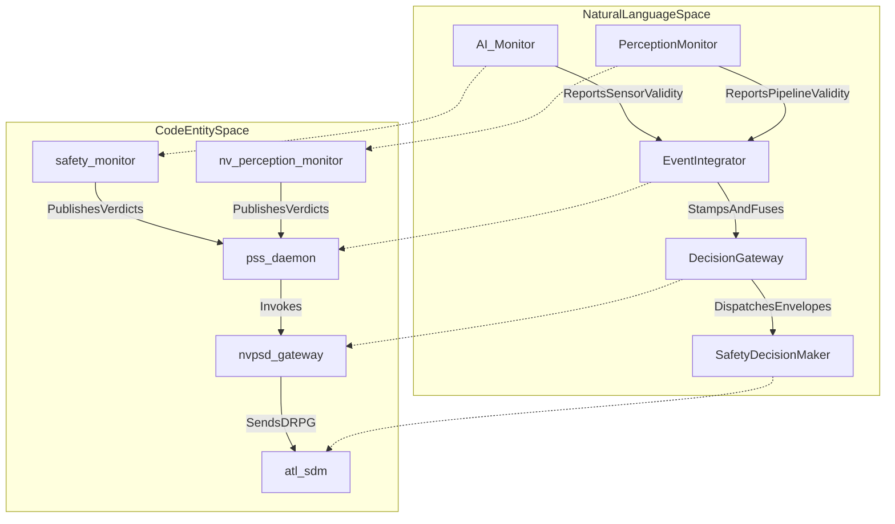
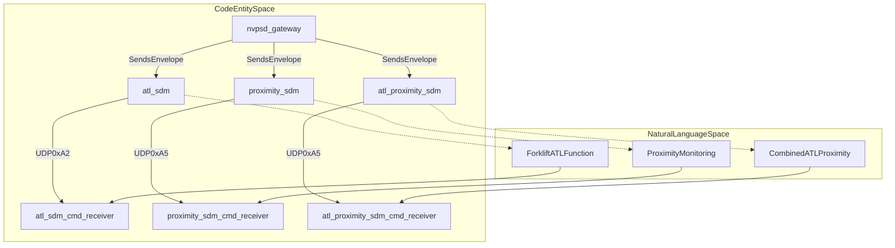

<!-- source: DeepWiki mcp.deepwiki.com · repo NVIDIA/halos-outside-in-safety · page 2 Safety Core (OISF/PSF) · fetched 2026-11-09 -->

# Safety Core (OISF/PSF)

Relevant source files

The following files were used as context for generating this wiki page:

- [SAFETY_NOTICE.md](SAFETY_NOTICE.md)
- [docs/getting-started/safety-core.mdx](docs/getting-started/safety-core.mdx)
- [docs/integration/components/decision-maker.mdx](docs/integration/components/decision-maker.mdx)
- [docs/integration/index.mdx](docs/integration/index.mdx)
- [docs/reference/event-mapping-configuration.mdx](docs/reference/event-mapping-configuration.mdx)
- [safety-core/BUILD.md](safety-core/BUILD.md)
- [safety-core/CMakeLists.txt](safety-core/CMakeLists.txt)
- [safety-core/adapters/vss/event-mappings/atl_proximity/event_mapping_atl_proximity.pb.txt](safety-core/adapters/vss/event-mappings/atl_proximity/event_mapping_atl_proximity.pb.txt)
- [safety-core/adapters/vss/mdx-client/README.md](safety-core/adapters/vss/mdx-client/README.md)
- [safety-core/components/event-integrator/daemon/include/NvPSSSafetyEventManager.hpp](safety-core/components/event-integrator/daemon/include/NvPSSSafetyEventManager.hpp)
- [safety-core/components/event-integrator/daemon/include/pss_protocol.h](safety-core/components/event-integrator/daemon/include/pss_protocol.h)
- [tools/srr-debug-viewer/README.md](tools/srr-debug-viewer/README.md)

The Safety Core is a robust C/C++ safety engine located in `safety-core/` that acts as the deterministic decision-making backbone for the NVIDIA Halos Outside-In Safety (HOISA) blueprint [safety-core/BUILD.md:6-8](). It bridges upstream perception output from AI pipelines with physical field actuators, continuously validating sensor integrity, supervising internal subsystem health, fusing multi-source telemetry, and enforcing fail-safe states.

For detailed integration instructions, see the [Integration Guide](/integration) and the child pages linked below.

## 2.1 Core Components

The Safety Core comprises several modular daemons and shared libraries that handle event integration, gateway routing, black-box logging, AI monitoring, and perception pipeline validation [docs/integration/index.mdx:16-25](). The event integrator (`nvpss_daemon`) ingests sanitized events, while the decision gateway (`nvpsd_gateway`) securely dispatches decision requests to isolated Safety Decision Makers (SDMs). System health is continuously evaluated by the Safety AI Monitor (`safety_monitor`) and the Perception Monitor (`nv_perception_monitor`), backed by the black-box logging library (`libnvpsb.so`) and `safecomm` IPC primitives.

For full architectural details, component interactions, and protocol specifications, see [Core Components](#2.1).

Sources: [docs/integration/index.mdx:16-46](), [docs/getting-started/safety-core.mdx:16-50](), [safety-core/CMakeLists.txt:129]()

---

## 2.2 Decision Makers (SDMs)

Safety Decision Makers (SDMs) consume validated `DecisionRequest` payloads from the NvPSD Gateway and translate them into deterministic 64-byte UDP control commands for PLCs, robotic controllers, or reference command receivers [docs/integration/components/decision-maker.mdx:5-10](). The Safety Core ships with reference SDMs including `atl_sdm` (forklift safety function), `proximity_sdm` (proximity monitoring), combined `atl_proximity_sdm`, and `crossing_junction_safety_monitor_sdm` [safety-core/CMakeLists.txt:129](). When any path fault, dropped heartbeat, or sensor failure occurs, the SDM immediately latches a safe state that requires explicit operator intervention to release [docs/integration/components/decision-maker.mdx:8-13]().

For detailed configuration parameters, command packet schemas, and guide on writing custom decision makers, see [Decision Makers (SDMs)](#2.2).

Sources: [docs/integration/components/decision-maker.mdx:5-34](), [safety-core/CMakeLists.txt:129]()

---

## 2.3 Perception Adapters and Event Mapping

The perception adapter layer bridges upstream computer vision pipelines with the Safety Core via Kafka messaging. The `mdx_client` executable consumes `mdx-events` and `mdx-frames` topics, parsing Protobuf messages and matching them against user-defined rule configurations (`event_mapping.proto`) [docs/reference/event-mapping-configuration.mdx:5-15](). It resolves individual camera feeds or 3D Bird's-Eye View (BEV) pipeline identifiers to emit standardized `SafetyEvent` reports into the safety daemon [safety-core/adapters/vss/mdx-client/README.md:6-36]().

For detailed configuration structures, violation filters, proximity-pair rules, and custom event ingestion, see [Perception Adapters and Event Mapping](#2.3).

Sources: [docs/reference/event-mapping-configuration.mdx:5-43](), [safety-core/adapters/vss/mdx-client/README.md:6-36]()

---

## 2.4 Building and Packaging

The Safety Core uses CMake to orchestrate multi-component builds supporting both `x86_64` and `aarch64` architectures [safety-core/BUILD.md:6-10](). It incorporates dependency link stubs (`safety-core/cmake/stubs`) and third-party NVDEC headers (`safety-core/cmake/third-party-headers`) to maintain consistent cross-compilation flows without requiring target-specific runtime libraries at build time [safety-core/BUILD.md:28-35](). Build targets generate Debian runtime and development packages (`psf-desktop.deb`, `psf-tegra.deb`) as well as standalone Docker image archives under `<build-dir>/packages` [safety-core/BUILD.md:73-126]().

For step-by-step compilation instructions, toolchain configuration files, and packaging targets, see [Building and Packaging](#2.4).

Sources: [safety-core/BUILD.md:6-126](), [safety-core/CMakeLists.txt:4-116]()

---

## 2.5 Safety Core Runtime Configuration

Runtime behavior across the safety engine is controlled by text configuration files and deployment scripts. Key configuration assets include `nvpss.conf` for daemon supervision, sensor pipeline definitions (`sensor_config.conf` for 2D, `sensor_pipelines_config.conf` for 3D/BEV), and specific decision maker configurations (`atl_sdm_zone1.conf`, `pxc_sdm_forklift.conf`) [docs/integration/components/decision-maker.mdx:30-32](), [safety-core/adapters/vss/mdx-client/README.md:23-24](). These files establish operational thresholds, heartbeat intervals, timeout limits, and subscription maps.

For comprehensive configuration file schemas, zone setups, and override mechanisms, see [Safety Core Runtime Configuration](#2.5).

Sources: [docs/integration/components/decision-maker.mdx:30-34](), [safety-core/adapters/vss/mdx-client/README.md:23-24]()

---

