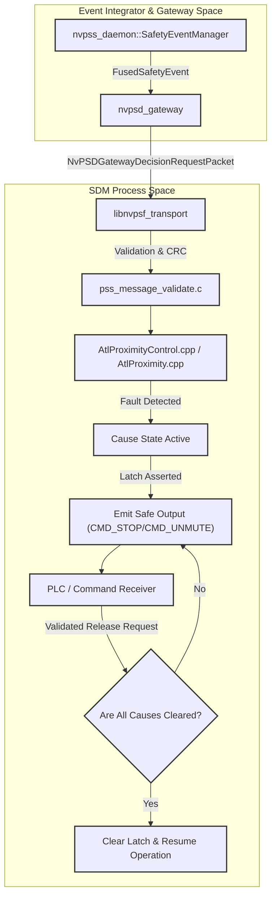
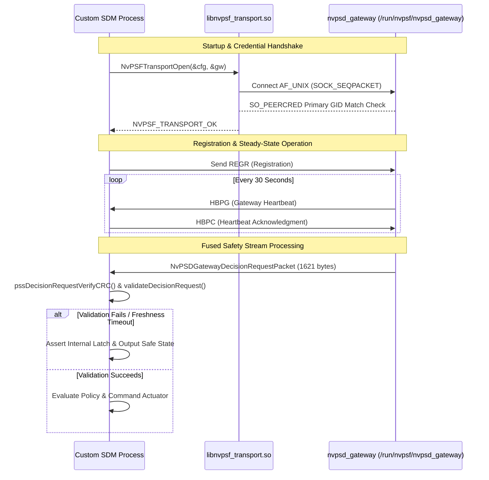

<!-- source: DeepWiki mcp.deepwiki.com · repo NVIDIA/halos-outside-in-safety · page 2.2 Decision Makers (SDMs) · fetched 2026-11-09 -->

# Decision Makers (SDMs)

Relevant source files

The following files were used as context for generating this wiki page:

- [docs/integration/safe-state-model.mdx](docs/integration/safe-state-model.mdx)
- [docs/integration/writing-a-decision-maker.mdx](docs/integration/writing-a-decision-maker.mdx)
- [safety-core/components/event-integrator/daemon/src/NvPSSSafetyEventManager.cpp](safety-core/components/event-integrator/daemon/src/NvPSSSafetyEventManager.cpp)
- [safety-core/components/safecomm/posix_msg_que/include/posix_msg_que.h](safety-core/components/safecomm/posix_msg_que/include/posix_msg_que.h)
- [safety-core/decision-makers/CMakeLists.txt](safety-core/decision-makers/CMakeLists.txt)
- [safety-core/decision-makers/atl_proximity/CMakeLists.txt](safety-core/decision-makers/atl_proximity/CMakeLists.txt)
- [safety-core/decision-makers/atl_proximity/README.md](safety-core/decision-makers/atl_proximity/README.md)
- [safety-core/decision-makers/atl_proximity/atl_proximity_sdm.cmake](safety-core/decision-makers/atl_proximity/atl_proximity_sdm.cmake)

## Purpose and Scope
This page details the Safety Decision Makers (SDMs) within the HOISA `safety-core/decision-makers/` subsystem [safety-core/decision-makers/CMakeLists.txt:1-20](). It covers the reference implementations—Access Traffic Light (`atl_sdm`), Proximity Monitoring (`proximity_sdm`), Combined (`atl_proximity_sdm`), and Crossing-Junction Safety Monitor—alongside the core safe-state latching model and the architectural contract required to implement a custom SDM.

---

## Reference Safety Decision Makers

HOISA features four primary decision-making modules that process fused safety events from the `nvpsd` gateway and command downstream actuators (PLCs or robot controllers via UDP/POSIX queues).

| SDM Binary / Module | Source Directory | Target Use Case / Function | Command Output | Sources |
|---|---|---|---|---|
| `atl_sdm` | `safety-core/decision-makers/atl` | Forklift Access Traffic Light (ATL) zone/tripwire safety [safety-core/decision-makers/CMakeLists.txt:4-5]() | `CMD_UNMUTE`, `CMD_SW_ERROR` [docs/integration/safe-state-model.mdx:25-25]() | `[safety-core/decision-makers/CMakeLists.txt:4-5](), [docs/integration/safe-state-model.mdx:25-25]()` |
| `proximity_sdm` | `safety-core/decision-makers/proximity` | Standalone proximity monitoring (PXC) [safety-core/decision-makers/CMakeLists.txt:8-10]() | `CMD_STOP`, `CMD_SW_ERROR` [docs/integration/safe-state-model.mdx:26-26]() | `[safety-core/decision-makers/CMakeLists.txt:8-10](), [docs/integration/safe-state-model.mdx:26-26]()` |
| `atl_proximity_sdm` | `safety-core/decision-makers/atl_proximity` | Combined ATL and forklift-to-person proximity [safety-core/decision-makers/atl_proximity/atl_proximity.cmake:30-34]() | Worst-tier command aggregation (`CMD_STOP`, `CMD_REDUCE`, `CMD_NORMAL`) [safety-core/decision-makers/atl_proximity/README.md:62-71]() | `[safety-core/decision-makers/atl_proximity/atl_proximity.cmake:30-34](), [safety-core/decision-makers/atl_proximity/README.md:62-71]()` |
| Crossing-Junction | `safety-core/decision-makers/crossing-junction-safety-monitor` | Junction collision avoidance & cross-traffic monitoring [safety-core/decision-makers/CMakeLists.txt:18-20]() | Junction-specific interlock signals | `[safety-core/decision-makers/CMakeLists.txt:18-20]()` |

The `atl_proximity_sdm` implementation relies on specific C++ source modules:
- `AtlProximity.cpp` [safety-core/decision-makers/atl_proximity/atl_proximity.cmake:30-31]()
- `AtlProximityControl.cpp` [safety-core/decision-makers/atl_proximity/atl_proximity.cmake:32-32]()
- `sensor_config_parser.cpp` [safety-core/decision-makers/atl_proximity/atl_proximity.cmake:33-33]()

Sources: `[safety-core/decision-makers/CMakeLists.txt:1-20](), [safety-core/decision-makers/atl_proximity/atl_proximity.cmake:30-34](), [docs/integration/safe-state-model.mdx:23-27](), [safety-core/decision-makers/atl_proximity/README.md:62-71]()`

---

## Safe-State Model and Latch Architecture

Every reference SDM adheres to a strict safe-state model governing fault detection, latch assertion, and operator/PLC release protocols [docs/integration/safe-state-model.mdx:6-10]().

### Core Mechanics
1. **Causes**: Fault conditions (e.g., sensor loss, communication gaps, sequence errors) are evaluated independently. Each cause is strictly binary (active or inactive) [docs/integration/safe-state-model.mdx:16-17]().
2. **The Latch**: Raising any latching fault sets an internal flag in the SDM process. While set, the SDM overrides its operational decision and continuously outputs its designated safe state (`CMD_STOP` or `CMD_UNMUTE`) [docs/integration/safe-state-model.mdx:18-20]().
3. **The Release**: Clearing underlying physical faults *does not* clear the latch. The SDM retains its safe output until it accepts an explicit release request packet from the PLC, which is permitted *only when zero fault causes remain active* [docs/integration/safe-state-model.mdx:21-22]().

### Diagram: SDM Cause-to-Latch Data Flow (Code Entity Space)

Sources: `[docs/integration/safe-state-model.mdx:12-35](), [safety-core/decision-makers/atl_proximity/atl_proximity.cmake:30-34](), [safety-core/components/event-integrator/daemon/src/NvPSSSafetyEventManager.cpp:147-155]()`

---

## Implementing a Custom Decision Maker

To write a custom SDM that successfully interfaces with the `nvpsd` gateway, developers must satisfy a strict communication and runtime contract [docs/integration/writing-a-decision-maker.mdx:6-10]().

### Gateway Connection Contract
1. **Shared Process Group**: The SDM must execute within the same primary POSIX group ID as `nvpsd_gateway` [docs/integration/writing-a-decision-maker.mdx:28-29]() (verified via `SO_PEERCRED` checks) [docs/integration/writing-a-decision-maker.mdx:61-62]().
2. **Transport Initialization**: Connect to the UNIX domain socket located at `NVPSF_SOCKET_PATH_PSD_GATEWAY` (`/run/nvpsf/nvpsd_gateway`) using `SOCK_SEQPACKET` [docs/integration/writing-a-decision-maker.mdx:57-58]().
3. **Registration (`REGR`)**: Send an initial registration message immediately upon connection, repeating every 30 seconds [docs/integration/writing-a-decision-maker.mdx:30-31]().
4. **Heartbeat Loop**: Respond to every gateway heartbeat (`HBPG`) with an acknowledgement (`HBPC`) and supervise incoming gateway heartbeats [docs/integration/writing-a-decision-maker.mdx:31-32]().
5. **Packet Validation**: Validate payload size, schema version (`PSS_SCHEMA_VERSION`), CRC (`pssDecisionRequestVerifyCRC`), and packet sequence headers [docs/integration/writing-a-decision-maker.mdx:32-33, 46-50]().

### Diagram: SDM Connection and Transport Lifecycle (Natural Language to Code Space)

Sources: `[docs/integration/writing-a-decision-maker.mdx:44-112]()`

---

## Message Transport & Inter-Process Communication

Decision makers consume fixed-size serialization structures. Message queue buffers and transport configurations are strictly bounded to prevent memory fragmentation and ensure deterministic latency.

- **Maximum Message Size (`MQ_MAX_MSG_SIZE`)**: Configured to `16384` bytes to accommodate large sensor data arrays (`DecisionRequest` structures scaling up to 32 slots) [safety-core/components/safecomm/posix_msg_que/include/posix_msg_que.h:40-46]().
- **Gateway Decision Packet Size**: Exactly `1621` bytes (`sizeof(NvPSDGatewayDecisionRequestPacket)`) [docs/integration/writing-a-decision-maker.mdx:62-63]().
- **Queue Depth Minimum**: The client requests receive/send buffers dimensioned for at least `516` decision packets via `NvPSFGatewaySdmMinQueueDepth()` [docs/integration/writing-a-decision-maker.mdx:62-63, 78-78]().

Sources: `[safety-core/components/safecomm/posix_msg_que/include/posix_msg_que.h:40-46](), [docs/integration/writing-a-decision-maker.mdx:62-79]()`

---

