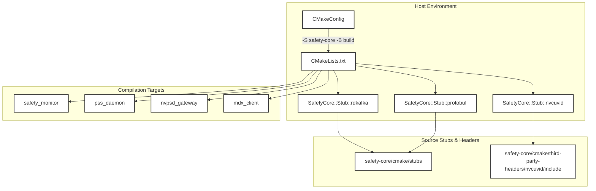
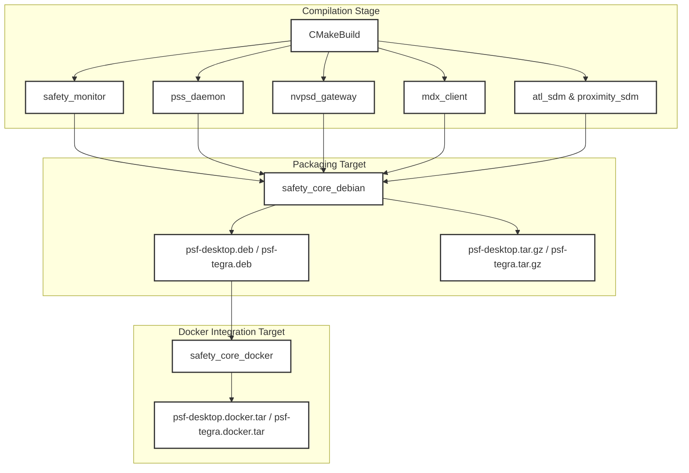

<!-- source: DeepWiki mcp.deepwiki.com · repo NVIDIA/halos-outside-in-safety · page 2.4 Building and Packaging · fetched 2026-11-09 -->

# Building and Packaging

<details>
<summary>Relevant source files</summary>

The following files were used as context for generating this wiki page:

- [SAFETY_NOTICE.md](SAFETY_NOTICE.md)
- [safety-core/BUILD.md](safety-core/BUILD.md)
- [safety-core/CMakeLists.txt](safety-core/CMakeLists.txt)
- [safety-core/adapters/vss/event-mappings/atl_proximity/event_mapping_atl_proximity.pb.txt](safety-core/adapters/vss/event-mappings/atl_proximity/event_mapping_atl_proximity.pb.txt)
- [safety-core/adapters/vss/mdx-client/README.md](safety-core/adapters/vss/mdx-client/README.md)
- [safety-core/components/event-integrator/daemon/include/NvPSSSafetyEventManager.hpp](safety-core/components/event-integrator/daemon/include/NvPSSSafetyEventManager.hpp)
- [safety-core/components/event-integrator/daemon/include/pss_protocol.h](safety-core/components/event-integrator/daemon/include/pss_protocol.h)
- [tools/srr-debug-viewer/README.md](tools/srr-debug-viewer/README.md)

</details>


## Purpose and Scope

This page covers the compilation, cross-compilation, stub-based dependency resolution, and packaging pipeline for the `safety-core` engine of the HOISA (Halos Outside-In Safety) system. It details how the CMake build system [safety-core/CMakeLists.txt:1-116]() configures binaries, shared libraries, Debian packages, and Docker image archives for `x86_64` and `aarch64` architectures as documented in `safety-core/BUILD.md` [safety-core/BUILD.md:1-213]().

Sources: [safety-core/BUILD.md:1-10](), [safety-core/CMakeLists.txt:1-15]()

---

## Build Prerequisites and Environment Configuration

Compiling `safety-core` requires host build tools, runtime package utilities, and public development packages. The host environment must provide build essentials, CMake, Ninja, and packaging tools [safety-core/BUILD.md:12-20]().

| Dependency / Tool | Requirement / Package | Role in Build Process |
| :--- | :--- | :--- |
| Build System | `cmake`, `ninja-build`, `build-essential` | Generates build trees and executes parallel compilation [safety-core/BUILD.md:16-17]() |
| Packaging Tools | `dpkg-dev`, `docker.io` | Produces `.deb` package archives and local container images [safety-core/BUILD.md:18]() |
| Messaging & Parsing | `librdkafka-dev`, `libprotobuf-dev` | Provides Kafka development headers (`rdkafka.h`) and Google Protobuf headers [safety-core/BUILD.md:19-33]() |
| CUDA Toolkit | `/usr/local/cuda-13.0` (configurable via `-DSAFETY_CORE_CUDA_TOOLKIT_ROOT`) | Supplies CUDA driver headers and libraries for `ai-monitor` and GPU tasks [safety-core/BUILD.md:22-26]() |

Sources: [safety-core/BUILD.md:12-26]()

---

## Cross-Compilation, Stubs, and Third-Party Headers

To maintain consistent x86_64 and aarch64 build flows without requiring target-architecture copies of proprietary runtime libraries during compilation, `safety-core` employs link-time dependency stubs and isolated third-party headers [safety-core/BUILD.md:28-34]().

- **Stubs**: Dependency stubs are maintained under `safety-core/cmake/stubs` and exported as target namespaces such as `SafetyCore::Stub::nvcuvid`, `SafetyCore::Stub::rdkafka`, and `SafetyCore::Stub::protobuf` [safety-core/BUILD.md:28](), [safety-core/BUILD.md:188-194](). These stubs satisfy symbol resolution at link time, while runtime environments supply the real libraries [safety-core/BUILD.md:195-197]().
- **NVDEC Headers**: `safety-core/cmake/third-party-headers/nvcuvid/include` provides `nvcuvid.h` and `cuviddec.h` for `safety_monitor` [safety-core/BUILD.md:28](), [safety-core/BUILD.md:34]().
- **Toolchain Files**: Cross-compilation from an `x86_64` host to `aarch64` uses `safety-core/cmake/toolchains/aarch64-linux-gnu.cmake` with target name variables like `-DSAFETY_CORE_ARM64_CUDA_TARGET_NAME=sbsa-linux` [safety-core/BUILD.md:60-71]().

Sources: [safety-core/BUILD.md:28-36](), [safety-core/BUILD.md:60-71](), [safety-core/BUILD.md:188-197]()

### Diagram: Build and Stub Resolution Flow


Sources: [safety-core/BUILD.md:28-36](), [safety-core/CMakeLists.txt:1-50]()

---

## CMake Build Execution (x86_64 and aarch64)

The build process is managed via CMake with configurable target architecture parameters (`SAFETY_CORE_TARGET_ARCH`) [safety-core/CMakeLists.txt:57-58]().

### Configuring and Building for x86_64
```sh
cmake -S safety-core -B safety-core/build-x86_64 \
  -DSAFETY_CORE_TARGET_ARCH=x86_64

cmake --build safety-core/build-x86_64 --parallel
```
Sources: [safety-core/BUILD.md:43-47]()

### Configuring and Building for ARM64/Tegra (Native or Cross-Compiled)
For native ARM64 hosts:
```sh
cmake -S safety-core -B safety-core/build-aarch64 \
  -DSAFETY_CORE_TARGET_ARCH=aarch64

cmake --build safety-core/build-aarch64 --parallel
```
Sources: [safety-core/BUILD.md:54-58]()

For cross-compilation from `x86_64` to `aarch64`:
```sh
cmake -S safety-core -B safety-core/build-aarch64 \
  -DSAFETY_CORE_TARGET_ARCH=aarch64 \
  -DCMAKE_TOOLCHAIN_FILE=safety-core/cmake/toolchains/aarch64-linux-gnu.cmake \
  -DSAFETY_CORE_ARM64_CUDA_TARGET_NAME=sbsa-linux

cmake --build safety-core/build-aarch64 --parallel
```
Sources: [safety-core/BUILD.md:63-69]()

Sources: [safety-core/BUILD.md:40-69](), [safety-core/CMakeLists.txt:57-82]()

---

## Packaging: Debian Packages and Docker Archives

Once compilation completes, packages and container archives are generated using dedicated CMake targets [safety-core/BUILD.md:73-146]().

### Packaging Targets and Output Artifacts

- **Debian Packages (`safety_core_debian`)**: Generates `.deb` and `.tar.gz` bundles for runtime deployment and development headers [safety-core/BUILD.md:78-100]().
  - `x86_64`: `psf-desktop.deb`, `psf-desktop-dev.deb`, `psf-desktop.tar.gz`, `psf-desktop-dev.tar.gz` [safety-core/BUILD.md:87-90]()
  - `aarch64`: `psf-tegra.deb`, `psf-tegra-dev.deb`, `psf-tegra.tar.gz`, `psf-tegra-dev.tar.gz` [safety-core/BUILD.md:96-99]()
- **Docker Image Archives (`safety_core_docker`)**: Builds container image archives (`.docker.tar`) using the generated Debian packages as inputs [safety-core/BUILD.md:104-125]().
  - Tags: `psf-desktop:latest` and `psf-tegra:latest` [safety-core/BUILD.md:130-132]()
- **Aggregate Package Target (`safety_core_package`)**: Builds both Debian packages and Docker archives in a single step [safety-core/BUILD.md:141-146]().

Sources: [safety-core/BUILD.md:73-146]()

### Packaged Runtime Layout

The runtime Debian package installs core binaries and configurations under `/opt/nvidia/psf`:
- `/opt/nvidia/psf/bin/safety_monitor` [safety-core/BUILD.md:203]()
- `/opt/nvidia/psf/bin/nv_perception_monitor` [safety-core/BUILD.md:204]()
- `/opt/nvidia/psf/bin/pss_daemon` [safety-core/BUILD.md:205]()
- `/opt/nvidia/psf/bin/nvpsd_gateway` [safety-core/BUILD.md:206]()
- `/opt/nvidia/psf/bin/launch_psf.sh` [safety-core/BUILD.md:207]()
- `/opt/nvidia/psf/apps/...` (Decision Maker SDMs and command receivers) [safety-core/BUILD.md:209-213]()

Sources: [safety-core/BUILD.md:198-213]()

### Diagram: Packaging and Artifact Generation Pipeline


Sources: [safety-core/BUILD.md:73-146](), [safety-core/CMakeLists.txt:1-55]()

---

