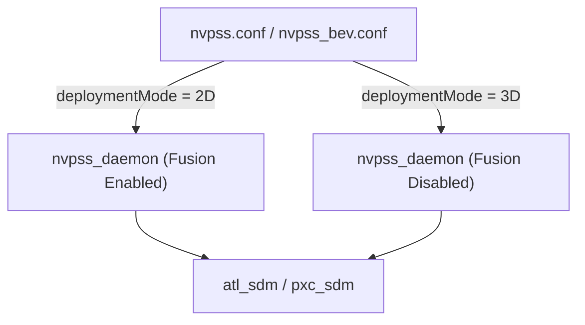
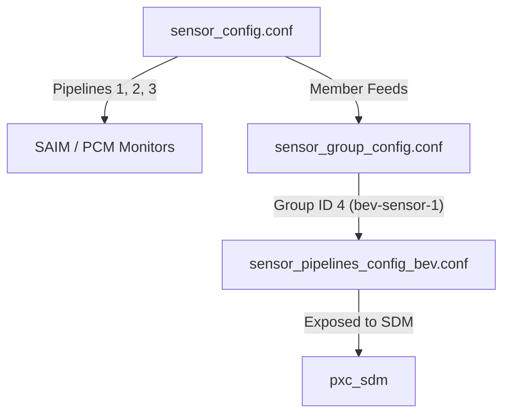
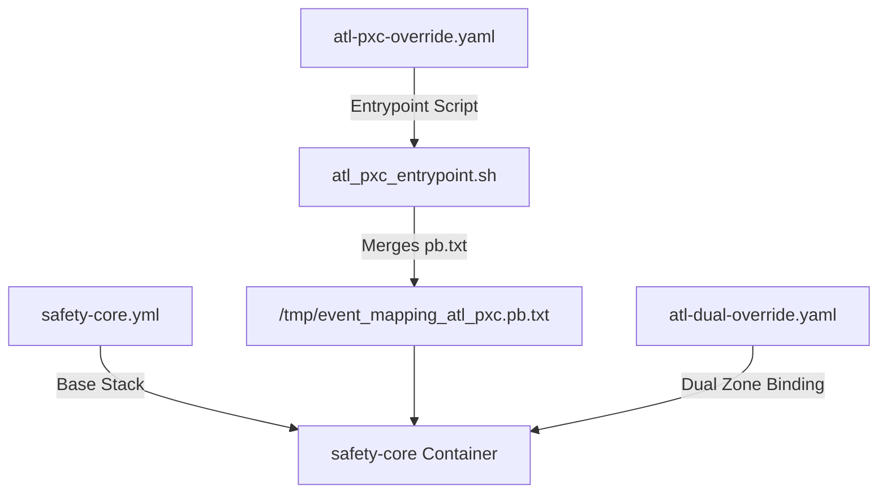

<!-- source: DeepWiki mcp.deepwiki.com · repo NVIDIA/halos-outside-in-safety · page 2.5 Safety Core Runtime Configuration · fetched 2026-11-09 -->

# Safety Core Runtime Configuration

<details>
<summary>Relevant source files</summary>

The following files were used as context for generating this wiki page:

- [closed-loop-testing/comm-layer/tests/test_atl_zones.py](closed-loop-testing/comm-layer/tests/test_atl_zones.py)
- [closed-loop-testing/safety-core/atl-dual-override.yaml](closed-loop-testing/safety-core/atl-dual-override.yaml)
- [closed-loop-testing/safety-core/atl-pxc-override.yaml](closed-loop-testing/safety-core/atl-pxc-override.yaml)
- [closed-loop-testing/safety-core/configs/atl_sdm.conf](closed-loop-testing/safety-core/configs/atl_sdm.conf)
- [closed-loop-testing/safety-core/configs/atl_sdm_zone2.conf](closed-loop-testing/safety-core/configs/atl_sdm_zone2.conf)
- [closed-loop-testing/safety-core/configs/nvpss.conf](closed-loop-testing/safety-core/configs/nvpss.conf)
- [closed-loop-testing/safety-core/configs/nvpss_bev.conf](closed-loop-testing/safety-core/configs/nvpss_bev.conf)
- [closed-loop-testing/safety-core/configs/proximity_event_mapping.pb.txt](closed-loop-testing/safety-core/configs/proximity_event_mapping.pb.txt)
- [closed-loop-testing/safety-core/configs/pxc_sdm.conf](closed-loop-testing/safety-core/configs/pxc_sdm.conf)
- [closed-loop-testing/safety-core/configs/sensor_group_config.conf](closed-loop-testing/safety-core/configs/sensor_group_config.conf)
- [closed-loop-testing/safety-core/configs/sensor_pipelines_config.conf](closed-loop-testing/safety-core/configs/sensor_pipelines_config.conf)
- [closed-loop-testing/safety-core/configs/sensor_pipelines_config_bev.conf](closed-loop-testing/safety-core/configs/sensor_pipelines_config_bev.conf)
- [closed-loop-testing/safety-core/safety-core.yml](closed-loop-testing/safety-core/safety-core.yml)
- [closed-loop-testing/safety-core/scripts/atl_pxc_entrypoint.sh](closed-loop-testing/safety-core/scripts/atl_pxc_entrypoint.sh)

</details>


This page details the runtime configuration architecture of the Safety Core (`safety-core`) within the Halos Outside-In Safety (HOISA) system. It covers the PSS daemon configurations (`nvpss.conf`, `nvpss_bev.conf`), sensor pipeline and group mappings, decision maker bindings (`atl_sdm.conf`, `pxc_sdm.conf`, `atl_sdm_zone2.conf`), and deployment override structures (`atl-pxc-override.yaml`, `atl-dual-override.yaml`, `atl_pxc_entrypoint.sh`).

---

## 1. PSS Daemon Configuration (`nvpss.conf` & `nvpss_bev.conf`)

The Perception and Safety Service (`pss`) daemon is controlled via configuration files that establish heartbeat fail-safes, retry budgets, staging queues, deployment topology modes, and event bypass rules.

### Configuration Parameters and Semantics

*   **Heartbeat & Fail-Safe Parameters:**
    *   `max_hb_failures`: Defines consecutive RPC heartbeat misses before triggering `SW_FAIL` and disconnecting [closed-loop-testing/safety-core/configs/nvpss.conf:4-6](). Valid range is `[1, 255]`, with an image default of `50`.
    *   `pss_to_psd_retry_budget` & `pss_to_psd_response_timeout_ms`: Controls delivery fail-safes. The product of retries and timeout must not exceed `6000` ms [closed-loop-testing/safety-core/configs/nvpss.conf:8-10]().
    *   `status_noop_interval_ms`: Sets the status/no-op `DecisionRequest` interval between `100` and `600000` ms [closed-loop-testing/safety-core/configs/nvpss.conf:12-13]().

*   **Queuing and Deployment Mode:**
    *   `psd_operational_queue_depth` & `psd_critical_queue_depth`: Staging queue depths for the decision gateway (`nvpsd`), sized between `8` and `512` [closed-loop-testing/safety-core/configs/nvpss.conf:15-18]().
    *   `deploymentMode`: Selects between `2D` (individual camera pipelines) and `3D` (Sparse4D BEV fused groups) [closed-loop-testing/safety-core/configs/nvpss.conf:20-23]().
    *   `enableFusion`: Toggles multi-camera event fusion [closed-loop-testing/safety-core/configs/nvpss.conf:25-26](). In 3D BEV configurations (`nvpss_bev.conf`), fusion is disabled (`enableFusion = false`) because the BEV application performs fusion upstream [closed-loop-testing/safety-core/configs/nvpss_bev.conf:33-36]().

*   **Time Windows and Event Bypassing:**
    *   `timeWindowSize`: Controls the temporal correlation window and STALE event threshold [closed-loop-testing/safety-core/configs/nvpss.conf:35-39](). SIL environments set this to `6000` ms (`6` seconds) to accommodate perception transport skew and prevent dropping tripwire events [closed-loop-testing/safety-core/configs/nvpss.conf:37-39]().
    *   `bypassFusionEvents`: Lists safety event types (such as `SW_FAIL`, `EVENT_0` through `EVENT_11`) that bypass fusion and route directly to decision makers [closed-loop-testing/safety-core/configs/nvpss.conf:63-87]().


*Figure 1: Configuration to PSS Daemon Runtime Flow.*

Sources: `closed-loop-testing/safety-core/configs/nvpss.conf`, `closed-loop-testing/safety-core/configs/nvpss_bev.conf`

---

## 2. Sensor Pipelines and Group Topologies

The mapping between physical sensors, processing pipelines, and logical safety groups is managed through dedicated configuration files mounted into the `safety-core` container.

### Pipeline Configuration Files

*   **`sensor_config.conf`**: Lists individual camera sensor pipelines (pipelines `1` through `3`) supplying raw frames or 2D detections.
*   **`sensor_pipelines_config.conf`**: Maps pipeline IDs to symbolic names used by the perception monitor (`PCM`) and safety AI monitor (`SAIM`).
*   **`sensor_group_config.conf`**: Defines logical groupings for 3D Sparse4D deployment [closed-loop-testing/safety-core/configs/sensor_group_config.conf:1-7]().
    *   Example entry: `4, bev-sensor-1, 1|2|3` defines a group with pipeline ID `4` named `bev-sensor-1` comprising member pipelines `1`, `2`, and `3` [closed-loop-testing/safety-core/configs/sensor_group_config.conf:7]().
*   **`sensor_pipelines_config_bev.conf`**: Exposes the BEV group (`bev-sensor-1`, pipeline `4`) to the decision makers instead of individual cameras [closed-loop-testing/safety-core/configs/sensor_pipelines_config_bev.conf:5-8]().


*Figure 2: Sensor Pipeline and Group Topology.*

Sources: `closed-loop-testing/safety-core/configs/sensor_config.conf`, `closed-loop-testing/safety-core/configs/sensor_pipelines_config_bev.conf`, `closed-loop-testing/safety-core/configs/sensor_group_config.conf`

---

## 3. Decision Maker Bindings (`atl_sdm`, `pxc_sdm`)

Safety Decision Makers (SDMs) require explicit configuration bindings to map event identifiers (`EVENT_0` through `EVENT_14`) to logical states and output codes.

### SDM Configuration Mappings

*   **`atl_sdm.conf` (Automatic Trailer Loading)**:
    Binds trailer-crossing and restricted-area violation events [closed-loop-testing/safety-core/configs/atl_sdm.conf:4-15]().
    ```ini
    forklift_entered = EVENT_0   # forklift tripwire OUT: entered the trailer
    forklift_exited  = EVENT_1   # forklift tripwire IN: left the trailer
    person_entered   = EVENT_2   # person tripwire OUT: entered the trailer
    person_exited    = EVENT_3   # person tripwire IN: left the trailer
    roi_violation    = EVENT_4   # a person is in the restricted area
    roi_cleared      = EVENT_5   # that violation cleared
    ```

*   **`atl_sdm_zone2.conf` (Dual-Zone ATL Extension)**:
    Binds secondary trailer bay events (`EVENT_6` through `EVENT_11`) used when running `--app atl_dual` [closed-loop-testing/safety-core/configs/atl_sdm_zone2.conf:4-14]().

*   **`proximity_event_mapping.pb.txt` (Proximity SDM)**:
    Defines social distancing tiers and distance thresholds mapping objects to proximity response events (`EVENT_12` through `EVENT_14`) [closed-loop-testing/safety-core/configs/proximity_event_mapping.pb.txt:31-62]().
    *   `d <= 2.0 m`: `EVENT_14` (`CMD_STOP`) [closed-loop-testing/safety-core/configs/proximity_event_mapping.pb.txt:53-61]()
    *   `2.0 < d <= 3.5 m`: `EVENT_13` (`CMD_REDUCE`) [closed-loop-testing/safety-core/configs/proximity_event_mapping.pb.txt:42-51]()
    *   `d > 3.5 m`: `EVENT_12` (`CMD_NORMAL`) [closed-loop-testing/safety-core/configs/proximity_event_mapping.pb.txt:31-40]()

Sources: `closed-loop-testing/safety-core/configs/atl_sdm.conf`, `closed-loop-testing/safety-core/configs/atl_sdm_zone2.conf`, `closed-loop-testing/safety-core/configs/proximity_event_mapping.pb.txt`

---

## 4. Override YAMLs and Entrypoint Scripts

Deployment profiles customize the base `safety-core.yml` compose stack using override files and specialized container entrypoints.

### Compose Overrides and Scripts

*   **`safety-core.yml`**: Base service definition configuring image volumes, network mode (`host`), and standard environment variables [closed-loop-testing/safety-core/safety-core.yml:1-37]().
*   **`atl-pxc-override.yaml`**: Combines ATL and Proximity applications (`--app atl,pxc`) into a single container instance [closed-loop-testing/safety-core/atl-pxc-override.yaml:1-34](). It utilizes `atl_pxc_entrypoint.sh` to merge protocol buffer event mappings [closed-loop-testing/safety-core/atl-pxc-override.yaml:22]().
*   **`atl_pxc_entrypoint.sh`**: Concatenates `event_mapping_atl.pb.txt` and `proximity_event_mapping.pb.txt` into `/tmp/event_mapping_atl_pxc.pb.txt` before executing the primary container entrypoint [closed-loop-testing/safety-core/scripts/atl_pxc_entrypoint.sh:14-25]().
*   **`atl-dual-override.yaml`**: Configures multi-zone ATL execution (`--app atl_dual`), binding secondary ports (`COMM_UDP_PORT_ZONE2`) and `atl_sdm_zone2.conf` [closed-loop-testing/safety-core/atl-dual-override.yaml:1-26]().


*Figure 3: Override Stack and Entrypoint Data Flow.*

Sources: `closed-loop-testing/safety-core/safety-core.yml`, `closed-loop-testing/safety-core/atl-pxc-override.yaml`, `closed-loop-testing/safety-core/atl-dual-override.yaml`, `closed-loop-testing/safety-core/scripts/atl_pxc_entrypoint.sh`

---

