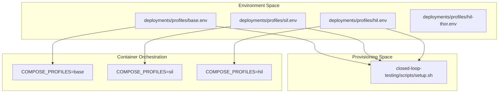
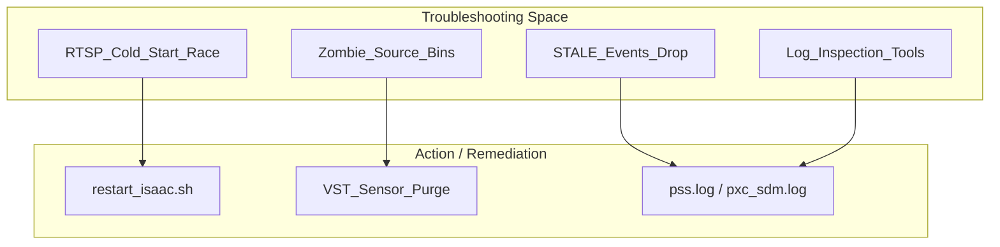

<!-- source: DeepWiki mcp.deepwiki.com · repo NVIDIA/halos-outside-in-safety · page 3 Deployment and Profiles · fetched 2026-11-09 -->

# Deployment and Profiles

Relevant source files

The following files were used as context for generating this wiki page:

- [closed-loop-testing/scripts/setup.sh](closed-loop-testing/scripts/setup.sh)
- [deployments/profiles/base.env](deployments/profiles/base.env)
- [deployments/profiles/hil.env](deployments/profiles/hil.env)
- [deployments/profiles/sil.env](deployments/profiles/sil.env)
- [docs/deployment/index.mdx](docs/deployment/index.mdx)
- [docs/release-notes.mdx](docs/release-notes.mdx)

This section provides a high-level overview of the deployment profiles, environment variable configurations, setup automation scripts, and multi-node execution strategies for the Halos Outside-In Safety (HOISA) blueprint. HOISA supports multiple deployment topologies ranging from standalone Safety Core evaluation (`base`) and single-host software-in-the-loop simulation (`sil`) to distributed hardware-in-the-loop setups combining x86 stimulus hosts with NVIDIA IGX Thor safety targets (`hil`, `hil-thor`, `base-thor`).

For detailed implementation guides, step-by-step walkthroughs, and troubleshooting playbooks, refer to the respective child pages:
- [Profiles and Environment Configuration](#3.1)
- [SIL Deployment Walkthrough](#3.2)
- [HIL and Thor Deployment](#3.3)
- [Operations and Troubleshooting](#3.4)

---

## Deployment Architecture Overview

The deployment subsystem coordinates Docker Compose profiles, environment configuration files (`.env`), and preflight provisioning scripts located under `deployments/profiles/` and `closed-loop-testing/scripts/`.

*Diagram 1: Natural Language Mapping from Environment Profiles to Compose Orchestration.*

Sources: `deployments/profiles/sil.env:1-92]`, `deployments/profiles/base.env:1-28]`, `deployments/profiles/hil.env:1-56]`, `closed-loop-testing/scripts/setup.sh:1-54]()`.

---

## 3.1. Profiles and Environment Configuration

Environment files define parameters for each deployment mode, including Docker image tags (`PSF_IMAGE`, `ISAAC_SIM_IMAGE`), ROS domain IDs (`ROS_DOMAIN_ID`), communication ports (`COMM_UDP_PORT`), and data mount paths (`MDX_DATA_DIR`). 

The provisioning script `closed-loop-testing/scripts/setup.sh` inspects the active `COMPOSE_PROFILES` string from the selected `.env` file to provision required directory structures conditionally (`psf-log`, `comm-layer`, `isaac-cache`) and validates container user permissions on NGC dataset extracts (`collected-assets`) [closed-loop-testing/scripts/setup.sh:44-146]().

For detailed variable breakdowns, preflight checks, and cleanup procedures, see [Profiles and Environment Configuration](#3.1).

Sources: `deployments/profiles/sil.env:1-92]`, `deployments/profiles/base.env:1-28]`, `deployments/profiles/hil.env:1-56]`, `closed-loop-testing/scripts/setup.sh:1-146]`.

---

## 3.2. SIL Deployment Walkthrough

Software-in-the-Loop (SIL) deployment integrates Isaac Sim, the ROS2 forklift controller, the communication layer, and the Safety Core (PSF) inside a self-contained single-host Docker Compose environment (`sil.env`) [deployments/profiles/sil.env:1-2](). Bring-up can be orchestrated via Jupyter notebooks (`deploy_hoisa_launchable.ipynb`) or directly through Docker Compose stacks utilizing VSS 2D/3D overrides and camera calibration parameters.

For step-by-step bring-up instructions and override configurations, see [SIL Deployment Walkthrough](#3.2).

Sources: `deployments/profiles/sil.env:1-92]`, `docs/deployment/index.mdx:1-40]`.

---

## 3.3. HIL and Thor Deployment

Hardware-in-the-Loop (HIL) deployments decouple simulation stimulus generation from safety decision enforcement across a dual-host topology. An x86 stimulus host runs Isaac Sim, the ROS2 controller, and the communication layer (`hil.env`), while an NVIDIA IGX Thor target executes the safety host stack (`hil-thor.env`, `launch_thor_safety.sh`) [deployments/profiles/hil.env:1-6](). Communication between hosts is mediated over UDP and REST APIs (`VST_BASE_URL`, `PERCEPTION_BASE_URL`) [deployments/profiles/hil.env:33-36]().

For network configurations, preflight validation scripts (`hil_preflight.sh`), and lifecycle scripts, see [HIL and Thor Deployment](#3.3).

Sources: `deployments/profiles/hil.env:1-56]`, `docs/deployment/index.mdx:33-38]`.

---

## 3.4. Operations and Troubleshooting

Runtime operations in HOISA environments can encounter specific failure modes, such as STALE event dropouts due to timestamp drift, zombie source bins lingering after unexpected container terminations, RTSP cold-start synchronization races, or corrupt VST sensor registries. Remediation scripts like `restart_isaac.sh`, VST sensor purges, and log inspection utilities (`pss.log`, `comm-layer`) help stabilize long-running test benches.

*Diagram 2: Troubleshooting Flow and Remediation Code References.*

For common failure symptoms, error codes, and diagnostic procedures, see [Operations and Troubleshooting](#3.4).

Sources: `deployments/profiles/sil.env:42-75]`, `docs/release-notes.mdx:51-70]`.

---

