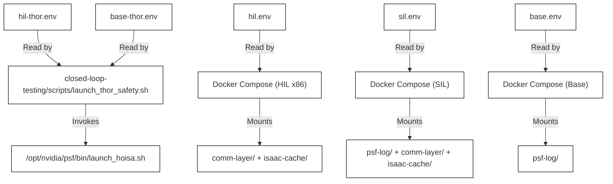
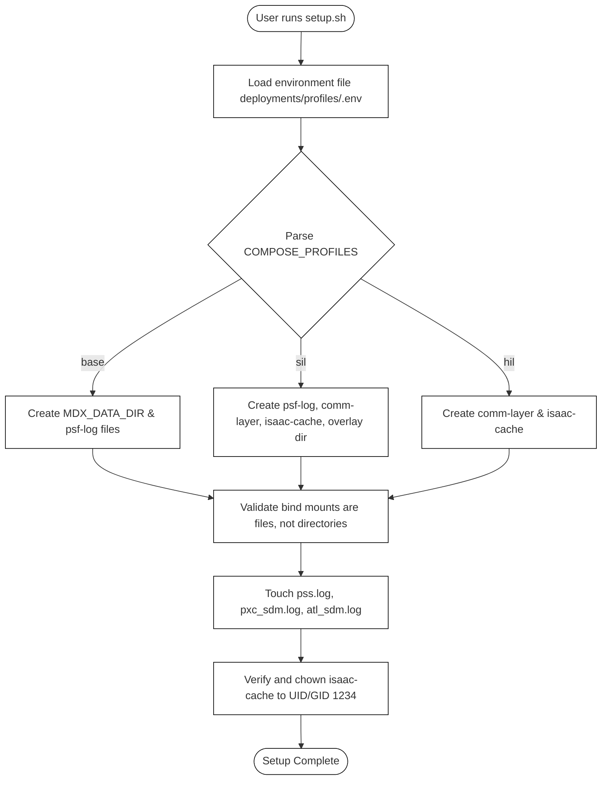
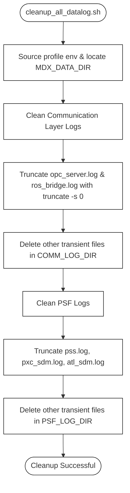
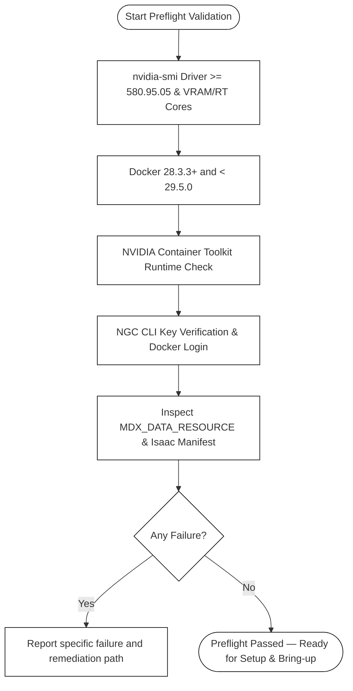

<!-- source: DeepWiki mcp.deepwiki.com · repo NVIDIA/halos-outside-in-safety · page 3.1 Profiles and Environment Configuration · fetched 2026-11-09 -->

# Profiles and Environment Configuration

Relevant source files

The following files were used as context for generating this wiki page:

- [closed-loop-testing/scripts/cleanup_all_datalog.sh](closed-loop-testing/scripts/cleanup_all_datalog.sh)
- [closed-loop-testing/scripts/launch_thor_safety.sh](closed-loop-testing/scripts/launch_thor_safety.sh)
- [closed-loop-testing/scripts/setup.sh](closed-loop-testing/scripts/setup.sh)
- [closed-loop-testing/scripts/stop_thor_safety.sh](closed-loop-testing/scripts/stop_thor_safety.sh)
- [deployments/profiles/base-thor.env](deployments/profiles/base-thor.env)
- [deployments/profiles/base.env](deployments/profiles/base.env)
- [deployments/profiles/hil-thor.env](deployments/profiles/hil-thor.env)
- [deployments/profiles/hil.env](deployments/profiles/hil.env)
- [deployments/profiles/sil.env](deployments/profiles/sil.env)
- [docs/reference/runtime-profile.mdx](docs/reference/runtime-profile.mdx)
- [skills/hoisa-deploy-profile/references/halos_thor.md](skills/hoisa-deploy-profile/references/halos_thor.md)
- [skills/hoisa-deploy-profile/references/prerequisites.md](skills/hoisa-deploy-profile/references/prerequisites.md)
- [skills/hoisa-deploy-profile/references/vss_hil_overrides.md](skills/hoisa-deploy-profile/references/vss_hil_overrides.md)

## Purpose and Scope
This section covers the runtime environment configuration files, deployment profiles, directory provisioning, log cleanup utilities, and preflight validation checks used across the HOISA (Halos Outside-In Safety) architecture. HOISA supports multiple deployment topologies ranging from standalone SIL (Software-in-the-Loop) simulations on x86 single hosts to distributed HIL (Hardware-in-the-Loop) configurations combining x86 simulation stimulus with NVIDIA IGX Thor safety hardware.

---

## 1. Profile Environment Files and Variables

HOISA defines five primary profile environment configurations located under `deployments/profiles/`:
* `base.env`: VSS Warehouse perception and Safety Core (PSF) only, rendering safety states via VST UI overlays [deployments/profiles/base.env:1-27]().
* `sil.env`: Self-contained x86 single-host SIL environment including Isaac Sim, Communication Layer, Forklift Controller, and Safety Core [deployments/profiles/sil.env:1-91]().
* `hil.env`: x86 stimulus host configuration for HIL deployments (Isaac Sim + comm-layer + controller), delegating safety processing to a remote Thor device [deployments/profiles/hil.env:1-55]().
* `base-thor.env`: IGX Thor hybrid deployment pairing VSS Warehouse with the Safety Core (`nv-psf` container + host binaries) for native edge safety [deployments/profiles/base-thor.env:1-27]().
* `hil-thor.env`: Thor safety-host side configuration for HIL, directing safety command sinks back to the remote x86 comm-layer [deployments/profiles/hil-thor.env:1-23]().

### Key Environment Variables Matrix

| Variable | Description | Target Profile(s) | Default / Example Value |
| :--- | :--- | :--- | :--- |
| `COMPOSE_PROFILES` | Selects active Docker Compose service groups | `base`, `sil`, `hil` | `base`, `sil`, `hil` [deployments/profiles/base.env:15](), [deployments/profiles/sil.env:4](), [deployments/profiles/hil.env:8]() |
| `SCENARIO` | Identifies simulation scenario configuration | `sil`, `hil` | `warehouse_20x20_1fl` [deployments/profiles/sil.env:15]() |
| `MDX_DATA_DIR` | Local root directory for cache, logs, and datasets | All profiles | `/path/to/sil-data` [deployments/profiles/sil.env:23]() |
| `COMM_UDP_PORT` | UDP port for safety command egress/ingress | `base`, `sil`, `hil` | `12345` (base) / `12346` (sil/hil) [deployments/profiles/base.env:20](), [deployments/profiles/sil.env:31]() |
| `PSF_IMAGE` | Safety Core container image reference | All profiles | `nvcr.io/nvidia/halos-outside-in/outside-in-safety:...` [deployments/profiles/sil.env:45]() |
| `PSF_LAUNCH_MODE` | Safety AI Monitor (SAIM) operation mode (`skip`, `learn`, `active`) | All profiles | `skip` or `active` [deployments/profiles/sil.env:46]() |
| `ROS_AUTOMATIC_DISCOVERY_RANGE` | CycloneDDS discovery scope (`LOCALHOST`, `SUBNET`, `OFF`) | `sil`, `hil` | `LOCALHOST` (single host) / `SUBNET` (HIL) [deployments/profiles/sil.env:91]() |

*Sources: [deployments/profiles/base.env:1-27](), [deployments/profiles/sil.env:1-91](), [deployments/profiles/hil.env:1-55](), [deployments/profiles/base-thor.env:1-27](), [deployments/profiles/hil-thor.env:1-23](), [closed-loop-testing/scripts/launch_thor_safety.sh:1-66]()*

---

## 2. Directory Provisioning (`setup.sh`)

The `setup.sh` utility provisions required data directories, log files, and cache structures based on the `COMPOSE_PROFILES` declared in the selected profile environment file [closed-loop-testing/scripts/setup.sh:1-54]().

### Implementation Details
* **Conditional Provisioning**: Inspects `COMPOSE_PROFILES` to determine whether PSF logs (`NEED_PSF`), communication layer logs (`NEED_COMM`), or Isaac Sim assets (`NEED_ISAAC`) should be created [closed-loop-testing/scripts/setup.sh:47-54]().
* **File vs Directory Bind-Mount Guard**: Docker automatically creates directories for missing bind-mount sources. Because Safety Core configuration files expect files (such as `pss.log`, `pxc_sdm.log`, and `atl_sdm.log`), `setup.sh` explicitly validates that these paths are not directories, unlinks or throws errors if misconfigured, and touches them as empty files with `777` permissions [closed-loop-testing/scripts/setup.sh:68-88]().
* **Isaac Sim Cache and Collected Assets**: Sets up omniverse cache subdirectories (`cache/ov`, `cache/warp`, `kit-cache`, `data`, `nvidia-omniverse`, `nv`), assigns `1234:1234` ownership, and verifies that `collected-assets` are readable by the container user [closed-loop-testing/scripts/setup.sh:99-146]().

*Sources: [closed-loop-testing/scripts/setup.sh:1-146]()*

---

## 3. Datalog Cleanup (`cleanup_all_datalog.sh`)

The `cleanup_all_datalog.sh` script purges per-run telemetry and log files while preserving active log inodes [closed-loop-testing/scripts/cleanup_all_datalog.sh:1-108]().

### Log Truncation Strategy
Deleting log files while containers are actively writing to them via `tee` unlinks the inode. The container continues writing to the unlinked sector, causing log files to permanently disappear from the mount point and breaking readiness checks (e.g., `opc_server.log`) [closed-loop-testing/scripts/cleanup_all_datalog.sh:60-65](). 
* `cleanup_all_datalog.sh` uses `sudo truncate -s 0` on known log files (`opc_server.log`, `ros_bridge.log`, `pss.log`, `pxc_sdm.log`, `atl_sdm.log`) to reset file sizes to zero without breaking active file descriptors [closed-loop-testing/scripts/cleanup_all_datalog.sh:60-88]().
* Non-essential transient files within `COMM_LOG_DIR` and `PSF_LOG_DIR` are purged using `sudo find` [closed-loop-testing/scripts/cleanup_all_datalog.sh:66-93]().

*Sources: [closed-loop-testing/scripts/cleanup_all_datalog.sh:1-108]()*

---

## 4. Preflight and Environment Validation Checks

Before executing any profile bring-up, system prerequisites must be validated against HOISA specifications [skills/hoisa-deploy-profile/references/prerequisites.md:1-182]().

### Preflight Verification Pipeline
1. **GPU & Driver Validation**: Queries `nvidia-smi` to ensure driver version `>= 580.95.05` and checks for RTX core availability and VRAM capacity (`>24 GB` for perception, RT-core support for Isaac Sim) [skills/hoisa-deploy-profile/references/prerequisites.md:14-51]().
2. **Docker & Container Toolkit**: Validates Docker version bounds (`28.3.3 <= Docker < 29.5.0` to avoid NGC repository format errors), Compose version `>= v2.39`, and checks the NVIDIA Container Toolkit runtime configuration (`nvidia-smi` execution inside a test container) [skills/hoisa-deploy-profile/references/prerequisites.md:54-101]().
3. **NGC CLI & Authentication**: Verifies NGC API key presence across environment variables, `~/.ngc/config`, or `~/.bashrc` without echoing plaintext keys, performing container registry authentication and resource manifest inspection [skills/hoisa-deploy-profile/references/prerequisites.md:103-182]().
4. **Thor Safety Host Launch**: For IGX Thor deployments, `launch_thor_safety.sh` performs preflight validation of host environment variables, checks executable permissions for `/opt/nvidia/psf/bin/launch_hoisa.sh`, verifies sensor config mapping, and spawns the hybrid stack [closed-loop-testing/scripts/launch_thor_safety.sh:1-66]().

*Sources: [skills/hoisa-deploy-profile/references/prerequisites.md:1-182](), [closed-loop-testing/scripts/launch_thor_safety.sh:1-66]()*

---

