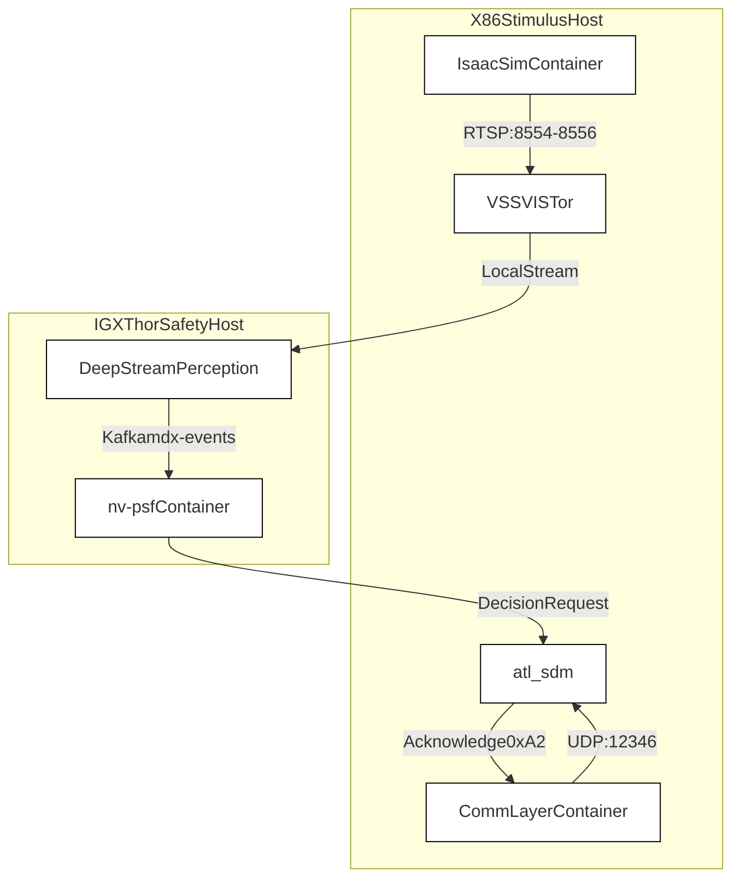
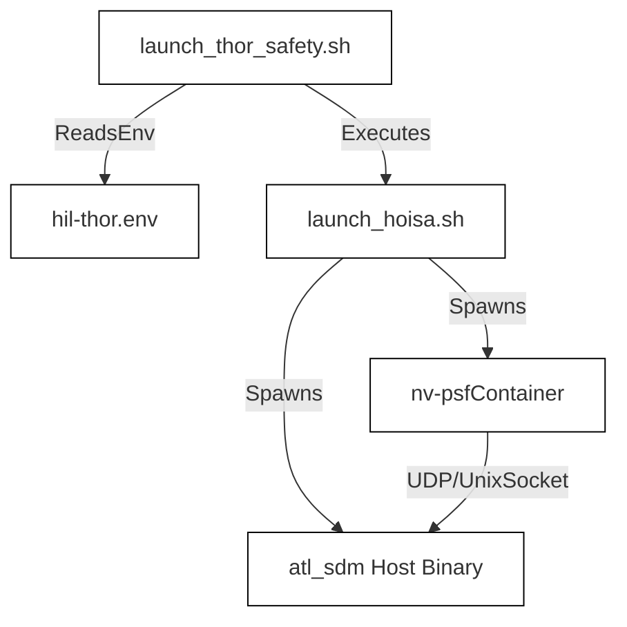

<!-- source: DeepWiki mcp.deepwiki.com · repo NVIDIA/halos-outside-in-safety · page 3.3 HIL and Thor Deployment · fetched 2026-11-09 -->

# HIL and Thor Deployment

<details>
<summary>Relevant source files</summary>

The following files were used as context for generating this wiki page:

- [closed-loop-testing/hil/README.md](closed-loop-testing/hil/README.md)
- [closed-loop-testing/scripts/hil_preflight.sh](closed-loop-testing/scripts/hil_preflight.sh)
- [closed-loop-testing/scripts/launch_thor_safety.sh](closed-loop-testing/scripts/launch_thor_safety.sh)
- [closed-loop-testing/scripts/stop_thor_safety.sh](closed-loop-testing/scripts/stop_thor_safety.sh)
- [deployments/profiles/base-thor.env](deployments/profiles/base-thor.env)
- [deployments/profiles/hil-thor.env](deployments/profiles/hil-thor.env)
- [docs/reference/launcher.mdx](docs/reference/launcher.mdx)
- [docs/testing/hil/architecture.mdx](docs/testing/hil/architecture.mdx)
- [docs/testing/hil/quickstart.mdx](docs/testing/hil/quickstart.mdx)
- [docs/testing/sil/components/forklift-controller.mdx](docs/testing/sil/components/forklift-controller.mdx)
- [docs/testing/sil/sil-2d.mdx](docs/testing/sil/sil-2d.mdx)
- [docs/testing/sil/sil-3d.mdx](docs/testing/sil/sil-3d.mdx)
- [skills/hoisa-deploy-profile/references/halos_thor.md](skills/hoisa-deploy-profile/references/halos_thor.md)
- [skills/hoisa-deploy-profile/references/prerequisites.md](skills/hoisa-deploy-profile/references/prerequisites.md)
- [skills/hoisa-deploy-profile/references/vss_hil_overrides.md](skills/hoisa-deploy-profile/references/vss_hil_overrides.md)

</details>


## Purpose and Scope

This section covers the dual-host Hardware-in-the-Loop (HIL) deployment architecture for the Halos Outside-In Safety (HOISA) framework. The deployment distributes workload across two distinct machines: an x86 stimulus host running NVIDIA Isaac Sim, the communication layer, and the forklift controller; and an NVIDIA IGX Thor safety host running the Video Search and Summarization (VSS) perception stack and the Safety Core (`nv-psf` container combined with host-side Safety Decision Maker binaries). This page details environment configuration (`hil.env` and `hil-thor.env`), host-side launcher scripts (`launch_thor_safety.sh`), VSS HIL perception overrides, preflight checks (`hil_preflight.sh`), and cross-host networking requirements.

---

## 1. Dual-Host Architecture and Environment Configuration

The HIL topology separates the simulation-and-stimulus execution plane from the safety-critical perception-and-decision plane. The x86 stimulus host executes the physical simulation and streams camera feeds via RTSP, while the IGX Thor device processes video streams through deep learning perception modules and executes safety logic via host-side application cores.


*Title: Dual-Host HIL System Architecture and Data Flows*

Configuration is split into two environment files: `deployments/profiles/hil.env` for the x86 side and `deployments/profiles/hil-thor.env` for the safety host side [deployments/profiles/hil-thor.env:1-12](). 

The IGX Thor configuration file (`hil-thor.env`) specifies core parameters including the target application core placement (`SDM_TARGET=ccplex`), operational mode (`PSF_LAUNCH_MODE=skip` or `active`), Kafka broker address (`KAFKA_BROKER=localhost:9092`), and the command routing sink pointing back to the x86 communication layer (`PSF_CMD_RX_IP` and `PSF_CMD_RX_PORT=12346`) [deployments/profiles/hil-thor.env:10-23]().

Sources:
- `deployments/profiles/hil-thor.env:1-24`
- `docs/testing/hil/architecture.mdx:1-84`

---

## 2. Thor Safety Core Orchestration Scripts

On the IGX Thor device, the Safety Core operates via a hybrid architecture. Instead of deploying entirely within Docker Compose, the system orchestrates an `nv-psf` container alongside native host binaries (`atl_sdm`, `safety_monitor`) via `launch_thor_safety.sh` and `launch_hoisa.sh` [skills/hoisa-deploy-profile/references/halos_thor.md:10-16]().


*Title: Thor Safety Core Launch Sequence (`launch_thor_safety.sh`)*

The `launch_thor_safety.sh` script validates environment variables such as `HOST_IP`, `PSF_IMAGE`, `PSF_CMD_RX_IP`, `PSF_CMD_RX_PORT`, and `PSF_SENSOR_CONFIG` [closed-loop-testing/scripts/launch_thor_safety.sh:33-40](). It checks for the presence of the Tegra host package launcher at `/opt/nvidia/psf/bin/launch_hoisa.sh` and verifies the sensor configuration template path [closed-loop-testing/scripts/launch_thor_safety.sh:41-45](). Upon passing checks, it executes `launch_hoisa.sh` with appropriate arguments for the ATL application profile [closed-loop-testing/scripts/launch_thor_safety.sh:60-66]().

Sources:
- `closed-loop-testing/scripts/launch_thor_safety.sh:1-67`
- `skills/hoisa-deploy-profile/references/halos_thor.md:1-134`

---

## 3. VSS Warehouse HIL Overrides and Perception Pipeline

For the `hil` profile, VSS Warehouse runs on the IGX Thor safety host and ingests camera streams published by the remote x86 stimulus host [skills/hoisa-deploy-profile/references/vss_hil_overrides.md:1-4](). 

Remote stream URLs must reference the x86 host IP rather than `localhost`:
```text
rtsp://<x86_host_ip>:8554/camera
rtsp://<x86_host_ip>:8555/camera_01
rtsp://<x86_host_ip>:8556/camera_02
```
[skills/hoisa-deploy-profile/references/vss_hil_overrides.md:5-13]()

Sensor registration supports two exclusive modes: configuration file mode (`SENSOR_INFO_SOURCE=file`) where the VST service reads `camera_info.json`, or Isaac-side registration where Isaac Sim pushes sensor metadata directly to the VST API [skills/hoisa-deploy-profile/references/vss_hil_overrides.md:16-41](). File mode requires that Isaac Sim streams are active and delivering frames *before* VSS is deployed to avoid cold-start DESCRIBE race conditions [skills/hoisa-deploy-profile/references/vss_hil_overrides.md:36-39]().

Sources:
- `skills/hoisa-deploy-profile/references/vss_hil_overrides.md:1-59`

---

## 4. Preflight Verification (`hil_preflight.sh`) and Networking

Before initiating a HIL run, the two-host environment must be validated using `hil_preflight.sh` from the x86 stimulus host [docs/testing/hil/quickstart.mdx:118-123]().

```bash
bash ../closed-loop-testing/scripts/hil_preflight.sh profiles/hil.env --thor <user>@<THOR_IP>
```

The preflight tool checks SSH reachability, repository checkout consistency, environment variable configuration, clock skew between hosts, and network port availability [docs/testing/hil/quickstart.mdx:124-128]().

### Network Ports and Protocols

| Port / Range | Protocol | Listener | Connector | Role |
| --- | --- | --- | --- | --- |
| `8554`, `8555`, `8556` | RTSP over TCP | `isaac-sim` (x86) | VST (IGX Thor) | Camera stream transmission |
| `12346` | UDP | `comm-layer` (x86) | SDM (IGX Thor) | Safety command communication (`0xA2` packets) |
| `4840` | OPC UA over TCP | `comm-layer` (x86) | External clients / Health check | State reporting and readiness gate |
| `30888` | HTTP | VST (IGX Thor) | x86 host | VST API and sensor management |
| `22` | SSH over TCP | IGX Thor | x86 host | Orchestration and preflight control |

[docs/testing/hil/architecture.mdx:48-61]()

The communication layer on the x86 host binds UDP port `12346` and acknowledges safety packets using a 64-byte protocol frame identified by magic byte `0xA2` [docs/testing/hil/architecture.mdx:27-72](). The IGX Thor safety host requires inbound rules allowing TCP `8554`-`8556` and outbound rules to reach the x86 communication layer on UDP `12346` [docs/testing/hil/architecture.mdx:64]().

Sources:
- `docs/testing/hil/architecture.mdx:1-169`
- `docs/testing/hil/quickstart.mdx:1-403`

---

