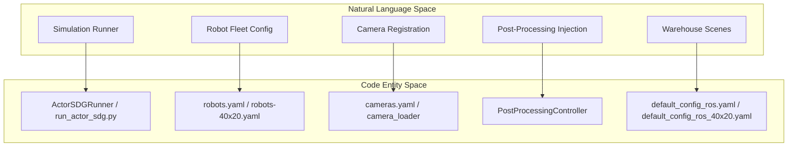
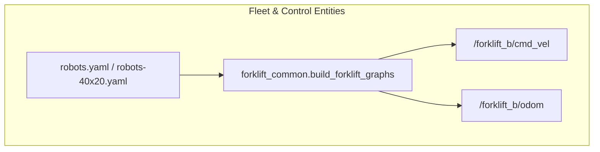
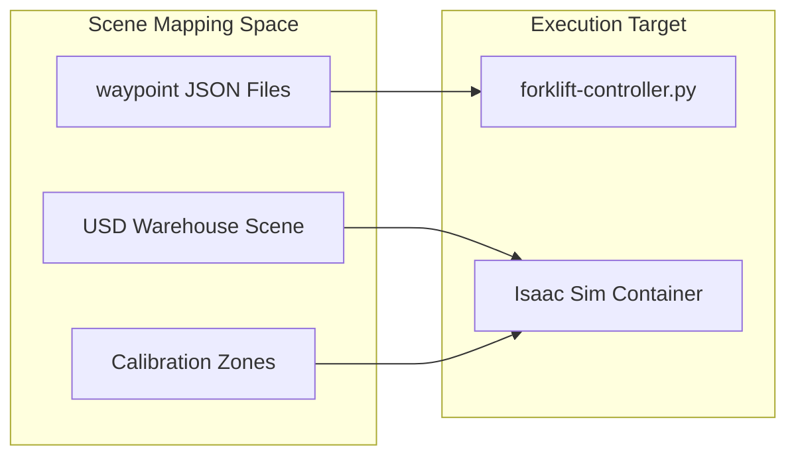

<!-- source: DeepWiki mcp.deepwiki.com · repo NVIDIA/halos-outside-in-safety · page 4 Closed-Loop Simulation (Isaac Sim SIL) · fetched 2026-11-09 -->

# Closed-Loop Simulation (Isaac Sim SIL)

Relevant source files

The following files were used as context for generating this wiki page:

- [closed-loop-testing/forklift-controller/docker_run.sh](closed-loop-testing/forklift-controller/docker_run.sh)
- [closed-loop-testing/forklift-controller/forklift-controller.yml](closed-loop-testing/forklift-controller/forklift-controller.yml)
- [closed-loop-testing/forklift-controller/launch_controller.sh](closed-loop-testing/forklift-controller/launch_controller.sh)
- [closed-loop-testing/isaac-sim/isaac-sim.yml](closed-loop-testing/isaac-sim/isaac-sim.yml)
- [closed-loop-testing/isaac-sim/sil/configs/scenarios.yaml](closed-loop-testing/isaac-sim/sil/configs/scenarios.yaml)
- [docs/testing/sil/architecture.mdx](docs/testing/sil/architecture.mdx)
- [docs/testing/sil/overview.mdx](docs/testing/sil/overview.mdx)

The closed-loop simulation harness leverages NVIDIA Isaac Sim to establish a Software-in-the-Loop (SIL) environment. This harness replaces physical warehouses, forklifts, and cameras with virtual counterparts while running production-grade AI perception, safety logic, and communication layers. 

For comprehensive details on specific subsystems, consult the child pages:
- [Simulation Runner and Scenario Configuration](#4.1)
- [Action Graphs and Robot Fleet Configuration](#4.2)
- [Cameras, RTSP and VST Sensor Registration](#4.3)
- [Post-Processing Anomaly Injection](#4.4)
- [Warehouse Scenes and Waypoints](#4.5)

---

## Simulation Harness Architecture

The simulation harness bridges abstract simulation concepts to concrete code entities within the `closed-loop-testing/isaac-sim/` and `closed-loop-testing/forklift-controller/` directories.

Sources: `closed-loop-testing/isaac-sim/isaac-sim.yml:1-63`, `closed-loop-testing/isaac-sim/sil/configs/scenarios.yaml:1-29`, `docs/testing/sil/architecture.mdx:1-142`

---

## 4.1. Simulation Runner and Scenario Configuration

The simulation lifecycle is governed by entrypoint scripts and configuration manifests that orchestrate Isaac Replicator Agents (IRA), digital humans, and scenario parameters. Scenarios link specific warehouse USD configurations, camera layouts, and robot fleets into a unified execution context.

For a thorough breakdown of runner lifecycles, configuration files, runtime patches, and indicator loaders, refer to [Simulation Runner and Scenario Configuration](#4.1).

Sources: `closed-loop-testing/isaac-sim/sil/configs/scenarios.yaml:1-29`, `docs/testing/sil/architecture.mdx:1-142`

---

## 4.2. Action Graphs and Robot Fleet Configuration

Robots within the simulation are instantiated dynamically via fleet configuration files (`robots.yaml` and `robots-40x20.yaml`). Omniverse Action Graphs construct the runtime control loops, handling kinematics, odometry publishing, safety indicators, and proximity lines for each forklift instance.

Sources: `closed-loop-testing/forklift-controller/forklift-controller.yml:1-51`, `docs/testing/sil/architecture.mdx:1-28`

For details on graph construction, fleet parameters, and extension patterns, see [Action Graphs and Robot Fleet Configuration](#4.2).

---

## 4.3. Cameras, RTSP and VST Sensor Registration

Camera nodes and RTSP streaming pipelines provide the visual data consumed by the VSS perception stack. The simulation self-hosts RTSP streams in-process and auto-registers sensors using configuration descriptors and registration managers.

For implementation specifics regarding encoding, decoding, and VST registration, see [Cameras, RTSP and VST Sensor Registration](#4.3).

Sources: `docs/testing/sil/architecture.mdx:1-25`, `docs/testing/sil/overview.mdx:1-145`

---

## 4.4. Post-Processing Anomaly Injection

To test system resilience against perception failures and edge cases, the simulation harness integrates a post-processing controller. This controller manages allow-listed effects, presets, spatial scopes, and targeted anomalies defined within configuration presets.

For details on effect definitions, scoping rules, and automated testing hooks, see [Post-Processing Anomaly Injection](#4.4).

Sources: `docs/testing/sil/overview.mdx:1-69`

---

## 4.5. Warehouse Scenes and Waypoints

Physical layouts are defined by USD warehouse scenes (such as the 20x20m and 40x20m two-dock configurations). Navigation and motion planning rely on JSON waypoint files mapped per scenario and vehicle, paired with calibration zones required by perception modules.

Sources: `closed-loop-testing/forklift-controller/launch_controller.sh:1-60`, `closed-loop-testing/isaac-sim/sil/configs/scenarios.yaml:1-29`

For complete mapping schemas, coordinate spaces, and waypoint generation guides, see [Warehouse Scenes and Waypoints](#4.5).

---

