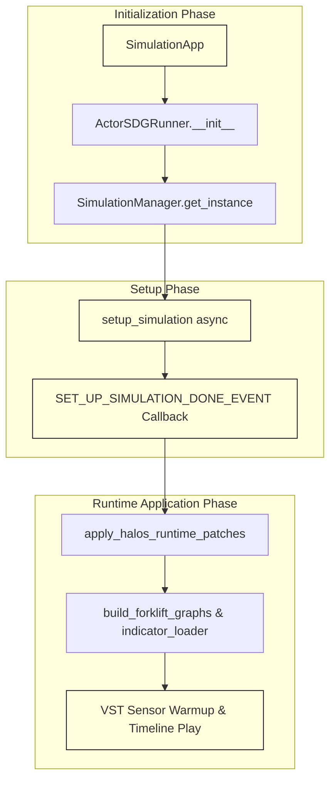
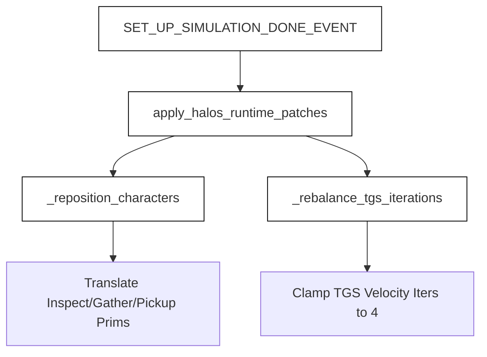
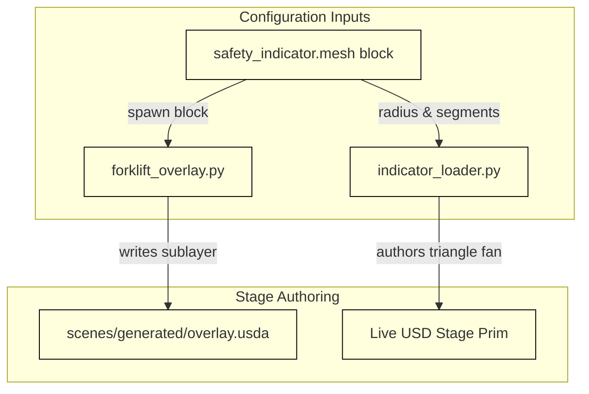

<!-- source: DeepWiki mcp.deepwiki.com · repo NVIDIA/halos-outside-in-safety · page 4.1 Simulation Runner and Scenario Configuration · fetched 2026-11-09 -->

# Simulation Runner and Scenario Configuration

<details>
<summary>Relevant source files</summary>

The following files were used as context for generating this wiki page:

- [.gitignore](.gitignore)
- [closed-loop-testing/isaac-sim/sil/scenes/indicator_warehouse_20x20_layout_overflow_test.usd](closed-loop-testing/isaac-sim/sil/scenes/indicator_warehouse_20x20_layout_overflow_test.usd)
- [closed-loop-testing/isaac-sim/sil/scripts/action_graphs/srr_ground_truth.py](closed-loop-testing/isaac-sim/sil/scripts/action_graphs/srr_ground_truth.py)
- [closed-loop-testing/isaac-sim/sil/scripts/forklift_overlay.py](closed-loop-testing/isaac-sim/sil/scripts/forklift_overlay.py)
- [closed-loop-testing/isaac-sim/sil/scripts/indicator_loader.py](closed-loop-testing/isaac-sim/sil/scripts/indicator_loader.py)
- [closed-loop-testing/isaac-sim/sil/scripts/run_actor_sdg.py](closed-loop-testing/isaac-sim/sil/scripts/run_actor_sdg.py)
- [closed-loop-testing/isaac-sim/sil/scripts/runtime_patches/README.md](closed-loop-testing/isaac-sim/sil/scripts/runtime_patches/README.md)
- [closed-loop-testing/isaac-sim/sil/scripts/runtime_patches/halos_runtime_patches.py](closed-loop-testing/isaac-sim/sil/scripts/runtime_patches/halos_runtime_patches.py)
- [closed-loop-testing/isaac-sim/sil/scripts/runtime_patches/scene_component_isolation.py](closed-loop-testing/isaac-sim/sil/scripts/runtime_patches/scene_component_isolation.py)
- [closed-loop-testing/regression-reporter/halos-integration/default_config_ros.yaml.template](closed-loop-testing/regression-reporter/halos-integration/default_config_ros.yaml.template)
- [docs/testing/sil/components/isaac-sim.mdx](docs/testing/sil/components/isaac-sim.mdx)

</details>


## Purpose and Scope
This page details the core simulation runner and configuration architecture for the Halos Outside-In Safety (HOISA) Software-in-the-Loop (SIL) environment. It covers the `ActorSDGRunner` lifecycle [closed-loop-testing/isaac-sim/sil/scripts/run_actor_sdg.py:43] running on Isaac Sim 6.1, the Replicator Agent (IRA) scene configuration (`default_config_ros.yaml`), scenario mappings (`scenarios.yaml`), runtime USD stage patches (`halos_runtime_patches.py`), procedural forklift overlays (`forklift_overlay.py`), and safety indicator generation (`indicator_loader.py`).

---

## 1. `ActorSDGRunner` Lifecycle and Execution Flow

The simulation driver is encapsulated by the `ActorSDGRunner` class (`run_actor_sdg.py`). It orchestrates the Isaac Sim application initialization, Replicator Agent setup, procedural asset overlay, runtime stage modifications, and VST (Video Streaming Toolkit) camera warmup.

### Lifecycle Sequence



*Natural Language to Code Entity Mapping:*
* **Driver Entrypoint**: `run_actor_sdg.py` [closed-loop-testing/isaac-sim/sil/scripts/run_actor_sdg.py:4]
* **Runner Class**: `ActorSDGRunner` [closed-loop-testing/isaac-sim/sil/scripts/run_actor_sdg.py:43]
* **Singleton Manager**: `SimulationManager.get_instance()` [closed-loop-testing/isaac-sim/sil/scripts/run_actor_sdg.py:10]
* **Runtime Patches Callback**: `apply_halos_runtime_patches()` [closed-loop-testing/isaac-sim/sil/scripts/runtime_patches/halos_runtime_patches.py]

Sources: [closed-loop-testing/isaac-sim/sil/scripts/run_actor_sdg.py:1-138]()

---

## 2. Scenario and Configuration Schema

Simulation runs are governed by a collection of YAML configuration files located in `/isaac-sim/sil/configs/`. These files decouple scene definitions, robot fleets, camera placements, and behavior trees from the core simulation executable.

### Configuration Hierarchy
* `scenarios.yaml`: Maps high-level scenario IDs (e.g., `warehouse_20x20_1fl`) to specific IRA configs, robot fleet YAMLs, camera definitions, and waypoint directories [docs/testing/sil/components/isaac-sim.mdx:37-49].
* `default_config_ros.yaml`: Replicator Agent 1.7.0 configuration schema defining simulation duration, base USD stage path, character groups, and ceiling camera target generation ranges [closed-loop-testing/regression-reporter/halos-integration/default_config_ros.yaml.template:48-123].
* `robots.yaml`: Describes the robot fleet, articulation prim paths, spawn poses, and control/odometry Action Graphs.

```yaml
isaacsim.replicator.agent:
  version: 1.7.0
  seed: 42
  simulation_duration: 300.0
  environment:
    base_stage_asset_path: /isaac-sim/sil/scenes/indicator_warehouse_20x20_layout_overflow_test.usd
  character:
    root_prim_path: /World/Characters
    motion_library_path: Isaac/People/MotionLibrary/HumanMotionLibrary.usd
    groups:
      inspect_workers:
        num: 1
        asset_path: Isaac/People/Characters/
        behavior_tree: /isaac-sim/sil/configs/inspect_loop.bt.json
```

Sources: [closed-loop-testing/regression-reporter/halos-integration/default_config_ros.yaml.template:1-122](), [docs/testing/sil/components/isaac-sim.mdx:1-125]()

---

## 3. Runtime Stage Modifications (`halos_runtime_patches.py`)

Because Replicator Agent 6.1 initializes agents dynamically without deterministic USD spawn attributes for characters, Halos applies a post-setup stage patch (`apply_halos_runtime_patches`) immediately after `setup_simulation()` completes [closed-loop-testing/isaac-sim/sil/scripts/runtime_patches/halos_runtime_patches.py:5-17].

### Patch Operations
1. **Character Repositioning**: Moves IRA-spawned pedestrians (`/World/Characters/<group>/<group>_0`) from NavMesh-randomized positions to canonical scenario spawn coordinates (e.g., `inspect_workers_0` to `(2.26, -10.30, 0.00)`) [closed-loop-testing/isaac-sim/sil/scripts/runtime_patches/halos_runtime_patches.py:10-16].
2. **PhysX TGS Re-balancing**: Clamps forklift articulation TGS velocity iterations to `4` (migrating excess velocity iterations to position iterations) to preserve Isaac Sim 5.1 baseline dynamics under PhysX 5.3 [closed-loop-testing/isaac-sim/sil/scripts/runtime_patches/halos_runtime_patches.py:62-74].



Sources: [closed-loop-testing/isaac-sim/sil/scripts/runtime_patches/halos_runtime_patches.py:1-137]()

---

## 4. Forklift Overlay and Indicator Loader

To avoid modifying tracked warehouse USD scene files when adding or repositioning robots, asset placement is handled procedurally at startup.

### Forklift Overlay (`forklift_overlay.py`)
`forklift_overlay.py` reads `robots.yaml`, parses `spawn:` configuration blocks (asset path, position, yaw angle, scale), and generates an ephemeral sublayer (`.overlay.usda`) under `scenes/generated/` before the primary stage opens [closed-loop-testing/isaac-sim/sil/scripts/forklift_overlay.py:3-44]. This keeps warehouse geometry purely static while allowing dynamic fleet composition.

### Indicator Loader (`indicator_loader.py`)
Safety-indicator discs are procedurally generated by `indicator_loader.py` to match the configuration specified under `robots.yaml` [closed-loop-testing/isaac-sim/sil/scripts/indicator_loader.py:3-8].



Sources: [closed-loop-testing/isaac-sim/sil/scripts/forklift_overlay.py:1-150](), [closed-loop-testing/isaac-sim/sil/scripts/indicator_loader.py:1-152]()

---

