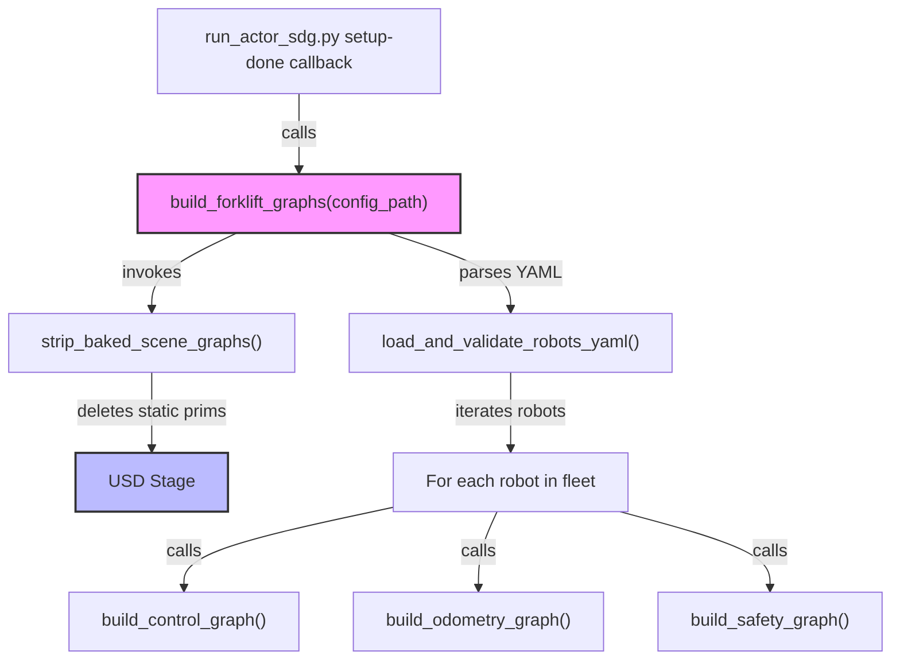
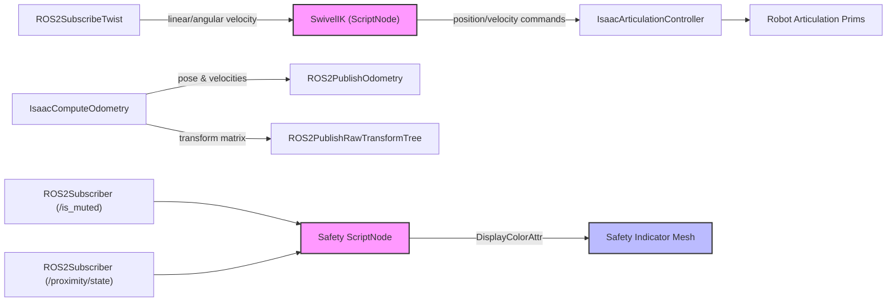

<!-- source: DeepWiki mcp.deepwiki.com · repo NVIDIA/halos-outside-in-safety · page 4.2 Action Graphs and Robot Fleet Configuration · fetched 2026-11-09 -->

# Action Graphs and Robot Fleet Configuration

<details>
<summary>Relevant source files</summary>

The following files were used as context for generating this wiki page:

- [closed-loop-testing/forklift-controller/fleet_config.py](closed-loop-testing/forklift-controller/fleet_config.py)
- [closed-loop-testing/forklift-controller/proximity_gate.py](closed-loop-testing/forklift-controller/proximity_gate.py)
- [closed-loop-testing/forklift-controller/test/test_proximity_gate.py](closed-loop-testing/forklift-controller/test/test_proximity_gate.py)
- [closed-loop-testing/isaac-sim/sil/configs/robots-40x20.yaml](closed-loop-testing/isaac-sim/sil/configs/robots-40x20.yaml)
- [closed-loop-testing/isaac-sim/sil/configs/robots.yaml](closed-loop-testing/isaac-sim/sil/configs/robots.yaml)
- [closed-loop-testing/isaac-sim/sil/scripts/action_graphs/README.md](closed-loop-testing/isaac-sim/sil/scripts/action_graphs/README.md)
- [closed-loop-testing/isaac-sim/sil/scripts/action_graphs/__init__.py](closed-loop-testing/isaac-sim/sil/scripts/action_graphs/__init__.py)
- [closed-loop-testing/isaac-sim/sil/scripts/action_graphs/forklift_common.py](closed-loop-testing/isaac-sim/sil/scripts/action_graphs/forklift_common.py)
- [closed-loop-testing/isaac-sim/sil/scripts/action_graphs/forklift_control.py](closed-loop-testing/isaac-sim/sil/scripts/action_graphs/forklift_control.py)
- [closed-loop-testing/isaac-sim/sil/scripts/action_graphs/forklift_odometry.py](closed-loop-testing/isaac-sim/sil/scripts/action_graphs/forklift_odometry.py)
- [closed-loop-testing/isaac-sim/sil/scripts/action_graphs/forklift_safety_indicator.py](closed-loop-testing/isaac-sim/sil/scripts/action_graphs/forklift_safety_indicator.py)
- [closed-loop-testing/isaac-sim/sil/scripts/action_graphs/proximity_line.py](closed-loop-testing/isaac-sim/sil/scripts/action_graphs/proximity_line.py)
- [deployments/scripts/preflight.py](deployments/scripts/preflight.py)
- [docs/testing/sil/extending-the-fleet.mdx](docs/testing/sil/extending-the-fleet.mdx)

</details>


## Purpose and Scope

This page details the architecture of robot fleet configurations and OmniGraph Action Graph builders used in the Halos Outside-In Safety (HOISA) Software-in-the-Loop (SIL) simulation environment. It covers the schema definitions for `robots.yaml` and `robots-40x20.yaml`, the orchestrator function `build_forklift_graphs()` inside `forklift_common.py`, the specialized OmniGraph modules (`forklift_control.py`, `forklift_odometry.py`, `forklift_safety_indicator.py`, and `proximity_line.py`), and the end-to-end workflow for extending the robot fleet.

---

## 1. Fleet Configuration Schemas (`robots.yaml` & `robots-40x20.yaml`)

Robot and fleet topologies are defined externally via declarative YAML schemas rather than hardcoded into USD stage assets. The default single-robot profile uses `robots.yaml`, while multi-robot variants (such as the two-dock setup) use `robots-40x20.yaml` [closed-loop-testing/isaac-sim/sil/configs/robots.yaml:1-16](), [closed-loop-testing/isaac-sim/sil/configs/robots-40x20.yaml:1-16]().

### Configuration Structure
Each configuration file contains three core blocks:
1. **`scene`**: Defines the target USD asset path loaded by Isaac Sim [closed-loop-testing/isaac-sim/sil/configs/robots.yaml:28](), [closed-loop-testing/isaac-sim/sil/configs/robots-40x20.yaml:57]().
2. **`models`**: Defines asset-coupled parameters shared by all instances of a specific robot model (e.g., `forklift_b`), including asset S3/Omniverse paths, drive type kinematics (`swivel`), wheel radii, wheelbases, steering limits, and safety indicator mesh specifications [closed-loop-testing/isaac-sim/sil/configs/robots.yaml:34-79](), [closed-loop-testing/isaac-sim/sil/configs/robots-40x20.yaml:67-112]().
3. **`robots`**: An array of instance configurations. Each instance overrides or inherits model parameters and defines specific simulation properties such as `articulation_prim`, controller `drive` settings, `spawn` coordinates (position and yaw), and `proximity` watchdog parameters [closed-loop-testing/isaac-sim/sil/configs/robots.yaml:80-123]().

```mermaid
graph TD
    sub-yaml["robots.yaml / robots-40x20.yaml"] -->|scene| SceneUSD["sil/scenes/*.usd"]
    sub-yaml -->|models| ModelBlock["models: forklift_b (wheelbase, drive_type, asset_path)"]
    sub-yaml -->|robots| RobotInstance["robots: [name: forklift_b, articulation_prim, spawn, proximity]"]
    ModelBlock -->|merged via _apply_model()| RobotInstance
    RobotInstance -->|loaded by| Loader["forklift_common.load_and_validate_robots_yaml()"]

    style sub-yaml fill:#f9f,stroke:#333,stroke-width:2px
    style Loader fill:#bbf,stroke:#333,stroke-width:2px
```

Sources: `[closed-loop-testing/isaac-sim/sil/configs/robots.yaml:1-123]()`, `[closed-loop-testing/isaac-sim/sil/configs/robots-40x20.yaml:1-119]`, `[closed-loop-testing/isaac-sim/sil/scripts/action_graphs/forklift_common.py:1-160]()`.

---

## 2. Action Graph Builders and Orchestrator (`forklift_common.py`)

Rather than relying on baked-in Action Graphs within the USD scene, runtime Python builders in `closed-loop-testing/isaac-sim/sil/scripts/action_graphs/` construct graphs dynamically upon simulation startup [closed-loop-testing/isaac-sim/sil/scripts/action_graphs/README.md:54-55]().

### Orchestration and Prims Stripping
The orchestrator entry point `build_forklift_graphs()` (defined in `forklift_common.py`) coordinates the build pipeline:
1. **`strip_baked_scene_graphs()`**: Removes legacy static graphs (such as `/World/ActionGraph`, `/World/ROS_Forklift_Control_Graph`, and `/World/Odometry_Graph`) from the loaded USD stage to prevent duplicate execution or state collision [closed-loop-testing/isaac-sim/sil/scripts/action_graphs/forklift_common.py:27-45]().
2. **YAML Validation**: Loads and validates `robots.yaml` via `load_and_validate_robots_yaml()`, folding instance parameters over model defaults using `_apply_model()` [closed-loop-testing/isaac-sim/sil/scripts/action_graphs/forklift_common.py:139-158]().
3. **Graph Generation**: Invokes specialized builders for control, odometry, and safety indicators per robot entry.



Sources: `[closed-loop-testing/isaac-sim/sil/scripts/action_graphs/forklift_common.py:1-160]()`, `[closed-loop-testing/isaac-sim/sil/scripts/action_graphs/README.md:1-55]()`.

---

## 3. Specialized Robot Action Graphs

### Control Graph (`forklift_control.py`)
`build_control_graph()` replaces the legacy baked control graph by subscribing to `/cmd_vel` (`geometry_msgs/Twist`) and driving the robot's articulation joints via an embedded script node executing Swivel Inverse Kinematics [closed-loop-testing/isaac-sim/sil/scripts/action_graphs/forklift_control.py:3-45]().
* **Key Nodes**: `OnPlaybackTick`, `ROS2Context`, `SubscribeTwist`, `SwivelIK` (OgnScriptNode), and `IsaacArticulationController` [closed-loop-testing/isaac-sim/sil/scripts/action_graphs/forklift_control.py:121-127]().
* **Kinematics**: Computes steering angles and drive wheel velocities based on wheelbase, wheel radius, and maximum steering limits, respecting reverse logic flag configurations [closed-loop-testing/isaac-sim/sil/scripts/action_graphs/forklift_control.py:43-80]().

### Odometry Graph (`forklift_odometry.py`)
`build_odometry_graph()` generates `/World/<name>_OdometryGraph` instances that compute and publish robot odometry and transform trees [closed-loop-testing/isaac-sim/sil/scripts/action_graphs/forklift_odometry.py:3-39]().
* **Key Nodes**: `IsaacComputeOdometry`, `ROS2PublishOdometry`, and `ROS2PublishRawTransformTree` [closed-loop-testing/isaac-sim/sil/scripts/action_graphs/forklift_odometry.py:68-74]().
* **Topic & Frame Resolution**: Ensures unique association of chassis primitives and prevents TF parent-frame collisions across multi-robot fleets [closed-loop-testing/isaac-sim/sil/scripts/action_graphs/forklift_odometry.py:46-136]().

### Safety Indicator Graph (`forklift_safety_indicator.py`)
`build_safety_graph()` dynamically creates indicator graphs (`/World/<name>_SafetyGraph`) that update the display color of safety disc meshes based on safety state subscriptions (`/<name>/safety/is_muted` or `/<name>/proximity/state`) [closed-loop-testing/isaac-sim/sil/scripts/action_graphs/forklift_safety_indicator.py:3-40]().
* **Sources**: Supports `mute` (ATL mode, green when muted), `proximity` (PXC mode, green/orange/red depending on proximity state), or `both` [closed-loop-testing/isaac-sim/sil/scripts/action_graphs/forklift_safety_indicator.py:5-18]().

### Proximity Line Graph (`proximity_line.py`)
When opted in via `robots.yaml` (`proximity_line: {enabled: true}`), `build_proximity_line()` subscribes to `/safety/proximity/pair` and visualizes proximity pairs and separation distances directly on the simulation floor [closed-loop-testing/isaac-sim/sil/scripts/action_graphs/proximity_line.py:3-14]().



Sources: `[closed-loop-testing/isaac-sim/sil/scripts/action_graphs/forklift_control.py:1-160]`, `[closed-loop-testing/isaac-sim/sil/scripts/action_graphs/forklift_odometry.py:1-145]`, `[closed-loop-testing/isaac-sim/sil/scripts/action_graphs/forklift_safety_indicator.py:1-168]`, `[closed-loop-testing/isaac-sim/sil/scripts/action_graphs/proximity_line.py:1-181]()`.

---

## 4. Extending the Fleet

Adding a new robot instance or fleet variant involves configuring YAML definitions and verifying consistency across containers:
1. **Update Fleet YAML**: Add a new robot block under `robots:` in `robots.yaml` or `robots-40x20.yaml`, ensuring unique `name` and `articulation_prim` attributes [closed-loop-testing/isaac-sim/sil/configs/robots.yaml:80-123](), [closed-loop-testing/isaac-sim/sil/configs/robots-40x20.yaml:1-119]().
2. **Configure Controller Service**: Provision a corresponding controller container profile (e.g., adding `multi-robot` compose profiles for container `forklift-controller-b2`) [closed-loop-testing/isaac-sim/sil/configs/robots-40x20.yaml:15-16]().
3. **Run Preflight Verification**: Execute `preflight.py` from the host to validate consistency between the fleet configuration, controller services, and waypoint files before launching simulation containers [deployments/scripts/preflight.py:30-59]().

```bash
python3 deployments/scripts/preflight.py --robots-config closed-loop-testing/isaac-sim/sil/configs/robots-40x20.yaml
```

Sources: `[closed-loop-testing/isaac-sim/sil/configs/robots-40x20.yaml:1-50]`, `[deployments/scripts/preflight.py:1-154]()`.

---

