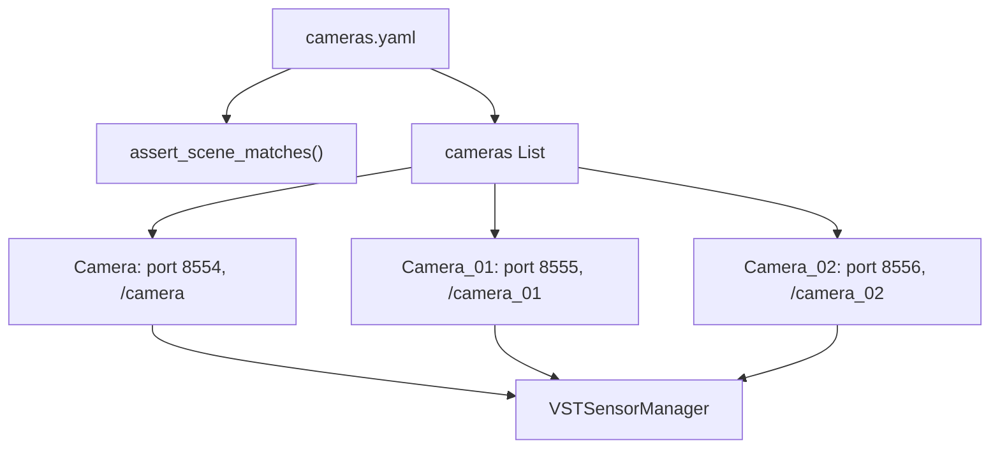
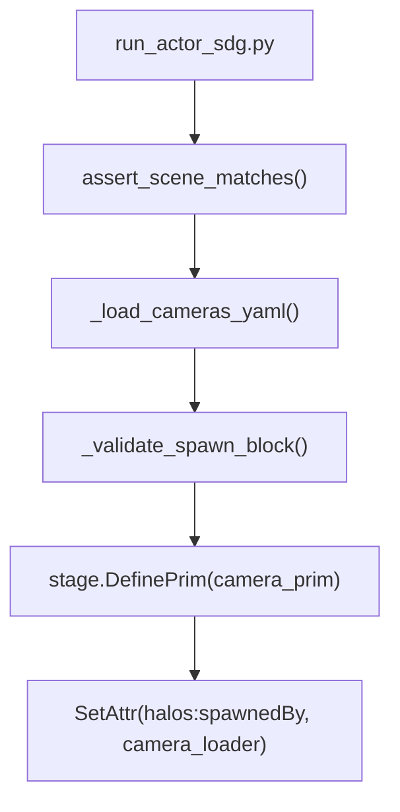
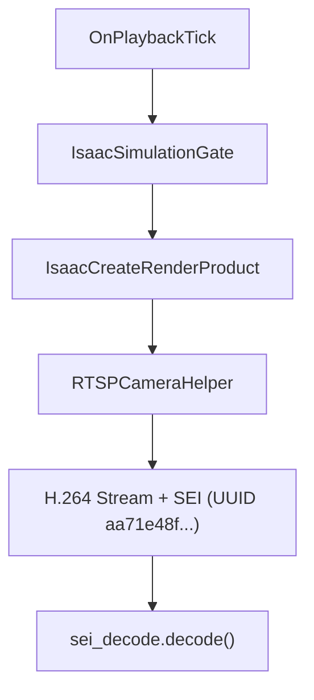
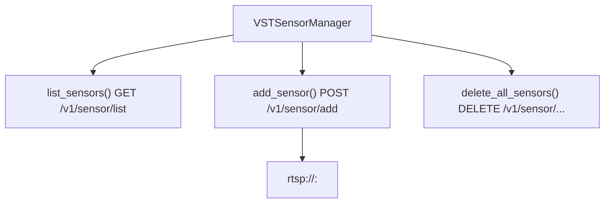

<!-- source: DeepWiki mcp.deepwiki.com · repo NVIDIA/halos-outside-in-safety · page 4.3 Cameras, RTSP and VST Sensor Registration · fetched 2026-11-09 -->

# Cameras, RTSP and VST Sensor Registration

Relevant source files

The following files were used as context for generating this wiki page:

- [closed-loop-testing/isaac-sim/Dockerfile](closed-loop-testing/isaac-sim/Dockerfile)
- [closed-loop-testing/isaac-sim/sil/configs/cameras-40x20.yaml](closed-loop-testing/isaac-sim/sil/configs/cameras-40x20.yaml)
- [closed-loop-testing/isaac-sim/sil/configs/cameras.yaml](closed-loop-testing/isaac-sim/sil/configs/cameras.yaml)
- [closed-loop-testing/isaac-sim/sil/configs/default_config_ros.yaml](closed-loop-testing/isaac-sim/sil/configs/default_config_ros.yaml)
- [closed-loop-testing/isaac-sim/sil/configs/default_config_ros_40x20.yaml](closed-loop-testing/isaac-sim/sil/configs/default_config_ros_40x20.yaml)
- [closed-loop-testing/isaac-sim/sil/scripts/action_graphs/rtsp_cameras.py](closed-loop-testing/isaac-sim/sil/scripts/action_graphs/rtsp_cameras.py)
- [closed-loop-testing/isaac-sim/sil/scripts/camera_loader.py](closed-loop-testing/isaac-sim/sil/scripts/camera_loader.py)
- [closed-loop-testing/isaac-sim/sil/scripts/rtsp/sei_decode.py](closed-loop-testing/isaac-sim/sil/scripts/rtsp/sei_decode.py)
- [closed-loop-testing/isaac-sim/sil/scripts/test_vst_sensor_manager_config.py](closed-loop-testing/isaac-sim/sil/scripts/test_vst_sensor_manager_config.py)
- [closed-loop-testing/isaac-sim/sil/scripts/vst_sensor_manager.py](closed-loop-testing/isaac-sim/sil/scripts/vst_sensor_manager.py)
- [docs/reference/sei-configuration.mdx](docs/reference/sei-configuration.mdx)

## Purpose and Scope
This page details the camera configuration schema, dynamic prim generation, RTSP multi-camera streaming pipelines, H.264 SEI metadata injection and decoding, and the Video Storage Toolkit (VST) sensor registration lifecycle within Halos Outside-In Safety (HOISA). It bridges Isaac Sim 6.1 simulation output with perception services (`vss`) and the safety engine (`safety-core`).

Sources:
- `closed-loop-testing/isaac-sim/sil/configs/cameras.yaml:1-50` ()
- `closed-loop-testing/isaac-sim/sil/scripts/camera_loader.py:1-49` ()
- `closed-loop-testing/isaac-sim/sil/scripts/action_graphs/rtsp_cameras.py:1-36` ()
- `closed-loop-testing/isaac-sim/sil/scripts/vst_sensor_manager.py:1-20` ()

## 1. Camera Configuration Schema (`cameras.yaml`)
Camera deployment in Isaac Sim 6.1 uses `cameras.yaml`, replacing the legacy `mediamtx` broker with per-camera in-process RTSP streaming servers. 

Key attributes in `cameras.yaml` [closed-loop-testing/isaac-sim/sil/configs/cameras.yaml:1-52]():
- `scene`: Restricts configuration application to specified warehouse USD stages, validated by `camera_loader.assert_scene_matches()` [closed-loop-testing/isaac-sim/sil/configs/cameras.yaml:32-37]().
- `cameras`: Array of camera definitions containing:
  - `name`: Display name used by VST [closed-loop-testing/isaac-sim/sil/configs/cameras.yaml:8]()
  - `camera_prim`: USD prim path on the stage [closed-loop-testing/isaac-sim/sil/configs/cameras.yaml:11]()
  - `port`: Unique TCP port for the in-process RTSP server (e.g., `8554`, `8555`, `8556`) [closed-loop-testing/isaac-sim/sil/configs/cameras.yaml:9]()
  - `mount_path`: URL suffix starting with `/` [closed-loop-testing/isaac-sim/sil/configs/cameras.yaml:10]()
  - `spawn`: Optional world-space transform and intrinsic parameters for dynamic prim loading [closed-loop-testing/isaac-sim/sil/configs/cameras.yaml:12-21]().
- `rtsp.host`: Host IP address string used by `vst_sensor_manager.py` to construct endpoints [closed-loop-testing/isaac-sim/sil/configs/cameras.yaml:49-52]().

*Diagram 1: Configuration flow from `cameras.yaml` to `VSTSensorManager`.*

Sources:
- `closed-loop-testing/isaac-sim/sil/configs/cameras.yaml:1-92` ()
- `closed-loop-testing/isaac-sim/sil/scripts/camera_loader.py:90-136` ()

## 2. Dynamic Camera Loading (`camera_loader.py`)
To decouple camera poses from static scene USDs, `camera_loader.py` dynamically spawns camera prims at startup.

Key functions and validation flows:
- `_load_cameras_yaml(yaml_path)`: Reads and parses the YAML configuration [closed-loop-testing/isaac-sim/sil/scripts/camera_loader.py:83-88]().
- `assert_scene_matches(config_path, base_stage_asset_path)`: Prevents world-space coordinate errors by verifying that the loaded warehouse USD matches the declared `scene:` value [closed-loop-testing/isaac-sim/sil/scripts/camera_loader.py:90-136]().
- `_validate_spawn_block(name, spawn)`: Checks required numeric keys (`position`, `rotation_yxz_deg`, `focal_length`, `horizontal_aperture`, `vertical_aperture`) [closed-loop-testing/isaac-sim/sil/scripts/camera_loader.py:143-156]().
- **Idempotency**: Spawned prims receive the `halos:spawnedBy` attribute (`_MARKER_ATTR`, `_MARKER_VALUE`). Existing unmarked prims at target paths raise a fatal error to prevent conflicts between baked definitions and dynamic configurations [closed-loop-testing/isaac-sim/sil/scripts/camera_loader.py:43-48]().

*Diagram 2: Code entity execution flow in `camera_loader.py`.*

Sources:
- `closed-loop-testing/isaac-sim/sil/scripts/camera_loader.py:1-156` ()

## 3. RTSP Multi-Camera Action Graph & SEI Metadata (`rtsp_cameras.py` & `sei_decode.py`)
Streaming frames from Isaac Sim to downstream perception is managed by an OmniGraph built via `rtsp_cameras.py`.

- `build_rtsp_graph()`: Validates camera prim presence, clears existing graphs at `/World/RTSPMultiGraph`, and configures an `OnPlaybackTick` trigger routed through an `IsaacSimulationGate` (with `step=2` to enforce 30Hz streaming) [closed-loop-testing/isaac-sim/sil/scripts/action_graphs/rtsp_cameras.py:119-179]().
- **SEI Encoding**: Each frame includes H.264 SEI (Supplemental Enhancement Information) `user_data_unregistered` NAL units carrying metadata (simulation time, frame number, ISO8601 timestamp) stamped with UUID `aa71e48f-0711-5d80-a247-cd31ca6fa49c` [closed-loop-testing/isaac-sim/sil/scripts/action_graphs/rtsp_cameras.py:10-13]().
- `sei_decode.py`: Parses H.264 byte streams, isolates NAL unit type `6`, matches the target UUID, and validates JSON schemas containing `publish_sim_time_ns`, `timestamp_iso8601`, `timestamp`, and `frame_num` [closed-loop-testing/isaac-sim/sil/scripts/rtsp/sei_decode.py:21-73]().

*Diagram 3: RTSP graph execution and SEI decoding pipeline.*

Sources:
- `closed-loop-testing/isaac-sim/sil/scripts/action_graphs/rtsp_cameras.py:1-179` ()
- `closed-loop-testing/isaac-sim/sil/scripts/rtsp/sei_decode.py:1-109` ()

## 4. VST Sensor Registration Lifecycle (`vst_sensor_manager.py`)
The `VSTSensorManager` Python module provides an interface to the VST Sensor Management API, registering RTSP stream URLs for perception processing.

Key classes and methods in `VSTSensorManager` (`closed-loop-testing/isaac-sim/sil/scripts/vst_sensor_manager.py`):
- `__init__(base_url, auth_token, timeout)`: Sets base URLs from parameters or environment variables (`VST_BASE_URL`, `VST_AUTH_TOKEN`) [closed-loop-testing/isaac-sim/sil/scripts/vst_sensor_manager.py:48-73]().
- `_request(method, endpoint, data)`: Handles HTTP communication (`GET`, `POST`, `DELETE`) with automatic `urllib` fallback if `requests` is absent [closed-loop-testing/isaac-sim/sil/scripts/vst_sensor_manager.py:84-144]().
- `list_sensors()`: Queries `/v1/sensor/list` to return registered sensors [closed-loop-testing/isaac-sim/sil/scripts/vst_sensor_manager.py:145-164]().
- `get_sensor_streams(sensor_id)`: Retrieves active stream details from `/v1/sensor/streams` [closed-loop-testing/isaac-sim/sil/scripts/vst_sensor_manager.py:165-191]().

*Diagram 4: VST sensor management API request lifecycle.*

Sources:
- `closed-loop-testing/isaac-sim/sil/scripts/vst_sensor_manager.py:1-191` ()

---

