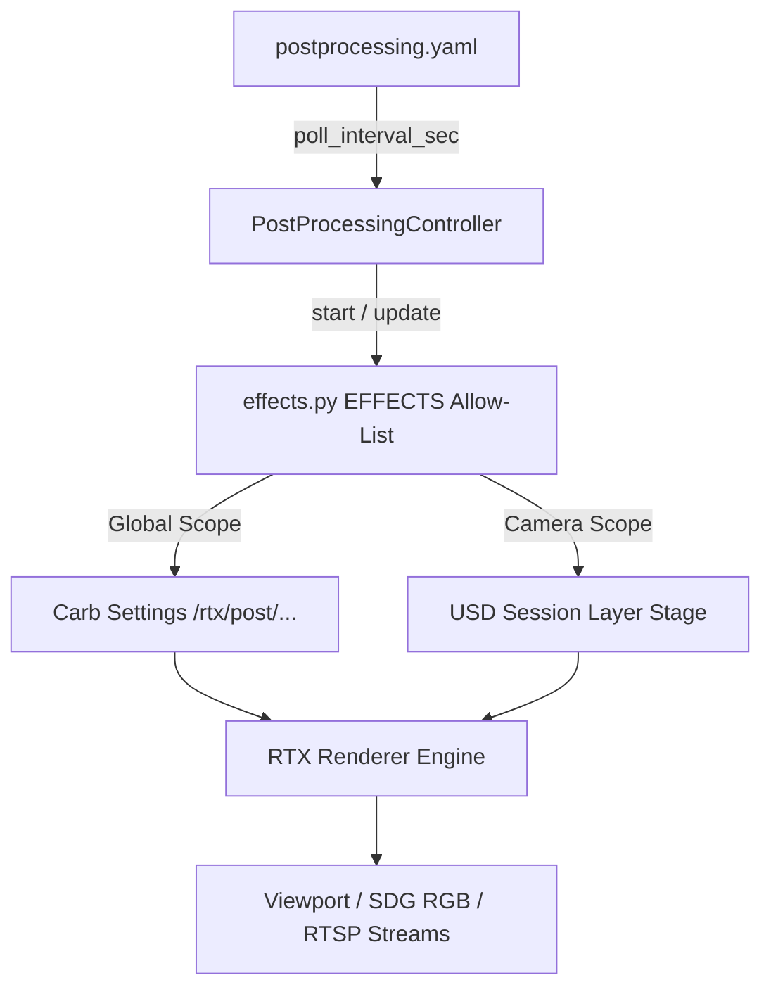
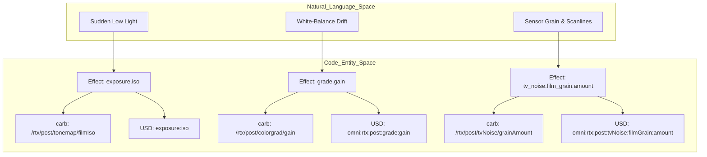
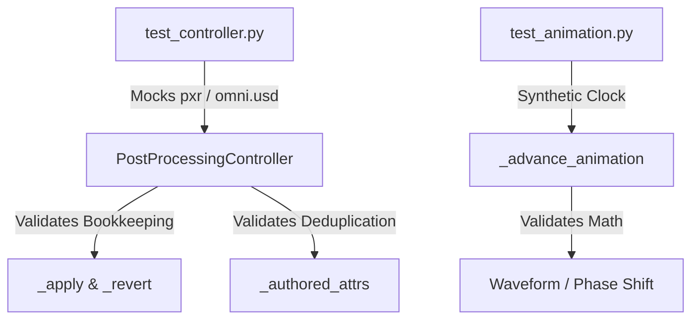

<!-- source: DeepWiki mcp.deepwiki.com · repo NVIDIA/halos-outside-in-safety · page 4.4 Post-Processing Anomaly Injection · fetched 2026-11-09 -->

# Post-Processing Anomaly Injection

Relevant source files

The following files were used as context for generating this wiki page:

- [closed-loop-testing/isaac-sim/sil/configs/postprocessing.yaml](closed-loop-testing/isaac-sim/sil/configs/postprocessing.yaml)
- [closed-loop-testing/isaac-sim/sil/scripts/postprocessing/README.md](closed-loop-testing/isaac-sim/sil/scripts/postprocessing/README.md)
- [closed-loop-testing/isaac-sim/sil/scripts/postprocessing/__init__.py](closed-loop-testing/isaac-sim/sil/scripts/postprocessing/__init__.py)
- [closed-loop-testing/isaac-sim/sil/scripts/postprocessing/controller.py](closed-loop-testing/isaac-sim/sil/scripts/postprocessing/controller.py)
- [closed-loop-testing/isaac-sim/sil/scripts/postprocessing/effects.py](closed-loop-testing/isaac-sim/sil/scripts/postprocessing/effects.py)
- [closed-loop-testing/isaac-sim/sil/scripts/postprocessing/set_preset.sh](closed-loop-testing/isaac-sim/sil/scripts/postprocessing/set_preset.sh)
- [closed-loop-testing/isaac-sim/sil/scripts/postprocessing/test_animation.py](closed-loop-testing/isaac-sim/sil/scripts/postprocessing/test_animation.py)
- [closed-loop-testing/isaac-sim/sil/scripts/postprocessing/test_controller.py](closed-loop-testing/isaac-sim/sil/scripts/postprocessing/test_controller.py)
- [docs/integration/saim-distortion-injection.mdx](docs/integration/saim-distortion-injection.mdx)

This page documents the config-driven RTX post-processing anomaly injection subsystem used within the Isaac Sim Software-in-the-Loop (SIL) simulation harness (`closed-loop-testing/isaac-sim/sil/scripts/postprocessing/`). The subsystem injects realistic sensor faults—such as low light, white-balance drift, brightness flicker, sensor grain, scanlines, and CRT anomalies—directly into the renderer pipeline to test perception and safety monitors under degraded visual conditions.

---

## 1. Subsystem Architecture & Non-OmniGraph Design

Unlike modular pipeline components built using OmniGraphs (which require graph reconstruction and simulation restart), RTX post-processing executes directly within the renderer engine (`closed-loop-testing/isaac-sim/sil/scripts/postprocessing/README.md:7-12`). Because the pass runs prior to the video encoder, a single preset configuration instantly propagates to the viewport, the Synthetic Data Generation (SDG) RGB output, and every RTSP camera stream simultaneously [closed-loop-testing/isaac-sim/sil/scripts/postprocessing/controller.py:5-8].

The lifecycle of the injection mechanism is managed by `PostProcessingController`, which coordinates live file polling, preset resolution, USD session layer authoring, and deferred render-product binding [closed-loop-testing/isaac-sim/sil/scripts/postprocessing/controller.py:79-160].

*Sources: `closed-loop-testing/isaac-sim/sil/scripts/postprocessing/controller.py:79-160`, `closed-loop-testing/isaac-sim/sil/scripts/postprocessing/effects.py:44-178`, `closed-loop-testing/isaac-sim/sil/configs/postprocessing.yaml:1-41`*

---

## 2. Scopes, Targets, and the EFFECTS Allow-List

The controller supports three distinct evaluation scopes depending on whether an anomaly applies site-wide or targets specific cameras [closed-loop-testing/isaac-sim/sil/scripts/postprocessing/controller.py:10-25]:

1. **Global Scope (Default)**: Modifies Carb settings (`carb.settings`) which affect the viewport and all cameras lacking specific overrides [closed-loop-testing/isaac-sim/sil/scripts/postprocessing/controller.py:12-13, closed-loop-testing/isaac-sim/sil/scripts/postprocessing/effects.py:8-9].
2. **Per-Camera Scope (`cameras:` key)**: Authors USD attributes directly onto specified camera prims and render products, isolating degradation to individual sensors [closed-loop-testing/isaac-sim/sil/scripts/postprocessing/controller.py:14-17].
3. **Per-Camera Independent Scope (`per_camera:` key)**: Allows unique settings and independent animation blocks per camera prim [closed-loop-testing/isaac-sim/sil/scripts/postprocessing/controller.py:18-24].

Every controllable effect is cataloged in `effects.py` via the `Effect` class, which maps logical strings to low-level renderer paths, USD attributes, required USD schemas, and value types (`KIND_BOOL`, `KIND_FLOAT`, `KIND_COLOR3`) [closed-loop-testing/isaac-sim/sil/scripts/postprocessing/effects.py:37-56].

*Sources: `closed-loop-testing/isaac-sim/sil/scripts/postprocessing/effects.py:37-178`, `closed-loop-testing/isaac-sim/sil/configs/postprocessing.yaml:46-110`*

---

## 3. Configuration, Presets, and Live Switching

Presets are declared in `postprocessing.yaml` under version `1` schema [closed-loop-testing/isaac-sim/sil/configs/postprocessing.yaml:32-37]. The file maintains an `active:` preset pointer that `PostProcessingController` polls periodically (controlled by `poll_interval_sec`, default `0.5s`) [closed-loop-testing/isaac-sim/sil/scripts/postprocessing/controller.py:88-115, closed-loop-testing/isaac-sim/sil/configs/postprocessing.yaml:35].

Operators can switch presets dynamically at runtime using `set_preset.sh`, which performs an atomic file replacement via a temporary file in the same directory (`.postprocessing.yaml.XXXXXX`), preventing partial reads [closed-loop-testing/isaac-sim/sil/scripts/postprocessing/set_preset.sh:5-80].

| Preset Name | Description | Key Settings / Targets |
| :--- | :--- | :--- |
| `baseline` | Reference golden run with no degradation | `settings: {}` [closed-loop-testing/isaac-sim/sil/configs/postprocessing.yaml:39-41] |
| `low_light` | Sudden lamp failure / sensor underexposure | `auto_exposure.enabled: false`, `exposure.iso: 12.0` [closed-loop-testing/isaac-sim/sil/configs/postprocessing.yaml:46-51] |
| `hue_shift` | Warm white-balance color cast | `grade.enabled: true`, `grade.gain: [1.03, 1.0, 0.97]` [closed-loop-testing/isaac-sim/sil/configs/postprocessing.yaml:55-60] |
| `flicker` | Sine-modulated brightness oscillation | `exposure.iso` animated via sine waveform (`frequency_hz: 2.0`) [closed-loop-testing/isaac-sim/sil/configs/postprocessing.yaml:86-97] |
| `tv_noise` | Analog sensor grain combined with scanlines | `tv_noise.enabled: true`, `film_grain.amount: 0.12`, `scanlines.spread: 1.0` [closed-loop-testing/isaac-sim/sil/configs/postprocessing.yaml:102-110] |
| `crt_artifacts` | Roll, ghosting, wave distortion, vertical lines | Boolean toggles for scroll bug, ghost flickering, and wave distortion [closed-loop-testing/isaac-sim/sil/configs/postprocessing.yaml:129-139] |

*Sources: `closed-loop-testing/isaac-sim/sil/configs/postprocessing.yaml:32-139`, `closed-loop-testing/isaac-sim/sil/scripts/postprocessing/set_preset.sh:1-93`*

---

## 4. Animation Engine and Phase Synchronization

Animated effects evaluate periodic mathematical functions (such as sine waves) over time relative to a latched clock origin (`_animation_t0`) [closed-loop-testing/isaac-sim/sil/scripts/postprocessing/controller.py:26-29, 141-147]. 

When multiple camera scopes or render products are animated within a single preset, they share a unified clock origin while supporting individual phase shifts via `animation.phase_deg` [closed-loop-testing/isaac-sim/sil/scripts/postprocessing/controller.py:26-29]. This ensures that multi-camera dissonance (e.g., two cameras flickering 180 degrees out of phase) is deterministically reproducible across simulation runs [closed-loop-testing/isaac-sim/sil/scripts/postprocessing/controller.py:26-29].

*Sources: `closed-loop-testing/isaac-sim/sil/scripts/postprocessing/controller.py:26-29, 141-147`*

---

## 5. Verification, Testing, and Diagnostics

The post-processing framework is accompanied by robust test suites that execute independently of Kit runtime dependencies:

* **`test_animation.py`**: Validates animator math, backward compatibility for non-phased presets (`flicker`), antiphase symmetry checks, and discrete Fourier transform (DFT) frequency separation across synthetic clock samples [closed-loop-testing/isaac-sim/sil/scripts/postprocessing/README.md:24, closed-loop-testing/isaac-sim/sil/scripts/postprocessing/test_animation.py:3-177].
* **`test_controller.py`**: Tests controller application, reversion logic (`_apply`, `_revert`), USD attribute deduplication, session layer authoring, and deferred render-product queue management using mock `pxr` and `omni.usd` modules [closed-loop-testing/isaac-sim/sil/scripts/postprocessing/README.md:25, closed-loop-testing/isaac-sim/sil/scripts/postprocessing/test_controller.py:3-27].

*Sources: `closed-loop-testing/isaac-sim/sil/scripts/postprocessing/test_controller.py:3-27`, `closed-loop-testing/isaac-sim/sil/scripts/postprocessing/test_animation.py:3-17`*

---

