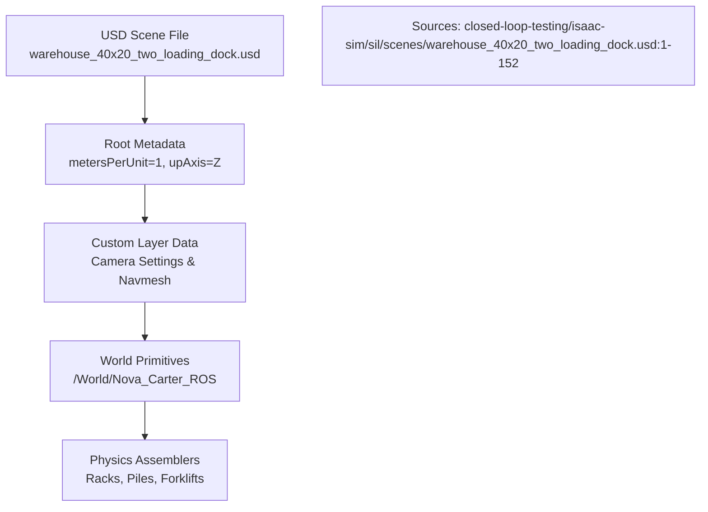
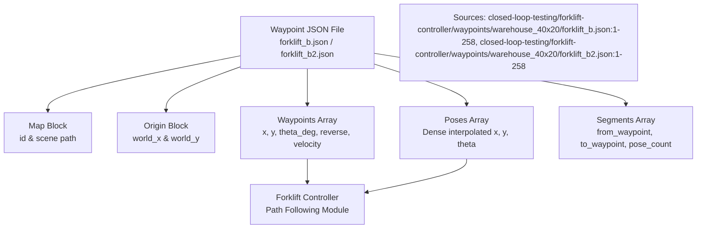
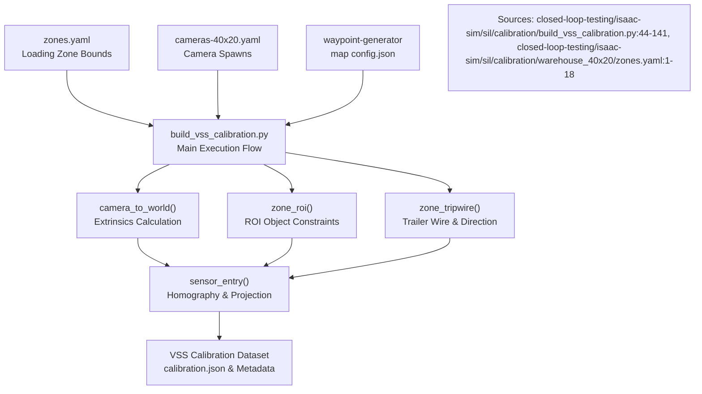

<!-- source: DeepWiki mcp.deepwiki.com · repo NVIDIA/halos-outside-in-safety · page 4.5 Warehouse Scenes and Waypoints · fetched 2026-11-09 -->

# Warehouse Scenes and Waypoints

<details>
<summary>Relevant source files</summary>

The following files were used as context for generating this wiki page:

- [closed-loop-testing/forklift-controller/waypoints/warehouse_20x20/forklift_b.json](closed-loop-testing/forklift-controller/waypoints/warehouse_20x20/forklift_b.json)
- [closed-loop-testing/forklift-controller/waypoints/warehouse_40x20/forklift_b.json](closed-loop-testing/forklift-controller/waypoints/warehouse_40x20/forklift_b.json)
- [closed-loop-testing/forklift-controller/waypoints/warehouse_40x20/forklift_b2.json](closed-loop-testing/forklift-controller/waypoints/warehouse_40x20/forklift_b2.json)
- [closed-loop-testing/isaac-sim/sil/calibration/build_vss_calibration.py](closed-loop-testing/isaac-sim/sil/calibration/build_vss_calibration.py)
- [closed-loop-testing/isaac-sim/sil/calibration/warehouse_40x20/zones.yaml](closed-loop-testing/isaac-sim/sil/calibration/warehouse_40x20/zones.yaml)
- [closed-loop-testing/isaac-sim/sil/scenes/warehouse_40x20_two_loading_dock.usd](closed-loop-testing/isaac-sim/sil/scenes/warehouse_40x20_two_loading_dock.usd)

</details>


## Purpose and Scope
This page details the USD simulation scenes, per-robot waypoint JSON configurations, and calibration zone specifications used in the HOISA closed-loop simulation harness (`closed-loop-testing/`). It covers the physical layout representations in Isaac Sim (`warehouse_40x20_two_loading_dock.usd`), trajectory and pose data structures consumed by the forklift controller, and the calibration pipeline (`build_vss_calibration.py`) that translates simulation camera parameters and loading zone bounds into VSS 2D perception configurations.

---

## 1. USD Simulation Scenes
The simulation harness supports multiple standardized warehouse environments modeled in Universal Scene Description (USD) format. The primary environments include the 20x20 overflow test layout and the `warehouse_40x20_two_loading_dock.usd` scene.

The `warehouse_40x20_two_loading_dock.usd` asset defines the structural geometry, physics properties, camera mount points, and metrics assemblers for multi-dock testing. The file root establishes simulation metadata such as `metersPerUnit = 1`, `upAxis = "Z"`, and timeline parameters (`framesPerSecond = 24`, `timeCodesPerSecond = 60`) [closed-loop-testing/isaac-sim/sil/scenes/warehouse_40x20_two_loading_dock.usd:146-152]().

Custom layer data embeds camera settings (`Front`, `Perspective`, `Right`, `Top`) and navmesh settings (`agentMaxFloorSlope`, `agentMaxRadius`, `agentMaxStepHeight`) [closed-loop-testing/isaac-sim/sil/scenes/warehouse_40x20_two_loading_dock.usd:4-125](). Physics metrics are assembled under `/World` for racks, crates, safety tape, forklifts, and warehouse piles [closed-loop-testing/isaac-sim/sil/scenes/warehouse_40x20_two_loading_dock.usd:23-103]().


Sources: `closed-loop-testing/isaac-sim/sil/scenes/warehouse_40x20_two_loading_dock.usd:1-152`

---

## 2. Waypoint JSON Files and Schema
Trajectory planning and path following for forklifts in simulation rely on per-robot JSON configuration files located under `closed-loop-testing/forklift-controller/waypoints/`. Each file specifies the target map ID, associated USD scene, world origin offset, discrete waypoints, pre-computed dense poses, and trajectory segments.

### Schema Structure
- `map`: Dictionary identifying the `id` (e.g., `warehouse_40x20` or `warehouse_20x20`) and corresponding USD `scene` path [closed-loop-testing/forklift-controller/waypoints/warehouse_40x20/forklift_b.json:2-5]().
- `origin`: World-space coordinate offset (`world_x`, `world_y`) defining the local coordinate frame origin [closed-loop-testing/forklift-controller/waypoints/warehouse_40x20/forklift_b.json:6-9]().
- `waypoints`: List of target coordinates (`x`, `y`, `theta_deg`), motion mode (`reverse`: boolean), velocity limits, and operational notes [closed-loop-testing/forklift-controller/waypoints/warehouse_40x20/forklift_b.json:10-31]().
- `poses`: Dense array of interpolated poses (`x`, `y`, `theta`) consumed by path-following controllers [closed-loop-testing/forklift-controller/waypoints/warehouse_40x20/forklift_b.json:32-243]().
- `segments`: Transition metadata linking `from_waypoint` to `to_waypoint`, specifying whether movement is in reverse and the associated `pose_count` [closed-loop-testing/forklift-controller/waypoints/warehouse_40x20/forklift_b.json:244-257]().

Example configuration snippet for `forklift_b` in the 40x20 warehouse:
```json
{
  "map": {
    "id": "warehouse_40x20",
    "scene": "sil/scenes/warehouse_40x20_two_loading_dock.usd"
  },
  "origin": {
    "world_x": 2.0,
    "world_y": -13.35
  }
}
```
*(Reference: `closed-loop-testing/forklift-controller/waypoints/warehouse_40x20/forklift_b.json`)*

Similarly, `forklift_b2.json` targets the second loading dock at `world_y = -21.63` [closed-loop-testing/forklift-controller/waypoints/warehouse_40x20/forklift_b2.json:6-9](), and `warehouse_20x20/forklift_b.json` handles overflow tests [closed-loop-testing/forklift-controller/waypoints/warehouse_20x20/forklift_b.json:1-30]().


Sources: `closed-loop-testing/forklift-controller/waypoints/warehouse_40x20/forklift_b.json:1-258`, `closed-loop-testing/forklift-controller/waypoints/warehouse_40x20/forklift_b2.json:1-258`, `closed-loop-testing/forklift-controller/waypoints/warehouse_20x20/forklift_b.json:1-253`

---

## 3. Calibration Zones and Dataset Generation
To enable VSS perception monitoring within Isaac Sim scenes, simulation camera spawns and loading zone definitions are processed into calibration datasets via `build_vss_calibration.py` [closed-loop-testing/isaac-sim/sil/calibration/build_vss_calibration.py:1-19]().

### Zone Definitions (`zones.yaml`)
Loading zones for the two-dock scene are specified with bounding box limits in meters (`x_min`, `x_max`, `y_min`, `y_max`) and the trailer-facing edge (`trailer_side`) [closed-loop-testing/isaac-sim/sil/calibration/warehouse_40x20/zones.yaml:1-17](). Each zone ID maps directly to corresponding ROIs (`roi-id-N`) and tripwires (`tripwire-id-N`) consumed by the ATL decision maker [closed-loop-testing/isaac-sim/sil/calibration/warehouse_40x20/zones.yaml:4-17]().

```yaml
zones:
  - id: 1                    # /World/Loading_Zone (forklift_b)
    x_min: 5.307
    x_max: 10.004
    y_min: -19.261
    y_max: -10.761
    trailer_side: x_max
  - id: 2                    # /World/Loading_Zone_01 (forklift_b2)
    x_min: 5.307
    x_max: 10.004
    y_min: -27.883
    y_max: -19.383
    trailer_side: x_max
```
*(Reference: `closed-loop-testing/isaac-sim/sil/calibration/warehouse_40x20/zones.yaml`)*

### Calibration Builder Pipeline (`build_vss_calibration.py`)
The Python script loads camera specifications (`cameras-40x20.yaml`), zone definitions (`zones.yaml`), and map configs to generate camera intrinsics, extrinsics, homography matrices, and spatial constraints [closed-loop-testing/isaac-sim/sil/calibration/build_vss_calibration.py:144-158]().

Key functions within `build_vss_calibration.py`:
- `camera_to_world(spawn)`: Computes rotation and position matrices from USD YXZ rotation parameters [closed-loop-testing/isaac-sim/sil/calibration/build_vss_calibration.py:44-49]().
- `euler_xyz_deg(rotation)`: Converts rotation matrices to intrinsic XYZ Euler angles for VSS `direction3d` attributes [closed-loop-testing/isaac-sim/sil/calibration/build_vss_calibration.py:52-57]().
- `zone_roi(zone)`: Generates restricted object type constraints (`Person`) and confined object types (`Forklift`) for ROIs [closed-loop-testing/isaac-sim/sil/calibration/build_vss_calibration.py:60-67]().
- `zone_tripwire(zone)`: Defines wire segment endpoints and directional vector vectors facing into the trailer [closed-loop-testing/isaac-sim/sil/calibration/build_vss_calibration.py:70-79]().
- `sensor_entry(...)`: Constructs complete sensor calibration entries including camera matrices, homography, tripwires, and ROIs [closed-loop-testing/isaac-sim/sil/calibration/build_vss_calibration.py:82-123]().
- `add_fov_polygons(sensors)`: Optionally computes camera frustum polygons via `spatialai_data_utils` when available [closed-loop-testing/isaac-sim/sil/calibration/build_vss_calibration.py:126-141]().


Sources: `closed-loop-testing/isaac-sim/sil/calibration/build_vss_calibration.py:1-141`, `closed-loop-testing/isaac-sim/sil/calibration/warehouse_40x20/zones.yaml:1-18`

---

