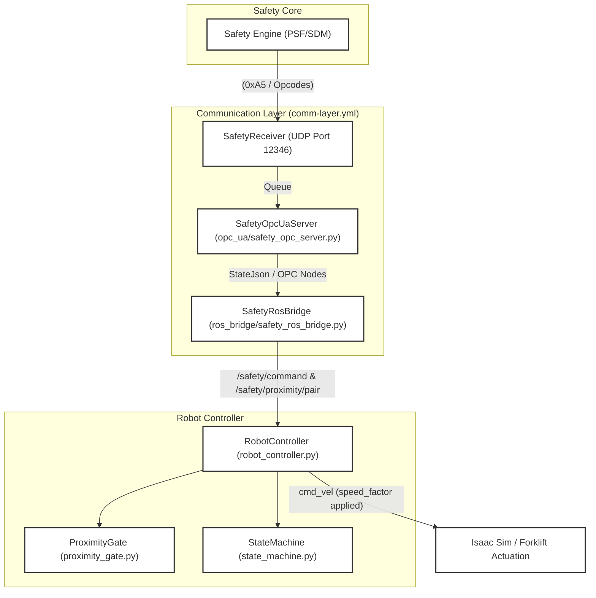
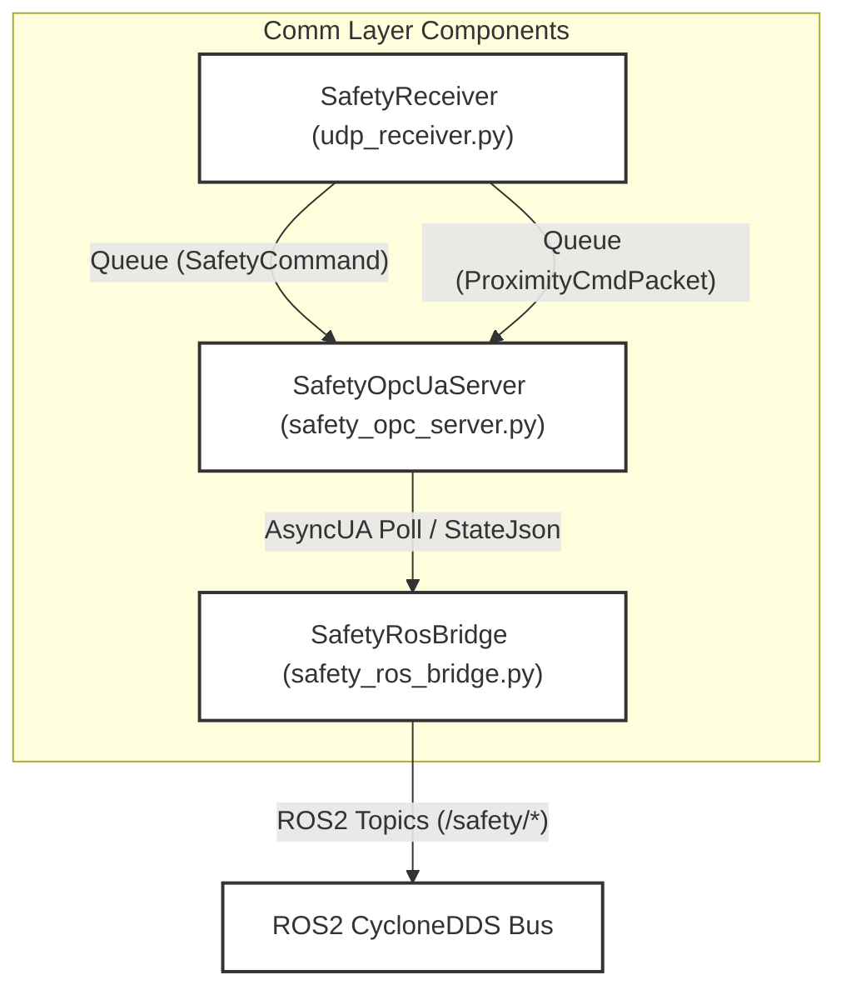

<!-- source: DeepWiki mcp.deepwiki.com · repo NVIDIA/halos-outside-in-safety · page 5 Robot Control and Communication Layer · fetched 2026-11-09 -->

# Robot Control and Communication Layer

Relevant source files

The following files were used as context for generating this wiki page:

- [closed-loop-testing/comm-layer/Dockerfile](closed-loop-testing/comm-layer/Dockerfile)
- [closed-loop-testing/comm-layer/comm-layer.yml](closed-loop-testing/comm-layer/comm-layer.yml)
- [closed-loop-testing/comm-layer/scripts/entrypoint.sh](closed-loop-testing/comm-layer/scripts/entrypoint.sh)
- [closed-loop-testing/comm-layer/src/comm_layer/opc_ua/safety_opc_server.py](closed-loop-testing/comm-layer/src/comm_layer/opc_ua/safety_opc_server.py)
- [closed-loop-testing/comm-layer/src/ros_bridge/safety_ros_bridge.py](closed-loop-testing/comm-layer/src/ros_bridge/safety_ros_bridge.py)
- [closed-loop-testing/comm-layer/tests/test_atl_safe_hold.py](closed-loop-testing/comm-layer/tests/test_atl_safe_hold.py)
- [closed-loop-testing/comm-layer/tests/test_no_tear.py](closed-loop-testing/comm-layer/tests/test_no_tear.py)
- [closed-loop-testing/forklift-controller/Dockerfile](closed-loop-testing/forklift-controller/Dockerfile)
- [closed-loop-testing/forklift-controller/path_resume.py](closed-loop-testing/forklift-controller/path_resume.py)
- [closed-loop-testing/forklift-controller/robot_controller.py](closed-loop-testing/forklift-controller/robot_controller.py)
- [closed-loop-testing/forklift-controller/test/test_path_resume.py](closed-loop-testing/forklift-controller/test/test_path_resume.py)
- [closed-loop-testing/forklift-controller/test/test_robot_controller_topics.py](closed-loop-testing/forklift-controller/test/test_robot_controller_topics.py)

This wiki page covers the **Robot Control and Communication Layer** (Section 5) of the Halos Outside-In Safety (HOISA) system. The control and communication layer bridges safety decisions generated by the Safety Core (PSF) to actuation commands executed by the ROS2-controlled forklift fleet in simulation or hardware. 

The layer is divided into two primary subsystems:
1. **Forklift Controller**: Manages waypoint navigation, speed scaling, state machines, and proximity gate responses on the robot side [closed-loop-testing/forklift-controller/robot_controller.py:49-166]().
2. **Communication Bridge Layer**: Receives UDP safety packets from the safety engine, exposes them over an OPC UA server (non-safe black channel), and translates them into ROS2 topics via `SafetyRosBridge` [closed-loop-testing/comm-layer/src/comm_layer/opc_ua/safety_opc_server.py:63-166](), [closed-loop-testing/comm-layer/src/ros_bridge/safety_ros_bridge.py:114-179]().

For deep technical details, implementation scripts, and test suites, refer to the child pages:
- [Forklift Controller](#5.1)
- [Comm Layer: UDP, ROS Bridge and OPC UA](#5.2)

---

## Architecture and Data Flow Overview

The safety loop closure relies on a multi-stage translation pipeline passing through UDP, OPC UA, ROS2, and finally into the robot controller node.

**Sources:** `closed-loop-testing/comm-layer/comm-layer.yml:1-35](), [closed-loop-testing/comm-layer/src/comm_layer/opc_ua/safety_opc_server.py:63-166](), [closed-loop-testing/comm-layer/src/ros_bridge/safety_ros_bridge.py:114-179](), [closed-loop-testing/forklift-controller/robot_controller.py:49-166]()`

---

## 5.1 Forklift Controller

The forklift controller is a ROS2 node (`RobotController`) built to ingest planned waypoint paths, monitor robot odometry (`/odom`), handle global safety commands (`/safety/command`), and process proximity intervention gates (`/safety/proximity/pair`) [closed-loop-testing/forklift-controller/robot_controller.py:49-166]().

Key responsibilities and components detailed in the child page include:
- **Path Following & Mid-Path Resume**: Utilizing `path_resume.py` to identify the nearest path index and resume navigation seamlessly when restarting or spawning mid-route [closed-loop-testing/forklift-controller/path_resume.py:28-47]().
- **Proximity Gate**: Evaluating `ProximityGate` objects to dynamically apply speed factors (`NORMAL`, `STOP`, `REDUCE_SPEED`) or trigger safety holds [closed-loop-testing/forklift-controller/robot_controller.py:163-167]().
- **State Machine**: Managing state transitions between `IDLE`, `MOVING`, `PAUSED`, and `SLOW` via `StateMachine` [closed-loop-testing/forklift-controller/robot_controller.py:39-81]().
- **Deployment Scripts & Testing**: Containerized execution through `Dockerfile` and automated tests verifying topic mapping and path resumption [closed-loop-testing/forklift-controller/Dockerfile:1-65](), [closed-loop-testing/forklift-controller/test/test_path_resume.py:1-66]().

For full documentation, code structures, and test guides, see [Forklift Controller](#5.1).

**Sources:** `closed-loop-testing/forklift-controller/robot_controller.py:39-167](), [closed-loop-testing/forklift-controller/path_resume.py:28-47](), [closed-loop-testing/forklift-controller/Dockerfile:1-65](), [closed-loop-testing/forklift-controller/test/test_path_resume.py:1-66]()`

---

## 5.2 Comm Layer: UDP, ROS Bridge and OPC UA

The communication layer runs as a dedicated container (`comm-layer`) defined in `comm-layer.yml` and orchestrated via `scripts/entrypoint.sh` [closed-loop-testing/comm-layer/comm-layer.yml:1-34](), [closed-loop-testing/comm-layer/scripts/entrypoint.sh:1-133](). It forms an uncertified black channel communication bridge between the safety core and ROS2 nodes.

Core components include:
- **UDP Packet Decoding**: Ingests raw safety packets (including `0xA5` proximity opcodes and ATL zone updates) over UDP ports [closed-loop-testing/comm-layer/src/comm_layer/opc_ua/safety_opc_server.py:99-150]().
- **OPC UA Server**: Exposes safety state snapshots and proximity metrics over non-safe OPC UA nodes (`Safety.Command`, `Safety.StateJson`, `Safety.ProximityStateJson`) [closed-loop-testing/comm-layer/src/comm_layer/opc_ua/safety_opc_server.py:63-86]().
- **ROS2 Bridge**: Polls the OPC UA server and publishes synchronized safety statuses and proximity decisions to topics such as `/safety/command`, `/safety/is_muted`, and `/safety/proximity/pair` [closed-loop-testing/comm-layer/src/ros_bridge/safety_ros_bridge.py:114-145]().

For detailed service initialization routines, container entrypoint configuration, and regression test suites (such as NVBug 6512051 atomic state serialization tests), see [Comm Layer: UDP, ROS Bridge and OPC UA](#5.2).

**Sources:** `closed-loop-testing/comm-layer/comm-layer.yml:1-35](), [closed-loop-testing/comm-layer/scripts/entrypoint.sh:1-133](), [closed-loop-testing/comm-layer/src/comm_layer/opc_ua/safety_opc_server.py:63-150](), [closed-loop-testing/comm-layer/src/ros_bridge/safety_ros_bridge.py:114-145]()`

---

