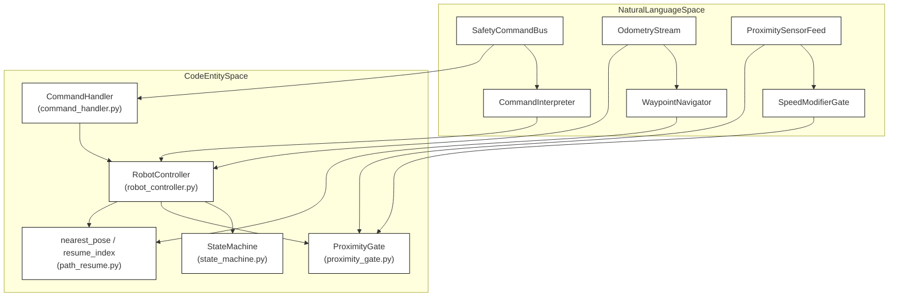
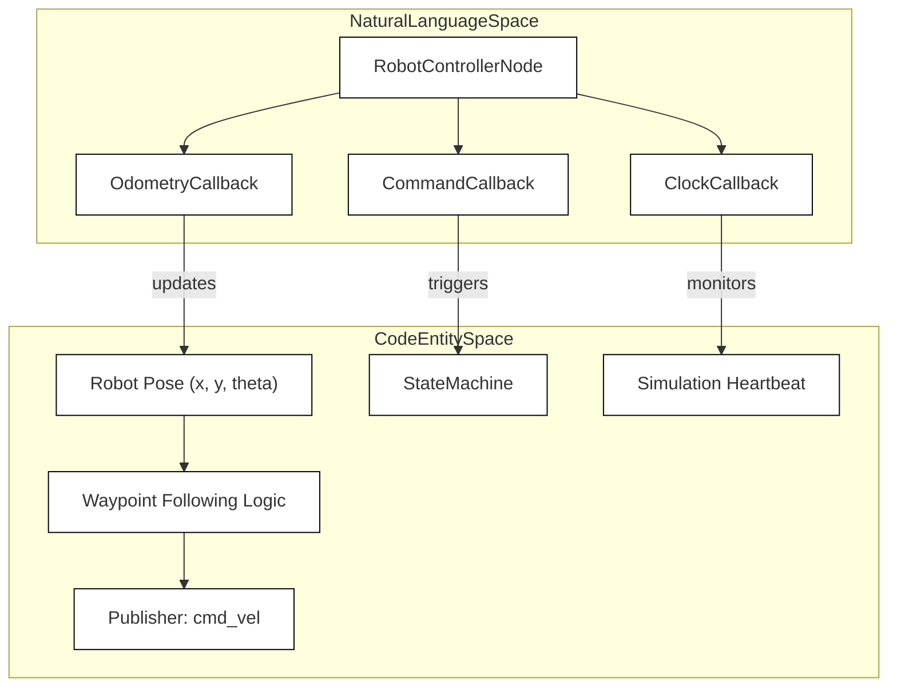

<!-- source: DeepWiki mcp.deepwiki.com · repo NVIDIA/halos-outside-in-safety · page 5.1 Forklift Controller · fetched 2026-11-09 -->

# Forklift Controller

<details>
<summary>Relevant source files</summary>

The following files were used as context for generating this wiki page:

- [closed-loop-testing/forklift-controller/Dockerfile](closed-loop-testing/forklift-controller/Dockerfile)
- [closed-loop-testing/forklift-controller/command_handler.py](closed-loop-testing/forklift-controller/command_handler.py)
- [closed-loop-testing/forklift-controller/docker_run.sh](closed-loop-testing/forklift-controller/docker_run.sh)
- [closed-loop-testing/forklift-controller/forklift-controller.yml](closed-loop-testing/forklift-controller/forklift-controller.yml)
- [closed-loop-testing/forklift-controller/launch_controller.sh](closed-loop-testing/forklift-controller/launch_controller.sh)
- [closed-loop-testing/forklift-controller/path_resume.py](closed-loop-testing/forklift-controller/path_resume.py)
- [closed-loop-testing/forklift-controller/robot_controller.py](closed-loop-testing/forklift-controller/robot_controller.py)
- [closed-loop-testing/forklift-controller/state_machine.py](closed-loop-testing/forklift-controller/state_machine.py)
- [closed-loop-testing/forklift-controller/test/send_command.py](closed-loop-testing/forklift-controller/test/send_command.py)
- [closed-loop-testing/forklift-controller/test/test_path_resume.py](closed-loop-testing/forklift-controller/test/test_path_resume.py)
- [closed-loop-testing/forklift-controller/test/test_robot_controller_topics.py](closed-loop-testing/forklift-controller/test/test_robot_controller_topics.py)
- [closed-loop-testing/isaac-sim/isaac-sim.yml](closed-loop-testing/isaac-sim/isaac-sim.yml)
- [closed-loop-testing/isaac-sim/sil/configs/scenarios.yaml](closed-loop-testing/isaac-sim/sil/configs/scenarios.yaml)

</details>


## Purpose and Scope
The Forklift Controller provides autonomous path following, command processing, state machine orchestration, and safety/proximity gating for simulated or physical forklift robots within the Halos Outside-In Safety (HOISA) architecture. Operating as a ROS 2 node (`RobotController`), it bridges safety decisions received from perception-safety components with robot actuation commands (`cmd_vel`) [closed-loop-testing/forklift-controller/robot_controller.py:1-49](). 

This leaf page details the implementation of `RobotController`, fleet configurations (`fleet_config`), proximity gating (`proximity_gate`), path resumption logic (`path_resume`), command handlers (`command_handler`), container deployment scripts, and unit tests.

---

## 1. System Architecture and Component Layout

The forklift controller codebase is structured into modular ROS 2 nodes and standalone Python libraries handling specific functional domains, such as state transitions, path adherence, and safety overrides.


*Sources: [closed-loop-testing/forklift-controller/robot_controller.py:1-49](), [closed-loop-testing/forklift-controller/command_handler.py:1-102](), [closed-loop-testing/forklift-controller/path_resume.py:1-47]()*

---

## 2. Robot Controller Node (`robot_controller.py`)

The `RobotController` class inherits from `rclpy.node.Node` and acts as the central orchestrator for a single robot instance (e.g., `forklift_b`, `forklift_b2`) [closed-loop-testing/forklift-controller/robot_controller.py:49-55](). It maintains subscriptions to robot odometry, simulation clock signals, and global safety commands, while publishing velocity commands and visualization markers [closed-loop-testing/forklift-controller/robot_controller.py:120-160]().

### Key Attributes and Initialization
* **Node Identification**: Automatically names the node using the configured `robot_id` (e.g., `forklift_b_controller`) to avoid parameter and rosout collisions across multiple containers [closed-loop-testing/forklift-controller/robot_controller.py:54-70]().
* **Speed Profiles**: Manages `base_linear_speed` and `base_angular_speed` adjusted dynamically via command factors and proximity gates [closed-loop-testing/forklift-controller/robot_controller.py:53-78]().
* **Simulation Clock Monitoring**: Subscribes to `/clock` to detect simulation pauses, jumps, or resets (`_odom_jump_threshold`), pausing navigation states if simulation time stops advancing [closed-loop-testing/forklift-controller/robot_controller.py:111-119]().


*Sources: [closed-loop-testing/forklift-controller/robot_controller.py:49-160]()*

---

## 3. Command Handling and State Machine

The controller delegates state management and command interpretation to dedicated helper modules: `state_machine.py` and `command_handler.py`.

### Command Handler (`command_handler.py`)
The `CommandHandler` class subscribes to `/safety/command` using JSON-formatted string messages [closed-loop-testing/forklift-controller/command_handler.py:28-53](). It supports targeted commands (filtering by `robot_id`) and global broadcasts (`robot_id: null`) [closed-loop-testing/forklift-controller/command_handler.py:63-68]().

| JSON Field | Type | Description |
| :--- | :--- | :--- |
| `robot_id` | `String` (Opt) | Target robot name, or `null` for all robots [closed-loop-testing/forklift-controller/command_handler.py:12-14]() |
| `command` | `String` | Action command: `proceed`, `stop`, `slow`, `idle` [closed-loop-testing/forklift-controller/command_handler.py:11-15]() |
| `speed_factor` | `Float` (Opt) | Multiplier for linear/angular speed (0.0 to 1.0) [closed-loop-testing/forklift-controller/command_handler.py:11-16]() |
| `timestamp` | `Integer` (Opt) | Epoch millisecond timestamp for command ordering/rejection [closed-loop-testing/forklift-controller/command_handler.py:11-16]() |
| `reason` | `String` (Opt) | Descriptive log rationale for safety state changes [closed-loop-testing/forklift-controller/command_handler.py:71-76]() |

Sources: [closed-loop-testing/forklift-controller/command_handler.py:28-102]()

---

## 4. Path Resuming and Proximity Gating

### Path Resumption (`path_resume.py`)
When a container starts or simulation resumes mid-path, the truck avoids returning to the start pose by evaluating its current position against the waypoint array [closed-loop-testing/forklift-controller/path_resume.py:3-16](). 

* `nearest_pose(poses, x, y, theta)`: Computes a weighted composite score combining Euclidean distance and heading delta (`HEADING_WEIGHT_M_PER_RAD = 3.0`) to locate the closest waypoint index [closed-loop-testing/forklift-controller/path_resume.py:21-41]().
* `resume_index(poses, x, y, theta)`: Returns `nearest + 1` so the robot drives toward the subsequent unreached waypoint rather than back-tracking [closed-loop-testing/forklift-controller/path_resume.py:44-47]().

```python
# Example usage of resume_index from path_resume.py
from path_resume import resume_index

# Given waypoint poses and current robot odometry (x, y, theta)
next_idx = resume_index(poses, robot_x, robot_y, robot_theta)
```
Sources: [closed-loop-testing/forklift-controller/path_resume.py:1-47](), [closed-loop-testing/forklift-controller/test/test_path_resume.py:1-66]()

---

## 5. Deployment Artifacts and Launch Scripts

The controller can be executed via standalone Docker containers, Docker Compose stacks, or local shell execution scripts.

### Build and Launch Files
* **Dockerfile**: Built on `ros:jazzy-ros-base`, installing `python3-yaml`, `ros-jazzy-rmw-cyclonedds-cpp`, and copying controller modules into `/app` [closed-loop-testing/forklift-controller/Dockerfile:1-65]().
* **Compose Integration (`forklift-controller.yml`)**: Defines services for primary and secondary forklifts (`forklift-controller`, `forklift-controller-b2`) using shared volume mounts for warehouse configs and waypoints [closed-loop-testing/forklift-controller/forklift-controller.yml:1-50]().
* **Launch Script (`launch_controller.sh`)**: Sets up environment paths, resolves waypoint maps based on `WAYPOINTS_MAP`, and executes `robot_controller.py` with arguments [closed-loop-testing/forklift-controller/launch_controller.sh:1-59]().
* **Docker Run Script (`docker_run.sh`)**: Handles direct container builds, old container cleanup, and volume mounts for external waypoint files [closed-loop-testing/forklift-controller/docker_run.sh:1-43]().

Sources: [closed-loop-testing/forklift-controller/Dockerfile:1-65](), [closed-loop-testing/forklift-controller/forklift-controller.yml:1-50](), [closed-loop-testing/forklift-controller/launch_controller.sh:1-59](), [closed-loop-testing/forklift-controller/docker_run.sh:1-43]()

---

## 6. Testing and Verification

The forklift controller includes pytest-based test suites covering path resumption calculations and topic binding correctness without requiring active ROS daemon instances [closed-loop-testing/forklift-controller/test/test_path_resume.py:1-3](), [closed-loop-testing/forklift-controller/test/test_robot_controller_topics.py:1-3]().

* **Path Resume Tests (`test_path_resume.py`)**: Verifies correct index resumption at segment ends, mid-segments, wrapping headings across $\pi$, and multi-segment warehouse paths [closed-loop-testing/forklift-controller/test/test_path_resume.py:26-66]().
* **Topic Mapping Tests (`test_robot_controller_topics.py`)**: Validates fallback mechanisms to fleet file conventions and custom topic overrides using ROS node stubs [closed-loop-testing/forklift-controller/test/test_robot_controller_topics.py:17-88]().
* **Command Utility (`send_command.py`)**: Provides command line injection of `proceed`, `stop`, `slow`, and `idle` states into `/safety/command` with subscriber count verification [closed-loop-testing/forklift-controller/test/send_command.py:1-132]().

Sources: [closed-loop-testing/forklift-controller/test/test_path_resume.py:1-66](), [closed-loop-testing/forklift-controller/test/test_robot_controller_topics.py:1-88](), [closed-loop-testing/forklift-controller/test/send_command.py:1-132]()

---

