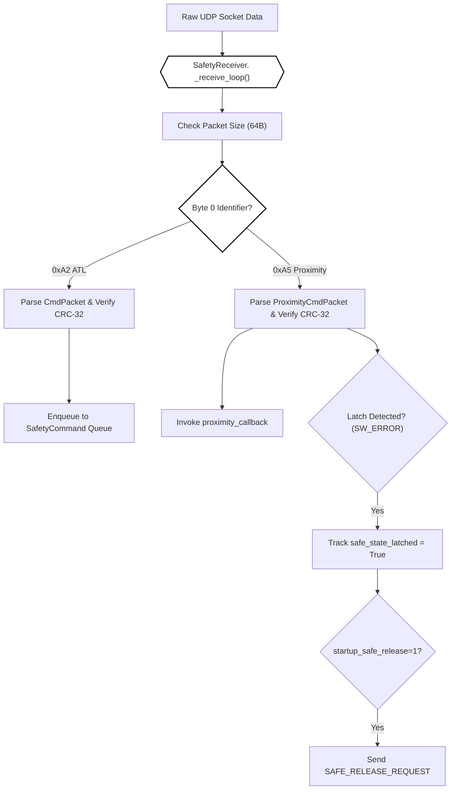
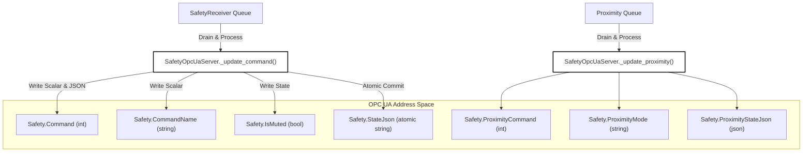
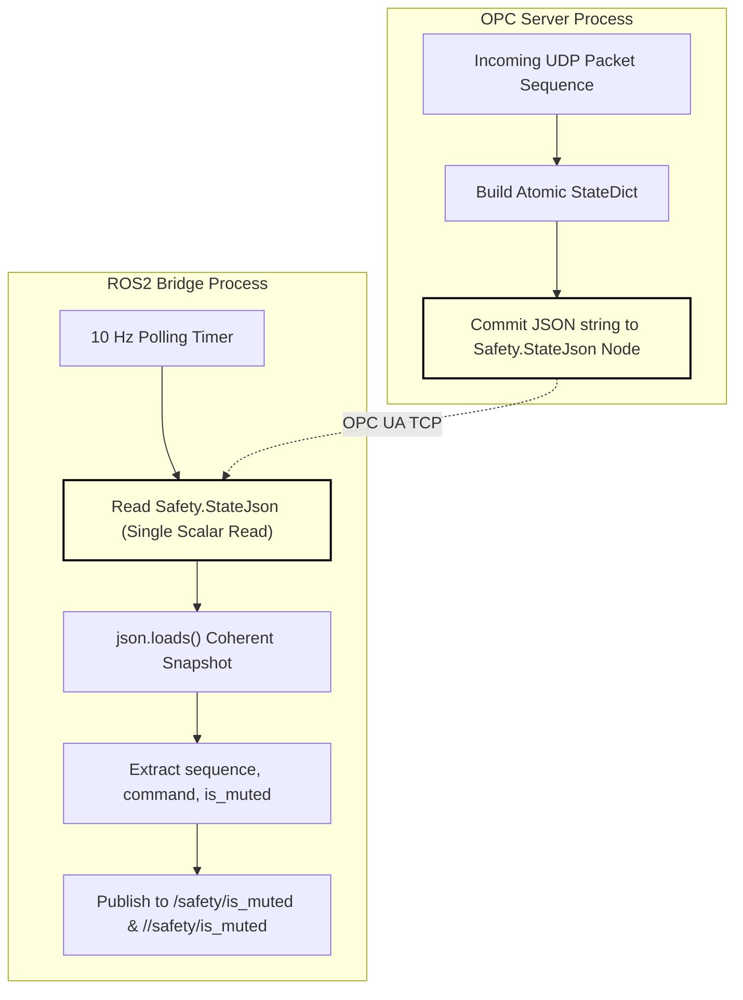
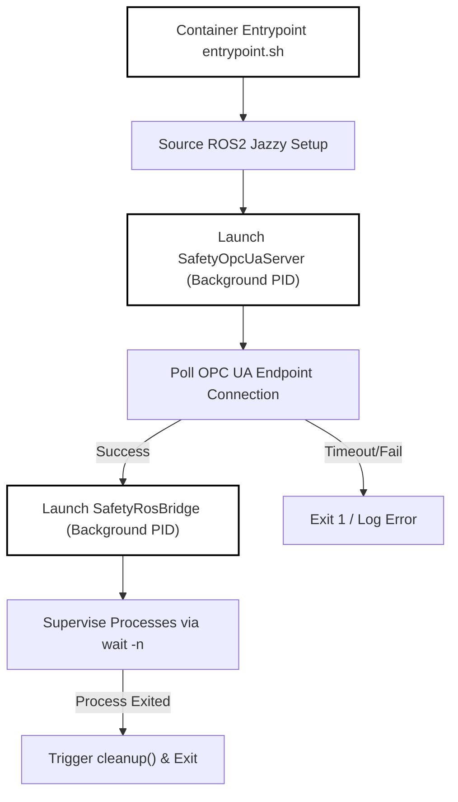
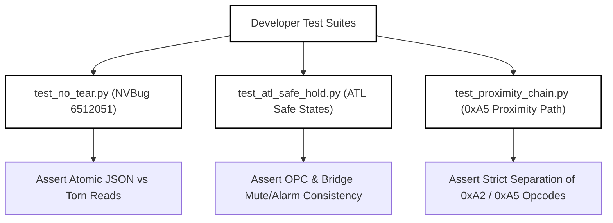

<!-- source: DeepWiki mcp.deepwiki.com · repo NVIDIA/halos-outside-in-safety · page 5.2 Comm Layer: UDP, ROS Bridge and OPC UA · fetched 2026-11-09 -->

# Comm Layer: UDP, ROS Bridge and OPC UA

Relevant source files

The following files were used as context for generating this wiki page:

- [closed-loop-testing/comm-layer/Dockerfile](closed-loop-testing/comm-layer/Dockerfile)
- [closed-loop-testing/comm-layer/comm-layer.yml](closed-loop-testing/comm-layer/comm-layer.yml)
- [closed-loop-testing/comm-layer/scripts/entrypoint.sh](closed-loop-testing/comm-layer/scripts/entrypoint.sh)
- [closed-loop-testing/comm-layer/src/comm_layer/common/proximity_commands.py](closed-loop-testing/comm-layer/src/comm_layer/common/proximity_commands.py)
- [closed-loop-testing/comm-layer/src/comm_layer/opc_ua/safety_opc_server.py](closed-loop-testing/comm-layer/src/comm_layer/opc_ua/safety_opc_server.py)
- [closed-loop-testing/comm-layer/src/comm_layer/scripts/send_packet.py](closed-loop-testing/comm-layer/src/comm_layer/scripts/send_packet.py)
- [closed-loop-testing/comm-layer/src/comm_layer/udp_receiver/safety_receiver.py](closed-loop-testing/comm-layer/src/comm_layer/udp_receiver/safety_receiver.py)
- [closed-loop-testing/comm-layer/src/ros_bridge/safety_ros_bridge.py](closed-loop-testing/comm-layer/src/ros_bridge/safety_ros_bridge.py)
- [closed-loop-testing/comm-layer/tests/test_atl_safe_hold.py](closed-loop-testing/comm-layer/tests/test_atl_safe_hold.py)
- [closed-loop-testing/comm-layer/tests/test_no_tear.py](closed-loop-testing/comm-layer/tests/test_no_tear.py)
- [closed-loop-testing/comm-layer/tests/test_proximity_chain.py](closed-loop-testing/comm-layer/tests/test_proximity_chain.py)

### Purpose and Scope
This page details the communication layer in the HOISA (Halos Outside-In Safety) architecture, which closes the perception-to-actuation safety loop. The communication layer spans three core components: the UDP Safety Receiver (`SafetyReceiver`), the OPC UA Non-Safe Black Channel Server (`SafetyOpcUaServer`), and the ROS2 Safety Bridge (`SafetyRosBridge`). Together, these services decode raw 64-byte safety packets from the Perception Safety Feature (PSF) core, host them over a standardized OPC UA data exchange, and translate them into ROS2 topics consumed by the forklift controller.

---

## 1. UDP Safety Receiver and Packet Decoding

The UDP receiver service (`SafetyReceiver`) listens for incoming 64-byte safety packets emitted by the safety core over UDP [closed-loop-testing/comm-layer/src/comm_layer/udp_receiver/safety_receiver.py:118-141]. 

### Packet Structure and Discriminator Byte
Two distinct packet types arrive on the same port, differentiated entirely by **Byte 0** [closed-loop-testing/comm-layer/src/comm_layer/udp_receiver/safety_receiver.py:9-15]:
* `0xA2`: Area Trust Level (ATL) command packets (`CmdPacket`) [closed-loop-testing/comm-layer/src/comm_layer/common/safety_commands.py:50-57].
* `0xA5`: Proximity Safety Feature (PXC) command packets (`ProximityCmdPacket`) [closed-loop-testing/comm-layer/src/comm_layer/common/proximity_commands.py:5-70].

> **CRITICAL OPCODE COLLISION WARNING**: 
> Byte opcode values `0x02` and `0x07` carry diametrically opposed safety meanings between ATL and Proximity modes:
> * In **ATL (`0xA2`)**: `0x02` means `MUTE` (allow operation) and `0x07` means `UNMUTE` (prevent operation + alarm) [closed-loop-testing/comm-layer/src/comm_layer/common/proximity_commands.py:16-19].
> * In **Proximity (`0xA5`)**: `0x02` means `STOP` (prevent operation) and `0x07` means `NORMAL` (standard operation) [closed-loop-testing/comm-layer/src/comm_layer/common/proximity_commands.py:16-19].
> 
> Because of this collision, Byte 0 must select the exact parser and command enum; sharing a single enum would silently invert safety semantics [closed-loop-testing/comm-layer/src/comm_layer/common/proximity_commands.py:11-25].

### Validation and Latch Handling
The receiver performs the following validation steps upon packet arrival:
1. **Size check**: Verifies packet length equals `COMMAND_PACKET_SIZE` (64 bytes) [closed-loop-testing/comm-layer/src/comm_layer/udp_receiver/safety_receiver.py:143].
2. **Identifier check**: Inspects byte 0 to route to either `_process_atl` or `_process_proximity` [closed-loop-testing/comm-layer/src/comm_layer/udp_receiver/safety_receiver.py:118-124].
3. **CRC-32 verification**: Validates the ISO 3309 CRC checksum over the header and object record payloads [closed-loop-testing/comm-layer/src/comm_layer/udp_receiver/safety_receiver.py:24-25].

For proximity packets, the receiver tracks safe-state latches (`_LATCH_OPCODES` including `SW_ERROR` and `SAFE_RELEASE_DENIED`) and manages the automated safe-release handshake (`SAFE_RELEASE_REQUEST`) if `startup_safe_release` is enabled [closed-loop-testing/comm-layer/src/comm_layer/udp_receiver/safety_receiver.py:68-87, 155-177].

*Sources: `closed-loop-testing/comm-layer/src/comm_layer/udp_receiver/safety_receiver.py`, `closed-loop-testing/comm-layer/src/comm_layer/common/proximity_commands.py`*

---

## 2. OPC UA Server and Black Channel Data Exchange

The `SafetyOpcUaServer` exposes decoded safety commands over an OPC UA server interface (`opc.tcp://0.0.0.0:4840/safety/`) [closed-loop-testing/comm-layer/src/comm_layer/opc_ua/safety_opc_server.py:63-109]. 

> **IMPORTANT**: This server is a **Non-Safe Black Channel** data exchange mechanism. It is **not** an OPC UA Safety-certified implementation; certified safety protocols (such as PROFISAFE or FSoE) remain future work [closed-loop-testing/comm-layer/src/comm_layer/opc_ua/safety_opc_server.py:5-14].

### Exposed Node Architecture
The server relies on the `asyncua` sync library to manage its address space [closed-loop-testing/comm-layer/src/comm_layer/opc_ua/safety_opc_server.py:52-60]. It exposes distinct node trees for ATL commands, proximity packets, and secondary safety zones:

* **ATL Nodes (`Safety.*`)**:
  * `Safety.Command`: Current command code integer [closed-loop-testing/comm-layer/src/comm_layer/opc_ua/safety_opc_server.py:71].
  * `Safety.CommandName`: String description of the command [closed-loop-testing/comm-layer/src/comm_layer/opc_ua/safety_opc_server.py:72].
  * `Safety.Sequence`: Packet sequence number [closed-loop-testing/comm-layer/src/comm_layer/opc_ua/safety_opc_server.py:73].
  * `Safety.Status` & `Safety.StatusName`: Safety status code and description [closed-loop-testing/comm-layer/src/comm_layer/opc_ua/safety_opc_server.py:74-75].
  * `Safety.IsMuted` & `Safety.IsAlarm`: Booleans tracking the aggregate zone safety state [closed-loop-testing/comm-layer/src/comm_layer/opc_ua/safety_opc_server.py:77-78].
  * `Safety.StateJson`: An atomic JSON string snapshot of the latest packet and tracked state [closed-loop-testing/comm-layer/src/comm_layer/opc_ua/safety_opc_server.py:79].
* **Proximity Nodes**: Living on separate nodes, containing `ProximityCommand`, `ProximityMode` ("stop", "reduce_speed", "normal"), `ProximitySeparation`, and `ProximityStateJson` [closed-loop-testing/comm-layer/src/comm_layer/opc_ua/safety_opc_server.py:81-87].
* **Zone 2 Nodes**: Mirrors the ATL node structure for a secondary safety monitoring zone (`atl_dual`) [closed-loop-testing/comm-layer/src/comm_layer/opc_ua/safety_opc_server.py:124-125].

*Sources: `closed-loop-testing/comm-layer/src/comm_layer/opc_ua/safety_opc_server.py`*

---

## 3. ROS2 Safety Bridge

The `SafetyRosBridge` consumes safety updates from either the OPC UA server or a direct queue and publishes them onto ROS2 topics [closed-loop-testing/comm-layer/src/ros_bridge/safety_ros_bridge.py:114-179].

### Published ROS2 Topics
* `/safety/command` (`std_msgs/String`): JSON string containing full command details, sequence numbers, and timestamps [closed-loop-testing/comm-layer/src/ros_bridge/safety_ros_bridge.py:119-122].
* `/safety/status` (`std_msgs/Int32`): Numerical safety status code [closed-loop-testing/comm-layer/src/ros_bridge/safety_ros_bridge.py:123].
* `/safety/is_muted` & `/safety/is_alarm` (`std_msgs/Bool`): Core boolean flags governing whether machine motion is allowed [closed-loop-testing/comm-layer/src/ros_bridge/safety_ros_bridge.py:124-125].
* `/<robot_id>/safety/is_muted` (`std_msgs/Bool`): Per-robot mirror topics generated for each forklift specified in the fleet configuration [closed-loop-testing/comm-layer/src/ros_bridge/safety_ros_bridge.py:126-131].
* `/safety/proximity/mode` (`std_msgs/String`) & `/safety/proximity/pair` (`std_msgs/String`): Proximity decision topics publishing motion levels (`stop`, `reduce_speed`, `normal`) and object record pairs [closed-loop-testing/comm-layer/src/ros_bridge/safety_ros_bridge.py:136-144].

### Preventing Field-Tearing (NVBug 6512051)
In earlier revisions, the bridge read command attributes (sequence number, command code, status) across 7 separate OPC UA `read_value()` calls. This introduced a race condition where mid-update interleaving paired a fresh sequence number with a stale command code (e.g., publishing `is_muted=False` during a critical `MUTE` sequence) [closed-loop-testing/comm-layer/tests/test_no_tear.py:5-13]. 

The bridge resolves this by reading and parsing a single atomic `StateJson` node [closed-loop-testing/comm-layer/tests/test_no_tear.py:105-131]. Because scalar string reads cannot interleave byte-wise, the sequence and command tuple remains entirely coherent.

*Sources: `closed-loop-testing/comm-layer/src/ros_bridge/safety_ros_bridge.py`, `closed-loop-testing/comm-layer/tests/test_no_tear.py`*

---

## 4. Container Architecture, Entrypoint and Deployment

The communication layer runs as a containerized service managed via Docker Compose (`comm-layer.yml`) [closed-loop-testing/comm-layer/comm-layer.yml:1-35].

### Container Lifecycle and Entrypoint
The container image is built on `ros:jazzy-ros-base` and includes `asyncua` and CycloneDDS for Isaac Sim ROS2 domain compatibility [closed-loop-testing/comm-layer/Dockerfile:10-31]. 

The container initialization script (`entrypoint.sh`) performs the following sequence:
1. Sources the ROS2 Jazzy environment (`/opt/ros/jazzy/setup.bash`) [closed-loop-testing/comm-layer/scripts/entrypoint.sh:5-8].
2. Initializes log files under `/app/logs/` [closed-loop-testing/comm-layer/scripts/entrypoint.sh:22-24].
3. Starts `SafetyOpcUaServer` with optional zone 2 or proximity ports (`--zone2-port`, `--pxc-port`) in the background [closed-loop-testing/comm-layer/scripts/entrypoint.sh:37-55].
4. Polls the OPC UA endpoint until ready, verifying connectivity via a synchronous client probe [closed-loop-testing/comm-layer/scripts/entrypoint.sh:60-81].
5. Starts `SafetyRosBridge`, passing configured topic prefixes, OPC UA endpoints, and scenario names [closed-loop-testing/comm-layer/scripts/entrypoint.sh:83-94].
6. Enters a supervision wait loop (`wait -n`), terminating services if either process exits unexpectedly [closed-loop-testing/comm-layer/scripts/entrypoint.sh:122-133].

*Sources: `closed-loop-testing/comm-layer/scripts/entrypoint.sh`, `closed-loop-testing/comm-layer/comm-layer.yml`, `closed-loop-testing/comm-layer/Dockerfile`*

---

## 5. Testing and Validation

The comm-layer module includes automated regression and unit test suites that run inside the container environment to verify packet decoding, latch handshakes, and atomic state propagation.

### Key Test Modules
* `test_no_tear.py`: Validates the atomic `StateJson` design against simulated torn-read race conditions (NVBug 6512051) [closed-loop-testing/comm-layer/tests/test_no_tear.py:1-134].
* `test_atl_safe_hold.py`: Ensures ATL safe holds (such as `SW_ERROR` following an `UNMUTE`) correctly propagate through OPC UA nodes and bridge outputs to `/safety/is_muted` [closed-loop-testing/comm-layer/tests/test_atl_safe_hold.py:1-161].
* `test_proximity_chain.py`: Tests the complete 0xA5 proximity decoding chain, confirming that proximity `STOP` commands never leak into the ATL command queue [closed-loop-testing/comm-layer/tests/test_proximity_chain.py:1-191].
* `send_packet.py`: A developer utility script used to inject custom 64-byte ATL or proximity packets (including negative tests for bad CRCs or wrong identifiers) into running receivers [closed-loop-testing/comm-layer/src/comm_layer/scripts/send_packet.py:1-155].

*Sources: `closed-loop-testing/comm-layer/tests/test_no_tear.py`, `closed-loop-testing/comm-layer/tests/test_atl_safe_hold.py`, `closed-loop-testing/comm-layer/tests/test_proximity_chain.py`*

---

