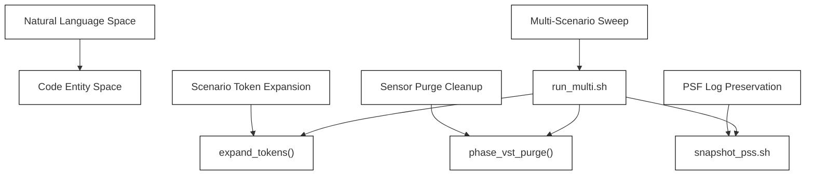
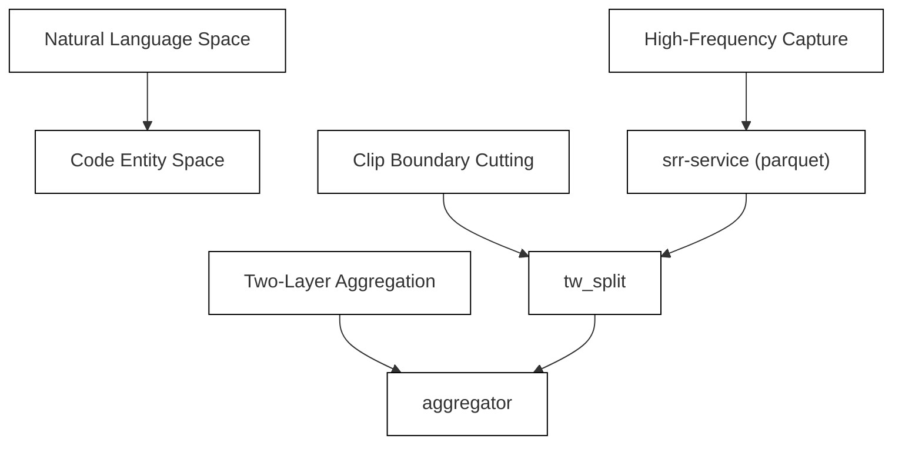

<!-- source: DeepWiki mcp.deepwiki.com · repo NVIDIA/halos-outside-in-safety · page 6 Regression Testing (SRR) · fetched 2026-11-09 -->

# Regression Testing (SRR)

Relevant source files

The following files were used as context for generating this wiki page:

- [closed-loop-testing/regression-reporter/.env.example](closed-loop-testing/regression-reporter/.env.example)
- [closed-loop-testing/regression-reporter/scripts/run_multi.sh](closed-loop-testing/regression-reporter/scripts/run_multi.sh)
- [closed-loop-testing/regression-reporter/scripts/snapshot_pss.sh](closed-loop-testing/regression-reporter/scripts/snapshot_pss.sh)
- [docs/testing/srr/architecture.mdx](docs/testing/srr/architecture.mdx)
- [docs/testing/srr/overview.mdx](docs/testing/srr/overview.mdx)
- [skills/hoisa-deploy-profile/references/calibration_3d.md](skills/hoisa-deploy-profile/references/calibration_3d.md)
- [skills/hoisa-deploy-profile/references/ngc_artifacts.md](skills/hoisa-deploy-profile/references/ngc_artifacts.md)

The Simulation Regression Reporter (`srr`) harness provides closed-loop regression testing for the Halos Outside-In Safety system [docs/testing/srr/overview.mdx:5-10](). It runs test scenarios inside Isaac Sim, records what the Safety Core decides alongside what simulation ground truth dictates, aligns the data frame-by-frame, and generates graded regression reports [docs/testing/srr/overview.mdx:5-10](). 

This page serves as a high-level overview of scenario orchestration, data recording, metrics calculation, and report analysis. For deep implementation details, refer to the respective child pages:
- Scenario Orchestration: See [Scenario Orchestration](#6.1) (covers `run_multi.sh` [closed-loop-testing/regression-reporter/scripts/run_multi.sh:1-4](), behavior trees [closed-loop-testing/regression-reporter/scripts/run_multi.sh:22-27](), and environment setup [closed-loop-testing/regression-reporter/scripts/run_multi.sh:41-56]()).
- SRR Service: Recording and Metrics: See [SRR Service: Recording and Metrics](#6.2) (covers recording schemas [docs/testing/srr/architecture.mdx:62-71](), clip splitting, calibration datasets [closed-loop-testing/regression-reporter/.env.example:28-32](), and two-layer scoring [docs/testing/srr/architecture.mdx:49-58]()).
- Analysis Scripts and Report Interpretation: See [Analysis Scripts and Report Interpretation](#6.3) (covers `snapshot_pss.sh` [closed-loop-testing/regression-reporter/scripts/snapshot_pss.sh:1-27](), summary reports, and result interpretation [docs/testing/srr/overview.mdx:47-60]()).

---

## 6.1 Scenario Orchestration

Scenario orchestration governs the automated execution of multi-test sweeps, environment configuration, and asset synchronization across Isaac Sim and the regression framework [closed-loop-testing/regression-reporter/scripts/run_multi.sh:4-33](). Orchestration scripts coordinate scenario definitions, path randomization, and phase-gate readiness checks without human intervention [closed-loop-testing/regression-reporter/scripts/run_multi.sh:25-33]().

*Figure 1: Bridging Natural Language Scenario Orchestration Concepts to Script Implementation.*

For detailed information on the `run_multi.sh` lifecycle, behavior tree configurations (`srr_<name>_char{0,1,2}.bt.json`), path randomization, and environment synchronization, see [Scenario Orchestration](#6.1).

Sources: `closed-loop-testing/regression-reporter/scripts/run_multi.sh:1-56`, `docs/testing/srr/architecture.mdx:91-97`.

---

## 6.2 SRR Service: Recording and Metrics

The SRR service records the closed loop by capturing ground-truth poses from Isaac Sim (`/gt/*`) alongside perception events from Kafka (`mdx-*`) and actual Safety Core decisions (`/safety/*`) [docs/testing/srr/architecture.mdx:15-20](). Data is logged at 30 Hz into a unified `parquet` structure, split into analytical clips at trailer tripwire crossings (`TW_X`), and evaluated across two scoring layers [docs/testing/srr/architecture.mdx:39-58]().

*Figure 2: Bridging Recording and Scoring Concepts to Python Service Components.*

For detailed information on the recorder service, `tw_split`, calibration bindings (`CALIBRATION_JSON`) [closed-loop-testing/regression-reporter/.env.example:28-32](), and phase 1/2 metrics, see [SRR Service: Recording and Metrics](#6.2).

Sources: `docs/testing/srr/architecture.mdx:15-71`, `closed-loop-testing/regression-reporter/.env.example:28-32`.

---

## 6.3 Analysis Scripts and Report Interpretation

Analysis tooling processes the aggregated test runs to generate Markdown summary reports, JSON failure manifests, and review videos [docs/testing/overview.mdx:47-60](). Critical internal states of the Safety Core (`pss.log`) are preserved via snapshot utilities (`snapshot_pss.sh`) prior to container restarts [closed-loop-testing/regression-reporter/scripts/snapshot_pss.sh:1-17]().

For detailed information on latency diagnostics, failure splitting (`perclass_split_idsw`), safety unmute flags, `snapshot_pss.sh` operational modes, and interpreting metric results, see [Analysis Scripts and Report Interpretation](#6.3).

Sources: `closed-loop-testing/regression-reporter/scripts/snapshot_pss.sh:1-27`, `docs/testing/srr/overview.mdx:47-60`.

---

